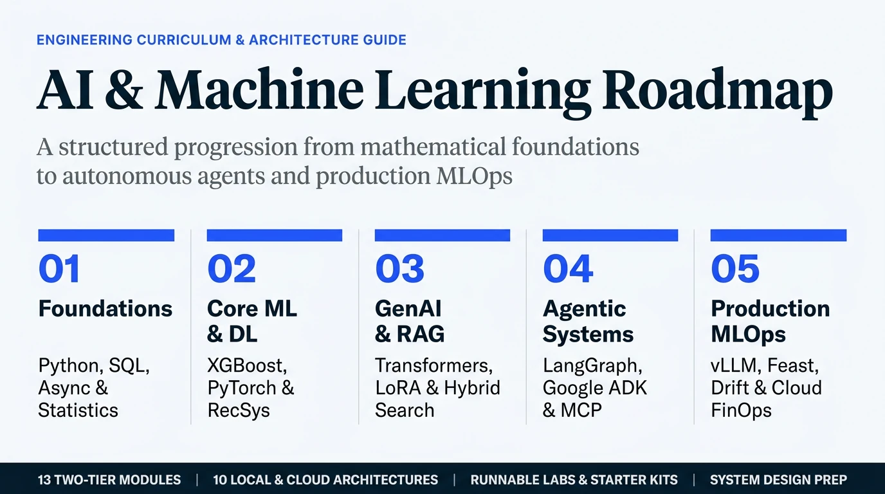
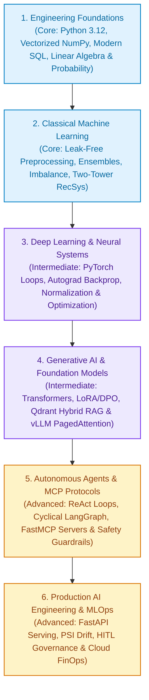

<div align="center">

# Agentic AI & ML Engineering Roadmap

**From Mathematical & Algorithmic Foundations to Production-Grade Agentic Systems**

[](LICENSE)
[](https://www.python.org/)
[](scripts/validate_links.py)
[](docs/index.md)
[](CONTRIBUTING.md)

<br/>



<br/>

**A disciplined, production-first engineering curriculum designed to build reliable, high-performance Machine Learning and Agentic AI systems.**

[Explore Roadmap](./ROADMAP.md) • [Getting Started](./docs/getting-started.md) • [Learning Paths](./docs/learning-paths.md) • [Portfolio Projects](./projects/README.md) • [Interview Kits](./interview-kits/README.md)

</div>

---

## 🧭 Who This Roadmap Is For

- **Software & Backend Engineers** seeking to transition into AI/ML Engineering without getting lost in shallow API wrapper hype.
- **Data Scientists & Classical ML Engineers** advancing to Generative AI, RAG systems, and Autonomous Agent orchestration.
- **AI Engineers & Architects** designing enterprise multi-agent platforms, Model Context Protocol (MCP) tool servers, and production MLOps pipelines.

---

## 🎯 What You Will Build & Master

- **Algorithmic Mastery:** Implement Autograd, Backpropagation, Scaled Dot-Product Attention, and Numerically Stable Softmax from scratch in pure NumPy.
- **Enterprise Retrieval (RAG):** Design hybrid vector search using dense cosine embeddings and sparse BM25 fused via Reciprocal Rank Fusion (RRF) in Qdrant.
- **Autonomous Systems:** Construct stateful cyclical multi-agent workflows using LangGraph and Google Agent Development Kit (ADK) with durable human-in-the-loop (HITL) checkpoints.
- **Distributed Tool Protocols:** Build decoupled, secure tool backends using the open Model Context Protocol (MCP) JSON-RPC 2.0 standard.
- **Production AI Engineering:** Eliminate pickle security vulnerabilities with safe `.npz` serialization, serve low-latency FastAPI endpoints, and monitor data drift with automated Population Stability Index (PSI) calculations.

---

## 🗺️ High-Level Learning Roadmap

The curriculum is structured into 6 progressive tiers. Each module contains measurable learning objectives, production code, failure modes, and hands-on exercises:



> 📖 **[View the Complete Module-by-Module Sequence in ROADMAP.md →](./ROADMAP.md)**

---

## ⚡ Quick Navigation

| Resource | Purpose | Direct Link |
|---|---|---|
| **Curriculum Roadmap** | Detailed breakdown of all 13 modules across 6 tiers | [ROADMAP.md](./ROADMAP.md) |
| **Learning Paths** | Personalized tracks (Foundations, GenAI, Agents, MLOps) | [docs/learning-paths.md](./docs/learning-paths.md) |
| **Prerequisites Guide** | Self-assessment checklist and math/programming refresher | [docs/prerequisites.md](./docs/prerequisites.md) |
| **Portfolio Projects** | 10 real-world project blueprints (4 local, 6 enterprise cloud) | [projects/README.md](./projects/README.md) |
| **Runnable Starters** | Fully working, local $0 API cost codebases with pytest suites | [projects/intermediate/](./projects/intermediate/README.md) |
| **Interactive Labs** | Jupyter Notebooks for vectorized math, ML, and transformers | [notebooks/foundations/](./notebooks/foundations/01_numpy_pandas_sql_lab.ipynb) |
| **Interview Preparation** | System design, technical screenings, and resume CAR guide | [interview-kits/README.md](./interview-kits/README.md) |
| **Curated Resources** | Textbooks, courses, landmark research papers, and open-source tools | [resources/recommended_resources.md](./resources/recommended_resources.md) |
| **Technical Glossary** | Production terminology (RRF, PSI, HITL, MCP, PagedAttention) | [docs/glossary.md](./docs/glossary.md) |

---

## 🛠️ Project Highlights ($0 API Cost Starters)

You can clone and run complete production-grade systems immediately on your laptop without registering credit cards or generating paid API tokens:

- **[Starter 1: Air-Gapped Desktop Hybrid RAG & SQL Router Agent](./projects/intermediate/starter-local-rag-agent/README.md)**  
  *Stack:* Python 3.12+, Pure NumPy, SQLite in-memory, BM25 + Dense Cosine Vector Fusion  
  Combines local lexical and semantic document search with read-only SQL execution in an isolated offline environment.

- **[Starter 2: Full-Lifecycle Production MLOps & PSI Drift Engine](./projects/intermediate/starter-local-mlops/README.md)**  
  *Stack:* FastAPI, Uvicorn, Scikit-Learn, NumPy, Docker, Pytest  
  Implements zero-pickle `.npz` model persistence, leak-free training, REST prediction endpoints, automated Population Stability Index (PSI) drift monitoring, and non-root container deployment.

---

## 🚀 How to Get Started in 3 Steps

1. **Clone the repository:**
   ```bash
   git clone https://github.com/FirdowsRahaman/agentic-ai-and-ml-roadmap.git
   cd agentic-ai-and-ml-roadmap
   ```

2. **Select your learning path:**
   Review the [Learning Paths Guide](./docs/learning-paths.md) to pick the track suited to your goals (e.g. Applied ML, Generative AI, or Agent Systems).

3. **Verify the environment and run your first lab:**
   ```bash
   python scripts/validate_structure.py
   python scripts/validate_links.py
   ```

---

## 🤝 Contributing

We welcome contributions from engineers, researchers, and educators! Please read our [Contribution Guidelines](./CONTRIBUTING.md) for details on code style, link validation, notebook requirements, and the pull request process.

---

## 📄 License

This project is open-source under the [MIT License](./LICENSE).
