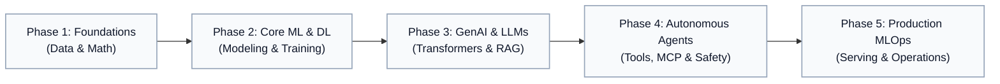

# Agentic AI & Machine Learning Roadmap

A structured, engineering-first roadmap for mastering classical machine learning, generative AI, and autonomous agent systems in production.

---

## 1. Start Here

Select your entry point based on your current background and engineering goals:

| Experience Level | Recommended Starting Point | Target Milestones |
|---|---|---|
| **Beginner** *(Familiar with basic code, new to ML)* | **[Phase 1: Foundations](#phase-1-foundations)** Begin at [Module 01](./curriculum/01-foundations/01_python_sql_and_data_stack.md) | Python memory model, SQL window functions, linear algebra intuition, and statistics fundamentals. |
| **Intermediate** *(Experienced developer or data practitioner)* | **[Phase 2: Core ML & DL](#phase-2-core-machine-learning--deep-learning)** Begin at [Module 03](./curriculum/02-core-ml-and-dl/03_classical_ml_and_recsys.md) or [Module 05](./curriculum/03-modern-ai-and-genai/05_nlp_cv_and_multimodal.md) | Production feature pipelines, PyTorch training loops, Transformer attention, and hybrid RAG search. |
| **Advanced** *(Practicing ML/SWE engineer)* | **[Phase 4: Autonomous Agents](#phase-4-autonomous-agents--systems)** Begin at [Module 07](./curriculum/04-agentic-ai/07_ai_agents_fundamentals.md) or [Module 11](./curriculum/05-production-and-practice/11_mlops_cloud_and_finops.md) | Multi-agent coordination, Model Context Protocol (MCP), runtime evals, and low-latency inference serving. |

---

## 2. Learning Roadmap

The curriculum progresses through five structured phases, taking you from data fundamentals to scalable production systems.

### Phase 1: Foundations
*Build rock-solid fluency in high-performance data processing, mathematical intuition, and probability.*

- **[Module 01: Python, SQL & Modern Data Stack](./curriculum/01-foundations/01_python_sql_and_data_stack.md)**  
  `Difficulty: Foundational` • `Study Time: 6–8 hrs` • `Prerequisites: Basic programming`  
  *Core topics:* Vectorized operations, memory views, CTEs, SQL window functions, analytical joins, and async I/O.  
  *Hands-on:* [Interactive NumPy, Pandas & SQL Lab](./notebooks/01_numpy_pandas_sql_lab.ipynb)

- **[Module 02: Mathematics & Statistics for AI/ML](./curriculum/01-foundations/02_math_and_statistics.md)**  
  `Difficulty: Foundational` • `Study Time: 5–7 hrs` • `Prerequisites: Module 01`  
  *Core topics:* Matrix decompositions, gradient descent intuition, probability distributions, Bayes' Theorem, and hypothesis testing.

### Phase 2: Core Machine Learning & Deep Learning
*Transition from data manipulation to predictive modeling, deep architectures, and objective optimization.*

- **[Module 03: Classical Machine Learning & Recommendation Systems](./curriculum/02-core-ml-and-dl/03_classical_ml_and_recsys.md)**  
  `Difficulty: Intermediate` • `Study Time: 8–10 hrs` • `Prerequisites: Modules 01, 02`  
  *Core topics:* Leak-free pipelines, gradient boosted trees (XGBoost/LightGBM), SHAP explainability, and two-stage recommendation systems.

- **[Module 04: Deep Learning, PyTorch & Reinforcement Learning](./curriculum/02-core-ml-and-dl/04_deep_learning_and_rl.md)**  
  `Difficulty: Intermediate` • `Study Time: 7–9 hrs` • `Prerequisites: Modules 02, 03`  
  *Core topics:* Tensor operations, autograd engine mechanics, normalization layers, modern optimizers (AdamW), and policy optimization.

### Phase 3: Generative AI, LLMs & Retrieval
*Master modern Transformer architectures, fine-tuning techniques, and production retrieval systems.*

- **[Module 05: NLP, Computer Vision & Multimodal AI](./curriculum/03-modern-ai-and-genai/05_nlp_cv_and_multimodal.md)**  
  `Difficulty: Intermediate` • `Study Time: 9–11 hrs` • `Prerequisites: Module 04`  
  *Core topics:* Tokenization algorithms, multi-head scaled dot-product attention, Vision Transformers (ViT), and multimodal contrastive learning (CLIP).  
  *Hands-on:* [Mini-Transformer Attention Lab](./notebooks/03_mini_transformer_attention.ipynb)

- **[Module 06: Generative AI, Fine-Tuning & Production RAG](./curriculum/03-modern-ai-and-genai/06_llms_finetuning_and_rag.md)**  
  `Difficulty: Advanced` • `Study Time: 10–12 hrs` • `Prerequisites: Module 05`  
  *Core topics:* Parameter-efficient fine-tuning (LoRA/QLoRA), alignment (DPO), hybrid vector search, reciprocal rank fusion (RRF), and cross-encoder reranking.

### Phase 4: Autonomous Agents & Systems
*Design robust, stateful autonomous agents equipped with durable memory, schema-validated tools, and guardrails.*

- **[Module 07: AI Agent Fundamentals & Reasoning Loops](./curriculum/04-agentic-ai/07_ai_agents_fundamentals.md)**  
  `Difficulty: Intermediate` • `Study Time: 6–8 hrs` • `Prerequisites: Module 06`  
  *Core topics:* Deterministic workflows vs. autonomous agents, ReAct loop mechanics, execution sandboxing, and loop circuit breakers.

- **[Module 08: Function Calling, LangGraph & Google ADK](./curriculum/04-agentic-ai/08_tools_langgraph_and_adk.md)**  
  `Difficulty: Advanced` • `Study Time: 6–8 hrs` • `Prerequisites: Module 07`  
  *Core topics:* Schema enforcement, state machines, cyclic execution graphs, human-in-the-loop (HITL) checkpoints, and framework patterns.

- **[Module 09: Multi-Agent Systems & Model Context Protocol (MCP)](./curriculum/04-agentic-ai/09_multi_agent_and_mcp.md)**  
  `Difficulty: Advanced` • `Study Time: 6–7 hrs` • `Prerequisites: Module 08`  
  *Core topics:* Multi-agent topologies (supervisor, parallel, swarm), context isolation, Model Context Protocol clients/servers, and agent communication.

- **[Module 10: Agent Evaluation, Safety & Governance](./curriculum/04-agentic-ai/10_agent_evals_and_safety.md)**  
  `Difficulty: Advanced` • `Study Time: 7–9 hrs` • `Prerequisites: Module 09`  
  *Core topics:* Eval-driven development, LLM-as-a-judge debiasing, prompt injection defense, regulatory risk frameworks, and token budgets.

### Phase 5: Production MLOps & System Practice
*Ship resilient, observable AI systems with continuous testing, drift detection, and hardware-efficient serving.*

- **[Module 11: Production MLOps, Drift & Cloud FinOps](./curriculum/05-production-and-practice/11_mlops_cloud_and_finops.md)**  
  `Difficulty: Advanced` • `Study Time: 8–10 hrs` • `Prerequisites: Modules 03, 10`  
  *Core topics:* FastAPI serving lifespans, point-in-time feature stores, population stability index (PSI) drift monitoring, and container security.

- **[Module 12: Real-World Troubleshooting Scenarios](./curriculum/05-production-and-practice/12_system_troubleshooting_scenarios.md)**  
  `Difficulty: Advanced` • `Study Time: 6–8 hrs` • `Prerequisites: Modules 01–11`  
  *Core topics:* Diagnosing train-serve skew, out-of-memory (OOM) recovery, catastrophic forgetting, and latency bottleneck triage.

- **[Module 13: Hands-On ML Algorithms from Scratch](./curriculum/05-production-and-practice/13_algorithms_from_scratch.md)**  
  `Difficulty: Intermediate` • `Study Time: 8–10 hrs` • `Prerequisites: Modules 01–06`  
  *Core topics:* Numerical stability, logistic regression, k-means clustering, BM25 indexing, and vector cosine search implemented in raw Python/NumPy.  
  *Hands-on:* [Algorithms from Scratch Notebook](./notebooks/02_ml_from_scratch_challenges.ipynb)

---

## 3. Choose Your Specialization

Tailor your study plan toward your desired career track:

| Specialization Track | Primary Focus Areas | Curriculum Path | Key Portfolio Project |
|---|---|---|---|
| **Machine Learning Engineer** | Classical ML, feature engineering, ranking models, tabular optimization | Modules `01`, `02`, `03`, `04`, `11`, `13` | [Local MLOps Service](./projects/starter-local-mlops/README.md) or [Two-Stage RecSys](./projects/README.md#project-8-meta--amazon-two-stage-e-commerce-recommendation--ranking-engine) |
| **Generative AI Engineer** | Multimodal architectures, LLM fine-tuning, hybrid RAG, serving throughput | Modules `01`, `02`, `05`, `06`, `11` | [Air-Gapped Hybrid RAG Agent](./projects/starter-local-rag-agent/README.md) or [vLLM Serving](./projects/README.md#project-10-ai-infrastructure-high-throughput-llm-serving-with-vllm--semantic-caching) |
| **Agentic AI Engineer** | Stateful reasoning graphs, function calling, MCP servers, safety evals | Modules `01`, `02`, `06`, `07`, `08`, `09`, `10` | [Google ADK + MCP Copilot](./projects/README.md#project-7-google-ecosystem-autonomous-operations-copilot-with-google-adk--mcp) |
| **AI Architect / MLOps Engineer** | End-to-end pipelines, feature stores, drift detection, cloud GPU FinOps | Modules `01`, `02`, `03`, `10`, `11`, `12` | [Serverless IDP Pipeline](./projects/README.md#project-5-aws-enterprise-serverless-intelligent-document-processing-idp-pipeline) or [Fraud Prevention + Feast](./projects/README.md#project-9-fintech--stripe-real-time-fraud-prevention-with-feast--drift-cicd) |

---

## 4. Hands-On Projects

Every project is structured to demonstrate concrete engineering capabilities: handling edge cases, respecting latency and memory constraints, and integrating automated tests.

| Project Name | Difficulty | Technologies | Expected Outcome |
|---|---|---|---|
| **[Air-Gapped Hybrid RAG & SQL Agent](./projects/starter-local-rag-agent/README.md)** | `Intermediate` | Ollama, Qdrant Hybrid RRF, DuckDB, LangGraph | Offline copilot providing document citations and read-only SQL guardrails with zero external API calls. |
| **[Full-Lifecycle Local MLOps Service](./projects/starter-local-mlops/README.md)** | `Intermediate` | Scikit-learn, FastAPI, PSI Drift, Docker, Pytest | Production microservice featuring automated schema validation, drift detection, and CI test pipelines. |
| **[Real-Time Edge Computer Vision Tracking](./projects/README.md#local-project-2-real-time-edge-computer-vision--multi-object-tracking-pipeline)** | `Intermediate` | YOLO, ONNX Runtime, OpenCV, ByteTrack | Sub-30ms multi-object tracking pipeline running locally with dwell-time analytics. |
| **[Autograd Engine & Mini-Transformer](./projects/README.md#local-project-3-autograd-engine--character-level-transformer-from-scratch)** | `Advanced` | Pure Python, NumPy | Working reverse-mode autodiff DAG and multi-head causal self-attention implemented without frameworks. |
| **[AWS Serverless Document Intelligence](./projects/README.md#project-5-aws-enterprise-serverless-intelligent-document-processing-idp-pipeline)** | `Advanced` | EventBridge, Textract, Bedrock, DynamoDB | Automated document extraction pipeline with PII masking, schema adherence, and asynchronous event triggers. |
| **[GCP Video Multimodal Search Engine](./projects/README.md#project-6-gcp-enterprise-multimodal-video-intelligence--semantic-search-engine)** | `Advanced` | Vertex AI, BigQuery Vector Index, Gemini Flash | Millisecond-level temporal video search matching natural language queries to exact timestamps. |
| **[Google ADK + MCP Operations Copilot](./projects/README.md#project-7-google-ecosystem-autonomous-operations-copilot-with-google-adk--mcp)** | `Advanced` | Google ADK, FastMCP, Docker, Human-in-the-Loop | Multi-agent operations copilot running safe tool invocations through Model Context Protocol. |
| **[Two-Stage Recommendation & Ranking](./projects/README.md#project-8-meta--amazon-two-stage-e-commerce-recommendation--ranking-engine)** | `Advanced` | PyTorch Two-Tower, FAISS HNSW, LightGBM | High-scale candidate generation and ranking engine evaluated against NDCG@10 metrics. |
| **[Real-Time Fraud Prevention with Feast](./projects/README.md#project-9-fintech--stripe-real-time-fraud-prevention-with-feast--drift-cicd)** | `Advanced` | Feast, XGBoost, Streamlit, CI/CD Drift Checks | Sub-20ms transaction risk evaluation with point-in-time correct historical joins. |
| **[High-Throughput LLM Serving System](./projects/README.md#project-10-ai-infrastructure-high-throughput-llm-serving-with-vllm--semantic-caching)** | `Advanced` | vLLM, PagedAttention, Redis, OpenTelemetry | Optimized inference cluster with semantic caching, reduced TTFT, and latency instrumentation. |

*Explore detailed architecture diagrams and design blueprints in the **[Project Catalog](./projects/README.md)** and the **[End-to-End Lifecycle Playbook](./projects/end_to_end_lifecycle_playbook.md)**.*

---

## 5. Interview Preparation

Targeted technical kits covering modern system design, deep-dive Q&A, and live screening challenges:

| Resource | Scope & Key Focus Areas | Link |
|---|---|---|
| **ML & GenAI System Design Framework** | 7-step interview framework, capacity math (QPS, VRAM, network), and worked end-to-end designs. | [Open System Design Kit →](./interview-kits/ml_system_design_framework.md) |
| **Classical ML, RecSys & MLOps Q&A** | Tree ensemble mechanics, calibration, PR-AUC vs. ROC-AUC, two-stage RecSys, and concept drift. | [Open Classical ML Kit →](./interview-kits/classical_ml_questions.md) |
| **GenAI, LLMs, RAG & Agents Q&A** | Attention computation, LoRA/DPO trade-offs, RAG failure modes, TTFT/TPOT metrics, and MCP. | [Open GenAI & Agents Kit →](./interview-kits/genai_and_agents_questions.md) |
| **SQL, Coding & PyTorch Bug Screening** | Point-in-time SQL window queries, memory leak triage, tensor debugging, and cache algorithms. | [Open Screening Kit →](./interview-kits/sql_and_coding_screenings.md) |
| **Resume Playbook & Engineering Flashcards** | Context-Action-Result (CAR) project descriptions, take-home rubrics, and 36 core review flashcards. | [Open Resume & Flashcards →](./interview-kits/resume_and_flashcards.md) |

---

## 6. Learning Resources

- **[Curated Engineering Resources](./resources/recommended_resources.md):** Hand-picked textbooks, foundational research papers, video lectures, and open-source repositories.
- **[Industry Trends & Recommended Skills](./resources/recommended_resources.md#1-industry-trends-and-recommended-skills):** Overview of high-signal skills in production machine learning and agent engineering.

---

## 7. Contributing & License

Contributions, bug reports, and enhancements to starter templates are welcome:
- Please review **[CONTRIBUTING.md](./CONTRIBUTING.md)** for PR guidelines and development standards.
- This repository is released under the **[MIT License](./LICENSE)**.
