# AI/ML Fresher Roadmap: From Foundations to Agentic AI & Production MLOps

A structured, **engineering-first** handbook and roadmap built to take learners, software engineers, and aspiring AI/ML engineers from **Python, SQL & Math foundations** all the way to **Transformers, `Qdrant` Hybrid RAG, Autonomous Agents (`LangGraph` / `Google ADK`), `MCP`, `vLLM` Serving, and Production MLOps**.

> **Designed to Flow Like One Connected Story:** Rather than a disconnected pile of flashcards, Modules `01 -> 13` read as **one continuous engineering narrative**: every section explains *why* the previous tool hit a limit before introducing the next, pairing **Plain-English analogies & animated `.svg` visuals** with collapsible `
` math/citations, a **15-Minute Runnable Lab**, and **[Portfolio Starters](./projects/end_to_end_lifecycle_playbook.md)** + **[Interview Kits](./interview-kits/ml_system_design_framework.md)**.

---

## Visual Architecture of What You Will Master

```mermaid
flowchart LR
    subgraph P1["1. Foundations"]
        M1["01: Python, SQL & Async"]
        M2["02: Math, Bayes & CLT"]
    end

    subgraph P2["2. Core ML & DL"]
        M3["03: XGBoost, Metrics & RecSys"]
        M4["04: PyTorch, LayerNorm & RL"]
    end

    subgraph P3["3. GenAI & Multimodal"]
        M5["05: Self-Attention, CV & Audio"]
        M6["06: LoRA, DPO, RAG & vLLM"]
    end

    subgraph P4["4. Autonomous Agents"]
        M7["07: Workflows vs ReAct"]
        M8["08: LangGraph, ADK & HITL"]
        M9["09: Multi-Agent & MCP"]
        M10["10: Evals, Safety & FinOps"]
    end

    subgraph P5["5. Production & Practice"]
        M11["11: MLOps, Feast & Drift"]
        M12["12: Incident Scenarios"]
        M13["13: ML From Scratch"]
    end

    M1 --> M2 --> M3 --> M4 --> M5 --> M6 --> M7 --> M8 --> M9 --> M10 --> M11 --> M12 --> M13

    classDef f1 fill:#E0F2FE,stroke:#0284C7,stroke-width:2px,color:#0369A1;
    classDef f2 fill:#DCFCE7,stroke:#16A34A,stroke-width:2px,color:#15803D;
    classDef f3 fill:#FEF3C7,stroke:#D97706,stroke-width:2px,color:#92400E;
    classDef f4 fill:#EDE9FE,stroke:#7C3AED,stroke-width:2px,color:#4C1D95;
    classDef f5 fill:#F1F5F9,stroke:#475569,stroke-width:2px,color:#1E293B;

    class M1,M2 f1;
    class M3,M4 f2;
    class M5,M6 f3;
    class M7,M8,M9,M10 f4;
    class M11,M12,M13 f5;
```

---

## 2026 Market Reality: What NOT to Waste Time On vs. Where to Focus

Hiring data and tech restructuring across 2025-2026 reshaped entry-level and mid-level AI expectations: routine boilerplate roles contracted while **full-stack AI systems engineers** remain supply-constrained:

| Skip / De-Emphasize in 2026 (Low ROI) | Focus Heavily Here Instead (High Hiring Signal) |
|---|---|
| Memorizing `Word2Vec`, `Bag-of-Words`, regex stemming, or legacy `RNN`/`VGG` architectures | **`BPE` Tokenizers, `Qdrant` Filterable Hybrid Search (`BM25 + Dense RRF`), Cross-Encoders & `ViT`/`CLIP` Transfer Learning** |
| Standalone "Prompt Engineering" tricks & single-turn chat wrappers | **Context Engineering** (50%-90% KV prefix-cache ordering, signal-to-noise pruning & grammar-constrained `Pydantic` JSON) |
| `.ipynb`-only Kaggle notebooks without tests, APIs, calibration, or Docker | **Deployed Systems:** `SHAP` + calibrated models, `FastAPI` `SSE` token streaming, non-root `Docker`, `PSI` drift & `DPO` data flywheels |
| Vibes-based prompt tweaking & custom brittle agent glue | **Eval-Driven Development (`EDD`)** (Day-1 Golden Datasets in CI/CD) + open agent standards (**`MCP`** vertical tools & **`A2A`** peer agents) |
| Blindly pasting `Cursor`/`Copilot` code or cramming only abstract puzzles | **Auditing AI-Generated Code** for silent data leakage, tenant filter bugs, `N+1` async bottlenecks & security flaws ([Practice Kit](./interview-kits/sql_and_coding_screenings.md)) |

---

## Choose Your Learning Track & Realistic Timeline

Don't try to cram 13 modules in a weekend. Pick the track aligned with your target role and background:

| Target Role Track | Modules to Prioritize | Portfolio Projects to Build |
|---|---|---|
| **Track A: Classical ML / Applied Data Scientist** | `01`, `02`, `03`, `04`, `11`, `12`, `13` | [Starter 2 (Local MLOps)](./projects/starter-local-mlops/README.md) + [Project 8 (RecSys)](./projects/README.md#project-8-meta--amazon-two-stage-e-commerce-recommendation--ranking-engine) or [Project 9 (Fraud + Feast)](./projects/README.md#project-9-fintech--stripe-real-time-fraud-prevention-with-feast--drift-cicd) |
| **Track B: GenAI & Autonomous Agent Engineer** | `01`, `02`, `05`, `06`, `07`, `08`, `09`, `10`, `11`, `12` | [Starter 1 (Local Hybrid RAG + SQL)](./projects/starter-local-rag-agent/README.md) + [Project 7 (Google ADK + MCP)](./projects/README.md#project-7-google-ecosystem-autonomous-operations-copilot-with-google-adk--mcp) |
| **Track C: Full-Stack AI/ML Engineer (Complete)** | All Modules `01` - `13` | 2 Local Projects (\$0) + 1 Cloud Architecture Blueprint |

### Pacing Schedules
- **16-Week Deep Mastery Schedule (~10 hrs/week: Recommended for True Beginners):**
  - *Weeks 1-3:* Phase 1 Foundations (`01-02`) + [Lab 01 Notebook](./notebooks/01_numpy_pandas_sql_lab.ipynb)
  - *Weeks 4-6:* Phase 2 Core ML & DL (`03-04`) + [Starter 2: Local MLOps](./projects/starter-local-mlops/README.md)
  - *Weeks 7-10:* Phase 3 Multimodal & GenAI (`05-06`) + [Lab 03 Attention Notebook](./notebooks/03_mini_transformer_attention.ipynb)
  - *Weeks 11-13:* Phase 4 Agentic AI & MCP (`07-10`) + [Starter 1: Local RAG Agent](./projects/starter-local-rag-agent/README.md)
  - *Weeks 14-16:* Phase 5 Production, Troubleshooting & Scratch Coding (`11-13`) + [Interview Kits](./interview-kits/ml_system_design_framework.md)
- **6-Week Fast-Track Crash Schedule (~20+ hrs/week: For CS Grads / Interview Prep):**
  - *Week 1:* `01-02` (Tier 2 SQL Windows, Async, Bayes, CLT) • *Week 2:* `03-04` (`XGBoost`, RecSys, `LayerNorm`, `AdamW`) • *Week 3:* `05-06` ($Q,K,V$ Attention, `LoRA`/`DPO`, Hybrid RAG, `vLLM`) • *Week 4:* `07-09` (`LangGraph`, `Google ADK`, `MCP`) • *Week 5:* `10-11` (Guardrails, `Feast`, `PSI` Drift, FinOps) • *Week 6:* `12-13` + [Mock Interview Kits](./interview-kits/ml_system_design_framework.md).

---

## Curriculum Modules (5 Progressive Phases)

### Phase 1: Foundations (`curriculum/01-foundations/`)
- **[01: Python, SQL & Modern Data Stack](./curriculum/01-foundations/01_python_sql_and_data_stack.md)**  
  `Generators` `NumPy Broadcasting` `Pandas Copy-on-Write` `SQL Window Functions & CTEs` `Pydantic` `asyncio`
- **[02: Mathematics & Statistics](./curriculum/01-foundations/02_math_and_statistics.md)**  
  `Tensor Shapes` `Cosine Similarity` `p95/p99 Percentiles` `Bayes' Theorem` `Central Limit Theorem` `A/B Z-Tests`

### Phase 2: Core Machine Learning & Deep Learning (`curriculum/02-core-ml-and-dl/`)
- **[03: Classical ML, Ensembles & Recommendation Systems](./curriculum/02-core-ml-and-dl/03_classical_ml_and_recsys.md)**  
  `Leak-Free Pipelines` `XGBoost / LightGBM / TabPFN` `SHAP & Probability Calibration` `PR-AUC` `Two-Tower RecSys & NDCG@K`
- **[04: Deep Learning, PyTorch & Reinforcement Learning](./curriculum/02-core-ml-and-dl/04_deep_learning_and_rl.md)**  
  `GELU / SwiGLU` `BatchNorm vs LayerNorm` `AdamW & Cosine Warmup` `Multi-GPU DDP vs FSDP (ZeRO-3)` `RL (PPO / GRPO)`

### Phase 3: Multimodal AI, LLMs & Advanced RAG (`curriculum/03-modern-ai-and-genai/`)
- **[05: NLP, Self-Attention, Computer Vision & Audio AI](./curriculum/03-modern-ai-and-genai/05_nlp_cv_and_multimodal.md)**  
  `BPE Tokenizers` `Scaled Dot-Product Attention (Q,K,V) & RoPE` `ResNet Skip Highway` `IoU / mAP` `ViT & CLIP` `Whisper & Audio Codecs`
- **[06: Generative AI, Fine-Tuning (`LoRA`/`DPO`), `Qdrant` & Production RAG](./curriculum/03-modern-ai-and-genai/06_llms_finetuning_and_rag.md)**  
  `VRAM Math` `Context Engineering & Prefix Caching` `Structured JSON` `Qdrant Filterable HNSW & Quantization` `Hybrid RRF + Rerank` `LoRA / QLoRA / DPO / GRPO` `vLLM`

### Phase 4: Autonomous Agents & MCP (`curriculum/04-agentic-ai/`)
- **[07: AI Agents Fundamentals & Workflows](./curriculum/04-agentic-ai/07_ai_agents_fundamentals.md)**  
  `Workflows vs Agents Rubric` `Safe AST ReAct Loop` `Working / Episodic / Semantic Memory` `Plan-and-Execute` `Loop Circuit Breakers`
- **[08: Function Calling, LangGraph & Google ADK](./curriculum/04-agentic-ai/08_tools_langgraph_and_adk.md)**  
  `Strict Tool Schemas` `Cyclical StateGraphs` `Google ADK (adk web / eval / deploy)` `Durable HITL Checkpoints`
- **[09: Multi-Agent Systems, `MCP` & `A2A` Protocol](./curriculum/04-agentic-ai/09_multi_agent_and_mcp.md)**  
  `Context Isolation` `Supervisor & Parallel Topologies` `MCP (stdio / Streamable HTTP)` `A2A Peer Agent Protocol` `Tool-Poisoning Defense`
- **[10: Eval-Driven Development, Safety, Governance & Token FinOps](./curriculum/04-agentic-ai/10_agent_evals_and_safety.md)**  
  `Eval-Driven Development & Golden Sets` `LLM-as-a-Judge Debiasing` `OpenTelemetry` `Indirect Injection` `EU AI Act & NIST RMF` `Model Cascading`

### Phase 5: Production MLOps, Troubleshooting & Live Coding (`curriculum/05-production-and-practice/`)
- **[11: Production MLOps, `SSE` Streaming, Drift & Cloud GPU FinOps](./curriculum/05-production-and-practice/11_mlops_cloud_and_finops.md)**  
  `safetensors & ONNX` `FastAPI Lifespan & SSE Streaming` `Data Flywheels` `Non-Root Docker` `Feast` `PSI Drift` `Shadow / Canary / A/B` `Spot GPUs`
- **[12: Real-World System Troubleshooting Scenarios](./curriculum/05-production-and-practice/12_system_troubleshooting_scenarios.md)**  
  `Day-1 Leakage vs Drift` `MCAR/MAR/MNAR` `Catastrophic Forgetting` `CUDA OOM Rescue Stack` `Cost-Matrix Thresholding`
- **[13: Hands-On Algorithms from Scratch (NumPy & Python)](./curriculum/05-production-and-practice/13_algorithms_from_scratch.md)**  
  `Linear & Logistic Regression` `Stable Softmax` `Vectorized K-Means` `O(N) Top-K Cosine` `BM25 Index` `Jittered Backoff`

---

## Interactive Labs & Runnable Starter Code

| Lab / Starter Kit | What You Practice | Launch / Open |
|---|---|---|
| **Notebook 01: NumPy, Pandas CoW & SQL Windows** | Broadcasting Z-scores, leak-free group imputation, SQLite `LAG` & rolling windows | [Notebook](./notebooks/01_numpy_pandas_sql_lab.ipynb) • [Open in Colab](https://colab.research.google.com/github/FirdowsRahaman/ai-ml-fresher-roadmap/blob/main/notebooks/01_numpy_pandas_sql_lab.ipynb) |
| **Notebook 02: ML & Search from Scratch** | Stable Softmax, Linear Regression, `O(N)` `argpartition` Cosine Search | [Notebook](./notebooks/02_ml_from_scratch_challenges.ipynb) • [Open in Colab](https://colab.research.google.com/github/FirdowsRahaman/ai-ml-fresher-roadmap/blob/main/notebooks/02_ml_from_scratch_challenges.ipynb) |
| **Notebook 03: Multi-Head Causal Attention** | Tensor head splitting, $\sqrt{d_k}$ scaling, causal mask verification | [Notebook](./notebooks/03_mini_transformer_attention.ipynb) • [Open in Colab](https://colab.research.google.com/github/FirdowsRahaman/ai-ml-fresher-roadmap/blob/main/notebooks/03_mini_transformer_attention.ipynb) |
| **Starter Repo 1: Air-Gapped Hybrid RAG + SQL Agent** | `BM25 + Vector RRF`, read-only SQL guardrail, intent router + `pytest` suite | **[Explore Starter Code →](./projects/starter-local-rag-agent/README.md)** |
| **Starter Repo 2: Local Full-Lifecycle MLOps API** | Leak-free `Pipeline`, `FastAPI` lifespan, `PSI` drift endpoint, `Dockerfile` + `pytest` | **[Explore Starter Code →](./projects/starter-local-mlops/README.md)** |
| **End-to-End AI Product Playbook (Day 0 → Live)** | Unifies all 13 modules: Unit Economics -> Golden Set -> `Qdrant` + `MCP` -> `SSE` -> Flywheel | **[Read Lifecycle Playbook →](./projects/end_to_end_lifecycle_playbook.md)** |

---

## Interview Preparation & Career Playbook

| Kit | Focus Areas | Link |
|---|---|---|
| **ML & GenAI System Design Framework** | 7-step 45-min rubric, QPS/VRAM math, worked Fraud & Enterprise RAG designs | [Open System Design Kit →](./interview-kits/ml_system_design_framework.md) |
| **Classical ML, RecSys & MLOps Q&A** | GBDTs, scaling traps, `PR-AUC`, Two-Tower RecSys, Concept Drift, `Feast` | [Open Classical ML Kit →](./interview-kits/classical_ml_questions.md) |
| **GenAI, LLMs, RAG & Agents Q&A** | Attention math, `LoRA`/`DPO`/`GRPO`, Hybrid RAG, `TTFT`/`TPOT`, `vLLM`, `MCP` | [Open GenAI & Agents Kit →](./interview-kits/genai_and_agents_questions.md) |
| **SQL, PyTorch Bug-Hunt & Screenings** | `DENSE_RANK`/`LAG` SQL, `merge_asof` point-in-time joins, 5 PyTorch bugs, `LRU` cache | [Open Screening Kit →](./interview-kits/sql_and_coding_screenings.md) |
| **Resume CAR Playbook & 36 Flashcards** | 1-page resume bullets, take-home grading rubric, red flags & revision glossary | [Open Resume & Flashcards →](./interview-kits/resume_and_flashcards.md) |
| **Curated Books, Courses & Papers** | Hand-picked textbooks, visual lectures, 8 landmark papers & OSS repos | [Open Resources Guide →](./resources/recommended_resources.md) |

---

## Portfolio Projects: Local (\$0) & Enterprise Cloud

### Track 1: 100% Local Projects (\$0 Cloud Spend)
| Project | Architecture Highlights | Blueprint & Starter |
|---|---|---|
| **1. Private Air-Gapped RAG & SQL Copilot** | Ollama 4-bit, `Qdrant` Hybrid `RRF`, in-process analytical SQL, router | [Blueprint](./projects/README.md#local-project-1-private-air-gapped-desktop-rag--multi-tool-agent) • [Starter](./projects/starter-local-rag-agent/README.md) |
| **2. Real-Time Edge CV Multi-Object Tracker** | Threaded OpenCV, `YOLO26` `ONNX Runtime`, `ByteTrack`, zone dwell times | [Blueprint](./projects/README.md#local-project-2-real-time-edge-computer-vision--multi-object-tracking-pipeline) |
| **3. Autograd Engine & Mini-Transformer** | Reverse-mode autodiff DAG + causal multi-head self-attention in pure NumPy | [Blueprint](./projects/README.md#local-project-3-autograd-engine--character-level-transformer-from-scratch) • [Lab](./notebooks/03_mini_transformer_attention.ipynb) |
| **4. Full-Lifecycle Local MLOps Service** | Leak-free pipeline, `FastAPI`, `PSI` drift monitor, non-root `Docker`, `pytest` | [Blueprint](./projects/README.md#local-project-4-full-lifecycle-local-mlops-pipeline-with-mlflow-optuna--docker) • [Starter](./projects/starter-local-mlops/README.md) |

### Track 2: Cloud & Big Tech Reference Architectures
| Target Ecosystem | Architecture Highlights | Blueprint |
|---|---|---|
| **5. AWS Serverless IDP Pipeline** | EventBridge, Textract table OCR, Comprehend PII masking, Bedrock JSON | [View AWS Blueprint →](./projects/README.md#project-5-aws-enterprise-serverless-intelligent-document-processing-idp-pipeline) |
| **6. GCP Video Semantic Search** | Vertex Multimodal Embeddings, BigQuery `HNSW`, Gemini 3 Flash temporal grounding | [View GCP Blueprint →](./projects/README.md#project-6-gcp-enterprise-multimodal-video-intelligence--semantic-search-engine) |
| **7. Google ADK + MCP Ops Copilot** | Hierarchical `google-adk` subagents, `FastMCP` server, `HITL` checkpoints | [View ADK Blueprint →](./projects/README.md#project-7-google-ecosystem-autonomous-operations-copilot-with-google-adk--mcp) |
| **8. Meta / Amazon Two-Stage RecSys** | PyTorch Two-Tower + `FAISS HNSW` (`<10ms`) + `LightGBM LambdaMART` (`NDCG@10`) | [View RecSys Blueprint →](./projects/README.md#project-8-meta--amazon-two-stage-e-commerce-recommendation--ranking-engine) |
| **9. Stripe / FinTech Fraud + `Feast`** | Point-in-time `Feast` store, cost-sensitive `XGBoost`, `PSI >= 0.25` CI/CD | [View Fraud Blueprint →](./projects/README.md#project-9-fintech--stripe-real-time-fraud-prevention-with-feast--drift-cicd) |
| **10. `vLLM` High-Throughput Serving** | `PagedAttention`, Redis semantic cache (`<15ms`), `OpenTelemetry` `TTFT`/`TPOT` | [View Infra Blueprint →](./projects/README.md#project-10-ai-infrastructure-high-throughput-llm-serving-with-vllm--semantic-caching) |

---

## Contributing & License

Contributions (new interview scenarios, starter kit extensions, typo/link fixes) are welcome! Please read **[CONTRIBUTING.md](./CONTRIBUTING.md)** before opening a pull request. Released under the **[MIT License](./LICENSE)**.
