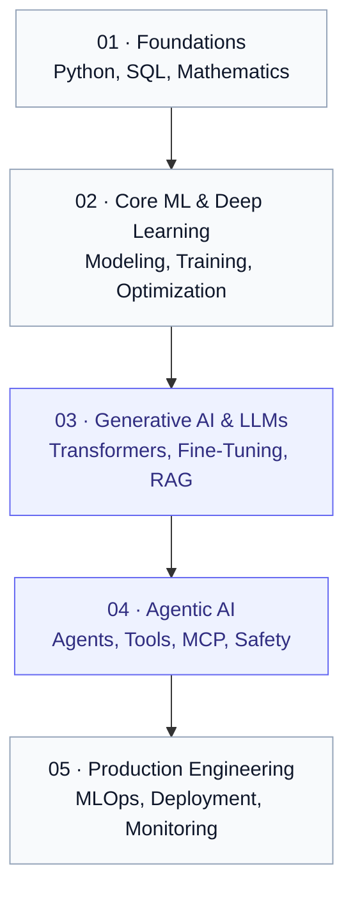

# Agentic AI & Machine Learning Roadmap

**An engineering-first roadmap for building, evaluating, deploying, and operating production-grade AI systems.**

A structured learning path covering classical machine learning, deep learning, generative AI, large language models, autonomous agents, and production MLOps.

---

## 1. Start Here

Choose a starting point based on your current experience. Follow the curriculum sequentially for a complete learning journey, or explore a specialization that matches your engineering goals.

| Experience Level | Recommended Starting Point | Learning Focus |
|---|---|---|
| **Beginner** | [Phase 1: Foundations](#phase-1-foundations) · [Module 01](./curriculum/01-foundations/01_python_sql_and_data_stack.md) | Python, SQL, data structures, mathematics, and statistics. |
| **Intermediate** | [Phase 2: Core ML & DL](#phase-2-core-machine-learning--deep-learning) · [Module 03](./curriculum/02-machine-learning/03_classical_ml_and_recsys.md) | Machine learning, feature engineering, model evaluation, and deep learning. |
| **Advanced** | [Phase 4: Autonomous Agents](#phase-4-autonomous-agents--systems) · [Module 07](./curriculum/05-agentic-ai/07_ai_agents_fundamentals.md) | Agent architectures, tool orchestration, multi-agent systems, MCP, and evaluation. |

Already experienced in a specific area? Explore [Choose Your Specialization](#3-choose-your-specialization) for a focused learning path.

---

## 2. Learning Roadmap

The curriculum is organized into five progressive phases, moving from foundational engineering concepts to production-ready autonomous AI systems.

### Phase 1: Foundations

*Build a strong foundation in programming, data processing, mathematics, and statistical reasoning.*

**[Module 01](./curriculum/01-foundations/01_python_sql_and_data_stack.md) — Python, SQL & Modern Data Stack**

- Difficulty: Foundational
- Study time: 6–8 hours
- Prerequisites: Basic programming
- Topics: Vectorized operations, memory views, CTEs, SQL window functions, analytical joins, and asynchronous I/O.
- Practical lab: [Interactive NumPy, Pandas & SQL Lab](./notebooks/foundations/01_numpy_pandas_sql_lab.ipynb)

**[Module 02](./curriculum/01-foundations/02_math_and_statistics.md) — Mathematics & Statistics for AI/ML**

- Difficulty: Foundational
- Study time: 5–7 hours
- Prerequisites: Module 01
- Topics: Matrix decompositions, gradient descent intuition, probability distributions, Bayes' theorem, and hypothesis testing.

### Phase 2: Core Machine Learning & Deep Learning

*Move from data processing to predictive modeling, neural architectures, and optimization.*

**[Module 03](./curriculum/02-machine-learning/03_classical_ml_and_recsys.md) — Classical Machine Learning & Recommendation Systems**

- Difficulty: Intermediate
- Study time: 8–10 hours
- Prerequisites: Modules 01 and 02
- Topics: Leak-free pipelines, gradient-boosted trees (XGBoost/LightGBM), SHAP explainability, and two-stage recommendation systems.

**[Module 04](./curriculum/03-deep-learning/04_deep_learning_and_rl.md) — Deep Learning, PyTorch & Reinforcement Learning**

- Difficulty: Intermediate
- Study time: 7–9 hours
- Prerequisites: Modules 02 and 03
- Topics: Tensor operations, autograd mechanics, normalization layers, AdamW, and policy optimization.

### Phase 3: Generative AI, LLMs & Retrieval

*Understand modern Transformer architectures, multimodal learning, fine-tuning, and production retrieval systems.*

**[Module 05](./curriculum/04-generative-ai/05_nlp_cv_and_multimodal.md) — NLP, Computer Vision & Multimodal AI**

- Difficulty: Intermediate
- Study time: 9–11 hours
- Prerequisites: Module 04
- Topics: Tokenization algorithms, multi-head scaled dot-product attention, Vision Transformers (ViT), and multimodal contrastive learning (CLIP).
- Practical lab: [Mini-Transformer Attention Lab](./notebooks/deep-learning/03_mini_transformer_attention.ipynb)

**[Module 06](./curriculum/04-generative-ai/06_llms_finetuning_and_rag.md) — Generative AI, Fine-Tuning & Production RAG**

- Difficulty: Advanced
- Study time: 10–12 hours
- Prerequisites: Module 05
- Topics: Parameter-efficient fine-tuning (LoRA/QLoRA), alignment (DPO), hybrid vector search, reciprocal rank fusion (RRF), and cross-encoder reranking.

### Phase 4: Autonomous Agents & Systems

*Build stateful autonomous agents with tool integration, memory, orchestration, and safety controls.*

**[Module 07](./curriculum/05-agentic-ai/07_ai_agents_fundamentals.md) — AI Agent Fundamentals & Reasoning Loops**

- Difficulty: Intermediate
- Study time: 6–8 hours
- Prerequisites: Module 06
- Topics: Deterministic workflows vs. autonomous agents, ReAct loops, execution sandboxing, and circuit breakers.

**[Module 08](./curriculum/05-agentic-ai/08_tools_langgraph_and_adk.md) — Function Calling, LangGraph & Google ADK**

- Difficulty: Advanced
- Study time: 6–8 hours
- Prerequisites: Module 07
- Topics: Schema enforcement, state machines, cyclic execution graphs, human-in-the-loop checkpoints, and framework patterns.

**[Module 09](./curriculum/05-agentic-ai/09_multi_agent_and_mcp.md) — Multi-Agent Systems & Model Context Protocol (MCP)**

- Difficulty: Advanced
- Study time: 6–7 hours
- Prerequisites: Module 08
- Topics: Supervisor, parallel and swarm architectures, context isolation, MCP clients and servers, and agent communication.

**[Module 10](./curriculum/05-agentic-ai/10_agent_evals_and_safety.md) — Agent Evaluation, Safety & Governance**

- Difficulty: Advanced
- Study time: 7–9 hours
- Prerequisites: Module 09
- Topics: Evaluation-driven development, LLM-as-a-judge debiasing, prompt injection defense, regulatory risk frameworks, and token budgets.

### Phase 5: Production MLOps & Engineering Practice

*Learn to deploy, monitor, troubleshoot, and optimize AI systems under real-world production constraints.*

**[Module 11](./curriculum/06-production-ai/11_mlops_cloud_and_finops.md) — Production MLOps, Drift & Cloud FinOps**

- Difficulty: Advanced
- Study time: 8–10 hours
- Prerequisites: Modules 03 and 10
- Topics: FastAPI serving lifecycles, point-in-time feature stores, population stability index (PSI), drift monitoring, and container security.

**[Module 12](./curriculum/06-production-ai/12_system_troubleshooting_scenarios.md) — Real-World Troubleshooting Scenarios**

- Difficulty: Advanced
- Study time: 6–8 hours
- Prerequisites: Modules 01–11
- Topics: Train-serve skew, out-of-memory recovery, catastrophic forgetting, and latency bottleneck diagnosis.

**[Module 13](./curriculum/06-production-ai/13_algorithms_from_scratch.md) — Hands-On ML Algorithms from Scratch**

- Difficulty: Intermediate
- Study time: 8–10 hours
- Prerequisites: Modules 01–06
- Topics: Numerical stability, logistic regression, k-means clustering, BM25 indexing, and vector cosine search implemented in Python/NumPy.
- Practical lab: [Algorithms from Scratch Notebook](./notebooks/machine-learning/02_ml_from_scratch_challenges.ipynb)

---

## 3. Choose Your Specialization

Use these learning paths to focus on the engineering skills and projects most relevant to your target role.

| Engineering Track | Focus Areas | Recommended Modules | Portfolio Projects |
|---|---|---|---|
| **Machine Learning Engineer** | Classical ML, feature engineering, ranking, tabular optimization | 01, 02, 03, 04, 11, 13 | [Local MLOps Service](./projects/intermediate/starter-local-mlops/README.md) · [Two-Stage RecSys](./projects/README.md#project-8-meta--amazon-two-stage-e-commerce-recommendation--ranking-engine) |
| **Generative AI Engineer** | Multimodal AI, LLM fine-tuning, hybrid RAG, inference serving | 01, 02, 05, 06, 11 | [Hybrid RAG Agent](./projects/intermediate/starter-local-rag-agent/README.md) · [vLLM Serving](./projects/README.md#project-10-ai-infrastructure-high-throughput-llm-serving-with-vllm--semantic-caching) |
| **Agentic AI Engineer** | Agent architectures, orchestration, MCP, safety and evaluation | 01, 02, 06, 07, 08, 09, 10 | [Google ADK + MCP Copilot](./projects/README.md#project-7-google-ecosystem-autonomous-operations-copilot-with-google-adk--mcp) |
| **AI Architect / MLOps Engineer** | System architecture, deployment, feature stores, monitoring, cloud FinOps | 01, 02, 03, 10, 11, 12 | [Serverless IDP Pipeline](./projects/README.md#project-5-aws-enterprise-serverless-intelligent-document-processing-idp-pipeline) · [Fraud Prevention + Feast](./projects/README.md#project-9-fintech--stripe-real-time-fraud-prevention-with-feast--drift-cicd) |

---

## 4. Hands-On Projects

Apply the concepts through practical engineering projects designed around architecture, implementation, testing, performance, and production constraints.

### Starter Projects

| Project | Difficulty | Technologies | Engineering Outcome |
|---|---|---|---|
| [Air-Gapped Hybrid RAG & SQL Agent](./projects/intermediate/starter-local-rag-agent/README.md) | Intermediate | Ollama, Qdrant, DuckDB, LangGraph | Offline copilot with document citations and read-only SQL guardrails. |
| [Full-Lifecycle Local MLOps Service](./projects/intermediate/starter-local-mlops/README.md) | Intermediate | Scikit-learn, FastAPI, PSI, Docker, Pytest | Production-style ML service with schema validation, drift detection, and CI testing. |

### Advanced Project Blueprints

| Project | Difficulty | Technologies | Engineering Outcome |
|---|---|---|---|
| [Real-Time Edge Computer Vision Tracking](./projects/README.md#local-project-2-real-time-edge-computer-vision--multi-object-tracking-pipeline) | Intermediate | YOLO, ONNX Runtime, OpenCV, ByteTrack | Local multi-object tracking with dwell-time analytics and sub-30ms target processing. |
| [Autograd Engine & Mini-Transformer](./projects/README.md#local-project-3-autograd-engine--character-level-transformer-from-scratch) | Advanced | Python, NumPy | Reverse-mode autodiff and multi-head causal self-attention implemented from scratch. |
| [AWS Serverless Document Intelligence](./projects/README.md#project-5-aws-enterprise-serverless-intelligent-document-processing-idp-pipeline) | Advanced | EventBridge, Textract, Bedrock, DynamoDB | Document extraction with PII masking, schema adherence, and asynchronous processing. |
| [GCP Video Multimodal Search](./projects/README.md#project-6-gcp-enterprise-multimodal-video-intelligence--semantic-search-engine) | Advanced | Vertex AI, BigQuery Vector Index, Gemini Flash | Natural-language video search with temporal timestamp retrieval. |
| [Google ADK + MCP Operations Copilot](./projects/README.md#project-7-google-ecosystem-autonomous-operations-copilot-with-google-adk--mcp) | Advanced | Google ADK, FastMCP, Docker | Multi-agent operations copilot with controlled MCP tool execution and human oversight. |
| [Two-Stage Recommendation & Ranking](./projects/README.md#project-8-meta--amazon-two-stage-e-commerce-recommendation--ranking-engine) | Advanced | PyTorch Two-Tower, FAISS HNSW, LightGBM | Candidate generation and ranking evaluated using NDCG@10. |
| [Real-Time Fraud Prevention with Feast](./projects/README.md#project-9-fintech--stripe-real-time-fraud-prevention-with-feast--drift-cicd) | Advanced | Feast, XGBoost, Streamlit, CI/CD | Transaction risk evaluation with point-in-time correct historical joins. |
| [High-Throughput LLM Serving](./projects/README.md#project-10-ai-infrastructure-high-throughput-llm-serving-with-vllm--semantic-caching) | Advanced | vLLM, PagedAttention, Redis, OpenTelemetry | Optimized inference with semantic caching and latency instrumentation. |

For complete architecture diagrams, implementation details, and engineering decisions, explore:

- [Complete Project Catalog](./projects/README.md)
- [End-to-End Lifecycle Playbook](./projects/end_to_end_lifecycle_playbook.md)

---

## 5. Interview Preparation

Prepare for technical interviews through focused engineering questions, system design frameworks, coding exercises, and practical troubleshooting scenarios.

| Resource | What It Covers |
|---|---|
| [ML & GenAI System Design Framework](./interview-kits/agentic-ai/ml_system_design_framework.md) | Seven-step interview framework, capacity planning, QPS, VRAM, networking, and end-to-end architecture design. |
| [Classical ML, RecSys & MLOps Q&A](./interview-kits/machine-learning/classical_ml_questions.md) | Tree ensembles, model calibration, PR-AUC vs. ROC-AUC, recommendation systems, and concept drift. |
| [GenAI, LLMs, RAG & Agents Q&A](./interview-kits/generative-ai/genai_and_agents_questions.md) | Attention, LoRA, DPO, RAG failure modes, TTFT/TPOT, and MCP. |
| [SQL, Coding & PyTorch Screening](./interview-kits/machine-learning/sql_and_coding_screenings.md) | SQL window queries, memory leak diagnosis, tensor debugging, and cache algorithms. |
| [Resume Playbook & Engineering Flashcards](./interview-kits/resume_and_flashcards.md) | CAR-based project descriptions, take-home assessment rubrics, and 36 core review flashcards. |

---

## 6. Learning Resources

Explore additional material to deepen your understanding of AI engineering and stay connected with the evolving ecosystem.

- [Curated Engineering Resources](./resources/recommended_resources.md) — Textbooks, foundational research papers, technical lectures, and open-source repositories.
- [Industry Trends & Recommended Skills](./resources/recommended_resources.md#1-industry-trends-and-recommended-skills) — Production machine learning and agent engineering skills.

---

## 7. Contributing

Contributions are welcome. You can help improve the curriculum, add practical examples, enhance starter projects, fix documentation, and suggest new engineering challenges.

Before submitting changes, review the [Contribution Guidelines](./CONTRIBUTING.md).

---

## 8. License

This project is licensed under the [MIT License](./LICENSE).

---

**Build strong foundations. Understand the systems. Engineer AI for production.**
