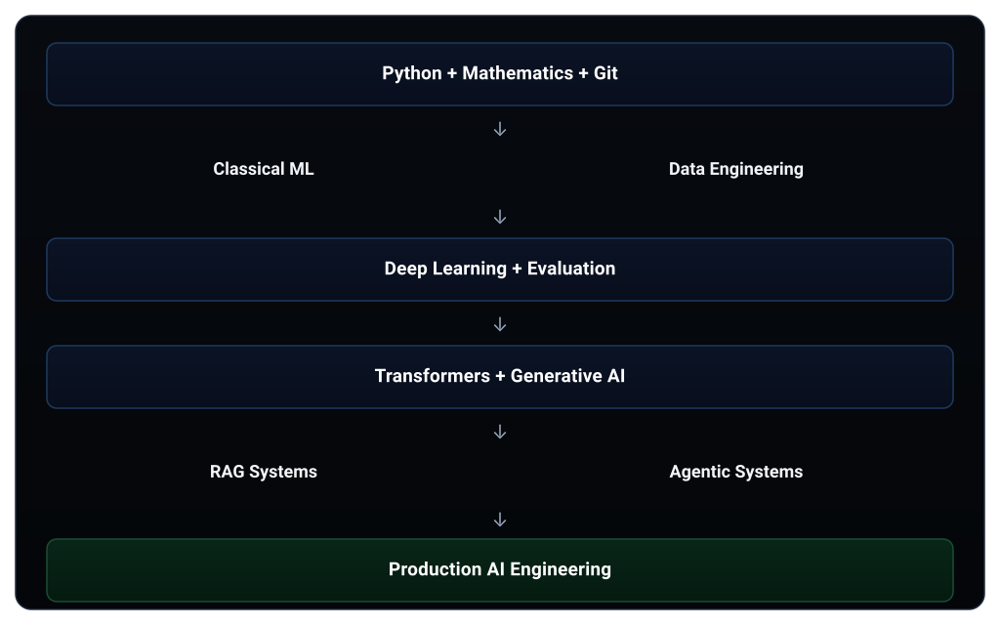
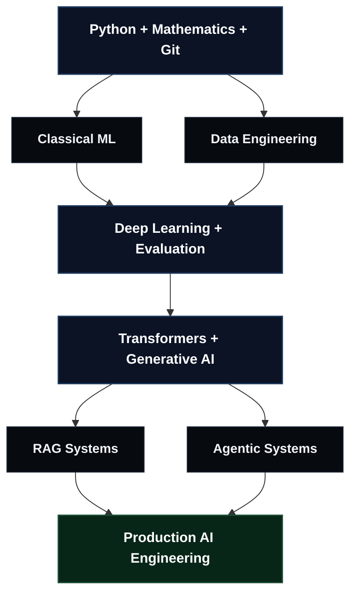

# Complete Agentic AI & ML Engineering Roadmap

[← Back to Portal](./README.md) | [Diagnostic Assessment](./docs/assessment-guide.md) | [Getting Started](./docs/getting-started.md) | [Learning Paths](./docs/learning-paths.md) | [Prerequisites](./docs/prerequisites.md)

---

##  Roadmap Overview & Prerequisite Dependency Graph 

The curriculum is structured into **five progressive phases** comprising **18 specialized learning units**. Each phase builds directly upon the mathematical and software primitives developed in previous tiers:

  

 

> **Note on Non-Linear Progression:** This is a conceptual dependency map, not a rigid requirement that every learner follow a single linear sequence. Software engineers can use the [Diagnostic Assessment Guide](./docs/assessment-guide.md) to fast-track directly into Generative AI and Agentic Systems, while data scientists may spend more time mastering Classical ML and Deep Learning optimization.

---

##  Phase 1: Engineering & Mathematical Foundations 
Focuses on vectorized computing, modern SQL analytical window functions, linear algebra geometry, matrix calculus, and statistical hypothesis testing.

| Unit ID | Module Title | Core Topics | Key Hands-On Lab | Difficulty | Est. Hours |
|---|---|---|---|---|---|
| **01** | **[Python, SQL & Data Stack](./curriculum/01-foundations/01_python_sql_and_data_stack.md)** | NumPy broadcasting, Pandas Copy-on-Write, SQLite analytical functions (`LAG`, `ROW_NUMBER`), Polars memory layout, AsyncIO | [`01_numpy_pandas_sql_lab.ipynb`](./notebooks/foundations/01_numpy_pandas_sql_lab.ipynb) | Core | 14 Hours |
| **02** | **[Math & Statistics](./curriculum/01-foundations/02_math_and_statistics.md)** | Matrix decomposition, SVD, Eigenvalues, Multivariate chain rule, analytical MSE gradients, Bayes' theorem, robust A/B Z-test | Analytical gradient check & A/B power lab | Core | 16 Hours |

[ Back to Top](#roadmap-overview)

---

##  Phase 2: Core Machine Learning & Deep Learning 
Emphasizes leak-free preprocessing pipelines, cost-sensitive classification under severe imbalance, custom PyTorch training loops, and distributed reinforcement learning.

| Unit ID | Module Title | Core Topics | Key Hands-On Lab | Difficulty | Est. Hours |
|---|---|---|---|---|---|
| **03** | **[Classical ML & RecSys](./curriculum/02-core-ml-and-dl/03_classical_ml_and_recsys.md)** | Leak-free pipelines, XGBoost/LightGBM, PR-AUC vs ROC-AUC, cost matrix optimization, Two-Tower candidate retrieval | Leak-free churn prediction pipeline | Intermediate | 18 Hours |
| **04A** | **[Core Deep Learning & PyTorch](./curriculum/02-core-ml-and-dl/04a_deep_learning_and_pytorch.md)** | Computational graphs, dynamic autograd DAG, SwiGLU/GeLU activations, LayerNorm/RMSNorm, custom PyTorch training loop | 5-step PyTorch loop with gradient clipping | Intermediate | 16 Hours |
| **04B** | **[Advanced DL & Reinforcement Learning](./curriculum/02-core-ml-and-dl/04b_advanced_dl_and_rl.md)** | Distributed Data Parallel (DDP), FSDP, ZeRO-1/2/3 memory math, REINFORCE policy gradient, PPO, DPO/GRPO alignment | REINFORCE policy gradient step in PyTorch | Advanced | 16 Hours |

[ Back to Top](#roadmap-overview)

---

##  Phase 3: Modern AI & Generative AI 
Deep dives into multi-head attention, parameter-efficient fine-tuning (LoRA), enterprise hybrid vector search, and high-throughput inference serving.

| Unit ID | Module Title | Core Topics | Key Hands-On Lab | Difficulty | Est. Hours |
|---|---|---|---|---|---|
| **05A** | **[NLP & Language Modeling Foundations](./curriculum/03-modern-ai-and-genai/05a_nlp_and_language_models.md)** | Subword BPE tokenization, word embeddings, TF-IDF, Okapi BM25 ranking, Scaled Dot-Product Attention math | Scaled Dot-Product Attention in pure NumPy | Intermediate | 14 Hours |
| **05B** | **[Computer Vision & Multimodal AI](./curriculum/03-modern-ai-and-genai/05b_computer_vision_and_multimodal.md)** | Vision Transformers (ViT), patch projections, CLIP contrastive InfoNCE alignment, YOLOv10/11 edge vision | Pretrained ViT fine-tuning & transfer learning | Intermediate | 16 Hours |
| **06A** | **[LLM Architecture & Inference Engines](./curriculum/03-modern-ai-and-genai/06a_llm_architecture_and_inference.md)** | Decoder-only Transformers, RoPE relative embeddings, KV cache memory scaling formula, Top-P sampling, constrained JSON decoding | Autoregressive KV cache token sampler | Advanced | 16 Hours |
| **06B** | **[RAG Engineering](./curriculum/03-modern-ai-and-genai/06b_rag_engineering.md)** | Chunking strategies, Qdrant vector indexing, Hybrid BM25 + Dense Cosine search, Reciprocal Rank Fusion (RRF), Cross-Encoder reranking | Air-Gapped Hybrid RAG with RRF | Advanced | 18 Hours |
| **06C** | **[Fine-Tuning, Serving & LLMOps](./curriculum/03-modern-ai-and-genai/06c_finetuning_and_serving.md)** | LoRA & QLoRA rank parameter math, AWQ/GPTQ quantization, vLLM continuous batching & PagedAttention, TTFT/TPOT latency | LoRA adapter parameter scaling verification | Advanced | 16 Hours |

[ Back to Top](#roadmap-overview)

---

##  Phase 4: Agentic AI Engineering 
Teaches stateful graph cycles, multi-actor collaboration, durable execution checkpoints, and standardized tool protocols.

| Unit ID | Module Title | Core Topics | Key Hands-On Lab | Difficulty | Est. Hours |
|---|---|---|---|---|---|
| **07** | **[Agent Fundamentals & Architecture](./curriculum/04-agentic-ai/07_agent_fundamentals.md)** | Workflows vs Agents taxonomy, ReAct reasoning loops, AST arithmetic sandbox, working memory, bounded execution loops | Safe AST math tool evaluator & ReAct loop | Intermediate | 16 Hours |
| **08** | **[Agent Orchestration & Workflows](./curriculum/04-agentic-ai/08_agent_orchestration.md)** | Strict JSON Schema tool contracts, LangGraph cyclical state machines, Google ADK, durable checkpoints, HITL approval interrupts | LangGraph cyclical execution graph | Advanced | 20 Hours |
| **09** | **[Multi-Agent Systems, MCP & A2A](./curriculum/04-agentic-ai/09_multi_agent_mcp_a2a.md)** | Supervisor-worker topologies, context isolation, FastMCP JSON-RPC 2.0 servers, Agent-to-Agent (A2A) protocol | Decoupled FastMCP tool server | Advanced | 20 Hours |
| **10** | **[Agent Evals, Safety & FinOps](./curriculum/04-agentic-ai/10_agent_evaluation_and_safety.md)** | Golden eval sets, trajectory tracing, indirect prompt injection guardrails, token budget FinOps | Pre-execution AST security filter | Advanced | 18 Hours |

[ Back to Top](#roadmap-overview)

---

##  Phase 5: Production AI Engineering & Practical Mastery 
Covers non-root Docker deployments, Population Stability Index drift tracking, real-world triage trees, and first-principles algorithm implementations.

| Unit ID | Module Title | Core Topics | Key Hands-On Lab | Difficulty | Est. Hours |
|---|---|---|---|---|---|
| **11** | **[Production ML, GenAI & AgentOps](./curriculum/05-production-and-practice/11_production_ai_engineering.md)** | Zero-pickle `.npz` serialization, FastAPI endpoints, PSI drift calculation, non-root Dockerfile, canary retraining triggers | Automated PSI canary retrain trigger | Advanced | 22 Hours |
| **12** | **[Incident Troubleshooting Labs](./curriculum/05-production-and-practice/12_incident_and_troubleshooting_labs.md)** | Real-world triage trees: training-serving skew, memory leaks, latency spikes, silent LLM degradation | Interactive diagnostic playbook | Advanced | 16 Hours |
| **13A** | **[ML Algorithms from Scratch](./curriculum/05-production-and-practice/13_algorithms_and_patterns_from_scratch/13a_ml_algorithms.md)** | Numerically stable softmax, batch gradient descent, Top-K cosine search via `np.argpartition`, causal attention | 5 core algorithms in pure NumPy | Advanced | 16 Hours |
| **13B** | **[AI Systems Patterns from Scratch](./curriculum/05-production-and-practice/13_algorithms_and_patterns_from_scratch/13b_system_patterns.md)** | LRU Cache, Token Bucket rate limiter, exponential backoff with full jitter, Circuit Breaker state machine | Resilient API gateway patterns | Advanced | 14 Hours |
| **14** | **[Production AI Agent Challenges](./curriculum/05-production-and-practice/14_production_ai_agent_challenges/README.md)** | 10 production agent challenges (ReAct sandbox, research swarms, autonomous coding, text-to-SQL AST security, durable HITL, resilience) & enterprise capstone | 10 runnable challenge suites + 1 multi-agent capstone | Expert | 68 Hours |

[ Back to Top](#roadmap-overview)

---

## ⏱️ Recommended Study Timelines

| Track | Target Audience | Weekly Commitment | Total Duration | Recommended Units |
|---|---|---|---|---|
| **Comprehensive Engineering Track** | Aspiring AI/ML Engineers & Complete Beginners | 10–12 Hours / Week | **25–31 Weeks** | All 18 Learning Units (~302 total study hours) + Capstone |
| **Guided Applied Track** | Developers seeking practical AI application skills | 8–10 Hours / Week | **16–20 Weeks** | Modules 01, 03, 04A, 05A, 06A, 06B, 07, 08, 11 |
| **Accelerated Developer Track** | Experienced Backend / Software Engineers | 10–12 Hours / Week | **12–16 Weeks** | Diagnostic bypass of Phase 1; focus on 04A, 06A-C, 07-10, 11 |

---

## 🛠️ Portfolio Projects & Capstones

Pair your curriculum progress with real-world, portfolio-ready implementations:
- **[Beginner Track ($0 Spend)](./projects/beginner/README.md):** Autograd & Mini-Transformer, Edge Computer Vision Tracker.
- **[Intermediate Runnable Starters](./projects/intermediate/README.md):**
  - [Starter 1: Air-Gapped Hybrid RAG & SQL Agent](./projects/intermediate/starter-local-rag-agent/README.md)
  - [Starter 2: Full-Lifecycle Production MLOps Engine](./projects/intermediate/starter-local-mlops/README.md)
- **[Advanced Cloud Blueprints](./projects/advanced/README.md):** Google ADK + MCP Copilot, Two-Stage RecSys Engine, Feast Real-Time Fraud, and vLLM Serving Infrastructure.
- **[Enterprise Lifecycle Playbook](./projects/end_to_end_lifecycle_playbook.md):** Comprehensive production architecture and deployment playbook.

[ Back to Top](#roadmap-overview)
