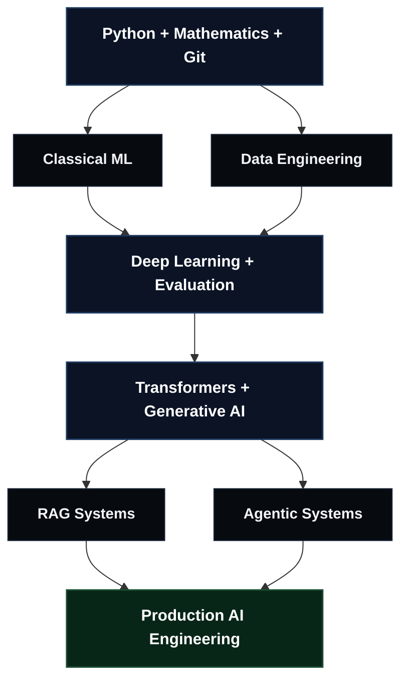

# Complete Agentic AI & ML Engineering Roadmap

[← Back to Portal](./README.md) | [Getting Started](./docs/getting-started.md) | [Learning Paths](./docs/learning-paths.md) | [Prerequisites](./docs/prerequisites.md)

---

## Roadmap Overview & Prerequisite Dependency Graph

The curriculum is structured into **six progressive engineering tiers**. Each tier builds directly upon the mathematical and software primitives developed in previous tiers:

  

 

> **Note on Non-Linear Progression:** This is a conceptual dependency map, not a rigid requirement that every learner follow a single linear sequence. For example, backend engineers might advance rapidly through Generative AI into Agentic Systems, while data scientists may focus deeply on Classical ML and Deep Learning optimization.

---

## Tier 1: Engineering Foundations
Focuses on vectorization, modern SQL analytical window functions, linear algebra geometry, and statistical hypothesis testing.

| Module | Core Topics | Key Hands-On Lab | Difficulty |
|---|---|---|---|
| **[Module 01: Python, SQL & Data Stack](./curriculum/01-foundations/01_python_sql_and_data_stack.md)** | NumPy broadcasting, Pandas Copy-on-Write, SQLite analytical functions (`LAG`, `ROW_NUMBER`), Polars memory layout | [`01_numpy_pandas_sql_lab.ipynb`](./notebooks/foundations/01_numpy_pandas_sql_lab.ipynb) | Core |
| **[Module 02: Math & Statistics](./curriculum/01-foundations/02_math_and_statistics.md)** | Matrix decomposition, SVD, Eigenvalues, Multivariate Normal, Baye's theorem, A/B hypothesis testing | Matrix projection & z-score lab | Core |

---

## Tier 2: Classical Machine Learning
Emphasizes leak-free preprocessing, cost-matrix optimization under severe class imbalance, and recommendation systems.

| Module | Core Topics | Key Hands-On Lab | Difficulty |
|---|---|---|---|
| **[Module 03: Classical ML & RecSys](./curriculum/02-machine-learning/03_classical_ml_and_recsys.md)** | Leak-free pipelines, XGBoost/LightGBM, PR-AUC vs ROC-AUC, Two-Tower candidate retrieval | Leak-free churn prediction pipeline | Intermediate |

---

## Tier 3: Deep Learning & Representation Learning
Builds computational graphs, autograd backpropagation, and PyTorch training loops from mathematical first principles.

| Module | Core Topics | Key Hands-On Lab | Difficulty |
|---|---|---|---|
| **[Module 04: Deep Learning & RL](./curriculum/03-deep-learning/04_deep_learning_and_rl.md)** | Gradient descent math, SwiGLU/GeLU activations, LayerNorm/RMSNorm, custom PyTorch loops, Policy Gradients | End-to-end PyTorch training with gradient clipping | Intermediate |

---

## Tier 4: Generative AI, LLMs & Retrieval-Augmented Generation
Deep dives into multi-head causal attention, parameter-efficient fine-tuning (LoRA), hybrid vector search, and token inference engines.

| Module | Core Topics | Key Hands-On Lab | Difficulty |
|---|---|---|---|
| **[Module 05: NLP, CV & Multimodal AI](./curriculum/04-generative-ai/05_nlp_cv_and_multimodal.md)** | Subword BPE tokenization, Vision Transformers (ViT), CLIP contrastive alignment, YOLOv10/11 edge vision | Mini multi-head attention in NumPy | Intermediate |
| **[Module 06: LLMs, Fine-Tuning & RAG](./curriculum/04-generative-ai/06_llms_finetuning_and_rag.md)** | LoRA rank math, DPO alignment, Qdrant Reciprocal Rank Fusion (BM25 + Dense Cosine), vLLM PagedAttention | Qdrant hybrid retrieval with RRF | Advanced |

---

## Tier 5: Autonomous Agents & Distributed Protocols
Teaches stateful graph cycles, multi-actor collaboration, durable execution checkpoints, and standardized tool protocols.

| Module | Core Topics | Key Hands-On Lab | Difficulty |
|---|---|---|---|
| **[Module 07: AI Agents Fundamentals](./curriculum/05-agentic-ai/07_ai_agents_fundamentals.md)** | Workflows vs Agents, ReAct reasoning loops, AST arithmetic sandbox, state persistence | Safe AST math tool evaluator | Intermediate |
| **[Module 08: Tools, LangGraph & ADK](./curriculum/05-agentic-ai/08_tools_langgraph_and_adk.md)** | Strict JSON Schema tool contracts, LangGraph cyclical state machines, Google ADK, HITL interrupts | LangGraph cyclical execution graph | Advanced |
| **[Module 09: Multi-Agent Systems & MCP](./curriculum/05-agentic-ai/09_multi_agent_and_mcp.md)** | Supervisor-worker topologies, context isolation, FastMCP JSON-RPC 2.0 servers, A2A communication | Decoupled FastMCP tool server | Advanced |
| **[Module 10: Agent Evals & Safety](./curriculum/05-agentic-ai/10_agent_evals_and_safety.md)** | Golden eval sets, trajectory tracing, indirect prompt injection guardrails, token budget FinOps | Pre-execution security filter | Advanced |

---

## Tier 6: Production AI, MLOps & High-Performance Engineering
Covers non-root Docker deployments, Population Stability Index drift tracking, real-world triage trees, and first-principles algorithm implementations.

| Module | Core Topics | Key Hands-On Lab | Difficulty |
|---|---|---|---|
| **[Module 11: Production MLOps & FinOps](./curriculum/06-production-ai/11_mlops_cloud_and_finops.md)** | Zero-pickle `.npz` serialization, FastAPI endpoints, PSI drift calculation, non-root Dockerfile | Automated PSI canary retrain trigger | Advanced |
| **[Module 12: Troubleshooting Scenarios](./curriculum/06-production-ai/12_system_troubleshooting_scenarios.md)** | Real-world triage trees: training-serving skew, memory leaks, latency spikes, silent LLM degradation | Interactive diagnostic playbook | Advanced |
| **[Module 13: Algorithms from Scratch](./curriculum/06-production-ai/13_algorithms_from_scratch.md)** | Numerically stable softmax, batch gradient descent, Top-K cosine search via `np.argpartition`, causal attention | 5 core algorithms in pure NumPy | Advanced |

---

## Portfolio Projects & Capstones
Pair your curriculum progress with real-world, portfolio-ready implementations:
- **[Beginner Track ($0 Spend)](./projects/beginner/README.md):** Autograd & Mini-Transformer, Edge Computer Vision Tracker.
- **[Intermediate Runnable Starters](./projects/intermediate/README.md):**
  - [Starter 1: Air-Gapped Hybrid RAG & SQL Agent](./projects/intermediate/starter-local-rag-agent/README.md)
  - [Starter 2: Full-Lifecycle Production MLOps Engine](./projects/intermediate/starter-local-mlops/README.md)
- **[Advanced Cloud Blueprints](./projects/advanced/README.md):** Google ADK + MCP Copilot, Two-Stage RecSys Engine, Feast Real-Time Fraud, and vLLM Serving Infrastructure.

---

[← Return to Home Portal](./README.md)
