# Module 01: Python, SQL & Modern Data Engineering Stack

> **Estimated Study Time:** 6–8 Hours | **Prerequisites:** Basic programming familiarity | **Lab:** [Run Interactive Notebook](../../notebooks/01_numpy_pandas_sql_lab.ipynb) | **[Open in Colab](https://colab.research.google.com/github/FirdowsRahaman/ai-ml-fresher-roadmap/blob/main/notebooks/01_numpy_pandas_sql_lab.ipynb)**

[← Back to Roadmap](../../README.md) | [Next: Module 02 — Math & Statistics →](./02_math_and_statistics.md)

---

## Mental Model: Why This Module Matters

Every machine learning model and AI agent sits on top of **data pipelines** and **clean Python engineering**. Before an interviewer asks you about Transformers or XGBoost, they verify whether you can extract messy data with SQL, transform millions of rows with vectorized NumPy/Pandas without running out of memory, and write type-safe, asynchronous Python services.

```mermaid
flowchart LR
    DB[("Relational DB / Logs")] -->|"SQL (Joins, CTEs, Windows)"| RAW["Extracted Dataset"]
    RAW -->|"Pandas / Polars Cleaning"| CLEAN["Validated DataFrame"]
    CLEAN -->|"NumPy Vectorization"| TENSOR["Feature Matrices (X, y)"]
    TENSOR -->|"Pydantic + Async Python"| PROD["ML Training & AI APIs"]

    classDef store fill:#E0F2FE,stroke:#0284C7,stroke-width:2px,color:#0369A1;
    classDef proc fill:#EDE9FE,stroke:#7C3AED,stroke-width:1.5px,color:#4C1D95;
    classDef out fill:#DCFCE7,stroke:#16A34A,stroke-width:2px,color:#15803D;

    class DB store;
    class RAW,CLEAN,TENSOR proc;
    class PROD out;
```



---

## Tier 1: Fresher Core (Must-Know Foundations)

### 1. Python Core Mechanics

#### Q1: Why is Python the dominant language for AI/ML despite being slower than C++?
**Answer:**
Python acts as an ergonomic **glue language** over high-performance C, C++, CUDA, and Rust backends:
- Libraries like **NumPy**, **PyTorch**, and **Polars** execute heavy matrix algebra in compiled C++/CUDA/Rust while exposing concise Python APIs.
- Unmatched ecosystem across classical ML (`scikit-learn`), deep learning (`torch`), data validation (`pydantic`), and GenAI (`langgraph`, `vllm`).

---

#### Q2: List vs. Tuple vs. Set vs. Dict — Complexity & Mutability
**Answer:**

| Structure | Syntax | Mutable? | Lookup Time | Primary AI/ML Use Case |
|---|---|---|---|---|
| **List** | `[1, 2, 3]` | Yes | `O(N)` | Dynamic batches, ordered token sequences |
| **Tuple** | `(224, 224, 3)` | No | `O(N)` | Fixed tensor shapes, immutable dictionary keys |
| **Set** | `{"cat", "dog"}` | Yes | `O(1)` avg | Deduplicating vocabulary tokens, fast membership checks |
| **Dict** | `{"id": 42}` | Yes | `O(1)` avg | Token-to-ID vocabularies, JSON payloads, feature maps |

```python
tensor_shape = (32, 3, 224, 224)  # Immutable shape tuple
vocab = {"<PAD>": 0, "<UNK>": 1, "ai": 2}  # O(1) token lookup
```

---

#### Q3: What is the difference between `==` and `is`, and `append()` vs. `extend()`?
**Answer:**
- `==` compares **value equality**; `is` checks **object identity** (same memory address — use `is None`, never `== None`).
- `append(x)` adds `x` as a **single item**; `extend(iterable)` unpacks and appends **each element**.

```python
a = [1, 2, 3]
b = [1, 2, 3]
print(a == b)  # True  (equal values)
print(a is b)  # False (distinct objects in memory)

items = [1, 2]
items.append([3, 4])   # [1, 2, [3, 4]]
items2 = [1, 2]
items2.extend([3, 4])  # [1, 2, 3, 4]
```

---

#### Q4: What are Python Generators (`yield`), and why are they critical in ML pipelines?
**Answer:**
A generator yields items **lazily one batch at a time** instead of materializing an entire dataset in RAM.

```python
from typing import Iterator

def stream_batches(file_path: str, batch_size: int = 64) -> Iterator[list[str]]:
    """Streams an arbitrarily large text file in fixed-size chunks with O(batch_size) RAM."""
    batch: list[str] = []
    with open(file_path, "r", encoding="utf-8") as f:
        for line in f:
            batch.append(line.strip())
            if len(batch) == batch_size:
                yield batch
                batch = []
        if batch:
            yield batch
```
> **Interview Insight:** PyTorch `IterableDataset` and Hugging Face streaming datasets (`streaming=True`) rely on generators so you can train on terabytes of data from a 16 GB RAM laptop.

---

### 2. Vectorized Computing with NumPy

#### Q5: Why is NumPy 30x–100x faster than Python `for` loops, and what is Broadcasting?
**Answer:**
1. **Contiguous Memory & SIMD:** NumPy arrays store homogeneous C types (`float32`, `int64`) in contiguous memory blocks, unlocking CPU SIMD vectorization without Python's dynamic type-checking overhead per element.
2. **Broadcasting:** NumPy automatically stretches dimensions of size `1` (without copying memory) when shapes are compatible from right to left.

```python
import numpy as np

# Feature matrix: 4 samples, 3 features -> shape (4, 3)
X = np.array([
    [10.0, 200.0, 0.5],
    [12.0, 180.0, 0.8],
    [9.0,  220.0, 0.3],
    [15.0, 250.0, 0.9],
])

# Column-wise Z-score standardization via broadcasting:
mean = X.mean(axis=0)          # shape (3,)
std = X.std(axis=0) + 1e-8     # shape (3,)
X_scaled = (X - mean) / std    # (4, 3) - (3,) -> broadcast across all 4 rows!
print(X_scaled.shape)          # (4, 3)
```

---

### 3. Tabular Wrangling with Modern Pandas (2.x / 3.0 Safe)

#### Q6: How do you safely inspect, slice (`loc` vs. `iloc`), and impute missing values in Pandas?
**Answer:**
- `df.loc[row_label, col_label]` selects by **explicit labels** (inclusive slice end).
- `df.iloc[row_pos, col_pos]` selects by **0-based integer positions** (exclusive slice end).
- **Avoid deprecated `df['col'].fillna(..., inplace=True)`!** Pandas 2.x/3.0 enforces **Copy-on-Write (CoW)**, so chained `inplace=True` triggers warnings or fails. Always assign back explicitly (`df['col'] = df['col'].fillna(...)`).

```python
import pandas as pd
import numpy as np

df = pd.DataFrame({
    "user_id": ["u1", "u2", "u3", "u4"],
    "plan": ["free", "pro", "pro", "free"],
    "spend": [15.0, np.nan, 120.0, np.nan],
})

# Modern Copy-on-Write safe group imputation:
df["spend_is_missing"] = df["spend"].isna().astype(int)
df["spend"] = df["spend"].fillna(
    df.groupby("plan")["spend"].transform("median")
)
print(df)
```

---

### 4. SQL Foundations with Real Queries

#### Q7: How do `INNER JOIN`, `LEFT JOIN`, and `GROUP BY ... HAVING` work in ML feature extraction?
**Answer:**
- **`WHERE`** filters individual rows *before* aggregation.
- **`HAVING`** filters aggregated groups *after* `GROUP BY`.
- **`LEFT JOIN`** preserves every entity in your base population (e.g., all registered users), filling `NULL` when an event table (e.g., `purchases`) has zero matches — critical so you don't accidentally drop churned/inactive users!

```sql
-- Build a user-level churn feature table without dropping zero-purchase users
SELECT
    u.user_id,
    u.signup_country,
    COUNT(o.order_id) AS total_orders,
    COALESCE(SUM(o.amount_usd), 0.0) AS lifetime_spend
FROM users AS u
LEFT JOIN orders AS o
    ON u.user_id = o.user_id
    AND o.order_date >= CURRENT_DATE - INTERVAL '90 days'
WHERE u.is_bot = FALSE
GROUP BY u.user_id, u.signup_country
HAVING COUNT(o.order_id) >= 0;
```

---

## Tier 2: MNC Production Depth (Modern AI Engineering)

### 5. Analytical SQL: CTEs & Window Functions (Top Screening Topic)

#### Q8: Why are SQL Window Functions (`ROW_NUMBER`, `LAG`, `AVG() OVER`) essential for ML feature engineering?
**Answer:**
Unlike `GROUP BY` (which collapses rows), **Window Functions** compute rankings, time deltas, and rolling statistics while preserving individual event rows — ideal for point-in-time transaction and clickstream features.

```sql
WITH ranked_tx AS (
    SELECT
        user_id,
        tx_id,
        tx_timestamp,
        amount_usd,
        -- Previous transaction amount for this user (detect sudden spikes)
        LAG(amount_usd, 1, 0.0) OVER (
            PARTITION BY user_id ORDER BY tx_timestamp
        ) AS prev_tx_amount,
        -- Rolling 3-transaction average per user
        AVG(amount_usd) OVER (
            PARTITION BY user_id
            ORDER BY tx_timestamp
            ROWS BETWEEN 2 PRECEDING AND CURRENT ROW
        ) AS rolling_3tx_avg,
        -- Deduplicate retries: keep latest record per transaction ID
        ROW_NUMBER() OVER (
            PARTITION BY tx_id ORDER BY updated_at DESC
        ) AS rn
    FROM transactions
)
SELECT user_id, tx_id, amount_usd, prev_tx_amount, rolling_3tx_avg
FROM ranked_tx
WHERE rn = 1;
```

---

### 6. Modern Python for AI Engineers: `uv`, `Pydantic`, `async/await` & `pytest`

#### Q9: Why do production AI/LLM backends rely on `Pydantic` and `asyncio`?
**Answer:**
1. **`uv` / Virtual Environments:** Modern AI repos pin reproducible environments via `pyproject.toml` and `uv.lock` (`uv sync`) rather than global `pip install`.
2. **`Pydantic` Validation:** Enforces strict runtime type checking and JSON Schema serialization for API requests, feature vectors, and LLM structured outputs.
3. **`async` / `await` Concurrency:** LLM calls and vector DB lookups are **network I/O-bound**. Running 10 RAG sub-queries sequentially at 800 ms each takes **8.0 seconds**; running them concurrently via `asyncio.gather()` takes **~800 ms**.

```python
import asyncio
from pydantic import BaseModel, Field, ValidationError

class PredictionRequest(BaseModel):
    user_id: str = Field(min_length=1)
    age: int = Field(ge=18, le=120)
    monthly_spend: float = Field(ge=0.0)

async def fetch_embedding(chunk_id: int) -> list[float]:
    await asyncio.sleep(0.05)  # Simulates non-blocking network API call
    return [0.1 * chunk_id, 0.2 * chunk_id]

async def embed_all_chunks(chunk_ids: list[int]) -> list[list[float]]:
    # Runs all requests concurrently on a single event loop
    return await asyncio.gather(*(fetch_embedding(cid) for cid in chunk_ids))

# Validate input schema + run async batch
req = PredictionRequest(user_id="u_42", age=26, monthly_spend=99.5)
vectors = asyncio.run(embed_all_chunks([1, 2, 3, 4]))
assert len(vectors) == 4
```

> **When Pandas hits RAM limits:** Mention **Polars** or **DuckDB** in interviews — both execute multi-threaded Rust/C++ query plans with lazy evaluation (`pl.scan_parquet(...)`) on 50 GB+ datasets without Out-Of-Memory crashes.

---

## Mini Hands-On Lab (15-Minute Exercise)

Implement a vectorized feature builder that cleans raw transaction logs, computes user-level Z-scores without loops, and passes all assertions:

```python
import numpy as np
import pandas as pd

def build_user_features(raw: pd.DataFrame) -> pd.DataFrame:
    df = raw.copy().drop_duplicates(subset=["tx_id"])
    df["amount"] = pd.to_numeric(df["amount"], errors="coerce")
    df = df.dropna(subset=["user_id", "amount"])

    agg = (
        df.groupby("user_id", as_index=False)
        .agg(tx_count=("tx_id", "count"), total_spend=("amount", "sum"))
    )
    vals = agg["total_spend"].to_numpy(dtype=float)
    std = vals.std()
    agg["spend_zscore"] = (vals - vals.mean()) / (std if std > 0 else 1.0)
    return agg.sort_values("user_id").reset_index(drop=True)

sample = pd.DataFrame({
    "tx_id": ["t1", "t1", "t2", "t3", "t4"],
    "user_id": ["u1", "u1", "u1", "u2", "u2"],
    "amount": ["100.0", "100.0", "50.0", "300.0", "invalid"],
})
out = build_user_features(sample)
assert list(out["tx_count"]) == [2, 1]
assert np.isclose(out["spend_zscore"].mean(), 0.0)
print("Lab 01 Passed!", out.to_dict(orient="records"))
```

---

## Key Takeaways for Interviews
- Use **generators (`yield`)** for lazy batch streaming and **NumPy broadcasting** instead of Python `for` loops.
- Avoid chained `inplace=True` in Pandas; use `groupby().transform()` and explicit column assignment for Copy-on-Write compatibility.
- Master **SQL `LEFT JOIN`**, **`HAVING` vs. `WHERE`**, and **Window Functions (`ROW_NUMBER`, `LAG`, `OVER`)** — they are tested in almost every screening.
- Use **`Pydantic`** for schema safety and **`asyncio.gather`** to parallelize I/O-bound LLM and vector search calls.

---

[← Back to Roadmap](../../README.md) | [Next: Module 02 — Math & Statistics →](./02_math_and_statistics.md)
