```mermaid
flowchart LR
    DB[("Relational DB / Logs")] -->|"SQL (Joins, CTEs, Windows)"| RAW["Extracted Dataset"]
    RAW -->|"Pandas / Polars Cleaning"| CLEAN["Validated DataFrame"]
    CLEAN -->|"NumPy Vectorization"| TENSOR["Feature Matrices (X, y)"]
    TENSOR -->|"Pydantic + Async Python"| PROD["ML Training & AI APIs"]

    classDef store fill:#E0F2FE,stroke:#0284C7,stroke-width:2px,color:#0369A1;
    classDef proc fill:#EDE9FE,stroke:#7C3AED,stroke-width:1.5px,color:#4C1D95;
    classDef out fill:#DCFCE7,stroke:#16A34A,stroke-width:2px,color:#15803D;

    class DB store;
    class RAW,CLEAN,TENSOR proc;
    class PROD out;
```

# Module 01: Python, SQL & Modern Data Engineering Stack

[← Back to Portal](../../README.md) | [Phase 1 Index](./README.md) | [Next: Module 02: Math & Statistics →](./02_math_and_statistics.md)

---

## 1. Overview

Every machine learning model and autonomous AI agent begins life as raw, messy data sitting inside a database or event log. Before touching neural networks or LLMs, we master the start of the data stream: extracting clean rows with `SQL`, imputing missing values with `Pandas`, transforming feature columns at compiled speed with `NumPy`, and orchestrating pipelines with type-safe, non-blocking asynchronous Python.



---

## 2. Learning Objectives

By the end of this module, you will be able to:
- **Analyze time and space complexity** of Python data structures (`list`, `set`, `dict`, `tuple`) to avoid $O(N)$ bottlenecks in token and feature processing.
- **Implement memory-efficient batch generators** using Python `yield` to stream multi-gigabyte training corpora under strict RAM constraints.
- **Formulate vectorized tensor transformations** in `NumPy` using multidimensional broadcasting rules without slow Python loops.
- **Execute leak-free data cleaning** in modern Pandas (version 2.0+) adhering strictly to Copy-on-Write (CoW) semantics.
- **Write complex analytical SQL queries** leveraging Common Table Expressions (CTEs), window functions (`ROW_NUMBER`, `LAG`, `LEAD`), and partitioned aggregations.
- **Construct concurrent async pipelines** using `asyncio.gather` and `Pydantic` schema validation for high-throughput AI API interactions.

---

## 3. Prerequisites

- **Python Basics:** Functions, variables, control flow (`if/else`, loops), and basic error handling (`try/except`).
- **Basic Relational Concepts:** Tables, primary keys, and fundamental `SELECT ... FROM` statements.
- **Terminal Familiarity:** Basic command line navigation and package installation (`pip`).

---

## 4. Core Concepts

### 4.1 Why Python Runs AI (The Steering Wheel Model)
Python is famously slower than C++ or Rust for CPU-bound computations, yet almost all AI engineering relies on Python. Think of Python as the **steering wheel of a sports car**: you write concise, expressive orchestration in Python, while the underlying math engine (`NumPy`, `PyTorch`, `Polars`) executes compiled C++, CUDA, or Rust instructions at native machine speed. The cardinal rule of AI engineering: **never iterate raw Python loops over large numerical arrays when a vectorized operation is available.**

### 4.2 Core Data Structures & Lookup Complexity
| Structure | Syntax | Mutable? | Lookup Time | Primary AI/ML Use Case |
|---|---|---|---|---|
| **List** | `[1, 2, 3]` | Yes | $O(N)$ | Dynamic batches, ordered token sequences |
| **Tuple** | `(224, 224, 3)` | No | $O(N)$ | Fixed tensor shapes, immutable dictionary keys |
| **Set** | `{"cat", "dog"}` | Yes | $O(1)$ avg | Deduplicating vocabulary tokens, fast membership checks |
| **Dict** | `{"id": 42}` | Yes | $O(1)$ avg | Token-to-ID vocabularies, JSON payloads, feature maps |

```python
tensor_shape = (32, 3, 224, 224)  # Immutable shape tuple
vocab = {"<PAD>": 0, "<UNK>": 1, "ai": 2}  # O(1) token lookup
```

### 4.3 Value Equality (`==`) vs. Object Identity (`is`)
- `==` compares **value equality** (e.g. do these two arrays hold the same elements?).
- `is` checks **object identity** (do these two variables point to the exact same memory address? Always write `x is None`, never `x == None`).
- `list.append(x)` appends $x$ as a single item; `list.extend(iterable)` unpacks and appends each element individually.

```python
a = [1, 2, 3]
b = [1, 2, 3]
print(a == b)  # True  (equal values)
print(a is b)  # False (distinct objects in memory)

items = [1, 2]
items.append([3, 4])   # [1, 2, [3, 4]]
items2 = [1, 2]
items2.extend([3, 4])  # [1, 2, 3, 4]
```

### 4.4 Lazy Batch Streaming with Python Generators (`yield`)
When processing a 50 GB training dataset on a 16 GB workstation, reading the whole file into a `list` triggers an Out-Of-Memory (OOM) crash. Generators evaluate lazily: they consume input streams line-by-line or chunk-by-chunk, yield batches to the caller, and suspend their execution frame until the next batch is requested:

```python
import io
import json
from collections.abc import Iterable, Iterator
from itertools import islice

def stream_batches_from_source(
    stream: Iterable[str], batch_size: int = 64
) -> Iterator[list[dict]]:
    """Genuine streaming generator that reads an open file or stream lazily

    in bounded chunks without loading the entire multi-gigabyte source into memory.
    """
    iterator = iter(stream)
    while True:
        # islice pulls at most batch_size lines from the iterator stream
        chunk = list(islice(iterator, batch_size))
        if not chunk:
            break
        # Yield deserialized records lazily per batch
        yield [json.loads(line) for line in chunk if line.strip()]

# Demonstration: Streaming a simulated 50GB line-delimited JSONL stream
simulated_jsonl_stream = io.StringIO(
    "\n".join(json.dumps({"user_id": f"u_{i}", "feature_vec": [i * 0.1, i * 0.2]}) for i in range(1000))
)

batches = stream_batches_from_source(simulated_jsonl_stream, batch_size=256)
first_batch = next(batches)
assert len(first_batch) == 256
assert first_batch[0]["user_id"] == "u_0"
assert len(next(batches)) == 256  # Lazily pulls the second batch without rewinding
```

---

## 5. Technical Deep Dive

### 5.1 NumPy Array Architecture & Vectorized Broadcasting
A Python list is an array of pointers to fragmented Python heap objects, incurring pointer chasing overhead. A **NumPy `ndarray`** is a contiguous block of homogeneous memory accompanied by a lightweight metadata header storing `shape`, `dtype`, and `strides`.

#### Broadcasting Compatibility Rule
Two array dimensions are compatible for element-wise operations if:
1. They are equal, OR
2. One of the dimensions is $1$.

```python
import numpy as np

# Feature matrix: 4 samples, 3 features -> shape (4, 3)
X = np.array([
    [10.0, 20.0, 30.0],
    [15.0, 25.0, 35.0],
    [20.0, 30.0, 40.0],
    [25.0, 35.0, 45.0],
])

# Feature-wise mean vector -> shape (3,) automatically broadcast to (4, 3)
means = X.mean(axis=0)      # array([17.5, 27.5, 37.5])
stds = X.std(axis=0)        # array([5.59, 5.59, 5.59])

# Vectorized Z-Score Standardization (zero Python loops!)
X_standardized = (X - means) / stds
assert X_standardized.shape == (4, 3)
assert np.allclose(X_standardized.mean(axis=0), 0.0)
```

### 5.2 Modern Pandas (2.0+) Copy-on-Write (CoW) Semantics
Prior to Pandas 2.0, operations produced ambiguous behavior regarding whether a slice was a view or a copy, frequently triggering `SettingWithCopyWarning`. Under **Copy-on-Write**, mutating a slice never silently alters the parent DataFrame:

```python
import pandas as pd
pd.options.mode.copy_on_write = True

df = pd.DataFrame({"user_id": ["u1", "u2", "u3"], "spend": [50.0, 0.0, 120.0]})
subset = df[df["spend"] > 0]
# Clean, deterministic mutation without SettingWithCopyWarning
subset["log_spend"] = np.log(subset["spend"])
assert "log_spend" not in df.columns  # Original DataFrame remains completely pristine!
```

### 5.3 Advanced Analytical SQL: Schema, CTEs & Window Functions
In production feature stores, raw transactional data must be aggregated and deduplicated using SQL window functions before being fed into ML models. 

Below is the complete source schema definition and feature extraction query:

```sql
-- 1. Source Feature Store Table Definition
CREATE TABLE transactions (
    tx_id VARCHAR(64) PRIMARY KEY,
    user_id VARCHAR(32) NOT NULL,
    amount_usd NUMERIC(10, 2) NOT NULL,
    created_at TIMESTAMP NOT NULL,
    updated_at TIMESTAMP NOT NULL
);

-- 2. Analytical Window Query with CTE
WITH ranked_transactions AS (
    SELECT
        user_id,
        tx_id,
        amount_usd,
        created_at,
        -- Analytical lag: previous transaction amount for velocity drift analysis
        LAG(amount_usd, 1, 0.0) OVER (
            PARTITION BY user_id ORDER BY created_at ASC
        ) AS prev_amount,
        -- Rolling 3-transaction average amount per user
        AVG(amount_usd) OVER (
            PARTITION BY user_id ORDER BY created_at ASC
            ROWS BETWEEN 2 PRECEDING AND CURRENT ROW
        ) AS rolling_3tx_avg,
        -- Deduplicate retried transactions: keep the latest update
        ROW_NUMBER() OVER (
            PARTITION BY tx_id ORDER BY updated_at DESC
        ) AS rn
    FROM transactions
)
SELECT user_id, tx_id, amount_usd, prev_amount, rolling_3tx_avg
FROM ranked_transactions
WHERE rn = 1;
```

### 5.4 Concurrent Async/Await with Pydantic Schema Validation
Waiting for LLM APIs or vector search queries is I/O-bound. Synchronous execution processes calls sequentially ($10 \times 1\text{s} = 10\text{s}$). Concurrent asynchronous execution with `asyncio.gather` executes requests concurrently on a single event loop ($~1\text{s}$ total):

<p align="center">
  
</p>

```python
import asyncio
from pydantic import BaseModel, Field

class PredictionRequest(BaseModel):
    user_id: str = Field(min_length=1)
    age: int = Field(ge=18, le=120)
    monthly_spend: float = Field(ge=0.0)

async def fetch_embedding(chunk_id: int) -> list[float]:
    await asyncio.sleep(0.05)  # Simulates network API latency
    return [0.1 * chunk_id, 0.2 * chunk_id]

async def embed_all_chunks(chunk_ids: list[int]) -> list[list[float]]:
    return await asyncio.gather(*(fetch_embedding(cid) for cid in chunk_ids))

req = PredictionRequest(user_id="u_42", age=26, monthly_spend=99.5)
vectors = asyncio.run(embed_all_chunks([1, 2, 3, 4]))
assert len(vectors) == 4
```

---

## 6. Hands-on Implementation

Implement a vectorized feature builder that cleans raw transaction logs, computes user-level Z-scores without loops, and passes all assertions:

```python
import numpy as np
import pandas as pd

def build_user_features(raw: pd.DataFrame) -> pd.DataFrame:
    df = raw.copy().drop_duplicates(subset=["tx_id"])
    df["amount"] = pd.to_numeric(df["amount"], errors="coerce")
    df = df.dropna(subset=["user_id", "amount"])

    agg = (
        df.groupby("user_id", as_index=False)
        .agg(tx_count=("tx_id", "count"), total_spend=("amount", "sum"))
    )
    vals = agg["total_spend"].to_numpy(dtype=float)
    std = vals.std()
    agg["spend_zscore"] = (vals - vals.mean()) / (std if std > 0 else 1.0)
    return agg.sort_values("user_id").reset_index(drop=True)

# Verification
sample = pd.DataFrame({
    "tx_id": ["t1", "t1", "t2", "t3", "t4"],
    "user_id": ["u1", "u1", "u1", "u2", "u2"],
    "amount": ["100.0", "100.0", "50.0", "300.0", "invalid"],
})
out = build_user_features(sample)
assert list(out["tx_count"]) == [2, 1]
assert np.isclose(out["spend_zscore"].mean(), 0.0)
print("Lab 01 Passed!", out.to_dict(orient="records"))
```

---

## 7. Practical Exercises

### Exercise 1: Multi-Axis Rolling Volatility
Given a matrix $X \in \mathbb{R}^{T \times D}$ representing time-series features over $T$ timesteps for $D$ assets:
1. Write a pure NumPy function `rolling_std(X, window=5)` that computes the rolling standard deviation using a sliding window.
2. Ensure no Python loop iterates over the $D$ feature columns.

### Exercise 2: Resilient Async Request Batcher
Using `asyncio` and `Pydantic`:
1. Build an asynchronous batch embedder that takes a list of strings, partitions them into batches of size $B=16$, and dispatches them with exponential backoff retry on simulated rate limits (`HTTP 429`).
2. Validate that failed chunks are reported without aborting the entire run.

---

## 8. Mini Project

### Streaming Event Log Cleaner & Analytical Aggregator
Build an end-to-end Python pipeline using `sqlite3` and `NumPy`:
- **Input:** A simulated event stream of 10,000 user activity records with synthetic duplicate IDs, negative timestamps, and malformed JSON payloads.
- **Requirements:**
  1. Ingest records into an in-memory SQLite table.
  2. Execute a SQL analytical query with `ROW_NUMBER() OVER (PARTITION BY event_id ORDER BY timestamp DESC)` to deduplicate.
  3. Extract numerical feature arrays and compute a standardized correlation matrix across user engagement metrics using pure `NumPy`.
  4. Write unit tests with `pytest` asserting zero nulls and unit variance along all standardized columns.

---

## 9. Advanced Topics

- **Apache Arrow & Zero-Copy Memory:** Understanding how columnar data formats (Arrow, Parquet) allow `Polars` and `DuckDB` to pass data directly into C++/Rust ML backends without serializing through Python memory.
- **SIMD Vectorization:** How CPU vector registers (AVX-512, ARM Neon) execute fused multiply-add operations across 8 or 16 floating-point numbers in a single clock cycle.
- **Lazy Query Optimization:** How `polars.LazyFrame` and `DuckDB` optimize execution graphs by pushing down predicates (`filter`) and projections (`select`) directly to disk readers.

---

## 10. Common Mistakes & Gotchas

1. **Mutable Default Arguments:** Writing `def train_batch(data, cache=[])` creates a single shared list across all function invocations, silently accumulating memory. Always use `cache: list | None = None`.
2. **Chained Indexing in Pandas:** Writing `df[df['a'] > 0]['b'] = 1` causes silent failure or unpredictable copies. Always use `df.loc[df['a'] > 0, 'b'] = 1`.
3. **Filtering Window Functions with `WHERE`:** Trying to write `WHERE ROW_NUMBER() OVER (...) = 1` causes a syntax error. Window functions execute *after* `WHERE`; always wrap window logic in a CTE or subquery.

---

## 11. Interview Questions & System Design

### Q1: What is the computational difference between Python's `range()` and a NumPy array?
`range()` is a generator-like object that yields Python integer objects on demand, consuming $O(1)$ memory but incurring Python interpreter overhead on each iteration. A NumPy array preallocates contiguous memory for fixed-width integers (e.g. `int64`), enabling direct SIMD hardware operations at compile speed.

### Q2: How does DuckDB achieve sub-second analytics over 50 GB CSV/Parquet files without loading everything into RAM?
DuckDB uses a vectorized columnar query execution engine with lazy execution and memory-mapped I/O. It reads only the required columns (projection pushdown) and filter rows (predicate pushdown) in small memory-sized chunks (vectors of 1024 or 2048 tuples), keeping RAM usage bounded.

---

## 12. Recommended Resources

- **Book:** [Designing Machine Learning Systems](https://www.oreilly.com/library/view/designing-machine-learning/9781098107956/) by Chip Huyen (Chapter 3: Data Engineering Fundamentals).
- **Documentation:** [NumPy Broadcasting Guide](https://numpy.org/doc/stable/user/basics.broadcasting.html).
- **Documentation:** [Pandas Copy-on-Write User Guide](https://pandas.pydata.org/docs/user_guide/copy_on_write.html).
- **Interactive:** [SQL Window Functions Tutorial (Mode Analytics)](https://mode.com/sql-tutorial/sql-window-functions/).

---

## 13. Completion Checklist

- [ ] Explain the difference between Python list pointer arrays and NumPy contiguous memory buffers.
- [ ] Implement a custom generator that yields fixed-size batches from an arbitrary iterable.
- [ ] Correctly predict the output shape of any two broadcastable NumPy arrays.
- [ ] Write a SQL CTE that uses `ROW_NUMBER()` to deduplicate records and `LAG()` to compute sequential deltas.
- [ ] Build a validated `Pydantic` schema and execute concurrent async queries using `asyncio.gather`.
- [ ] Successfully execute and pass all assertions in [`01_numpy_pandas_sql_lab.ipynb`](../../notebooks/foundations/01_numpy_pandas_sql_lab.ipynb).

---

[← Back to Roadmap](../../README.md) | [Next: Module 02: Math & Statistics →](./02_math_and_statistics.md)
