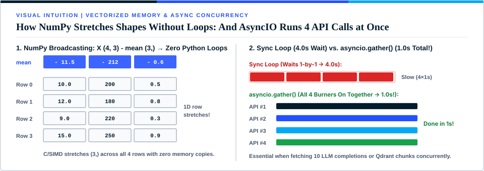

```mermaid
flowchart LR
    DB[("Relational DB / Logs")] -->|"SQL (Joins, CTEs, Windows)"| RAW["Extracted Dataset"]
    RAW -->|"Pandas / Polars Cleaning"| CLEAN["Validated DataFrame"]
    CLEAN -->|"NumPy Vectorization"| TENSOR["Feature Matrices (X, y)"]
    TENSOR -->|"Pydantic + Async Python"| PROD["ML Training & AI APIs"]

    classDef store fill:#E0F2FE,stroke:#0284C7,stroke-width:2px,color:#0369A1;
    classDef proc fill:#EDE9FE,stroke:#7C3AED,stroke-width:1.5px,color:#4C1D95;
    classDef out fill:#DCFCE7,stroke:#16A34A,stroke-width:2px,color:#15803D;

    class DB store;
    class RAW,CLEAN,TENSOR proc;
    class PROD out;
```

# Module 01: Python, SQL & Modern Data Engineering Stack

> **Difficulty:** Foundational | **Estimated Study Time:** 6-8 Hours | **Prerequisites:** Basic programming familiarity | **Lab:** [Run Interactive Notebook](../../notebooks/01_numpy_pandas_sql_lab.ipynb) | **[Open in Colab](https://colab.research.google.com/github/FirdowsRahaman/agentic-ai-and-ml-roadmap/blob/main/notebooks/01_numpy_pandas_sql_lab.ipynb)**
> **Focus:** Vectorized arrays, SQL window functions, analytical joins, and async Python

[Roadmap Index](../../README.md) | [Next: Module 02: Math & Statistics →](./02_math_and_statistics.md)

---

## Mental Model: Where Every AI Journey Starts

Every machine learning model and autonomous AI agent, no matter how smart, begins life as raw, messy data sitting inside a database or log file. Before we touch neural networks or LLMs, we start at the true beginning of the river: pulling clean rows out of databases with `SQL`, fixing missing values in `Pandas`, transforming columns at C++ speed with `NumPy`, and wrapping everything in type-safe, non-blocking Python.



---

## Tier 1: Core Foundations

Let's follow a single dataset step-by-step from raw Python variables into clean, model-ready tables.

### 1. Python Core Mechanics

#### 1.1 Why Python Runs AI (The "Steering Wheel" Mental Model)
If Python is famously slower than C++ or Rust, why does nearly all of AI run on Python? Think of Python as the **steering wheel of a race car**: you write short, readable Python commands at the top, while the heavy math engine underneath (`NumPy`, `PyTorch`, `Polars`) executes at full speed in compiled C++, CUDA, or Rust. Your job is to write clean orchestration in Python, and **never** write raw Python `for` loops over millions of numbers when a vectorized library function can do it in one step.

#### 1.2 Core Data Structures, Mutability & Lookup Complexity
Once you sit in Python's driver's seat, your first everyday decision is choosing the right container to hold data in memory, because picking a `list` instead of a `set` or `dict` can silently slow a 1-million-word vocabulary check from milliseconds to minutes:

| Structure | Syntax | Mutable? | Lookup Time | Primary AI/ML Use Case |
|---|---|---|---|---|
| **List** | `[1, 2, 3]` | Yes | `O(N)` | Dynamic batches, ordered token sequences |
| **Tuple** | `(224, 224, 3)` | No | `O(N)` | Fixed tensor shapes, immutable dictionary keys |
| **Set** | `{"cat", "dog"}` | Yes | `O(1)` avg | Deduplicating vocabulary tokens, fast membership checks |
| **Dict** | `{"id": 42}` | Yes | `O(1)` avg | Token-to-ID vocabularies, JSON payloads, feature maps |

```python
tensor_shape = (32, 3, 224, 224)  # Immutable shape tuple
vocab = {"<PAD>": 0, "<UNK>": 1, "ai": 2}  # O(1) token lookup
```

#### 1.3 Value Equality (`==`) vs. Object Identity (`is`) & List Mutation
As you manipulate those lists and dictionaries, two tiny Python behaviors trip up newcomers constantly: checking whether two variables hold *equal values* vs. *the exact same object in memory*, and adding items to a list without accidentally nesting a list inside a list:
- `==` compares **value equality**; `is` checks **object identity** (same memory address: always write `is None`, never `== None`).
- `append(x)` drops `x` in as a **single item**; `extend(iterable)` unpacks and adds **each element individually**.

```python
a = [1, 2, 3]
b = [1, 2, 3]
print(a == b)  # True  (equal values)
print(a is b)  # False (distinct objects in memory)

items = [1, 2]
items.append([3, 4])   # [1, 2, [3, 4]]
items2 = [1, 2]
items2.extend([3, 4])  # [1, 2, 3, 4]
```

#### 1.4 Lazy Batch Streaming with Python Generators (`yield`)
Lists and dicts work great when your dataset fits comfortably in memory, but what happens when your training log is **50 GB** on a **16 GB** laptop? A normal function is like downloading an entire 50 GB movie before watching frame 1 (crashing your RAM); a **generator (`yield`)** works like Netflix streaming, handing you one small batch at a time, pausing where it left off, and waiting until you ask for the next chunk:

```python
from typing import Iterator

def stream_batches(file_path: str, batch_size: int = 64) -> Iterator[list[str]]:
    """Streams an arbitrarily large text file in fixed-size chunks with O(batch_size) RAM."""
    batch: list[str] = []
    with open(file_path, "r", encoding="utf-8") as f:
        for line in f:
            batch.append(line.strip())
            if len(batch) == batch_size:
                yield batch
                batch = []
        if batch:
            yield batch
```
> **Engineering Insight:** PyTorch `IterableDataset` and Hugging Face streaming datasets (`streaming=True`) rely on generators under the hood so you can train on terabytes of text without running out of memory.

### 2. Vectorized Computing with `NumPy`

Streaming batches solves our memory limit, but standard Python lists still can't crunch math fast enough on each batch. To multiply millions of numbers in milliseconds, we pass those batches into **`NumPy`**.

> **What is `NumPy`?** Short for *Numerical Python*, `NumPy` is the foundational math library underneath almost every AI tool. Standard Python only knows single numbers and slow lists; `NumPy` gives Python fast **grids of numbers (`ndarray`)** so you can add or multiply a million numbers in one line of code: no `for` loops needed.

#### 2.1 Why `NumPy` Is 30×-100× Faster & How Broadcasting Works
Why is a `NumPy` array so much faster than a Python `list`? A Python `list` scatters numbers in separate boxes across RAM and checks every item's type one by one. A **NumPy array** packs same-type numbers side-by-side in one solid strip of C memory, letting your CPU multiply dozens of numbers in a single hardware instruction. Even better, **Broadcasting** lets you combine grids of different sizes: when you subtract a 3-number column average `(3,)` from a 4-row table `(4, 3)`, NumPy automatically "stretches" that 3-number row across all 4 rows without copying memory!

<details>
<summary><b>Deep Dive: Contiguous C Memory & CPU SIMD Vectorization</b></summary>

NumPy stores homogeneous C primitives (`float32`, `int64`) in contiguous memory buffers, eliminating per-element Python object pointer dereferencing and unlocking CPU **SIMD (Single Instruction, Multiple Data)** vector registers. Broadcasting aligns shapes from right to left: two axes are compatible when they are equal or one of them is `1`.

</details>

```python
import numpy as np

# Feature matrix: 4 samples, 3 features -> shape (4, 3)
X = np.array([
    [10.0, 200.0, 0.5],
    [12.0, 180.0, 0.8],
    [9.0,  220.0, 0.3],
    [15.0, 250.0, 0.9],
])

# Column-wise Z-score standardization via broadcasting:
mean = X.mean(axis=0)          # shape (3,)
std = X.std(axis=0) + 1e-8     # shape (3,)
X_scaled = (X - mean) / std    # (4, 3) - (3,) -> broadcast across all 4 rows!
print(X_scaled.shape)          # (4, 3)
```

### 3. Spreadsheet Data Cleaning with `Pandas`

`NumPy` shines on clean grids of pure numbers, yet real-world business files arrive messy, mixing user IDs, text categories (`"free"`, `"pro"`), and missing blank cells (`NaN`). Before `NumPy` or a model can touch that data, we clean and shape it with **`Pandas`**.

> **What is `Pandas`?** Think of `Pandas` as **programmable Excel inside Python**. Its main table object is called a **`DataFrame`** (rows and named columns), used to load CSV/SQL tables, fix messy text, and **impute** (*fill in missing blank cells*) before feeding clean numbers into an ML model.

#### 3.1 Label vs. Position Lookup (`loc`/`iloc`) & Filling Missing Values Safely
To navigate and clean a `DataFrame` without subtle bugs, keep three core habits straight:
- **`df.loc[...]` (Lookup by Name):** Grabs rows/columns by their **label name** (like asking for `"spend"`). Slice ends are *included*.
- **`df.iloc[...]` (Lookup by Row Number):** Grabs rows/columns by **0, 1, 2 position** (like Excel row numbers). Slice ends are *excluded*.
- **Imputing (Filling Blank `NaN` Cells) Safely:** In Pandas 2.x/3.0, **Copy-on-Write** protects tables from accidental silent edits, so avoid old `df['col'].fillna(..., inplace=True)` code and always assign back cleanly (`df['col'] = df['col'].fillna(...)`).

```python
import pandas as pd
import numpy as np

df = pd.DataFrame({
    "user_id": ["u1", "u2", "u3", "u4"],
    "plan": ["free", "pro", "pro", "free"],
    "spend": [15.0, np.nan, 120.0, np.nan],
})

# Modern Copy-on-Write safe group imputation:
df["spend_is_missing"] = df["spend"].isna().astype(int)
df["spend"] = df["spend"].fillna(
    df.groupby("plan")["spend"].transform("median")
)
print(df)
```

### 4. `SQL` Foundations with Real Queries

Where did that `Pandas` table come from in the first place? In a real company, data almost never sits in a neat CSV on your desktop: it lives across millions of rows inside cloud databases. Before Python even starts, we use **`SQL`** to join and filter the exact training table we need.

> **What is `SQL`?** *Structured Query Language* is how you pull data out of company databases (`PostgreSQL`, `Snowflake`, `BigQuery`). You write `SQL` to filter and join millions of rows *inside the database* first so Python only receives the clean summary table.

#### 4.1 Combining Tables (`INNER` vs. `LEFT JOIN`) & Filtering Groups (`WHERE` vs. `HAVING`)
The #1 SQL bug in machine learning happens right when joining two tables:
- **Real-World Analogy (`INNER` vs. `LEFT JOIN`):** Suppose Table A lists **all 1,000 registered app users** and Table B lists **orders placed this month**.
  - **`INNER JOIN`** keeps *only* users who bought something, silently deleting all inactive users (ruining a churn model!).
  - **`LEFT JOIN`** keeps **all 1,000 users** from Table A and puts `NULL` (blank) next to anyone with zero orders.
- **`WHERE` vs. `HAVING`:** `WHERE` filters individual rows *before* grouping; `HAVING` filters summary totals *after* `GROUP BY`.

```sql
-- Build a user-level churn feature table without dropping zero-purchase users
SELECT
    u.user_id,
    u.signup_country,
    COUNT(o.order_id) AS total_orders,
    COALESCE(SUM(o.amount_usd), 0.0) AS lifetime_spend
FROM users AS u
LEFT JOIN orders AS o
    ON u.user_id = o.user_id
    AND o.order_date >= CURRENT_DATE - INTERVAL '90 days'
WHERE u.is_bot = FALSE
GROUP BY u.user_id, u.signup_country
HAVING COUNT(o.order_id) >= 0;
```

---

## Tier 2: Production Architecture & Scale (Modern AI Engineering)

With Python, `NumPy`, `Pandas`, and basic `SQL`, you can build any laptop prototype. **Tier 2** upgrades those foundations for real production systems, where you need time-aware SQL features (`Window Functions`), strict input validation (`Pydantic`), and parallel API calls (`async/await`) that don't freeze your server.

### 5. Analytical `SQL`: `CTEs` (`WITH`) & Window Functions

#### 5.1 Computing Trends Without Losing Rows (`LAG`, `AVG() OVER` & `ROW_NUMBER`)
In Section 4, `GROUP BY` collapsed all of a user's orders into one lifetime total. What if a fraud model needs to compare *each individual transaction* against that user's *previous* swipe? That requires **Window Functions**:
- **`CTE` (`WITH temp_table AS (...)`):** Breaks a scary 40-line SQL query into clean, named step-by-step paragraphs you can read top-to-bottom.
- **Window Function (`OVER (...)`):** Lets each row "peek" at neighboring rows (like looking at the *previous* purchase via `LAG` or the *last 3 purchases* via `AVG() OVER`) **without squashing the rows together**!

```sql
WITH ranked_tx AS (
    SELECT
        user_id,
        tx_id,
        tx_timestamp,
        amount_usd,
        -- Previous transaction amount for this user (detect sudden spikes)
        LAG(amount_usd, 1, 0.0) OVER (
            PARTITION BY user_id ORDER BY tx_timestamp
        ) AS prev_tx_amount,
        -- Rolling 3-transaction average per user
        AVG(amount_usd) OVER (
            PARTITION BY user_id
            ORDER BY tx_timestamp
            ROWS BETWEEN 2 PRECEDING AND CURRENT ROW
        ) AS rolling_3tx_avg,
        -- Deduplicate retries: keep latest record per transaction ID
        ROW_NUMBER() OVER (
            PARTITION BY tx_id ORDER BY updated_at DESC
        ) AS rn
    FROM transactions
)
SELECT user_id, tx_id, amount_usd, prev_tx_amount, rolling_3tx_avg
FROM ranked_tx
WHERE rn = 1;
```

### 6. Modern Python Engineering Tools: `uv`, `Pydantic`, `async/await` & `pytest`

Once your data pipeline is clean, shipping it as a reliable AI service relies on four everyday Python engineering tools working together:

#### 6.1 What Each Tool Does in Plain English
1. **`uv` (Project Dependency Manager):** Like an ultra-fast `pip` + isolated sandbox (`venv`) in one tool: ensures project A's library versions never break project B (`uv sync`).
2. **`Pydantic` (Automatic Data Bouncer):** Checks incoming JSON/API inputs at the door: if someone sends `"age": -5` or `"twenty"`, `Pydantic` blocks it immediately with a clear error before bad data crashes your model.
3. **`async` / `await` (Kitchen Multitasking for Network Calls):** Waiting for an LLM API is like waiting for water to boil. Synchronous code stares at Pot #1 for 1 second, then Pot #2 for 1 second (`10 pots = 10s`). **`asyncio.gather()`** turns on all 10 burners at once so all 10 finish in **`~1s` total**!
4. **`pytest` (Automated Code Checker):** Runs small `assert` checks automatically on every code save so bugs get caught in 1 second.

<p align="center">
  
</p>

```python
import asyncio
from pydantic import BaseModel, Field, ValidationError

class PredictionRequest(BaseModel):
    user_id: str = Field(min_length=1)
    age: int = Field(ge=18, le=120)
    monthly_spend: float = Field(ge=0.0)

async def fetch_embedding(chunk_id: int) -> list[float]:
    await asyncio.sleep(0.05)  # Simulates non-blocking network API call
    return [0.1 * chunk_id, 0.2 * chunk_id]

async def embed_all_chunks(chunk_ids: list[int]) -> list[list[float]]:
    # Runs all requests concurrently on a single event loop
    return await asyncio.gather(*(fetch_embedding(cid) for cid in chunk_ids))

# Validate input schema + run async batch
req = PredictionRequest(user_id="u_42", age=26, monthly_spend=99.5)
vectors = asyncio.run(embed_all_chunks([1, 2, 3, 4]))
assert len(vectors) == 4
```

> **When Pandas hits RAM limits:** Mention **Polars** or **DuckDB** in interviews: both execute multi-threaded Rust/C++ query plans with lazy evaluation (`pl.scan_parquet(...)`) on 50 GB+ datasets without Out-Of-Memory crashes.

---

## Mini Hands-On Lab (15-Minute Exercise)

Implement a vectorized feature builder that cleans raw transaction logs, computes user-level Z-scores without loops, and passes all assertions:

```python
import numpy as np
import pandas as pd

def build_user_features(raw: pd.DataFrame) -> pd.DataFrame:
    df = raw.copy().drop_duplicates(subset=["tx_id"])
    df["amount"] = pd.to_numeric(df["amount"], errors="coerce")
    df = df.dropna(subset=["user_id", "amount"])

    agg = (
        df.groupby("user_id", as_index=False)
        .agg(tx_count=("tx_id", "count"), total_spend=("amount", "sum"))
    )
    vals = agg["total_spend"].to_numpy(dtype=float)
    std = vals.std()
    agg["spend_zscore"] = (vals - vals.mean()) / (std if std > 0 else 1.0)
    return agg.sort_values("user_id").reset_index(drop=True)

sample = pd.DataFrame({
    "tx_id": ["t1", "t1", "t2", "t3", "t4"],
    "user_id": ["u1", "u1", "u1", "u2", "u2"],
    "amount": ["100.0", "100.0", "50.0", "300.0", "invalid"],
})
out = build_user_features(sample)
assert list(out["tx_count"]) == [2, 1]
assert np.isclose(out["spend_zscore"].mean(), 0.0)
print("Lab 01 Passed!", out.to_dict(orient="records"))
```

---

## Key Engineering Takeaways
- Use **generators (`yield`)** for lazy batch streaming and **NumPy broadcasting** instead of Python `for` loops.
- Avoid chained `inplace=True` in Pandas; use `groupby().transform()` and explicit column assignment for Copy-on-Write compatibility.
- Master **SQL `LEFT JOIN`**, **`HAVING` vs. `WHERE`**, and **Window Functions (`ROW_NUMBER`, `LAG`, `OVER`)**: they are tested in almost every screening.
- Use **`Pydantic`** for schema safety and **`asyncio.gather`** to parallelize I/O-bound LLM and vector search calls.

> **Next in the Journey:** Now that you can pull, clean, and batch raw data into `NumPy` grids, how does an AI model actually measure similarity between those rows, handle extreme outliers, and prove statistically that a new model beats an old one? Let's flow straight into **[Module 02: Mathematics & Statistics](./02_math_and_statistics.md)**.

---

[← Back to Roadmap](../../README.md) | [Next: Module 02: Math & Statistics →](./02_math_and_statistics.md)
