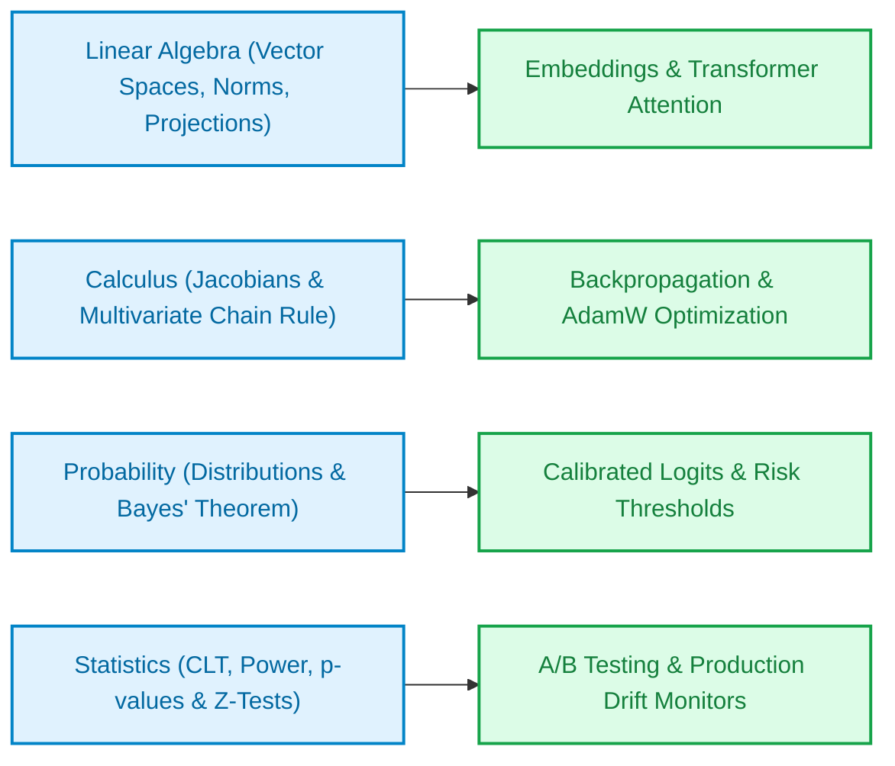

# Module 02: Mathematics & Statistics for AI/ML Engineers

[← Previous: Module 01: Python, SQL & Data Stack](./01_python_sql_and_data_stack.md) | [Phase 1 Index](./README.md) | [Next: Module 03: Classical ML & RecSys →](../02-core-ml-and-dl/03_classical_ml_and_recsys.md)

---

## 1. Overview

In [Module 01](./01_python_sql_and_data_stack.md), you turned raw database logs and files into clean `NumPy` feature matrices. This module bridges pure numbers and machine intelligence: turning matrices into semantic geometry, gradients into self-improving neural weights, and probability into calibrated real-world decisions. Every mathematical formula here maps directly to an active software engineering primitive in modern machine learning.



---

## 2. Audience

- **Software Engineers** seeking a rigorous, code-backed understanding of the linear algebra and calculus driving modern neural networks.
- **Data Scientists & ML Practitioners** looking to connect theoretical statistics to production A/B testing, sample size planning, and power calculations.
- **AI Engineers** who need to debug vanishing gradients, vector dimension mismatches, and false-positive traps in highly imbalanced production data.

---

## 3. Learning Objectives

By the end of this module, you will be able to:
- **Operate on vector spaces and norms**: Compute $L_1$, $L_2$, and $L_\infty$ norms and construct orthogonal projections onto subspaces.
- **Trace matrix linear transformations**: Understand geometric transformations (rotations, scalings, reflections) and track multi-dimensional tensor contractions.
- **Differentiate multivariate functions**: Apply the multivariate chain rule across computational graphs to compute Jacobians and analytical gradients.
- **Implement gradient descent optimizers**: Code Vanilla GD, Momentum, RMSprop, and AdamW from scratch in pure NumPy.
- **Characterize probability distributions**: Select and parameterize Gaussian, Bernoulli, Categorical, Poisson, Beta, and Dirichlet distributions for ML tasks.
- **Formulate Bayesian posteriors**: Calculate posterior probability under extreme class imbalance ($< 0.1\%$ base rates) to avoid false-alarm cascades.
- **Apply confidence intervals and statistical power**: Calculate Wald and bootstrap percentile intervals, Cohen's $d$ effect sizes, and minimum sample sizes for A/B testing.
- **Conduct rigorous hypothesis testing**: Verify assumptions (normality, independence, homoscedasticity) and execute two-proportion Z-tests with defensive error handling.

---

## 4. Prerequisites

- **Mandatory:** Completion of [Module 01: Python, SQL & Data Stack](./01_python_sql_and_data_stack.md).
- **Recommended:** Introductory high school single-variable derivatives ($\frac{d}{dx} x^2 = 2x$) and basic matrix arithmetic.

---

## 5. Learning Levels

1. **Foundations (Level 1):** Vector norms, dot products, matrix multiplication geometry, basic probability axioms.
2. **Applied (Level 2):** Analytical MSE/Log-Loss gradient derivation, finite-difference verification, AdamW optimizer loop, central limit theorem.
3. **Production (Level 3):** Statistical power planning for online experiments, defensive A/B testing under severe imbalance, bootstrap confidence intervals.

---

## 6. Core Concepts

### 6.1 Vector Spaces, Norms & Projections
A vector $\mathbf{v} \in \mathbb{R}^D$ represents both a point in $D$-dimensional space and a direction from the origin.

#### Vector Norms ($L_p$)
The general $L_p$ norm is defined as:
$$\|\mathbf{v}\|_p = \left( \sum_{i=1}^D |v_i|^p \right)^{1/p}$$
- **$L_1$ Norm (Manhattan):** $\|\mathbf{v}\|_1 = \sum |v_i|$. Used in Lasso regularization to induce sparse weights (driving irrelevant features strictly to zero).
- **$L_2$ Norm (Euclidean):** $\|\mathbf{v}\|_2 = \sqrt{\sum v_i^2}$. Used in Ridge regularization, weight decay, and Euclidean distance.
- **$L_\infty$ Norm (Max):** $\|\mathbf{v}\|_\infty = \max_i |v_i|$. Used in adversarial machine learning ($\epsilon$-bounded perturbations in FGSM attacks).

#### Orthogonal Projections
The projection of vector $\mathbf{y}$ onto the line spanned by vector $\mathbf{u}$ is:
$$\text{proj}_{\mathbf{u}}(\mathbf{y}) = \frac{\mathbf{y} \cdot \mathbf{u}}{\|\mathbf{u}\|_2^2} \mathbf{u}$$
This is the foundational geometric mechanism behind Ordinary Least Squares (OLS) regression: projecting the target vector $\mathbf{y}$ onto the column space of feature matrix $X$.

### 6.2 Matrix Multiplication as a Linear Transformation
Multiplying a matrix $A \in \mathbb{R}^{M \times D}$ by vector $\mathbf{x} \in \mathbb{R}^D$ maps $\mathbf{x}$ to a new coordinate system:
$$T(\mathbf{x}) = A\mathbf{x}$$
Every dense layer in a neural network ($y = Wx + b$) performs an affine transformation: rotating, scaling, and translating the feature space so that non-linear activation functions can separate decision boundaries.

```python
import numpy as np

# 2D Rotation matrix by angle theta (e.g. 45 degrees)
theta = np.radians(45)
R = np.array([
    [np.cos(theta), -np.sin(theta)],
    [np.sin(theta),  np.cos(theta)]
])

# Vector along x-axis
v = np.array([1.0, 0.0])
v_rotated = R @ v
assert np.isclose(np.linalg.norm(v_rotated), 1.0)  # Preserves length
```

### 6.3 Multivariate Chain Rule & Jacobians
For a scalar loss function $L = f(\mathbf{u})$ where $\mathbf{u} = g(\mathbf{w})$, the gradient with respect to weight vector $\mathbf{w}$ is governed by the total derivative:
$$\frac{\partial L}{\partial w_j} = \sum_{i=1}^K \frac{\partial L}{\partial u_i} \frac{\partial u_i}{\partial w_j} \implies \nabla_{\mathbf{w}} L = J_{\mathbf{u}}(\mathbf{w})^T \nabla_{\mathbf{u}} L$$
where $J_{\mathbf{u}}(\mathbf{w}) \in \mathbb{R}^{K \times D}$ is the **Jacobian matrix** containing all first-order partial derivatives $\frac{\partial u_i}{\partial w_j}$.

---

## 7. Technical Deep Dive

### 7.1 Analytical Gradient Derivation for Mean Squared Error (MSE)
Consider linear regression with target $y \in \mathbb{R}^N$, features $X \in \mathbb{R}^{N \times D}$, and weights $\mathbf{w} \in \mathbb{R}^D$:
$$\mathcal{L}(\mathbf{w}) = \frac{1}{2N} \|X\mathbf{w} - \mathbf{y}\|_2^2 = \frac{1}{2N} (X\mathbf{w} - \mathbf{y})^T (X\mathbf{w} - \mathbf{y})$$
Expanding the quadratic form:
$$\mathcal{L}(\mathbf{w}) = \frac{1}{2N} \left( \mathbf{w}^T X^T X \mathbf{w} - 2 \mathbf{y}^T X \mathbf{w} + \mathbf{y}^T \mathbf{y} \right)$$
Taking the vector derivative with respect to $\mathbf{w}$:
$$\nabla_{\mathbf{w}} \mathcal{L}(\mathbf{w}) = \frac{1}{N} X^T (X\mathbf{w} - \mathbf{y}) = \frac{1}{N} X^T \mathbf{e}$$
where $\mathbf{e} = X\mathbf{w} - \mathbf{y}$ is the residual error vector.

```python
def mse_loss_and_grad(w: np.ndarray, X: np.ndarray, y: np.ndarray) -> tuple[float, np.ndarray]:
    N = X.shape[0]
    preds = X @ w
    residuals = preds - y
    loss = (1.0 / (2.0 * N)) * np.sum(residuals ** 2)
    grad = (1.0 / N) * (X.T @ residuals)
    return loss, grad

# Numerical Finite Difference Verification (Crucial for verifying backward passes)
def numerical_gradient_check(w: np.ndarray, X: np.ndarray, y: np.ndarray, eps: float = 1e-5) -> float:
    _, analytical_grad = mse_loss_and_grad(w, X, y)
    num_grad = np.zeros_like(w)
    for i in range(len(w)):
        w_plus = w.copy()
        w_plus[i] += eps
        loss_plus, _ = mse_loss_and_grad(w_plus, X, y)
        w_minus = w.copy()
        w_minus[i] -= eps
        loss_minus, _ = mse_loss_and_grad(w_minus, X, y)
        num_grad[i] = (loss_plus - loss_minus) / (2.0 * eps)
    # Return relative error
    rel_error = np.linalg.norm(analytical_grad - num_grad) / (np.linalg.norm(analytical_grad) + np.linalg.norm(num_grad))
    return rel_error

rng = np.random.default_rng(42)
X_test = rng.standard_normal((100, 5))
y_test = rng.standard_normal(100)
w_init = rng.standard_normal(5)
error = numerical_gradient_check(w_init, X_test, y_test)
assert error < 1e-7, f"Gradient check failed! Relative error: {error}"
```

### 7.2 Gradient Descent Optimizers from Scratch
In production deep learning, vanilla SGD struggles with ill-conditioned loss surfaces (valleys with high curvature). Modern optimizers maintain running momentum and second-moment scaling:

```python
class AdamWOptimizer:
    """AdamW optimizer with decoupled weight decay (Loshchilov & Hutter)."""
    def __init__(self, params: np.ndarray, lr: float = 1e-3, beta1: float = 0.9, beta2: float = 0.999, eps: float = 1e-8, weight_decay: float = 0.01):
        self.params = params
        self.lr = lr
        self.beta1 = beta1
        self.beta2 = beta2
        self.eps = eps
        self.weight_decay = weight_decay
        self.m = np.zeros_like(params)  # 1st moment vector (momentum)
        self.v = np.zeros_like(params)  # 2nd moment vector (uncentered variance)
        self.t = 0                      # Timestep

    def step(self, grad: np.ndarray) -> np.ndarray:
        self.t += 1
        # Decoupled weight decay
        self.params -= self.lr * self.weight_decay * self.params
        
        # Update biased 1st and 2nd moment estimates
        self.m = self.beta1 * self.m + (1.0 - self.beta1) * grad
        self.v = self.beta2 * self.v + (1.0 - self.beta2) * (grad ** 2)
        
        # Bias correction
        m_hat = self.m / (1.0 - self.beta1 ** self.t)
        v_hat = self.v / (1.0 - self.beta2 ** self.t)
        
        # Update parameters
        self.params -= self.lr * m_hat / (np.sqrt(v_hat) + self.eps)
        return self.params
```

### 7.3 Probability Distributions in Machine Learning
| Distribution | Domain | Key Parameters | Primary ML Application |
|---|---|---|---|
| **Gaussian (Normal)** | $x \in \mathbb{R}$ | Mean $\mu$, Variance $\sigma^2$ | Residual noise modeling, VAE latent priors, Weight initialization |
| **Bernoulli** | $k \in \{0, 1\}$ | Probability $p$ | Binary classification outputs, Dropout masks |
| **Categorical / Multinomial** | $k \in \{1, \dots, K\}$ | Event probs $\mathbf{p} \in \Delta^K$ | Multi-class classification logits (Softmax), Token sampling |
| **Poisson** | $k \in \{0, 1, 2, \dots\}$ | Rate $\lambda > 0$ | Count data modeling (API request rate, user clicks per hour) |
| **Beta** | $\theta \in [0, 1]$ | Shape $\alpha > 0, \beta > 0$ | Conjugate prior for Bernoulli (Thompson Sampling in multi-armed bandits) |
| **Dirichlet** | $\mathbf{p} \in \Delta^K$ | Concentration $\boldsymbol{\alpha}$ | Latent Dirichlet Allocation (topic modeling), Prior over categorical dists |

### 7.4 Bayes' Theorem & The Base Rate Fallacy
In rare event detection (e.g., fraud or security breaches occurring in 0.1% of transactions), an algorithm with 99% accuracy can still yield a terrible false alarm rate:
$$P(\text{Fraud} \mid \text{Alarm}) = \frac{P(\text{Alarm} \mid \text{Fraud}) P(\text{Fraud})}{P(\text{Alarm})}$$
$$P(\text{Alarm}) = P(\text{Alarm} \mid \text{Fraud})P(\text{Fraud}) + P(\text{Alarm} \mid \text{Legit})P(\text{Legit})$$
For $P(\text{Fraud}) = 0.001$, sensitivity $99\%$, false positive rate $1\%$:
$$P(\text{Fraud} \mid \text{Alarm}) = \frac{0.99 \times 0.001}{0.99 \times 0.001 + 0.01 \times 0.999} = \frac{0.00099}{0.00099 + 0.00999} \approx 9.01\%$$
**Engineering Takeaway:** Even with a 99% accurate model, over 90% of raised alarms are false positives due to the severe base rate.

---

## 8. Hands-on Implementation

Implement a defensive, production-grade two-proportion Z-test for A/B testing with power calculations and sample validation:

```python
import math
from typing import TypedDict

class ABTestResult(TypedDict):
    z_score: float
    p_value: float
    is_significant: bool
    control_rate: float
    treatment_rate: float
    absolute_lift: float
    relative_lift_pct: float

def ab_conversion_ztest(
    conversions_c: int,
    visitors_c: int,
    conversions_t: int,
    visitors_t: int,
    alpha: float = 0.05,
) -> ABTestResult:
    """Performs a two-proportion Z-test comparing control vs treatment conversion rates.

    Defensive validations ensure non-zero sample sizes and positive counts.
    """
    if visitors_c <= 0 or visitors_t <= 0:
        raise ValueError("Visitor counts must be strictly positive.")
    if conversions_c < 0 or conversions_t < 0:
        raise ValueError("Conversion counts cannot be negative.")
    if conversions_c > visitors_c or conversions_t > visitors_t:
        raise ValueError("Conversions cannot exceed total visitors.")

    p_c = conversions_c / visitors_c
    p_t = conversions_t / visitors_t

    # Pooled probability
    p_pool = (conversions_c + conversions_t) / (visitors_c + visitors_t)

    # Edge cases: zero or complete conversion
    if p_pool == 0.0 or p_pool == 1.0:
        return {
            "z_score": 0.0,
            "p_value": 1.0,
            "is_significant": False,
            "control_rate": p_c,
            "treatment_rate": p_t,
            "absolute_lift": p_t - p_c,
            "relative_lift_pct": 0.0,
        }

    # Standard error under null hypothesis
    se_pool = math.sqrt(p_pool * (1.0 - p_pool) * (1.0 / visitors_c + 1.0 / visitors_t))
    z_score = (p_t - p_c) / se_pool

    # Two-tailed p-value via complementary error function
    p_value = 2.0 * (1.0 - 0.5 * (1.0 + math.erf(abs(z_score) / math.sqrt(2.0))))

    return {
        "z_score": round(z_score, 4),
        "p_value": round(p_value, 6),
        "is_significant": p_value < alpha,
        "control_rate": round(p_c, 4),
        "treatment_rate": round(p_t, 4),
        "absolute_lift": round(p_t - p_c, 4),
        "relative_lift_pct": round(((p_t - p_c) / p_c) * 100.0, 2) if p_c > 0 else 0.0,
    }

# Example: 10,000 visitors per variant
result = ab_conversion_ztest(conversions_c=320, visitors_c=10000, conversions_t=395, visitors_t=10000)
assert result["is_significant"] is True
assert result["p_value"] < 0.01
print("A/B Test Verification:", result)
```

---

## 9. Practical Exercises

### Exercise 1: Gram-Schmidt Orthogonalization
Given an arbitrary set of $K$ linearly independent column vectors $A = [\mathbf{a}_1, \dots, \mathbf{a}_K]$:
1. Implement the Gram-Schmidt process in pure NumPy to construct an orthonormal basis $Q = [\mathbf{q}_1, \dots, \mathbf{q}_K]$ such that $Q^T Q = I_K$.
2. Verify that $\|Q\mathbf{x}\|_2 = \|\mathbf{x}\|_2$ (orthonormal transformations preserve Euclidean lengths).

### Exercise 2: Bootstrap Percentile Confidence Intervals
1. Given 1,000 latency measurements with heavy tail skew (p99 > 3000ms), implement a bootstrap resampling function with $B=5,000$ iterations.
2. Calculate the non-parametric 95% confidence interval for the 95th percentile (p95) and contrast it with an assumption-violating Gaussian Wald interval.

---

## 10. Mini Project

### Production Online Experimentation & Statistical Power Calculator
Build a standalone statistical CLI and analysis engine:
- **Sample Size Planner:** Given baseline rate $p$, minimum detectable effect (MDE $\delta$), significance $\alpha=0.05$, and power $1-\beta=0.80$, compute the minimum required sample size per variant:
  $$N \approx \frac{2 (Z_{\alpha/2} + Z_\beta)^2 p (1-p)}{\delta^2}$$
- **Hypothesis Engine:** Ingest simulated daily conversion logs, evaluate cumulative two-tailed Z-scores, and flag whether early stopping risks peeking p-value inflation.
- **Reporting:** Export a markdown summary with statistical power, confidence intervals, and decision recommendations.

---

## 11. Production Considerations

1. **The Peeking Problem in A/B Testing:** Continuously checking p-values every hour and stopping the experiment as soon as $p < 0.05$ inflates the true false-positive rate from 5% to over 30%. Always fix sample sizes upfront or utilize sequential testing frameworks (e.g., mSPRT).
2. **Numerical Stability with Softmax & Log-Sum-Exp:** Computing $\frac{e^{z_i}}{\sum e^{z_j}}$ directly overflows floating-point numbers when $z_i > 709$. Always subtract $\max(\mathbf{z})$:
   $$\text{Softmax}(\mathbf{z})_i = \frac{e^{z_i - \max(\mathbf{z})}}{\sum_j e^{z_j - \max(\mathbf{z})}}$$
3. **Condition Number of Feature Covariance Matrices:** If feature columns are highly collinear, the matrix $X^T X$ has a huge condition number ($\kappa > 10^5$), causing matrix inversion (`np.linalg.inv`) to produce numerically garbage weights. Always apply Ridge regularization ($X^T X + \lambda I$).

---

## 12. Common Mistakes & Gotchas

1. **Confusing Dot Product with Cosine Similarity:** The dot product $\mathbf{a} \cdot \mathbf{b} = \|\mathbf{a}\| \|\mathbf{b}\| \cos\theta$ scales with vector magnitude. If longer documents have larger embedding norms, dot product search erroneously favors long texts over short, relevant matches.
2. **Reporting Arithmetic Means for Skewed Latencies:** When 99 requests take 20ms and 1 request takes 5,000ms, the mean is 69.8ms. Reporting 70ms hides that 1 out of 100 enterprise users is experiencing an unacceptable 5-second timeout. Always report P50, P95, and P99.
3. **Violating Independence Assumptions in Hypothesis Tests:** Running an A/B test where the same user appears in both control and treatment (or triggers multiple dependent sessions) violates the independent and identically distributed (i.i.d.) assumption, invalidating the Z-test.

---

## 13. Interview Questions & System Design

### Q1: Why does L1 regularization produce sparse weights while L2 regularization only shrinks them?
In geometric terms, the L1 constraint boundary is a diamond ($\sum |w_i| \le C$) with sharp corners on the coordinate axes. The elliptical contours of the MSE loss surface intersect the diamond at its corners where parameters are strictly zero. The L2 boundary is a smooth sphere ($\sum w_i^2 \le C$), meaning loss contours touch the boundary where parameters are small, but non-zero.

### Q2: What is the Law of Total Variance and why is it important in feature analysis?
The Law of Total Variance states:
$$\text{Var}(Y) = \mathbb{E}[\text{Var}(Y \mid X)] + \text{Var}(\mathbb{E}[Y \mid X])$$
It partitions the total variance of target $Y$ into the average unexplained variance remaining within feature slices plus the variance explained by the model's conditional expectations.

### Q3: Explain the difference between Type I and Type II errors in an ML monitoring context.
A **Type I error ($\alpha$)** is a false positive: raising a data drift or model regression alert when no actual drift occurred. A **Type II error ($\beta$)** is a false negative: failing to alert engineers when the production model is degrading in the wild. High statistical power ($1-\beta$) minimizes Type II errors.

---

## 14. Recommended Resources

- **Textbook:** [Mathematics for Machine Learning](https://mml-book.github.io/) by Deisenroth, Faisal, and Ong (Freely available online).
- **Textbook:** *Linear Algebra and Learning from Data* by Gilbert Strang (MIT).
- **Course:** [3Blue1Brown - Essence of Linear Algebra](https://www.youtube.com/playlist?list=PLZHQObOWTQDPD3MizzM2xVFitgF8hE_ab) (Visual geometric intuition).
- **Paper:** [Decoupled Weight Decay Regularization (AdamW)](https://arxiv.org/abs/1711.05101) by Loshchilov & Hutter.

---

## 15. Completion Checklist

- [ ] Calculate $L_1$, $L_2$, and $L_\infty$ norms for an arbitrary embedding vector.
- [ ] Derive the analytical gradient of MSE with respect to weight vector $\mathbf{w}$.
- [ ] Validate an analytical gradient using numerical finite difference checks ($< 10^{-6}$ error).
- [ ] Implement the AdamW optimizer loop with decoupled weight decay.
- [ ] Calculate the Bayesian posterior under extreme class imbalance ($P < 0.001$).
- [ ] Compute p50, p95, and p99 percentiles for skewed API latency logs.
- [ ] Conduct a two-proportion Z-test with defensive input validation.
- [ ] Pass all assertions in the Math & Statistics validation lab.

---

## 16. Further Exploration

- **Singular Value Decomposition (SVD):** Decompose $X = U \Sigma V^T$ to perform low-rank dimensionality reduction and matrix compression.
- **Fisher Information & Natural Gradient:** Study information geometry where optimization steps are taken along Riemannian manifolds rather than Euclidean space.
- **Multi-Armed Bandits & Thompson Sampling:** Implement Bayesian online decision-making to dynamically shift traffic toward winning A/B variants without waiting for static experiment windows.

---

[← Previous: Module 01: Python, SQL & Data Stack](./01_python_sql_and_data_stack.md) | [Phase 1 Index](./README.md) | [Next: Module 03: Classical ML & RecSys →](../02-core-ml-and-dl/03_classical_ml_and_recsys.md)
