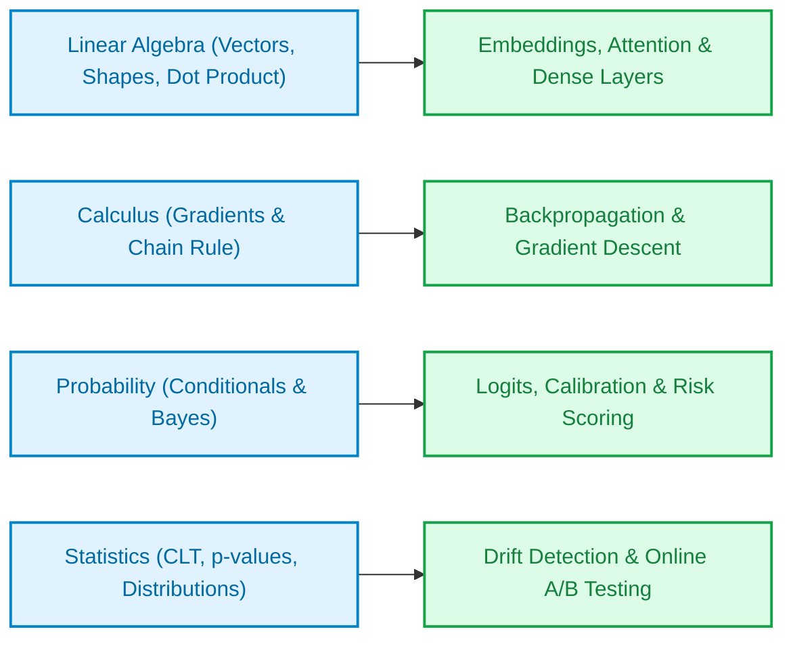
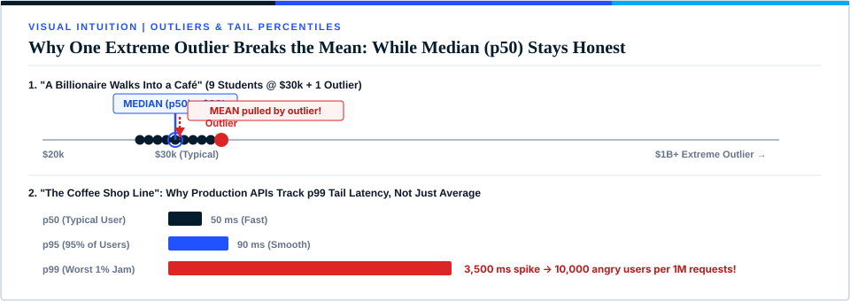

# Module 02: Mathematics & Statistics for AI/ML Engineers

> **Estimated Study Time:** 5-7 Hours | **Prerequisites:** [Module 01](./01_python_sql_and_data_stack.md) | **Focus:** Geometric & probabilistic intuition over rote memorization

[← Previous: Module 01: Python, SQL & Data Stack](./01_python_sql_and_data_stack.md) | [Home](../../README.md) | [Next: Module 03: Classical ML & RecSys →](../02-core-ml-and-dl/03_classical_ml_and_recsys.md)

---

## Mental Model: How Math Powers Modern AI

In [Module 01](./01_python_sql_and_data_stack.md), you turned messy SQL logs and CSVs into clean `NumPy` grids of numbers. Now, how does a machine turn those number grids into **meaning, predictions, and confident business decisions**? You never need to solve page-long integrals by hand, instead, every math concept here maps directly to one real engineering job:



---

## Tier 1: Core Foundations

### 1. Linear Algebra Intuition

#### 1.1 What Is a Tensor? (Numbers, Lists, Tables & Cubes)
- **In Plain English:** Don't let the word **"Tensor"** intimidate you: it is just the umbrella name for containers of numbers with different dimensions (`0D` single number, `1D` row, `2D` Excel-style table, `3D+` stack of tables):

| Object | Rank | Typical Shape | Everyday Picture & AI Example |
|---|---|---|---|
| **Scalar** | 0D | `()` | A single number on a thermometer (`loss = 0.24`) |
| **Vector** | 1D | `(D,)` | One row of stats for 1 house (`[sqft, rooms, age]`) or 1 word's embedding (`(768,)`) |
| **Matrix** | 2D | `(N, D)` | An Excel spreadsheet: `N` rows (houses) × `D` columns (features) |
| **3D Tensor** | 3D | `(B, T, D)` | A stack of `B` sentences, each `T` words long, each word having `D` numbers |
| **4D Tensor** | 4D | `(B, C, H, W)` | A batch of `B` color photos (`3` RGB channels × `Height` × `Width`) |

> **Matrix Multiplication Shape Rule:** Inner dimensions **must match**, and outer dimensions form the output:
> $$(N \times D) \cdot (D \times H) \longrightarrow (N \times H)$$
> In batched Transformers: `(B, T, D) @ (B, D, T) -> (B, T, T)` (the `T x T` self-attention score matrix!).

#### 1.2 Dot Product vs. Cosine Similarity
Once data lives inside 1D vectors (like two user profiles or two text embeddings), how do we measure whether two rows mean the same thing?
- **In Plain English:** Imagine two arrows pointing in space. **Dot Product** measures both *whether they point the same way* AND *how long they are*. **Cosine Similarity** ignores arrow length completely and only checks *whether they point in the same direction* (`1.0` = identical topic, `0.0` = unrelated, `-1.0` = opposite).
- **Rule of Thumb:** Use **Cosine Similarity** when comparing short vs. long text embeddings so a 10-page document doesn't overpower a 1-sentence query just by having larger numbers.

<details>
<summary><b>Deep Dive: Exact Vector Equations</b></summary>

- **Dot Product:** $\mathbf{a} \cdot \mathbf{b} = \sum_i a_i b_i = \|\mathbf{a}\|\|\mathbf{b}\|\cos\theta$ (used inside neural linear layers `X @ W + b` and raw attention scores `Q @ K.T`).
- **Cosine Similarity:** $\cos(\theta) = \frac{\mathbf{a} \cdot \mathbf{b}}{\|\mathbf{a}\|_2 \|\mathbf{b}\|_2} \in [-1, 1]$. Note: if vectors are already L2-normalized ($\|\mathbf{a}\|_2 = \|\mathbf{b}\|_2 = 1$), Dot Product and Cosine Similarity are identical!

</details>

```python
import numpy as np

def cosine_similarity(a: np.ndarray, b: np.ndarray) -> float:
    denom = np.linalg.norm(a) * np.linalg.norm(b)
    return float(np.dot(a, b) / max(denom, 1e-12))

short_doc = np.array([0.8, 0.4])
long_duplicate_doc = short_doc * 10.0  # 10x longer document with same topic proportions

print(f"Dot Product:       {np.dot(short_doc, long_duplicate_doc):.2f}")       # 8.00 (inflated by length)
print(f"Cosine Similarity: {cosine_similarity(short_doc, long_duplicate_doc):.3f}")  # 1.000 (identical meaning!)
```

### 2. Averages, Outliers & Real-World Speed Metrics

Comparing two rows with Cosine Similarity is step one; next, we need to summarize **entire columns** of thousands of rows, without letting a single extreme number trick us.

#### 2.1 Mean vs. Median vs. Percentiles (`p50`, `p95`, `p99`)
- **New Terms in Plain English:**
  - **Outlier:** One extreme, unusual value far away from everyone else.
  - **Impute:** Filling in missing blank cells in a dataset.
  - **SLA (Service Level Agreement):** Your app's promised speed limit (e.g., *"99% of users get a reply in under 300ms"*).
- **Story 1: Mean vs. Median ("A Billionaire Walks Into a Café"):**
  Imagine 9 students in a café each earning `\$30,000/year`. Both the **Mean** (average) and **Median** (the middle person when lined up from lowest to highest) are `\$30,000`. Now a billionaire (`\$1B/year`) walks in:
  - The **Mean** jumps to **`~\$100 Million`**, making it look like everyone in the café owns a private jet!
  - The **Median (`p50`)** stays **`\$30,000`**.
  - *Rule of Thumb:* Always use **Median** (never Mean) when filling missing cells (**imputing**) for skewed money/count columns like salary, rent, or order spend.
- **Story 2: Percentiles (`p50`, `p95`, `p99`: "The Coffee Shop Line"):**
  Suppose 100 people order coffee: 95 get their cup in **1 min**, 4 wait **2 mins**, and 1 person's espresso machine jams so they wait **45 mins**.
  - **`p50` (50th percentile / Median):** `1 min`: what a typical user experiences.
  - **`p95` (95th percentile):** `2 mins`: 95 out of 100 users waited `2 mins` or less.
  - **`p99` (99th percentile, "Tail Latency"):** `45 mins`, the worst 1% experience. If your AI app has 1,000,000 daily requests, a slow `p99` means **10,000 frustrated users every single day**, even while your "average" speed looks great!

<p align="center">
  
</p>

```python
import numpy as np

latencies_ms = np.array([40, 45, 48, 50, 52, 55, 58, 60, 62, 3500])  # 1 tail spike
print(f"Mean latency:   {np.mean(latencies_ms):.1f} ms")              # 397.0 ms (misleading)
print(f"Median (p50):   {np.median(latencies_ms):.1f} ms")            # 53.5 ms
print(f"p99 latency:    {np.percentile(latencies_ms, 99):.1f} ms")    # 3190.6 ms (catches tail risk)
```

#### 2.2 Spread (`Variance` & `Std Dev`) & The Bell Curve (`Normal / Gaussian Distribution`)
Knowing the center of a column (`Mean` or `Median`) still hides half the picture: we also need to know how tightly or wildly the numbers spread around that center:
- **In Plain English:** Two classes can both have an average exam score of `75`. If Class A scored `[74, 75, 76]` and Class B scored `[30, 75, 100]`, how do we measure that Class B is wildly spread out?
  - **Variance ($\sigma^2$):** Average of squared distances from the mean (squaring stops `-10` and `+10` from canceling out, but turns `"cm"` into awkward `"square cm"`).
  - **Standard Deviation ($\sigma = \sqrt{\sigma^2}$):** Takes the square root so the spread is back in **normal everyday units** (`cm`, `dollars`, `ms`).
  - **Normal ("Gaussian") Bell Curve:** Symmetric curve where most values cluster near the middle: **68%** fall within `±1` std dev, **95%** within `±2`, and **99.7%** within `±3`.

```python
import numpy as np

rng = np.random.default_rng(seed=42)
# Note: NumPy uses loc (mean) and scale (std dev)
heights_cm = rng.normal(loc=170.0, scale=10.0, size=10_000)

within_2_std = np.mean(np.abs(heights_cm - 170.0) <= 20.0)
print(f"Mean: {heights_cm.mean():.1f} cm | Std: {heights_cm.std():.1f} cm")
print(f"Fraction within 2 std devs: {within_2_std:.3f}")  # ~0.954 (95%)
```

#### 2.3 Linear Correlation vs. Confounders & Non-Linear Dependence
Once you understand one column's center and spread, the natural next question is: *do two columns move together?* Pearson correlation ($r \in [-1, 1]$) measures **straight-line** co-movement, which creates two classic traps:
1. **Confounders (Correlation ≠ Causation):** Ice cream sales and drowning incidents correlate positively ($r > 0.8$) because **summer heat** drives both: banning ice cream will not reduce drownings.
2. **Non-linear blindness:** If $y = x^2$ on $x \in [-3, 3]$, $y$ is 100% determined by $x$, yet Pearson correlation is **$0.0$**! Use Spearman rank correlation or mutual information for curved relationships.

---

## Tier 2: Production Architecture & Scale (Probability & Hypothesis Testing)

Summarizing past data in Tier 1 is descriptive; **Tier 2** shifts to **making decisions under uncertainty**, judging whether a model's rare fraud alarm is trustworthy (`Bayes' Theorem`) and proving whether a new model truly beat the old one in live traffic (`A/B Testing`).

### 3. Conditional Probability, Base Rates & Bayes' Theorem

#### 3.1 Bayes' Theorem & The Rare-Event False-Positive Trap
- **In Plain English:** Bayes' Theorem updates your belief after seeing new evidence, balancing **how accurate a detector is** against **how rare the event was to begin with**. If an event is ultra-rare (`1 in 1,000`), even a "99% accurate" alarm will mostly ring on false positives!

<details>
<summary><b>Deep Dive: Formal Bayes' Equation</b></summary>

$$P(A \mid B) = \frac{P(B \mid A) \cdot P(A)}{P(B)}$$

- $P(A)$: **Prior** (how common $A$ is before testing).
- $P(B \mid A)$: **Likelihood / Sensitivity** (probability the alarm triggers when $A$ is truly present).
- $P(A \mid B)$: **Posterior** (true probability of $A$ given the alarm went off).

</details>

**Concrete Example:** A disease affects **0.1%** of people ($P(D) = 0.001$). A test catches **99%** of sick people and falsely flags only **1%** of healthy people. If a random person tests positive, what is the chance they actually have the disease?

```python
p_disease = 0.001
p_pos_given_disease = 0.99
p_pos_given_healthy = 0.01

p_pos_total = (p_pos_given_disease * p_disease) + (p_pos_given_healthy * (1 - p_disease))
posterior = (p_pos_given_disease * p_disease) / p_pos_total
print(f"Actual probability of having the disease: {posterior:.1%}")  # Only 9.0%!
```
> **Why it matters in ML:** Even a "99% accurate" fraud or content-moderation classifier will generate **91% false alarms** when deployed on a `0.1%` base-rate stream unless you tune precision thresholds!

### 4. Central Limit Theorem (CLT), p-values & Confidence Intervals

Bayes' Theorem helps us evaluate a single model's predictions: now how do we prove that **Model B** actually outperforms **Model A** when we test both on real users?

#### 4.1 Why `A/B` Tests Work (`Central Limit Theorem`, `p-values` & Business Impact)
- **In Plain English:** User spending is super lopsided (most users spend `\$0`, a few spend `\$500`), not a neat bell curve at all! Yet if you take the *average* spend of 10,000 random users repeatedly, the **Central Limit Theorem (`CLT`)** proves those *averages* magically form a clean **Normal Bell Curve**, letting us calculate error bars (**Confidence Intervals**) and **`p-values`** when testing Model B against Model A!
- **What a `p-value` Really Means:** *"If Model B is actually NO better than Model A, how likely is it that pure luck produced a gap this big?"* When `p < 0.05` (less than a 1-in-20 fluke), we call the win **statistically significant**.
- **Statistical vs. Practical Significance:** With 50 million users, a tiny `+0.01%` click boost can score `p = 0.0001` (not a fluke!), yet earn `\$500` while costing `\$20,000` in extra GPUs: always check **real dollar ROI**, not just `p < 0.05`!

---

## Mini Hands-On Lab (15-Minute Exercise)

Write a two-proportion Z-test function to decide whether a Challenger ML model beat the Champion model's conversion rate at $\alpha = 0.05$:

```python
import math

def ab_conversion_ztest(
    conv_a: int, total_a: int, conv_b: int, total_b: int
) -> dict[str, float | bool]:
    p_a = conv_a / total_a
    p_b = conv_b / total_b
    p_pool = (conv_a + conv_b) / (total_a + total_b)
    se = math.sqrt(p_pool * (1 - p_pool) * (1 / total_a + 1 / total_b))
    z_stat = (p_b - p_a) / se
    # Two-tailed p-value via complementary error function
    p_val = math.erfc(abs(z_stat) / math.sqrt(2))
    return {
        "lift_pct": round(((p_b - p_a) / p_a) * 100, 2),
        "z_stat": round(z_stat, 3),
        "p_value": round(p_val, 5),
        "significant_at_95": p_val < 0.05,
    }

res = ab_conversion_ztest(conv_a=500, total_a=10_000, conv_b=585, total_b=10_000)
assert res["significant_at_95"] is True
print("Lab 02 Passed!", res)
```

---

## Key Engineering Takeaways
- Track **tensor shapes** explicitly: `(N, D) @ (D, H) -> (N, H)`.
- Use **Cosine Similarity** when document length shouldn't bias semantic similarity, and report **`p50`/`p95`/`p99` percentiles** alongside means.
- Apply **Bayes' Theorem** whenever base rates are rare (`< 1%` fraud/disease): high accuracy does not imply high precision.
- Distinguish **statistical significance ($p < 0.05$)** from **practical business effect size** in A/B experiments.

> **Next in the Journey:** With clean data pipelines (`Module 01`) and geometric/statistical intuition (`Module 02`) in place, we are ready to train our first real predictive models! Let's step into **[Module 03: Classical Machine Learning, Ensembles & Recommendation Systems](../02-core-ml-and-dl/03_classical_ml_and_recsys.md)**.

---

[← Previous: Module 01: Python, SQL & Data Stack](./01_python_sql_and_data_stack.md) | [Home](../../README.md) | [Next: Module 03: Classical ML & RecSys →](../02-core-ml-and-dl/03_classical_ml_and_recsys.md)
