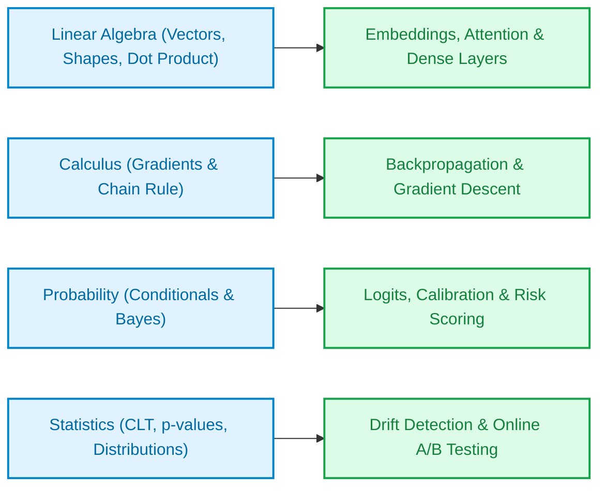

# Module 02: Mathematics & Statistics for AI/ML Engineers

[← Previous: Module 01: Python, SQL & Data Stack](./01_python_sql_and_data_stack.md) | [Phase 1 Index](./README.md) | [Next: Phase 2 / Module 03 →](../02-core-ml-and-dl/03_classical_ml_and_recsys.md)

---

## 1. Overview

In [Module 01](./01_python_sql_and_data_stack.md), you turned messy database logs and CSVs into clean `NumPy` grids of numbers. Now, how does a machine turn those numbers into **semantic meaning, predictions, and calibrated business decisions**? Machine learning engineers rarely solve multi-page symbolic calculus by hand; instead, every mathematical concept maps directly to a concrete engineering primitive:



---

## 2. Learning Objectives

By the end of this module, you will be able to:
- **Track tensor shapes rigorously** across linear layers and multi-head attention matrix multiplications (`(B, T, D) @ (B, D, T) -> (B, T, T)`).
- **Evaluate vector similarity** using Dot Product vs. L2-normalized Cosine Similarity, identifying when document length biases semantic retrieval.
- **Compute latency and error distributions** using median (p50), p95, and p99 percentiles to detect tail degradation hidden by arithmetic means.
- **Formulate Bayesian posteriors** for extreme class imbalance ($< 0.1\%$ base rates) to avoid false-positive alarm traps in fraud detection and content moderation.
- **Design and interpret online A/B hypothesis tests** using the Central Limit Theorem (CLT), two-proportion Z-tests, and two-tailed p-values.

---

## 3. Prerequisites

- **Python & NumPy Basics:** Array creation, indexing, and element-wise operations from [Module 01](./01_python_sql_and_data_stack.md).
- **Basic Algebra:** Exponentials, logarithms ($\ln x$), and geometric vectors.

---

## 4. Core Concepts

### 4.1 What Is a Tensor? (Rank & Dimensions)
A tensor is simply a generalized container for numbers with a designated rank (number of dimensions):

| Object | Rank | Typical Shape | Engineering Example |
|---|---|---|---|
| **Scalar** | 0D | `()` | Loss metric or learning rate (`loss = 0.24`) |
| **Vector** | 1D | `(D,)` | Single sample feature row or word embedding (`(768,)`) |
| **Matrix** | 2D | `(N, D)` | Feature matrix: $N$ samples $\times$ $D$ input features |
| **3D Tensor** | 3D | `(B, T, D)` | Batched sequences: $B$ batches $\times$ $T$ tokens $\times$ $D$ embedding dimensions |
| **4D Tensor** | 4D | `(B, C, H, W)` | Batched images: $B$ images $\times$ $C$ color channels $\times$ Height $\times$ Width |

> **Matrix Multiplication Shape Rule:** Inner dimensions **must match**, and outer dimensions form the result:
> $$(N \times D) \cdot (D \times H) \longrightarrow (N \times H)$$

### 4.2 Dot Product vs. Cosine Similarity
- **Dot Product:** $\mathbf{a} \cdot \mathbf{b} = \sum_i a_i b_i = \|\mathbf{a}\|_2 \|\mathbf{b}\|_2 \cos\theta$. Measures both alignment and magnitude. Used in neural dense layers (`X @ W + b`) and unnormalized attention scores (`Q @ K.T`).
- **Cosine Similarity:** $\cos\theta = \frac{\mathbf{a} \cdot \mathbf{b}}{\|\mathbf{a}\|_2 \|\mathbf{b}\|_2} \in [-1, 1]$. Ignores vector magnitude and checks purely directional alignment. Ideal for document and query embeddings of varying text lengths.

```python
import numpy as np

def cosine_similarity(a: np.ndarray, b: np.ndarray) -> float:
    denom = np.linalg.norm(a) * np.linalg.norm(b)
    return float(np.dot(a, b) / max(denom, 1e-12))

short_doc = np.array([0.8, 0.4])
long_duplicate_doc = short_doc * 10.0  # 10x longer document with same topic distribution

print(f"Dot Product:       {np.dot(short_doc, long_duplicate_doc):.2f}")       # 8.00 (inflated by magnitude)
print(f"Cosine Similarity: {cosine_similarity(short_doc, long_duplicate_doc):.3f}")  # 1.000 (identical meaning!)
```

---

## 5. Technical Deep Dive

### 5.1 Tail Latency & Outlier Robustness: Mean, Median & P99
In production systems, distributions are rarely symmetrical bell curves. Latency and spend follow heavy-tailed log-normal or Pareto distributions. Relying solely on the arithmetic mean conceals severe outages:

<p align="center">
  
</p>

```python
import numpy as np

# 1000 requests: 980 typical requests (~5ms) + 20 frozen database timeouts (5000ms)
np.random.seed(42)
typical = np.random.normal(loc=5.0, scale=1.0, size=980)
timeouts = np.full(shape=20, fill_value=5000.0)
latencies = np.concatenate([typical, timeouts])

# Evaluate quantiles with empirical percentile indexing
mean_lat = float(np.mean(latencies))
p50 = float(np.percentile(latencies, 50))
p95 = float(np.percentile(latencies, 95))
p99 = float(np.percentile(latencies, 99))

print(f"Mean Latency:    {mean_lat:.1f} ms")   # ~104.9 ms (severely distorted by tail!)
print(f"Median (p50):    {p50:.1f} ms")        # ~5.0 ms (typical user experience)
print(f"P95 Latency:     {p95:.1f} ms")        # ~6.6 ms
print(f"P99 Latency:     {p99:.1f} ms")        # 5000.0 ms (severe SLA breach detected!)
assert p99 == 5000.0, "Top 1% must capture the 20-sample tail timeout block"
```

### 5.2 Bayes' Theorem & The Base-Rate Fallacy in Rare Events
When classifying rare events (fraud, rare defects, toxicity), a classifier with $99\%$ accuracy can still yield an overwhelming majority of false alarms due to the **base-rate fallacy**:

$$P(A \mid B) = \frac{P(B \mid A) \cdot P(A)}{P(B)}$$

Where:
- $P(A)$ is the **Prior** (base rate of the rare event).
- $P(B \mid A)$ is the **Likelihood / Sensitivity** (true positive rate).
- $P(B)$ is the **Total Evidence** probability of the alarm firing:
  $$P(B) = P(B \mid A)P(A) + P(B \mid \neg A)P(\neg A)$$

```python
# 0.1% of transactions are fraudulent
p_fraud = 0.001
p_alarm_given_fraud = 0.99       # 99% Sensitivity
p_alarm_given_legit = 0.01       # 1% False Positive Rate

p_alarm_total = (p_alarm_given_fraud * p_fraud) + (p_alarm_given_legit * (1 - p_fraud))
posterior = (p_alarm_given_fraud * p_fraud) / p_alarm_total
print(f"True Probability of Fraud given an Alarm: {posterior:.1%}")  # Only 9.0%!
```
> **ML Engineering Takeaway:** In extreme imbalance ($0.1\%$), $91\%$ of all triggered alarms are false positives unless decision thresholds are calibrated against business cost matrices.

### 5.3 Matrix Calculus, Gradients & Backpropagation Intuition
Neural networks optimize loss functions via gradient descent. For a parameter vector $\mathbf{w} \in \mathbb{R}^d$, the gradient $\nabla_{\mathbf{w}} \mathcal{L}$ points in the direction of steepest rate of increase:

$$\nabla_{\mathbf{w}} \mathcal{L}(\mathbf{w}) = \left[ \frac{\partial \mathcal{L}}{\partial w_1}, \frac{\partial \mathcal{L}}{\partial w_2}, \dots, \frac{\partial \mathcal{L}}{\partial w_d} \right]^T$$

#### Analytical Derivation: Mean Squared Error (MSE) Gradient
Given design matrix $\mathbf{X} \in \mathbb{R}^{N \times d}$, targets $\mathbf{y} \in \mathbb{R}^N$, and residual vector $\mathbf{e} = (\mathbf{X}\mathbf{w} - \mathbf{y})$:

$$\mathcal{L}(\mathbf{w}) = \frac{1}{N} \|\mathbf{X}\mathbf{w} - \mathbf{y}\|_2^2 = \frac{1}{N} \mathbf{e}^T \mathbf{e}$$

Applying the multivariate chain rule:
$$\frac{\partial \mathcal{L}}{\partial \mathbf{e}} = \frac{2}{N} \mathbf{e}, \quad \frac{\partial \mathbf{e}}{\partial \mathbf{w}} = \mathbf{X} \implies \nabla_{\mathbf{w}} \mathcal{L}(\mathbf{w}) = \frac{2}{N} \mathbf{X}^T (\mathbf{X}\mathbf{w} - \mathbf{y})$$

```python
# Numerical Finite-Difference vs. Analytical Vectorized Gradient
def mse_loss(X: np.ndarray, y: np.ndarray, w: np.ndarray) -> float:
    return float(np.mean((X @ w - y) ** 2))

def analytical_gradient(X: np.ndarray, y: np.ndarray, w: np.ndarray) -> np.ndarray:
    N = X.shape[0]
    return (2.0 / N) * (X.T @ (X @ w - y))

# Verify against numerical gradient check: (f(w + eps) - f(w - eps)) / (2 * eps)
X_test = np.array([[1.0, 2.0], [3.0, 4.0], [5.0, 6.0]])
y_test = np.array([5.0, 11.0, 17.0])
w_init = np.array([0.5, 1.5])
eps = 1e-6

grad_analytic = analytical_gradient(X_test, y_test, w_init)
grad_numeric = np.zeros_like(w_init)
for i in range(len(w_init)):
    w_pos, w_neg = w_init.copy(), w_init.copy()
    w_pos[i] += eps
    w_neg[i] -= eps
    grad_numeric[i] = (mse_loss(X_test, y_test, w_pos) - mse_loss(X_test, y_test, w_neg)) / (2 * eps)

assert np.allclose(grad_analytic, grad_numeric, atol=1e-5), "Analytical gradient must match finite difference"
```

### 5.4 Central Limit Theorem (CLT) & Hypothesis Testing
Even when the underlying data is heavily skewed, the sample mean $\bar{X}$ of $N$ independent, identically distributed observations converges to a normal distribution:
$$\bar{X} \sim \mathcal{N}\left(\mu, \frac{\sigma^2}{N}\right)$$

This allows us to construct confidence intervals and compute two-tailed $p$-values to verify whether a challenger ML model significantly outperforms a baseline champion in production A/B tests.

---

## 6. Hands-on Implementation

Write a production-grade two-proportion Z-test with defensive input validation, boundary checking, and effect-size power evaluation:

```python
import math

def ab_conversion_ztest(
    conv_a: int, total_a: int, conv_b: int, total_b: int, alpha: float = 0.05
) -> dict[str, float | bool]:
    """Evaluates whether challenger conversion rate lift is statistically significant

    using a two-proportion pooled Z-test with defensive input validation.
    """
    # 1. Defensive Input Validation
    if total_a <= 0 or total_b <= 0:
        raise ValueError("Total sample sizes must be strictly positive integers.")
    if not (0 <= conv_a <= total_a) or not (0 <= conv_b <= total_b):
        raise ValueError("Conversions must be within [0, total_samples].")

    p_a = conv_a / total_a
    p_b = conv_b / total_b
    p_pool = (conv_a + conv_b) / (total_a + total_b)

    # 2. Edge Case: Zero conversions or 100% conversions across all groups
    if p_pool == 0.0 or p_pool == 1.0:
        return {
            "lift_pct": 0.0,
            "z_stat": 0.0,
            "p_value": 1.0,
            "significant_at_alpha": False,
        }

    # 3. Standard Error & Z-Score Computation
    se = math.sqrt(p_pool * (1.0 - p_pool) * (1.0 / total_a + 1.0 / total_b))
    z_stat = (p_b - p_a) / se

    # 4. Two-tailed p-value via Complementary Error Function
    p_val = math.erfc(abs(z_stat) / math.sqrt(2.0))
    lift_pct = ((p_b - p_a) / p_a) * 100.0 if p_a > 0 else float("inf")

    return {
        "lift_pct": round(lift_pct, 2),
        "z_stat": round(z_stat, 3),
        "p_value": round(p_val, 5),
        "significant_at_alpha": p_val < alpha,
    }

# Validation: Standard 85-conversion uplift test
res = ab_conversion_ztest(conv_a=500, total_a=10_000, conv_b=585, total_b=10_000)
assert res["significant_at_alpha"] is True
assert res["lift_pct"] == 17.0
assert res["p_value"] < 0.05
print("Lab 02 Validated Successfully!", res)
```

---

## 7. Practical Exercises

### Exercise 1: Pairwise Cosine Matrix via Matrix Multiplication
Given two normalized embedding matrices $A \in \mathbb{R}^{M \times D}$ and $B \in \mathbb{R}^{N \times D}$:
1. Prove mathematically that the matrix product $S = A B^T \in \mathbb{R}^{M \times N}$ represents all pairwise cosine similarities.
2. Implement this in NumPy and verify that row-wise diagonal values equal $1.0$ when $A = B$.

### Exercise 2: Sample Size Calculation for A/B Experiments
Using the CLT standard error formula:
1. Write a function `required_sample_size(base_rate, minimum_detectable_effect, alpha=0.05, beta=0.20)` that computes the minimum number of users per variant needed to detect a $5\%$ conversion lift with $80\%$ statistical power.

---

## 8. Mini Project

### Production Vector Distance Engine & Drift Detector
Construct an offline similarity scoring module:
- **Input:** 5,000 synthetic 128-dimensional query vectors and 20,000 document vectors.
- **Tasks:**
  1. L2-normalize all vectors in-place using NumPy broadcasting.
  2. Implement top-k nearest neighbor retrieval via matrix multiplication $Q D^T$ and `np.argpartition`.
  3. Simulate temporal concept drift by perturbing document distributions and measure the Kolmogorov-Smirnov statistic ($KS$-test) between baseline and drifted embedding norms.

---

## 9. Advanced Topics

- **Singular Value Decomposition (SVD):** Factoring any matrix $X = U \Sigma V^T$ to perform low-rank approximations, dimensionality reduction, and latent semantic analysis.
- **Eigenvalues & Covariance Matrices:** How Principal Component Analysis (PCA) identifies axes of maximal variance by diagonalizing the feature covariance matrix.
- **Kullback-Leibler (KL) Divergence:** Measuring information loss when approximating true data distribution $P$ with model distribution $Q$:
  $$D_{\text{KL}}(P \parallel Q) = \sum_x P(x) \ln\left(\frac{P(x)}{Q(x)}\right)$$

---

## 10. Common Mistakes & Gotchas

1. **Confusing Statistical Significance with Business Impact:** With $N = 10,000,000$, a conversion increase of $+0.001\%$ can yield $p = 0.0001$, but generate $\$100$ in revenue while costing $\$10,000$ in additional inference infrastructure. Always compute effect size and ROI.
2. **Ignoring L2 Normalization in Vector Search:** Running dot product search on raw, unnormalized embeddings results in longer documents always dominating the top ranks regardless of semantic relevance.
3. **Optimizing Accuracy on Imbalanced Data:** A model predicting "Legitimate" on a $0.1\%$ fraud dataset achieves $99.9\%$ accuracy while detecting zero fraud. Use PR-AUC and cost-weighted loss instead.

---

## 11. Interview Questions & System Design

### Q1: Why do we divide query-key dot products by $\sqrt{d_k}$ in Transformer attention?
As embedding dimension $d_k$ grows large, the variance of the dot product $\sum_{i=1}^{d_k} q_i k_i$ scales proportionally to $d_k$ (assuming zero mean and unit variance inputs). Large magnitude logits push the softmax function into regions with near-zero gradients (vanishing gradients). Scaling by $\frac{1}{\sqrt{d_k}}$ preserves unit variance and maintains stable gradient flow during backpropagation.

### Q2: What is the difference between ROC-AUC and PR-AUC in highly imbalanced domains?
ROC-AUC plots True Positive Rate vs. False Positive Rate ($FPR = \frac{FP}{FP + TN}$). When negative samples dominate ($TN \gg FP$), huge increases in false positives produce negligible changes in $FPR$, presenting an artificially optimistic evaluation. Precision-Recall AUC (PR-AUC) evaluates $\frac{TP}{TP + FP}$ against $\frac{TP}{TP + FN}$, ignoring $TN$ and accurately exposing false alarm surges.

---

## 12. Recommended Resources

- **Free Textbook:** [Mathematics for Machine Learning](https://mml-book.github.io/) by Deisenroth, Faisal, and Ong.
- **Visual Series:** [3Blue1Brown: Essence of Linear Algebra](https://www.3blue1brown.com/topics/linear-algebra).
- **Statistical Reference:** [StatQuest: Hypothesis Testing and p-values](https://statquest.org/).

---

## 13. Completion Checklist

- [ ] Verify tensor shapes across matrix multiplications using the inner/outer dimension rule.
- [ ] Differentiate when to apply Dot Product vs. L2-normalized Cosine Similarity in retrieval systems.
- [ ] Calculate p50, p95, and p99 percentiles from a raw latency log in NumPy.
- [ ] Apply Bayes' Theorem to derive true positive probabilities under extreme class imbalance.
- [ ] Implement a two-proportion Z-test and evaluate $p$-values against significance thresholds ($\alpha = 0.05$).
- [ ] Complete practical exercises on pairwise matrix similarity and minimum sample size calculation.

---

[← Previous: Module 01: Python, SQL & Data Stack](./01_python_sql_and_data_stack.md) | [Home](../../README.md) | [Next: Module 03: Classical ML & RecSys →](../02-machine-learning/03_classical_ml_and_recsys.md)
