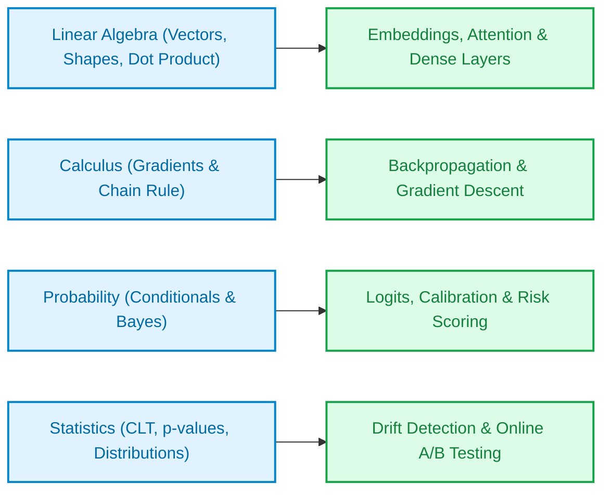

# Module 02: Mathematics & Statistics for AI/ML Engineers

> **Estimated Study Time:** 5–7 Hours | **Prerequisites:** [Module 01](./01_python_sql_and_data_stack.md) | **Focus:** Geometric & probabilistic intuition over rote memorization

[← Previous: Module 01 — Python, SQL & Data Stack](./01_python_sql_and_data_stack.md) | [Home](../../README.md) | [Next: Module 03 — Classical ML & RecSys →](../02-core-ml-and-dl/03_classical_ml_and_recsys.md)

---

## Mental Model: How Math Powers Modern AI

You do not need to solve page-long integrals by hand, but you **must** connect every mathematical pillar to where it shows up in code and production debugging:



---

## Tier 1: Fresher Core (Must-Know Foundations)

### 1. Linear Algebra Intuition

#### Q1: Scalar vs. Vector vs. Matrix vs. Tensor — How do shapes map to real ML data?
**Answer:**

| Object | Rank | Typical Shape | Real-World ML Meaning |
|---|---|---|---|
| **Scalar** | 0D | `()` | A single loss value (`loss = 0.24`) or learning rate |
| **Vector** | 1D | `(D,)` | One text embedding (`(768,)`) or one sample's features |
| **Matrix** | 2D | `(N, D)` | Tabular dataset: `N` samples × `D` features |
| **3D Tensor** | 3D | `(B, T, D)` | LLM batch: `Batch` × `Sequence Tokens` × `Hidden Dim` |
| **4D Tensor** | 4D | `(B, C, H, W)` | PyTorch vision batch: `Batch` × `Channels` × `Height` × `Width` |

> **Matrix Multiplication Shape Rule:** Inner dimensions **must match**, and outer dimensions form the output:
> $$(N \times D) \cdot (D \times H) \longrightarrow (N \times H)$$
> In batched Transformers: `(B, T, D) @ (B, D, T) -> (B, T, T)` (the `T x T` self-attention score matrix!).

---

#### Q2: What is a Dot Product vs. Cosine Similarity, and when does magnitude matter?
**Answer:**
- **Dot Product:** $\mathbf{a} \cdot \mathbf{b} = \sum_i a_i b_i = \|\mathbf{a}\|\|\mathbf{b}\|\cos\theta$. Sensitive to both angle **and** vector length. Used inside linear layers (`X @ W + b`) and attention logits (`Q @ K.T`).
- **Cosine Similarity:** Normalizes both vectors to unit length so only **directional alignment** matters (range `[-1, 1]`):
  $$\cos(\theta) = \frac{\mathbf{a} \cdot \mathbf{b}}{\|\mathbf{a}\|_2 \|\mathbf{b}\|_2}$$

```python
import numpy as np

def cosine_similarity(a: np.ndarray, b: np.ndarray) -> float:
    denom = np.linalg.norm(a) * np.linalg.norm(b)
    return float(np.dot(a, b) / max(denom, 1e-12))

short_doc = np.array([0.8, 0.4])
long_duplicate_doc = short_doc * 10.0  # 10x longer document with same topic proportions

print(f"Dot Product:       {np.dot(short_doc, long_duplicate_doc):.2f}")       # 8.00 (inflated by length)
print(f"Cosine Similarity: {cosine_similarity(short_doc, long_duplicate_doc):.3f}")  # 1.000 (identical meaning!)
```

---

### 2. Descriptive Statistics & Distributions

#### Q3: Mean vs. Median vs. Percentiles (`p50`, `p95`, `p99`) — Which should you report?
**Answer:**
- **Mean:** Pulled heavily by extreme outliers. Suitable for symmetric, Gaussian-like errors.
- **Median (`p50`):** Robust midpoint; mandatory when imputing skewed features like income, house prices, or transaction amounts.
- **Tail Percentiles (`p95`, `p99`):** Standard in production ML SLAs! An average API latency of `80ms` can hide the fact that 1% of users wait `4,200ms` (`p99 = 4.2s`).

```python
import numpy as np

latencies_ms = np.array([40, 45, 48, 50, 52, 55, 58, 60, 62, 3500])  # 1 tail spike
print(f"Mean latency:   {np.mean(latencies_ms):.1f} ms")              # 397.0 ms (misleading)
print(f"Median (p50):   {np.median(latencies_ms):.1f} ms")            # 53.5 ms
print(f"p99 latency:    {np.percentile(latencies_ms, 99):.1f} ms")    # 3190.6 ms (catches tail risk)
```

---

#### Q4: Variance, Standard Deviation, and the Normal (Gaussian) Distribution
**Answer:**
- **Variance ($\sigma^2$):** Average squared deviation from the mean.
- **Standard Deviation ($\sigma$):** $\sqrt{\sigma^2}$ — expressed in the **same units** as the original feature.
- **Normal Distribution ($\mathcal{N}(\mu, \sigma^2)$):** Symmetric bell curve obeying the **68–95–99.7 empirical rule** within $1\sigma, 2\sigma, 3\sigma$ of the mean $\mu$.

```python
import numpy as np

rng = np.random.default_rng(seed=42)
# Note: NumPy uses loc (mean) and scale (std dev)
heights_cm = rng.normal(loc=170.0, scale=10.0, size=10_000)

within_2_std = np.mean(np.abs(heights_cm - 170.0) <= 20.0)
print(f"Mean: {heights_cm.mean():.1f} cm | Std: {heights_cm.std():.1f} cm")
print(f"Fraction within 2 std devs: {within_2_std:.3f}")  # ~0.954 (95%)
```

---

#### Q5: Correlation vs. Causation — What does Pearson's $r$ miss?
**Answer:**
Pearson correlation ($r \in [-1, 1]$) measures **linear** co-movement only:
1. **Confounders:** Ice cream sales and drowning incidents correlate positively ($r > 0.8$) because **summer heat** drives both — banning ice cream will not reduce drownings.
2. **Non-linear blindness:** If $y = x^2$ on $x \in [-3, 3]$, $y$ is 100% determined by $x$, yet Pearson correlation is **$0.0$**! Use Spearman rank correlation or mutual information for monotonic/non-linear relationships.

---

## Tier 2: MNC Production Depth (Probability & Hypothesis Testing)

### 3. Conditional Probability & Bayes' Theorem (Classic Screening Trap)

#### Q6: Explain Bayes' Theorem and solve the "99% Accurate Rare-Disease Test" paradox.
**Answer:**
$$P(A \mid B) = \frac{P(B \mid A) \cdot P(A)}{P(B)}$$

- $P(A)$: **Prior** probability (base rate before seeing evidence).
- $P(B \mid A)$: **Likelihood** (sensitivity / true positive rate).
- $P(A \mid B)$: **Posterior** probability (updated belief after evidence).

**Interview Trap:** A disease affects **0.1%** of the population ($P(D) = 0.001$). A test has **99% sensitivity** ($P(+\mid D)=0.99$) and **99% specificity** ($P(-\mid \neg D)=0.99$, so false-positive rate $P(+\mid \neg D)=0.01$). If a random person tests positive, what is $P(D \mid +)$?

```python
p_disease = 0.001
p_pos_given_disease = 0.99
p_pos_given_healthy = 0.01

p_pos_total = (p_pos_given_disease * p_disease) + (p_pos_given_healthy * (1 - p_disease))
posterior = (p_pos_given_disease * p_disease) / p_pos_total
print(f"Actual probability of having the disease: {posterior:.1%}")  # Only 9.0%!
```
> **Why it matters in ML:** Even a "99% accurate" fraud or content-moderation classifier will generate **91% false alarms** when deployed on a `0.1%` base-rate stream unless you tune precision thresholds!

---

### 4. Central Limit Theorem (CLT), p-values & Confidence Intervals

#### Q7: Why does the Central Limit Theorem (CLT) make online A/B testing possible?
**Answer:**
Real user metrics (like revenue per session or click counts) are heavily skewed, **not** normally distributed. The **Central Limit Theorem** guarantees that the **distribution of sample means** across $N$ independent users converges to a **Normal Distribution** $\mathcal{N}(\mu, \sigma^2 / N)$ as $N$ grows large — allowing us to compute Z-scores, **95% Confidence Intervals** ($\bar{x} \pm 1.96 \frac{s}{\sqrt{N}}$), and **$p$-values** in A/B experiments.

- **Correct definition of a $p$-value:** Assuming the Null Hypothesis $H_0$ is true (no real difference between Model A and Model B), the $p$-value is the probability of observing a difference at least as extreme as our experiment purely by random chance.
- **$p < 0.05$ does NOT guarantee business value:** With 50 million users, a `0.01%` lift can have $p = 0.0001$ (statistically significant) yet fail to justify GPU serving costs (**practical significance / effect size**).

---

## Mini Hands-On Lab (15-Minute Exercise)

Write a two-proportion Z-test function to decide whether a Challenger ML model beat the Champion model's conversion rate at $\alpha = 0.05$:

```python
import math

def ab_conversion_ztest(
    conv_a: int, total_a: int, conv_b: int, total_b: int
) -> dict[str, float | bool]:
    p_a = conv_a / total_a
    p_b = conv_b / total_b
    p_pool = (conv_a + conv_b) / (total_a + total_b)
    se = math.sqrt(p_pool * (1 - p_pool) * (1 / total_a + 1 / total_b))
    z_stat = (p_b - p_a) / se
    # Two-tailed p-value via complementary error function
    p_val = math.erfc(abs(z_stat) / math.sqrt(2))
    return {
        "lift_pct": round(((p_b - p_a) / p_a) * 100, 2),
        "z_stat": round(z_stat, 3),
        "p_value": round(p_val, 5),
        "significant_at_95": p_val < 0.05,
    }

res = ab_conversion_ztest(conv_a=500, total_a=10_000, conv_b=585, total_b=10_000)
assert res["significant_at_95"] is True
print("Lab 02 Passed!", res)
```

---

## Key Takeaways for Interviews
- Track **tensor shapes** explicitly: `(N, D) @ (D, H) -> (N, H)`.
- Use **Cosine Similarity** when document length shouldn't bias semantic similarity, and report **`p50`/`p95`/`p99` percentiles** alongside means.
- Apply **Bayes' Theorem** whenever base rates are rare (`< 1%` fraud/disease) — high accuracy does not imply high precision.
- Distinguish **statistical significance ($p < 0.05$)** from **practical business effect size** in A/B experiments.

---

[← Previous: Module 01 — Python, SQL & Data Stack](./01_python_sql_and_data_stack.md) | [Home](../../README.md) | [Next: Module 03 — Classical ML & RecSys →](../02-core-ml-and-dl/03_classical_ml_and_recsys.md)
