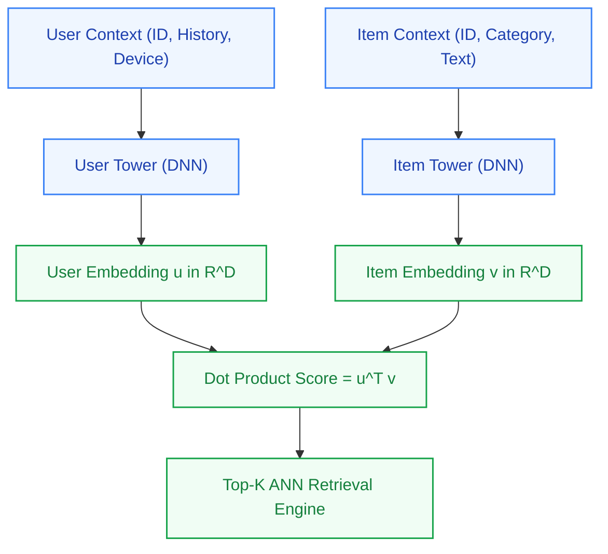

# Module 03: Classical Machine Learning & Recommendation Systems

[← Previous: Module 02](../01-foundations/02_math_and_statistics.md) | [Phase 2 Index](./README.md) | [Next: Module 04A →](./04a_deep_learning_and_pytorch.md)

---

## 1. Overview

While deep neural networks dominate perception and generative tasks, tree-based ensembles (XGBoost, LightGBM, CatBoost) and candidate retrieval models remain the dominant, most cost-effective workhorses in production for tabular business data, fraud detection, and recommendation systems. 

This module teaches production-first machine learning: building leak-free scikit-learn pipelines, handling severe class imbalance via asymmetric cost matrices and PR-AUC, and engineering two-tower candidate retrieval engines.

---

## 2. Who Should Study This?

- **Software Engineers** transitioning to applied machine learning who need leak-free data processing pipelines and deterministic cross-validation.
- **Data Scientists** wanting production-grade engineering patterns (scikit-learn Pipelines, ColumnTransformers, and Two-Tower embeddings).
- **MLOps Practitioners** designing automated retraining and evaluation gates for tabular systems.

---

## 3. Learning Objectives

By the end of this module, you will be able to:
- **Design leak-free scikit-learn preprocessing pipelines** using `Pipeline` and `ColumnTransformer` that fit transformers exclusively on training folds.
- **Implement cost-sensitive classification** to optimize decision thresholds against asymmetric business loss matrices rather than naive accuracy.
- **Evaluate imbalanced models correctly** using Precision-Recall Area Under Curve (PR-AUC) and calibration curves.
- **Build a Two-Tower candidate retrieval model** mapping high-dimensional user and item feature vectors into a shared metric embedding space.

---

## 4. Prerequisites

- **Python & Vectorized Computing:** NumPy broadcasting and array manipulation from [Module 01](../01-foundations/01_python_sql_and_data_stack.md).
- **Linear Algebra & Statistics:** Matrix projections, dot products, and Bayes' Theorem from [Module 02](../01-foundations/02_math_and_statistics.md).

---

## 5. Learning Levels

### Foundation
- Understand the bias-variance trade-off, supervised vs. unsupervised paradigms, and cross-validation strategies.
- Compute precision, recall, F1-score, and ROC-AUC.

### Applied Engineering
- Implement scikit-learn Pipelines with categorical encodings, robust scaling, and hyperparameter search.
- Train and tune gradient-boosted trees (XGBoost, LightGBM) with early stopping.

### Production Engineering
- Prevent subtle temporal data leakage in production feature stores.
- Deploy real-time Two-Tower approximate nearest neighbor (ANN) retrieval using vector dot-product indexing.

---

## 6. Core Concepts

### 6.1 The Silent Killer: Train-Test Data Leakage
Data leakage occurs when information from outside the training dataset is used to create the model. Fitting a standardizer or target encoder on the entire dataset before splitting causes overly optimistic cross-validation scores that collapse in production:

```python
# FATAL FLAW: Global fit causes test features to leak into training statistics
scaler = StandardScaler()
X_scaled = scaler.fit_transform(X) # Leaks test distribution!
X_train, X_test, y_train, y_test = train_test_split(X_scaled, y)

# CORRECT PATTERN: Fit transformers strictly within cross-validation folds
pipeline = Pipeline([
    ('encoder', OneHotEncoder(handle_unknown='ignore')),
    ('scaler', RobustScaler()),
    ('classifier', LogisticRegression())
])
pipeline.fit(X_train, y_train)
```

### 6.2 Precision-Recall AUC vs. ROC-AUC in Severe Imbalance
Under extreme imbalance (e.g., 0.1% fraud), ROC-AUC evaluates the True Positive Rate against the False Positive Rate ($FPR = rac{FP}{FP + TN}$). Because $TN$ is massive, $FPR$ stays deceptively tiny, hiding thousands of false alarms. **PR-AUC** plots Precision against Recall, penalizing false positives directly.

---

## 7. Technical Deep Dive

### 7.1 Two-Tower Candidate Retrieval Architecture
Recommendation systems operate in two stages:
1. **Candidate Retrieval (Two-Tower):** Scales to millions of items, retrieving top-100 candidates in under 10ms via Dot-Product vector search.
2. **Heavy Ranker (Cross-Attention or GBDT):** Ranks the top-100 items using rich cross-features.



---

## 8. Practical Implementation

Below is a complete, runnable, leak-free fraud detection pipeline with cost-sensitive threshold selection:

```python
import numpy as np
from sklearn.datasets import make_classification
from sklearn.model_selection import train_test_split
from sklearn.pipeline import Pipeline
from sklearn.preprocessing import StandardScaler
from sklearn.linear_model import LogisticRegression
from sklearn.metrics import precision_recall_curve, auc

# 1. Generate Synthetic Imbalanced Dataset (1% Fraud)
X, y = make_classification(
    n_samples=10000, n_features=10, weights=[0.99, 0.01], random_state=42
)
X_train, X_test, y_train, y_test = train_test_split(
    X, y, test_size=0.2, stratify=y, random_state=42
)

# 2. Assemble Leak-Free Pipeline
model = Pipeline([
    ("scaler", StandardScaler()),
    ("classifier", LogisticRegression(class_weight="balanced", random_state=42)),
])

# 3. Train Strictly on Training Data
model.fit(X_train, y_train)

# 4. Predict Probabilities & Evaluate PR-AUC
y_probs = model.predict_proba(X_test)[:, 1]
precisions, recalls, thresholds = precision_recall_curve(y_test, y_probs)
pr_auc = auc(recalls, precisions)

print(f"Test PR-AUC: {pr_auc:.4f}")
assert pr_auc > 0.3, "Model must outperform random baseline (0.01)"
```

---

## 9. Hands-on Exercises

### Beginner
Implement stratified K-Fold cross-validation on an imbalanced classification problem and verify that fold class proportions exactly match the global dataset.

### Intermediate
Build a custom scikit-learn transformer that caps extreme outlier values based on the 1st and 99th percentiles computed solely from the training set.

### Advanced
Implement a Two-Tower candidate retrieval model in pure NumPy using normalized user and item matrices, evaluating HitRate@10 on hold-out validation interactions.

---

## 10. Mini Project: Cost-Sensitive Churn Prediction Service

Build a production churn prevention service:
1. Ingest customer activity logs with temporal timestamps.
2. Implement temporal train-test splits (Train on Month 1–3, Test on Month 4).
3. Tune classification threshold to minimize dollar business cost:
   $$	ext{Cost} = (FP 	imes \$10 	ext{ discount cost}) + (FN 	imes \$250 	ext{ lost customer value})$$

---

## 11. Production Considerations

- **Temporal Leakage:** Always split transactional or user engagement data chronologically. Never use random k-fold cross-validation when predicting future behavior.
- **Serialization Safety:** Avoid storing production models in unvalidated `pickle` files. Prefer ONNX or safe weights formats.
- **Prediction Drift:** Track feature distributions between offline training datasets and incoming inference payloads using Population Stability Index (PSI).

---

## 12. Common Mistakes & Gotchas

1. **Target Encoding on Full Dataset:** Target encoding before cross-validation leaks target labels directly into feature values, inflating validation metrics.
2. **Optimizing ROC-AUC for Rare Events:** A high ROC-AUC (0.95) can mask a model that produces 50 false positives for every true positive.
3. **Evaluating Uncalibrated Probabilities:** Logistic regression produces calibrated probabilities; raw tree outputs often require Platt scaling or isotonic regression before being treated as probabilities.

---

## 13. Interview Questions & System Design

1. **Q:** Why does standard K-Fold cross-validation produce invalid estimates on time-series user data?  
   **A:** Standard K-Fold samples future observations into training folds, enabling the model to learn forward-looking signals that will not exist at real-time inference.
2. **System Design:** Design a real-time candidate generation service serving 50M items with sub-20ms latency. Explain how Two-Tower embeddings are indexed in Faiss or Milvus.

---

## 14. Recommended Resources

- [Feature Engineering & Selection](https://bookdown.org/max/FES/) — Max Kuhn & Kjell Johnson.
- [Scikit-Learn Pipeline Documentation](https://scikit-learn.org/stable/modules/compose.html).
- [Rules of Machine Learning (Google)](https://developers.google.com/machine-learning/guides/rules-of-ml).

---

## 15. Completion Checklist

- [ ] Can explain and prevent train-test data leakage using scikit-learn `Pipeline`.
- [ ] Understand when to prioritize PR-AUC over ROC-AUC.
- [ ] Can implement cost-sensitive threshold tuning for asymmetric loss matrices.
- [ ] Understand the two-stage recommendation architecture (Retrieval -> Ranking).

---

## 16. Further Exploration

- Explore gradient boosting internal algorithms: histogram-based binning in LightGBM and symmetric trees in CatBoost.
- Review deep ranking models: DLRM (Deep Learning Recommendation Model) and Two-Tower metric learning.
