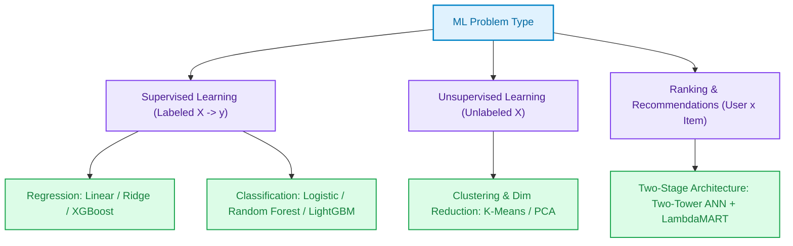
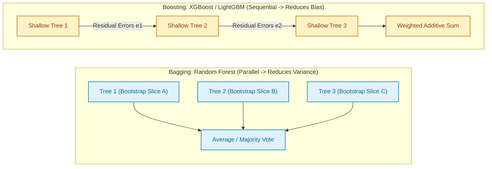
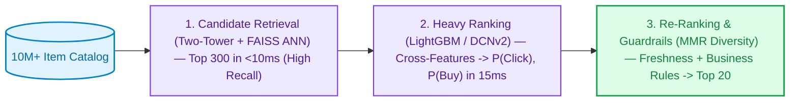

# Module 03: Classical Machine Learning, Ensembles & Recommendation Systems

> **Estimated Study Time:** 8–10 Hours | **Prerequisites:** [Module 01](../01-foundations/01_python_sql_and_data_stack.md), [Module 02](../01-foundations/02_math_and_statistics.md) | **Focus:** Tabular ML, Gradient Boosting, Evaluation & Two-Stage RecSys

[← Previous: Module 02 — Math & Statistics](../01-foundations/02_math_and_statistics.md) | [Home](../../README.md) | [Next: Module 04 — Deep Learning & RL →](./04_deep_learning_and_rl.md)

---

## Mental Model: Choosing the Right Classical Paradigm

With clean feature matrices from [Module 01](../01-foundations/01_python_sql_and_data_stack.md) and vector/probability intuition from [Module 02](../01-foundations/02_math_and_statistics.md), we can now teach computers to learn patterns directly from historical data. While LLMs dominate text, code, and images, **structured spreadsheet/database tables** (credit scores, fraud detection, dynamic pricing, churn, and shopping feeds) are still ruled by **tree ensembles (`XGBoost`, `LightGBM`), tabular foundation models (`TabPFN`), and two-stage recommendation funnels**—because they run in under 10 milliseconds on cheap CPUs and handle messy columns naturally.

<details>
<summary><b>Deep Dive: 2026 Enterprise Adoption & Tabular Research Benchmarks</b></summary>

While enterprise AI adoption reached **88%–89%** by 2025–2026, **only ~37% of organizations report measurable enterprise EBIT impact** — separating the top **6% "AI high performers"** who engineer end-to-end workflows from isolated pilot demos ([McKinsey *The State of AI*, 2026](https://www.mckinsey.com/capabilities/quantumblack/our-insights/the-state-of-ai); [Stanford HAI *AI Index*](https://hai.stanford.edu/ai-index)). Across structured tabular benchmarks, gradient-boosted trees and in-context tabular foundation models (`TabPFN`) consistently outperform standard deep neural networks due to axis-aligned feature selection and irregular boundary handling ([Hollmann et al., *Nature* 2025](https://www.nature.com/articles/s41586-024-08328-6); [`TabArena`, NeurIPS 2025](https://arxiv.org/abs/2506.16791); [Grinsztajn et al., NeurIPS 2022](https://arxiv.org/abs/2207.08815)).

</details>



---

## Tier 1: Core Foundations (Algorithms, Preprocessing & Evaluation)

### 1. Core Paradigms & Linear Models

#### 1.1 Learning Paradigms: Supervised, Unsupervised & Ranking
Instead of a programmer hand-coding brittle `if/else` rules (`Data + Rules -> Output`), machine learning flips the diagram (`Data + Answers -> Learned Rules`):
- **Supervised Learning:** Learns a mapping $f: X \to y$ from labeled historical examples—split into **Regression** (predicting a number like house price) and **Classification** (predicting a category like fraud vs. legitimate).
- **Unsupervised Learning:** Discovers hidden patterns in unlabeled $X$—like **Clustering** (`K-Means` customer groups) or **Dimensionality Reduction** (`PCA` compressing redundant columns).
- **Ranking:** Orders items for each user by relevance (`User × Item -> Top-K feed`).

#### 1.2 Linear Regression vs. Logistic Regression (And What a `Logit` Is)
The simplest way to do Supervised Learning is with a straight line—either outputting a number directly or squashing that line into a `0%–100%` probability:
- **Linear Regression (Predicting Any Number):** Draws the best-fitting line/plane $\hat{y} = \mathbf{w}^\top \mathbf{x} + b$ to predict continuous numbers (like house price `\$420,000` or tomorrow's temperature `31.5°C`), penalized by **Mean Squared Error (`MSE`)**.
- **Logistic Regression (Predicting Probability `0%–100%`):** Takes that raw unbounded score $z = \mathbf{w}^\top \mathbf{x} + b$—called a **`logit`** (which can be `-50` or `+80`)—and passes it through an S-shaped **Sigmoid curve** $\sigma(z) = \frac{1}{1 + e^{-z}}$ that squashes any number smoothly between `0` and `1` (e.g., `0.87` = 87% chance of spam). Applying a cutoff (like `>= 0.50`) turns that probability into a Yes/No label!

### 2. Feature Scaling, Encoding & `Scikit-Learn` Pipelines

Before feeding real data into Linear or Logistic Regression, there is a catch: if `salary` ranges up to `200,000` while `age` stops at `80`, the formula will obsess over `salary` simply because its numbers are bigger! Let's fix that cleanly without leaking test data.

> **What is `Scikit-Learn` (`sklearn`)?** Python's gold-standard library for classic table-based ML. Every algorithm and data cleaner in `sklearn` follows one universal 2-step habit: **`.fit(X_train)`** (*learn averages/rules from training data ONLY*) and **`.transform(X_test)` / `.predict(X_test)`** (*apply those learned rules to new data*).

#### 2.1 Which Models Need Feature Scaling—and Which Don't?
- **Need Scaling (Distance- or Slope-Based Models):** `Linear/Logistic Regression`, `KNN`, `SVM`, `K-Means`, `PCA`, and `Neural Networks`. Without scaling, a `salary` column (`0–200,000`) completely dwarfs `age` (`18–80`) just because the numbers are 2,500× bigger!
- **Do NOT Need Scaling (Tree-Based Models):** `Decision Trees`, `Random Forest`, `XGBoost`, `LightGBM`, `CatBoost`. Trees only ask simple yes/no threshold questions (`Is salary <= 50,000?`)—changing dollars to cents just moves the threshold to `5,000,000` without changing a single branch!

```python
from sklearn.compose import ColumnTransformer
from sklearn.pipeline import Pipeline
from sklearn.preprocessing import OneHotEncoder, StandardScaler
from sklearn.linear_model import LogisticRegression

# Leak-free preprocessing pipeline (fits ONLY on X_train!)
preprocessor = ColumnTransformer([
    ("num", StandardScaler(), ["age", "monthly_spend"]),
    ("cat", OneHotEncoder(handle_unknown="ignore"), ["country", "plan"]),
])

clf = Pipeline([
    ("prep", preprocessor),
    ("model", LogisticRegression(max_iter=1000, class_weight="balanced")),
])
```

#### 2.2 Stratified $K$-Fold Cross-Validation
Wrapping preprocessing inside `Pipeline` stops data leakage on one train/test split—but a single 80/20 split can still get lucky or unlucky on smaller datasets. **$K$-Fold Cross-Validation** rotates through $K$ folds (typically $K=5$), training on $K-1$ slices and testing on the held-out slice each turn, while **`StratifiedKFold`** guarantees every slice keeps the exact same rare-event percentage (essential when fraud is `< 5%`).

### 3. Trees, Bagging (Random Forest) vs. Boosting (`XGBoost` / `LightGBM`)

Linear models draw straight boundaries—so they struggle when risk depends on non-linear rules like *"young driver AND sports car, EXCEPT with 5 years of clean history"*. Decision tree ensembles capture those rules automatically:

#### 3.1 Bagging (`Random Forest`) vs. Gradient Boosting (`XGBoost`, `LightGBM`, `CatBoost`)
- **In Plain English (The Doctor Panel Analogy):**
  - **Single Decision Tree:** One doctor playing 20-questions—fast, easy to read, but easily memorizes quirks in old patient files (**overfits**).
  - **`Random Forest` (Bagging = Parallel Voting):** Asks **100 independent doctors** (each given a slightly shuffled set of patient charts and columns) at the same time and takes a majority vote—canceling out individual blind spots.
  - **`XGBoost` / `LightGBM` (Boosting = Relay Team Fixing Mistakes):** Doctor #1 makes initial guesses; Doctor #2 studies **only the patients Doctor #1 got wrong**; Doctor #3 studies **the leftover mistakes of #1 + #2**, and so on for 200+ small steps!



| Dimension | Single Decision Tree | Random Forest (Bagging) | Gradient Boosting (`XGBoost` / `LightGBM` / `CatBoost`) |
|---|---|---|---|
| **Training Mode** | Single greedy tree (Gini / Entropy) | **Parallel** deep trees on bootstrap samples + random feature subsets | **Sequential** shallow trees; each tree predicts the **negative gradient (residual errors)** of previous trees |
| **Error Reduced** | High variance (overfits easily) | **Reduces Variance** via averaging | **Reduces Bias** (and controls variance via `learning_rate` + L1/L2 regularization) |
| **Tabular SOTA?** | Baseline interpretability only | Strong out-of-the-box baseline | **Industry standard** for tabular competitions & production |

- **`XGBoost`** ([Chen & Guestrin, KDD 2016](https://arxiv.org/abs/1603.02754)): Depth-wise tree growth with exact/approximate second-order regularized objective + sparsity-aware missing-value routing.
- **`LightGBM`** ([Ke et al., NeurIPS 2017](https://proceedings.neurips.cc/paper/2017/hash/6449f44a102fde848669bdd9eb6b76fa-Abstract.html)): Leaf-wise tree growth + histogram binning + GOSS/EFB — achieving **up to 20× faster training** and lower memory on large datasets (`>10k–100M` rows).
- **`CatBoost`:** Ordered target statistics for high-cardinality categorical columns with minimal tuning.
- **2025–2026 Frontier — Tabular Foundation Models (`TabPFN`):** Pre-trained transformers using **in-context learning** over synthetic causal tabular priors ([Hollmann et al., *Nature* Jan 2025](https://www.nature.com/articles/s41586-024-08328-6); [`TabArena`, NeurIPS 2025](https://arxiv.org/abs/2506.16791)) now match or beat tuned GBDTs in a single `<1s` forward pass on small-to-medium datasets (`<=10,000` rows), while compiled GBDTs continue to lead at massive row scale and ultra-low CPU latency.

### 4. Evaluation Metrics: Precision, Recall, F1, ROC-AUC vs. PR-AUC

Once `XGBoost` or `TabPFN` outputs predictions, how do you grade it without falling into the rare-event trap we saw with Bayes' Theorem in Module 02?

#### 4.1 Precision, Recall, F1 & Why `PR-AUC` Beats `ROC-AUC` Under Imbalance
- $\text{Precision} = \frac{TP}{TP + FP}$ (*"When the model raises an alarm, how often is it right?"* — optimize for spam filters, kids' content recommendations).
- $\text{Recall} = \frac{TP}{TP + FN}$ (*"Out of all real positives, how many did we catch?"* — optimize for cancer screening, fraud/terror detection).
- $\text{F1} = \frac{2 \cdot \text{Precision} \cdot \text{Recall}}{\text{Precision} + \text{Recall}}$ (harmonic mean).
- **ROC-AUC vs. PR-AUC:** When negatives outnumber positives 1,000-to-1 (`0.1%` fraud), $TN$ is enormous, keeping False Positive Rate $\frac{FP}{FP + TN}$ artificially tiny and making **ROC-AUC look deceptively high (`0.98`)** even with thousands of false alarms. Always use **PR-AUC (`average_precision_score`)** on heavily imbalanced datasets!

#### 4.2 Model Explainability (`SHAP`) & Probability Calibration (`Platt` / `Isotonic`)
Winning on `PR-AUC` still leaves two questions every bank, hospital, or product manager will ask before letting you launch: *"Can I trust the exact probability number?"* and *"Can you explain WHY the model rejected this customer?"*
- **In Plain English:**
  1. **Calibration:** Just because an `XGBoost` model outputs `0.80` does **not** mean the borrower actually has an 80% chance of defaulting—raw tree scores are often stretched or squished. **Calibration** adjusts those raw scores against real outcomes so `0.80` truly means "8 out of 10".
  2. **`SHAP` Explainability:** Banks and hospitals aren't allowed to say *"The AI black box said no."* **`SHAP`** breaks every single prediction into exact credit/blame points per column (e.g., `Baseline 15% + High Debt (+31%) + Late Payments (+24%) = 70% Risk`).

<details>
<summary><b>Deep Dive: Calibration Methods, Brier Score & Shapley References</b></summary>

- **Calibration (`CalibratedClassifierCV`):** Use `method="sigmoid"` (Platt Scaling) on small validation sets (`<1,000` rows) and `method="isotonic"` on larger sets; measure calibration quality via **Brier Score** ($\frac{1}{N}\sum (\hat{p}_i - y_i)^2$, lower is better — [Niculescu-Mizil & Caruana, ICML 2005](https://dl.acm.org/doi/10.1145/1102351.1102430)).
- **`SHAP` (`shap.TreeExplainer`):** Computes exact game-theoretic Shapley values in polynomial time on trees ($\hat{y}_i = \phi_0 + \sum_j \phi_{ij}$ — [Lundberg & Lee, NeurIPS 2017](https://arxiv.org/abs/1705.07874)), satisfying EU AI Act High-Risk adverse-action auditability.

</details>

### 5. Unsupervised Essentials: `K-Means` & `PCA`

What if your table has **zero labels** at all—say, 1 million new shoppers you want to group by behavior or 100 overlapping columns you want to compress?

#### 5.1 Clustering (`K-Means` / `DBSCAN`) & Dimensionality Reduction (`PCA`)
- **`K-Means` (Grouping Similar Rows):** Drops $K$ pins ("centroids") on the map, assigns every data point to its closest pin, moves each pin to the center of its group, and repeats until stable. *When to skip:* Fails on ring/crescent shapes or heavy outliers—use `DBSCAN` / `HDBSCAN` instead.
- **`PCA` (Compressing Redundant Columns):** Imagine photographing a 3D cloud of points from the single camera angle that spreads the points out the widest—`PCA` squashes 100 correlated columns down to the few combined directions ("principal components") that preserve the most information.

---

## Tier 2: Production Architecture & Scale (Time Series, Fairness & RecSys)

In Tier 1, rows were independent snapshots. **Tier 2** tackles what happens in live production when rows arrive over **time**, impact **protected user groups**, or scale to **10 million catalog items** in a recommendation feed.

### 6. Time Series & Subgroup Fairness

#### 6.1 Chronological Splits (`TimeSeriesSplit`) & Subgroup Fairness Auditing
1. **Temporal Leakage:** Random shuffling lets the model see Wednesday's stock/demand numbers while predicting Tuesday (**look-ahead bias**). Always use chronological splits (`TimeSeriesSplit`) and decompose into **Trend + Seasonality + Residual**.
2. **Subgroup Fairness:** Overall accuracy hides demographic disparities. Audit **Equal Opportunity** (True Positive Rate parity) and **False Positive Rate parity** across protected slices before launch.

### 7. Two-Stage Recommendation & Ranking Architecture (Meta / Amazon / YouTube)

Now combine embeddings from Module 02 with `LightGBM` from Section 3: how do YouTube, Netflix, and Amazon rank **10 million items** for a user in under `30ms`? No heavy tree model can score 10 million rows fast enough—so production feeds split the job into a **fast narrowing funnel**:

> **What is `FAISS` / `ANN` (Approximate Nearest Neighbors)?** Checking a user's profile against 10 million products one-by-one takes seconds—way too slow! `ANN` libraries like Meta's **`FAISS`** organize vectors into neighborhood clusters/graphs (`HNSW`) so you jump straight to the 300 closest products in **under 10 milliseconds**.

#### 7.1 Candidate Retrieval (`Two-Tower` + `FAISS`), `LambdaMART` Ranking & `NDCG@K`



- **Collaborative vs. Content-Based Filtering:** Collaborative filtering learns from user-item interaction matrices/embeddings (suffers from **Cold Start** on brand-new items); Content-based filtering encodes item text/image metadata (solves item cold-start, lacks serendipity). Production Two-Tower models fuse both!
- **Ranking Metrics:** **Recall@K** for Stage 1 retrieval; **NDCG@K** (Normalized Discounted Cumulative Gain — rewards placing relevant items at rank 1 over rank 10 with logarithmic decay) and **MRR** for Stage 2 ranking; **CTR / Conversion / Dwell Time** online.

---

## Mini Hands-On Lab (15-Minute Exercise)

Implement `NDCG@K` from scratch in NumPy — the standard ranking evaluation metric for search and recommendation engines:

```python
import numpy as np

def dcg_at_k(relevances: list[float], k: int) -> float:
    rel = np.asarray(relevances[:k], dtype=float)
    if rel.size == 0:
        return 0.0
    discounts = np.log2(np.arange(2, rel.size + 2))
    return float(np.sum((2.0 ** rel - 1.0) / discounts))

def ndcg_at_k(predicted_relevances: list[float], k: int) -> float:
    ideal = sorted(predicted_relevances, reverse=True)
    idcg = dcg_at_k(ideal, k)
    return dcg_at_k(predicted_relevances, k) / idcg if idcg > 0 else 0.0

# Perfect ranking gives 1.0; inverted ranking gives lower score
assert np.isclose(ndcg_at_k([3, 2, 1, 0], k=3), 1.0)
assert ndcg_at_k([0, 1, 2, 3], k=3) < 0.5
print("Lab 03 Passed! Suboptimal NDCG@3 =", round(ndcg_at_k([0, 1, 2, 3], k=3), 4))
```

---

## Key Engineering Takeaways
- Wrap preprocessing inside `sklearn.pipeline.Pipeline` to eliminate train-test leakage, and scale features for distance/gradient models (not trees).
- Contrast **Bagging (`Random Forest` — parallel variance reduction)** against **Boosting (`XGBoost`/`LightGBM` — sequential residual bias reduction)**.
- Use **PR-AUC** (not Accuracy or ROC-AUC) for rare-event classification (`<1%` positives).
- Explain scale recommendations via the **Two-Stage Funnel**: fast Two-Tower ANN retrieval (`Recall@300`) followed by feature-rich ranking (`NDCG@10`) and MMR diversity.

> **Next in the Journey:** Tree ensembles rule structured spreadsheet columns—but what happens when your input isn't a neat table of `age` and `spend`, and is instead **raw pixels, spoken audio, or human language**? That is where trees hit a wall and neural networks take over in **[Module 04: Deep Learning, PyTorch & Reinforcement Learning](./04_deep_learning_and_rl.md)**.

---

[← Previous: Module 02 — Math & Statistics](../01-foundations/02_math_and_statistics.md) | [Home](../../README.md) | [Next: Module 04 — Deep Learning & RL →](./04_deep_learning_and_rl.md)
