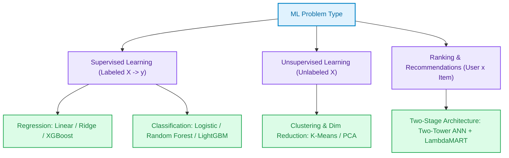
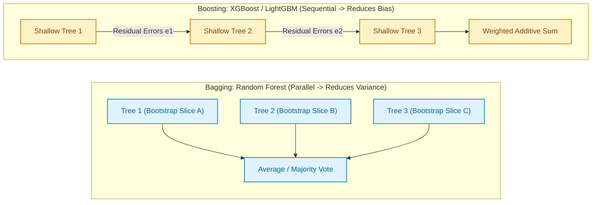
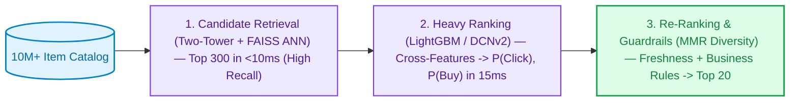

# Module 03: Classical Machine Learning, Ensembles & Recommendation Systems

> **Estimated Study Time:** 8–10 Hours | **Prerequisites:** [Module 01](../01-foundations/01_python_sql_and_data_stack.md), [Module 02](../01-foundations/02_math_and_statistics.md) | **Focus:** Tabular ML, Gradient Boosting, Evaluation & Two-Stage RecSys

[← Previous: Module 02 — Math & Statistics](../01-foundations/02_math_and_statistics.md) | [Home](../../README.md) | [Next: Module 04 — Deep Learning & RL →](./04_deep_learning_and_rl.md)

---

## Mental Model: Choosing the Right Classical Paradigm

While enterprise AI adoption across analytical ML and generative AI reached **88%–89%** by 2025–2026, **only ~37% of organizations report measurable enterprise EBIT impact** — separating the top **6% "AI high performers"** who engineer end-to-end production workflows from isolated pilot demos ([McKinsey *The State of AI*, 2026](https://www.mckinsey.com/capabilities/quantumblack/our-insights/the-state-of-ai); [Stanford HAI *AI Index*](https://hai.stanford.edu/ai-index)). Across high-throughput structured workloads (fraud scoring, credit underwriting, churn, dynamic pricing, and feed ranking), **gradient-boosted trees (`XGBoost`, `LightGBM`, `CatBoost`)**, **tabular foundation models (`TabPFN`)** ([Hollmann et al., *Nature* 2025](https://www.nature.com/articles/s41586-024-08328-6)), and **two-stage recommendation engines** remain foundational due to deterministic sub-10ms latency SLAs and tabular inductive bias ([`TabArena`, NeurIPS 2025](https://arxiv.org/abs/2506.16791); [Grinsztajn et al., NeurIPS 2022](https://arxiv.org/abs/2207.08815)).



---

## Tier 1: Core Foundations (Algorithms, Preprocessing & Evaluation)

### 1. Core Paradigms & Linear Models

#### 1.1 Learning Paradigms: Supervised, Unsupervised & Ranking
- **Traditional Rules:** Human writes `if-else` heuristics (`Data + Rules -> Output`). Brittle on edge cases.
- **Supervised Learning:** Algorithm learns mapping $f: X \to y$ from historical `(features, label)` pairs (`Data + Labels -> Model`). Split into **Regression** (continuous target, e.g., house price) and **Classification** (discrete class, e.g., fraud vs. legitimate).
- **Unsupervised Learning:** Discovers latent structure in unlabeled $X$ — e.g., **Clustering** (`K-Means` customer segmentation) and **Dimensionality Reduction** (`PCA` compressing correlated features).

---

#### 1.2 Linear Regression (MSE) vs. Logistic Regression (Sigmoid + Log Loss)
- **Linear Regression** predicts an unbounded continuous value $\hat{y} = \mathbf{w}^\top \mathbf{x} + b$, trained by minimizing **Mean Squared Error (MSE)**.
- **Logistic Regression** passes that linear logit $z = \mathbf{w}^\top \mathbf{x} + b$ through the **Sigmoid** function $\sigma(z) = \frac{1}{1 + e^{-z}}$, squashing outputs into calibrated probabilities $P(y=1 \mid \mathbf{x}) \in (0, 1)$, trained by minimizing **Binary Cross-Entropy (Log Loss)**. Applying a decision threshold (e.g., $\tau = 0.5$ or a cost-optimal threshold) turns the probability into a class label.

---

### 2. Feature Scaling, Encoding & Cross-Validation

#### 2.1 Feature Scaling Rules & Leak-Free `ColumnTransformer` Pipelines
- **Require Scaling (Distance- or Gradient-Based):** `Linear/Ridge/Lasso Regression`, `Logistic Regression`, `KNN`, `SVM`, `K-Means`, `PCA`, and `Neural Networks`. Without scaling, a `salary` column (`0–200,000`) completely dominates `age` (`18–80`) in Euclidean distances and gradient steps.
- **Do NOT Require Scaling (Tree-Based):** `Decision Trees`, `Random Forest`, `XGBoost`, `LightGBM`, `CatBoost`. Trees split on monotonic threshold inequalities (`feature <= threshold`), which are invariant to monotonic rescaling!

```python
from sklearn.compose import ColumnTransformer
from sklearn.pipeline import Pipeline
from sklearn.preprocessing import OneHotEncoder, StandardScaler
from sklearn.linear_model import LogisticRegression

# Leak-free preprocessing pipeline (fits ONLY on X_train!)
preprocessor = ColumnTransformer([
    ("num", StandardScaler(), ["age", "monthly_spend"]),
    ("cat", OneHotEncoder(handle_unknown="ignore"), ["country", "plan"]),
])

clf = Pipeline([
    ("prep", preprocessor),
    ("model", LogisticRegression(max_iter=1000, class_weight="balanced")),
])
```

---

#### 2.2 Stratified $K$-Fold Cross-Validation
A single 80/20 split can get lucky or unlucky on small-to-medium datasets. **$K$-Fold Cross-Validation** partitions training data into $K$ folds (typically $K=5$), training on $K-1$ folds and validating on the held-out fold $K$ times. **`StratifiedKFold`** guarantees every fold preserves the exact minority-class ratio (vital when positive labels are `< 5%`).

---

### 3. Trees, Bagging (Random Forest) vs. Boosting (`XGBoost` / `LightGBM`)

#### 3.1 Bagging (`Random Forest`) vs. Gradient Boosting (`XGBoost`, `LightGBM`, `CatBoost`)



| Dimension | Single Decision Tree | Random Forest (Bagging) | Gradient Boosting (`XGBoost` / `LightGBM` / `CatBoost`) |
|---|---|---|---|
| **Training Mode** | Single greedy tree (Gini / Entropy) | **Parallel** deep trees on bootstrap samples + random feature subsets | **Sequential** shallow trees; each tree predicts the **negative gradient (residual errors)** of previous trees |
| **Error Reduced** | High variance (overfits easily) | **Reduces Variance** via averaging | **Reduces Bias** (and controls variance via `learning_rate` + L1/L2 regularization) |
| **Tabular SOTA?** | Baseline interpretability only | Strong out-of-the-box baseline | **Industry standard** for tabular competitions & production |

- **`XGBoost`** ([Chen & Guestrin, KDD 2016](https://arxiv.org/abs/1603.02754)): Depth-wise tree growth with exact/approximate second-order regularized objective + sparsity-aware missing-value routing.
- **`LightGBM`** ([Ke et al., NeurIPS 2017](https://proceedings.neurips.cc/paper/2017/hash/6449f44a102fde848669bdd9eb6b76fa-Abstract.html)): Leaf-wise tree growth + histogram binning + GOSS/EFB — achieving **up to 20× faster training** and lower memory on large datasets (`>10k–100M` rows).
- **`CatBoost`:** Ordered target statistics for high-cardinality categorical columns with minimal tuning.
- **2025–2026 Frontier — Tabular Foundation Models (`TabPFN`):** Pre-trained transformers using **in-context learning** over synthetic causal tabular priors ([Hollmann et al., *Nature* Jan 2025](https://www.nature.com/articles/s41586-024-08328-6); [`TabArena`, NeurIPS 2025](https://arxiv.org/abs/2506.16791)) now match or beat tuned GBDTs in a single `<1s` forward pass on small-to-medium datasets (`<=10,000` rows), while compiled GBDTs continue to lead at massive row scale and ultra-low CPU latency.

---

### 4. Evaluation Metrics: Precision, Recall, F1, ROC-AUC vs. PR-AUC

#### 4.1 Precision, Recall, F1 & Why `PR-AUC` Beats `ROC-AUC` Under Imbalance
- $\text{Precision} = \frac{TP}{TP + FP}$ (*"When the model raises an alarm, how often is it right?"* — optimize for spam filters, kids' content recommendations).
- $\text{Recall} = \frac{TP}{TP + FN}$ (*"Out of all real positives, how many did we catch?"* — optimize for cancer screening, fraud/terror detection).
- $\text{F1} = \frac{2 \cdot \text{Precision} \cdot \text{Recall}}{\text{Precision} + \text{Recall}}$ (harmonic mean).
- **ROC-AUC vs. PR-AUC:** When negatives outnumber positives 1,000-to-1 (`0.1%` fraud), $TN$ is enormous, keeping False Positive Rate $\frac{FP}{FP + TN}$ artificially tiny and making **ROC-AUC look deceptively high (`0.98`)** even with thousands of false alarms. Always use **PR-AUC (`average_precision_score`)** on heavily imbalanced datasets!

---

### 5. Unsupervised Essentials: `K-Means` & `PCA`

#### 5.1 Clustering (`K-Means` / `DBSCAN`) & Dimensionality Reduction (`PCA`)
- **`K-Means`:** Iteratively assigns points to the nearest of $K$ centroids (Euclidean distance) and recomputes centroids as cluster means. Choose $K$ via the **Elbow Method (inertia)** + **Silhouette Score**. *Pitfalls:* Assumes spherical, equal-sized clusters; fails on outliers and non-convex shapes (use `DBSCAN` or `HDBSCAN` for arbitrary shapes/noise).
- **`PCA` (Principal Component Analysis):** Projects scaled data onto orthogonal eigenvectors of the covariance matrix ordered by explained variance — used to compress correlated features, speed up training, and visualize embeddings in 2D.

---

## Tier 2: Production Architecture & Scale (Time Series, Fairness & RecSys)

### 6. Time Series & Subgroup Fairness

#### 6.1 Chronological Splits (`TimeSeriesSplit`) & Subgroup Fairness Auditing
1. **Temporal Leakage:** Random shuffling lets the model see Wednesday's stock/demand numbers while predicting Tuesday (**look-ahead bias**). Always use chronological splits (`TimeSeriesSplit`) and decompose into **Trend + Seasonality + Residual**.
2. **Subgroup Fairness:** Overall accuracy hides demographic disparities. Audit **Equal Opportunity** (True Positive Rate parity) and **False Positive Rate parity** across protected slices before launch.

---

### 7. Two-Stage Recommendation & Ranking Architecture (Meta / Amazon / YouTube)

#### 7.1 Candidate Retrieval (`Two-Tower` + `FAISS`), `LambdaMART` Ranking & `NDCG@K`



- **Collaborative vs. Content-Based Filtering:** Collaborative filtering learns from user-item interaction matrices/embeddings (suffers from **Cold Start** on brand-new items); Content-based filtering encodes item text/image metadata (solves item cold-start, lacks serendipity). Production Two-Tower models fuse both!
- **Ranking Metrics:** **Recall@K** for Stage 1 retrieval; **NDCG@K** (Normalized Discounted Cumulative Gain — rewards placing relevant items at rank 1 over rank 10 with logarithmic decay) and **MRR** for Stage 2 ranking; **CTR / Conversion / Dwell Time** online.

---

## Mini Hands-On Lab (15-Minute Exercise)

Implement `NDCG@K` from scratch in NumPy — the standard ranking evaluation metric for search and recommendation engines:

```python
import numpy as np

def dcg_at_k(relevances: list[float], k: int) -> float:
    rel = np.asarray(relevances[:k], dtype=float)
    if rel.size == 0:
        return 0.0
    discounts = np.log2(np.arange(2, rel.size + 2))
    return float(np.sum((2.0 ** rel - 1.0) / discounts))

def ndcg_at_k(predicted_relevances: list[float], k: int) -> float:
    ideal = sorted(predicted_relevances, reverse=True)
    idcg = dcg_at_k(ideal, k)
    return dcg_at_k(predicted_relevances, k) / idcg if idcg > 0 else 0.0

# Perfect ranking gives 1.0; inverted ranking gives lower score
assert np.isclose(ndcg_at_k([3, 2, 1, 0], k=3), 1.0)
assert ndcg_at_k([0, 1, 2, 3], k=3) < 0.5
print("Lab 03 Passed! Suboptimal NDCG@3 =", round(ndcg_at_k([0, 1, 2, 3], k=3), 4))
```

---

## Key Engineering Takeaways
- Wrap preprocessing inside `sklearn.pipeline.Pipeline` to eliminate train-test leakage, and scale features for distance/gradient models (not trees).
- Contrast **Bagging (`Random Forest` — parallel variance reduction)** against **Boosting (`XGBoost`/`LightGBM` — sequential residual bias reduction)**.
- Use **PR-AUC** (not Accuracy or ROC-AUC) for rare-event classification (`<1%` positives).
- Explain scale recommendations via the **Two-Stage Funnel**: fast Two-Tower ANN retrieval (`Recall@300`) followed by feature-rich ranking (`NDCG@10`) and MMR diversity.

---

[← Previous: Module 02 — Math & Statistics](../01-foundations/02_math_and_statistics.md) | [Home](../../README.md) | [Next: Module 04 — Deep Learning & RL →](./04_deep_learning_and_rl.md)
