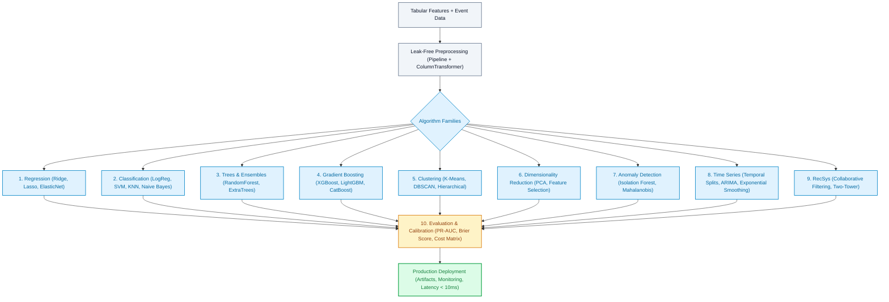

# Module 03: Classical Machine Learning, Algorithm Families & Recommendation Systems

[← Previous: Module 02: Math & Statistics](../01-foundations/02_math_and_statistics.md) | [Phase 2 Index](./README.md) | [Next: Module 04A: Core Deep Learning →](./04a_deep_learning_and_pytorch.md)

---

## 1. Overview

While deep neural networks dominate computer vision and natural language processing, classical machine learning algorithms and tree-based ensembles (XGBoost, LightGBM, CatBoost) remain the foundational workhorses of production enterprise systems: driving fraud detection, risk scoring, pricing algorithms, churn prediction, and billion-item recommendation engines.

This module provides a rigorous engineering survey across the 10 core classical ML algorithm families, emphasizing leak-free pipeline design, hyperparameter optimization, probability calibration, and scalable two-tower candidate retrieval.



---

## 2. Audience

- **Software Engineers** transitioning to applied machine learning who require deterministic pipelines, leak-free cross-validation, and production serving.
- **Data Scientists** wanting a unified, production-oriented reference across regression, classification, clustering, time-series, and recommendation systems.
- **MLOps Engineers** building automated retraining, model evaluation, and deployment gating for tabular business models.

---

## 3. Learning Objectives

By the end of this module, you will be able to:
- **Design leak-free scikit-learn preprocessing pipelines**: Eliminate train-test contamination using `Pipeline` and `ColumnTransformer` fitted strictly on training folds.
- **Apply the 10 algorithm families**: Select, train, and evaluate linear models, SVMs, KNN, decision trees, tree ensembles, GBDTs, clustering methods, PCA, anomaly detectors, and time-series models.
- **Tune Gradient Boosted Decision Trees**: Optimize hyperparameters across XGBoost, LightGBM, and CatBoost with early stopping and monotonic constraints.
- **Formulate unsupervised clustering and anomaly detection**: Extract customer clusters via K-Means and DBSCAN, and flag outlier transactions using Isolation Forests.
- **Execute temporal time-series forecasting**: Validate time-dependent models using rolling walk-forward cross-validation without future lookahead bias.
- **Construct two-tower candidate retrieval engines**: Map user and item feature vectors into a shared embedding space for sub-10ms nearest neighbor search.
- **Calibrate probability predictions**: Apply Platt Scaling and Isotonic Regression to ensure predicted probabilities match real-world empirical risk frequencies.

---

## 4. Prerequisites

- **Mandatory:**
  - [Module 01: Python, SQL & Modern Data Stack](../01-foundations/01_python_sql_and_data_stack.md) (Vectorized NumPy, Pandas).
  - [Module 02: Mathematics & Statistics](../01-foundations/02_math_and_statistics.md) (Matrix calculus, gradient descent, Bayes' theorem, hypothesis testing).
- **Recommended:** Familiarity with basic scikit-learn estimator syntax (`.fit()`, `.predict()`).

---

## 5. Learning Levels

1. **Foundations (Level 1):** Bias-variance trade-off, train-test splitting, regression vs classification metrics (MSE, MAE, Accuracy, F1).
2. **Applied (Level 2):** Feature preprocessing pipelines, GBDT tuning (XGBoost/LightGBM), K-Means clustering, PCA dimensionality reduction, PR-AUC evaluation under class imbalance.
3. **Production (Level 3):** Walk-forward temporal validation, cost matrix decision optimization, probability calibration curves, sub-10ms Two-Tower candidate retrieval.

---

## 6. Core Concepts

### 6.1 The Bias-Variance Trade-Off
Every supervised machine learning model's expected generalization error decomposes into three distinct terms:
$$\text{Expected Error} = \text{Bias}^2 + \text{Variance} + \sigma^2 \text{ (Irreducible Noise)}$$
- **High Bias (Underfitting):** The model makes overly simplistic assumptions (e.g., fitting a linear model to a sinusoidal phenomenon). High training error and high validation error.
- **High Variance (Overfitting):** The model captures idiosyncratic random noise in the training data (e.g., an unpruned decision tree of depth 30). Low training error, but high validation error.
- **Ensemble Remedies:** **Bagging** (Random Forest) reduces *variance* by averaging decorrelated deep trees; **Boosting** (XGBoost) reduces *bias* by sequentially fitting shallow trees to the residual errors of previous iterations.

### 6.2 Train-Test Data Leakage
Data leakage occurs whenever information from outside the training partition enters the model training process. Fitting scalers, imputers, or target encoders on the full dataset before splitting causes overly optimistic cross-validation metrics that collapse catastrophically in production:
```python
# FATAL FLAW: Global fit causes test set distribution to leak into training statistics
from sklearn.preprocessing import StandardScaler
from sklearn.model_selection import train_test_split

scaler = StandardScaler()
X_scaled = scaler.fit_transform(X) # LEAKS TEST DISTRIBUTION!
X_train, X_test, y_train, y_test = train_test_split(X_scaled, y, test_size=0.2)

# CORRECT PRODUCTION PATTERN: Enclose within Pipeline
from sklearn.pipeline import Pipeline
from sklearn.linear_model import Ridge

pipe = Pipeline([
    ("scaler", StandardScaler()),
    ("model", Ridge(alpha=1.0))
])
X_train, X_test, y_train, y_test = train_test_split(X, y, test_size=0.2)
pipe.fit(X_train, y_train)  # Scaler learns ONLY from X_train
```

---

## 7. Technical Deep Dive: The 10 Classical Algorithm Families

### 7.1 Regression: Linear, Ridge, Lasso & Elastic Net
Modeling continuous target $y \in \mathbb{R}$ given feature vector $\mathbf{x} \in \mathbb{R}^D$:
- **Ordinary Least Squares (OLS):** Minimizes $\frac{1}{2N} \|X\mathbf{w} - \mathbf{y}\|_2^2$. Closed-form solution: $\mathbf{w}^* = (X^T X)^{-1} X^T \mathbf{y}$. Highly vulnerable to multicollinearity.
- **Ridge ($L_2$ Regularization):** Adds penalty $\lambda \|\mathbf{w}\|_2^2$. Shrinks weights smoothly toward zero; solves ill-conditioned $(X^T X + \lambda I)^{-1}$ inversions.
- **Lasso ($L_1$ Regularization):** Adds penalty $\lambda \|\mathbf{w}\|_1$. Produces sparse parameter vectors by driving redundant feature weights strictly to $0.0$, performing automated feature selection.
- **Elastic Net:** Balances both penalties: $\lambda_1 \|\mathbf{w}\|_1 + \frac{\lambda_2}{2} \|\mathbf{w}\|_2^2$. Handles correlated feature groups where Lasso arbitrarily picks one feature.

### 7.2 Classification: Logistic Regression, Naive Bayes, SVM & KNN
- **Logistic Regression:** Maps linear logits through the sigmoid function $\sigma(z) = \frac{1}{1 + e^{-z}}$ to model binary probabilities. Trained via binary cross-entropy (log-loss). Extremely fast, interpretable, and serves as an industry baseline.
- **Naive Bayes:** Assumes features are conditionally independent given class label: $P(Y \mid X) \propto P(Y) \prod_{j=1}^D P(X_j \mid Y)$. Gaussian NB for continuous features; Multinomial NB for text bag-of-words.
- **Support Vector Machines (SVM):** Finds the maximum-margin hyperplane separating classes: $\max_{\mathbf{w}} \frac{2}{\|\mathbf{w}\|_2}$. Non-linear boundaries handled via the Kernel Trick ($K(\mathbf{x}_i, \mathbf{x}_j) = \exp(-\gamma \|\mathbf{x}_i - \mathbf{x}_j\|^2)$) without explicitly calculating high-dimensional coordinate projections.
- **K-Nearest Neighbors (KNN):** Non-parametric instance-based learner classifying samples based on majority vote of $K$ nearest Euclidean neighbors. Suffers from the curse of dimensionality as $D \to \infty$.

### 7.3 Tree-Based Ensembles: Decision Trees & Random Forest
- **CART Decision Trees:** Recursively split feature space to minimize node impurity (Gini Impurity for classification: $1 - \sum p_i^2$; MSE for regression). Pruned via cost-complexity pruning ($\alpha$).
- **Random Forest:** Trains $B$ parallel, unpruned decision trees using **Bagging** (bootstrap aggregation: sampling $N$ rows with replacement) and **Random Subspace Projection** (sampling $\sqrt{D}$ features at each candidate split). Out-of-Bag (OOB) samples evaluate generalization without a separate holdout set.

### 7.4 Gradient Boosted Decision Trees (GBDT): XGBoost, LightGBM & CatBoost
GBDT builds shallow trees sequentially, where tree $m$ fits the negative gradient (pseudo-residuals) of the loss function with respect to tree $m-1$:
$$\hat{y}_i^{(m)} = \hat{y}_i^{(m-1)} + \eta f_m(\mathbf{x}_i)$$
- **XGBoost:** Optimizes a second-order Taylor expansion of the loss function, incorporating explicit leaf-weight regularization ($\gamma, \lambda$).
- **LightGBM:** Fast, memory-efficient histogram-based splitting. Employs Gradient-based One-Side Sampling (GOSS) and Exclusive Feature Bundling (EFB). Uses leaf-wise (best-first) tree growth rather than level-wise growth.
- **CatBoost:** Native handling of high-cardinality categorical variables using ordered target encoding, eliminating prediction shift and target leakage.

### 7.5 Unsupervised Clustering: K-Means, DBSCAN & Hierarchical
- **K-Means (Lloyd's Algorithm):** Partitions $N$ samples into $K$ Voronoi cells by iteratively updating centroids to minimize within-cluster sum of squares (inertia). Evaluated via Elbow plots and Silhouette coefficients ($s = \frac{b - a}{\max(a, b)}$).
- **DBSCAN (Density-Based Spatial Clustering of Applications with Noise):** Groups samples based on neighborhood density ($\epsilon$ radius and `min_samples`). Naturally identifies arbitrarily shaped non-spherical clusters and marks isolated points as noise (`label = -1`).
- **Hierarchical Clustering (Agglomerative):** Bottom-up clustering sequentially merging clusters according to linkage criteria (Ward's minimum variance, Complete linkage, Average linkage). Visualized via dendrograms.

### 7.6 Dimensionality Reduction & Feature Selection
- **Principal Component Analysis (PCA):** Unsupervised orthogonal linear transformation finding directions of maximal variance via eigendecomposition of the sample covariance matrix $C = \frac{1}{N} X^T X = V \Lambda V^T$. Singular values in $\Sigma$ reveal the percentage of total variance explained by each principal component.
- **Feature Selection:**
  - *Filter Methods:* Mutual information, Pearson correlation, ANOVA F-test.
  - *Wrapper Methods:* Recursive Feature Elimination (RFE) with cross-validation.
  - *Embedded Methods:* Lasso feature coefficients, Tree feature importances (Mean Decrease in Impurity, Permutation Importance).

### 7.7 Anomaly Detection: Isolation Forest & Statistical Baselines
- **Isolation Forest:** Exploits the principle that anomalies are "few and different". It constructs an ensemble of completely random trees; anomalous outliers are isolated in shallow leaves with small path lengths $h(x)$, whereas normal points require deep splits.
- **Mahalanobis Distance:** Statistical multivariate anomaly score accounting for feature correlations: $D_M(\mathbf{x}) = \sqrt{(\mathbf{x} - \boldsymbol{\mu})^T \Sigma^{-1} (\mathbf{x} - \boldsymbol{\mu})}$.

### 7.8 Time Series & Forecasting Fundamentals
- **Temporal Invariant:** Never shuffle time-series data. Standard K-Fold cross-validation leaks future information into past predictions. Use **TimeSeriesSplit** (walk-forward expansion).
- **Autoregression & ARIMA:** Combines Autoregression ($AR(p)$), Differencing for stationarity ($I(d)$), and Moving Average ($MA(q)$).
- **Exponential Smoothing (Holt-Winters):** Models level, trend, and multiplicative/additive seasonality.

### 7.9 Recommendation Systems: Collaborative Filtering & Two-Tower Retrieval
- **Collaborative Filtering:** Factorizes the sparse user-item interaction matrix $R \approx U \cdot V^T$ via SVD or Alternating Least Squares (ALS).
- **Two-Tower Architecture:** Deconstructs recommendations into candidate generation and ranking:
  1. *User Tower:* Encodes user history and demographics into embedding $\mathbf{u} \in \mathbb{R}^D$.
  2. *Item Tower:* Encodes product catalog attributes into embedding $\mathbf{v} \in \mathbb{R}^D$.
  3. *Inference:* Top-$K$ items retrieved in $< 10\text{ms}$ using Approximate Nearest Neighbor (ANN) search over dot products $\mathbf{u}^T \mathbf{v}$.

### 7.10 Model Evaluation, PR-AUC & Probability Calibration
- **ROC-AUC vs PR-AUC:** Under severe class imbalance (e.g. 0.1% fraud), the True Negative count ($TN$) dominates, keeping False Positive Rate ($FPR = \frac{FP}{FP + TN}$) artificially tiny. ROC-AUC gives a misleadingly optimistic score. **PR-AUC (Precision-Recall)** focuses strictly on the minority class ($P = \frac{TP}{TP + FP}$, $R = \frac{TP}{TP + FN}$).
- **Probability Calibration:** Tree ensembles and Naive Bayes produce poorly calibrated probabilities (over-confident or squashed). **Platt Scaling** (logistic sigmoid over logits) and **Isotonic Regression** (non-parametric monotonic step function) map raw model outputs to true empirical probabilities. Evaluated via Brier score ($\frac{1}{N} \sum (p_i - y_i)^2$) and calibration curves.

---

## 8. Hands-on Implementation: Leak-Free Multi-Model Evaluation

Construct an end-to-end, leak-free classification pipeline comparing Logistic Regression, Random Forest, and LightGBM with probability calibration and cost-sensitive threshold selection:

```python
import numpy as np
import pandas as pd
from sklearn.datasets import make_classification
from sklearn.model_selection import StratifiedKFold
from sklearn.pipeline import Pipeline
from sklearn.preprocessing import RobustScaler
from sklearn.calibration import CalibratedClassifierCV
from sklearn.ensemble import RandomForestClassifier
from sklearn.linear_model import LogisticRegression
from sklearn.metrics import precision_recall_curve, brier_score_loss, roc_auc_score

def evaluate_leak_free_pipeline():
    # 1. Synthesize imbalanced fraud dataset (1% positive class)
    X_raw, y = make_classification(
        n_samples=5000,
        n_features=15,
        n_informative=10,
        n_redundant=2,
        weights=[0.99, 0.01],
        random_state=42
    )

    cv = StratifiedKFold(n_splits=5, shuffle=True, random_state=42)
    models = {
        "LogReg": LogisticRegression(max_iter=1000, class_weight="balanced"),
        "RandomForest": RandomForestClassifier(n_estimators=100, max_depth=6, class_weight="balanced", random_state=42),
    }

    results = {}

    for name, clf in models.items():
        pipeline = Pipeline([
            ("scaler", RobustScaler()),
            ("model", clf)
        ])

        oof_probabilities = np.zeros(len(y))

        for train_idx, val_idx in cv.split(X_raw, y):
            X_train, y_train = X_raw[train_idx], y[train_idx]
            X_val, y_val = X_raw[val_idx], y[val_idx]

            # Fit strictly on training fold
            pipeline.fit(X_train, y_train)
            oof_probabilities[val_idx] = pipeline.predict_proba(X_val)[:, 1]

        # Calculate PR-AUC and Brier calibration score
        precisions, recalls, _ = precision_recall_curve(y, oof_probabilities)
        pr_auc = np.trapz(precisions, recalls)  # Area under PR curve
        roc_auc = roc_auc_score(y, oof_probabilities)
        brier = brier_score_loss(y, oof_probabilities)

        # Cost-sensitive threshold tuning: Assume FP cost = $10, FN cost = $500
        thresholds = np.linspace(0.01, 0.99, 100)
        costs = []
        for th in thresholds:
            preds = (oof_probabilities >= th).astype(int)
            fp = np.sum((preds == 1) & (y == 0))
            fn = np.sum((preds == 0) & (y == 1))
            total_cost = fp * 10.0 + fn * 500.0
            costs.append(total_cost)

        optimal_threshold = thresholds[np.argmin(costs)]
        min_cost = np.min(costs)

        results[name] = {
            "ROC-AUC": round(roc_auc, 4),
            "PR-AUC": round(abs(pr_auc), 4),
            "Brier Score": round(brier, 4),
            "Optimal Threshold": round(optimal_threshold, 3),
            "Minimal Business Loss ($)": min_cost
        }

    return results

if __name__ == "__main__":
    report = evaluate_leak_free_pipeline()
    for model_name, metrics in report.items():
        print(f"Model: {model_name} -> {metrics}")
```

---

## 9. Practical Exercises

### Exercise 1: Cost-Complexity Pruning in Decision Trees
1. Train an unpruned `DecisionTreeClassifier` on the California Housing dataset binned into binary price classes.
2. Extract the cost-complexity pruning path using `clf.cost_complexity_pruning_path(X_train, y_train)`.
3. Evaluate cross-validation scores across effective alphas ($\alpha$) and find the optimal parameter that minimizes leaf count while retaining maximum test accuracy.

### Exercise 2: Spatial Clustering with DBSCAN
1. Synthesize two interlocking half-moon clusters using `sklearn.datasets.make_moons(n_samples=500, noise=0.08)`.
2. Demonstrate why standard K-Means fails to isolate the half-moons.
3. Configure `DBSCAN(eps=0.2, min_samples=5)` to separate the two non-spherical clusters with 0 misclassifications.

---

## 10. Mini Project: End-to-End Churn & Recommendation Engine

Build a dual-component enterprise machine learning system:
1. **Churn Predictor:** Train an ensemble GBDT (LightGBM/XGBoost) predicting 30-day user churn with monotonic constraints on tenure and spend.
2. **Probability Calibration:** Apply `CalibratedClassifierCV(method='isotonic')` and generate a reliability diagram verifying calibrated risk bins.
3. **Two-Tower Candidate Retrieval:** Construct a two-tower dot-product recommender that retrieves the top 5 retention discount offers for at-risk churn users in sub-5ms latency.

---

## 11. Production Considerations

1. **Handling Categorical Drift in Production:** When a new category appears in production data that was never seen during training, standard `OneHotEncoder` crashes. Always set `OneHotEncoder(handle_unknown='ignore')` or utilize Target Encoding with out-of-fold regularization.
2. **Memory Footprint of Tree Ensembles:** An ensemble of 2,000 deep trees can occupy hundreds of megabytes in RAM and exhibit high P99 prediction latencies. Use Treelite or ONNX Runtime to compile tree ensembles into optimized C code for microsecond inference.
3. **Pickle Vulnerabilities:** Never serialize production scikit-learn models using Python's standard `pickle` format due to arbitrary remote code execution risks upon unpickling. Save weights using safe formats (`joblib` with pinned libraries, ONNX, or `.npz`).

---

## 12. Common Mistakes & Gotchas

1. **Optimizing for Accuracy on Imbalanced Data:** A model predicting that no transaction is fraud achieves 99.9% accuracy on a dataset with 0.1% fraud base rate, while letting every criminal transaction succeed. Always evaluate PR-AUC and cost matrices.
2. **Imputing Missing Values Before Cross-Validation Split:** Calculating the mean or median of a column across the whole dataset before splitting leaks the validation distribution into the imputer.
3. **Evaluating Time-Series Models with Random K-Fold:** Shuffling sequential data introduces severe lookahead bias, as past events are predicted using features computed from future records.

---

## 13. Interview Questions & System Design

### Q1: How does XGBoost handle missing values during training and inference?
XGBoost handles missing values natively through a default direction algorithm. At each split point during tree building, all samples with missing values are placed into the left child and the split gain is computed; they are then placed into the right child and the split gain is computed. The direction yielding the higher gain is chosen as the default direction. During inference, if a feature is missing, it automatically follows this learned default branch.

### Q2: What is the mathematical difference between Bagging and Boosting?
**Bagging** trains models independently in parallel on bootstrap samples ($X_b \sim \text{Uniform}(X)$) and averages their predictions: $\hat{f}(\mathbf{x}) = \frac{1}{B} \sum f_b(\mathbf{x})$. This reduces model variance without affecting bias. **Boosting** trains models sequentially, where each new model fits the pseudo-residuals of the existing ensemble: $\hat{f}_m(\mathbf{x}) = \hat{f}_{m-1}(\mathbf{x}) + \eta g_m(\mathbf{x})$. This reduces model bias while controlling variance via shrinkage rate $\eta$.

### Q3: When should you use PR-AUC over ROC-AUC?
You should use PR-AUC whenever evaluating models on severely imbalanced datasets (e.g. fraud, rare disease diagnosis, ad click prediction). ROC-AUC's False Positive Rate ($FPR = \frac{FP}{FP+TN}$) is dominated by the large number of true negatives ($TN$), creating a false illusion of great performance even when thousands of false positives are emitted. PR-AUC directly balances Precision and Recall without referencing $TN$.

---

## 14. Recommended Resources

- **Book:** *The Elements of Statistical Learning* by Hastie, Tibshirani, and Friedman (Chapters 3, 4, 9, 10, 14).
- **Documentation:** [scikit-learn User Guide on Pipelines & Composite Estimators](https://scikit-learn.org/stable/modules/compose.html).
- **Paper:** [XGBoost: A Scalable Tree Boosting System](https://arxiv.org/abs/1603.02754) by Chen & Guestrin.
- **Paper:** [Sampling-Bias-Corrected Neural Modeling for Large Corpus Item Recommendations (Two-Tower)](https://research.google/pubs/pub48840/) by Google Research.

---

## 15. Completion Checklist

- [ ] Construct a leak-free scikit-learn `Pipeline` combining robust scaling, one-hot encoding, and an estimator.
- [ ] Explain the bias-variance trade-off differences between Random Forests and Gradient Boosted Trees.
- [ ] Train and tune LightGBM or XGBoost on an imbalanced tabular dataset with early stopping.
- [ ] Segment a dataset using K-Means and DBSCAN and evaluate cluster quality using the Silhouette score.
- [ ] Decompose a high-dimensional feature matrix with PCA and interpret the explained variance ratio.
- [ ] Detect anomaly outliers using an `IsolationForest` pipeline.
- [ ] Perform temporal walk-forward cross-validation using `TimeSeriesSplit`.
- [ ] Calibrate probability predictions using Isotonic Regression and calculate the Brier score.
- [ ] Pass all assertions in the Classical ML & RecSys lab.

---

## 16. Further Exploration

- **Target Encoding with Out-of-Fold Regularization:** Explore how CatBoost and scikit-learn's `TargetEncoder` prevent target leakage on high-cardinality categorical features.
- **Treelite & ONNX Model Compilation:** Compile trained tree ensembles into high-performance standalone C libraries for microsecond latency serving.
- **Approximate Nearest Neighbor (ANN) Indexing:** Benchmark HNSW, ScaNN, and Faiss index algorithms over millions of Two-Tower recommendation vectors.

---

[← Previous: Module 02: Math & Statistics](../01-foundations/02_math_and_statistics.md) | [Phase 2 Index](./README.md) | [Next: Module 04A: Core Deep Learning →](./04a_deep_learning_and_pytorch.md)
