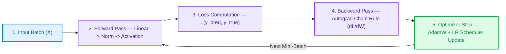
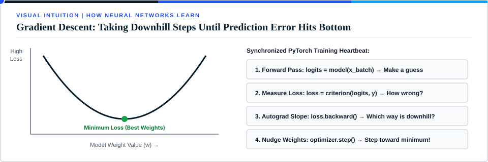

# Module 04: Deep Learning Fundamentals, PyTorch & Reinforcement Learning

> **Estimated Study Time:** 7–9 Hours | **Prerequisites:** [Module 02](../01-foundations/02_math_and_statistics.md), [Module 03](./03_classical_ml_and_recsys.md) | **Focus:** Representation Learning, Backprop, Normalization, Modern Optimizers & RL

[← Previous: Module 03 — Classical ML & RecSys](./03_classical_ml_and_recsys.md) | [Home](../../README.md) | [Next: Module 05 — NLP, CV & Multimodal →](../03-modern-ai-and-genai/05_nlp_cv_and_multimodal.md)

---

## Mental Model: Inside One Training Iteration

In [Module 03](./03_classical_ml_and_recsys.md), tree ensembles excelled on pre-built spreadsheet columns (`age`, `monthly_spend`). But when your input is raw pixels, audio waves, or sentences, nobody can hand-write rules for pixel `#4,812`. **Deep Learning** replaces manual feature engineering by stacking layers that **discover their own features automatically**—repeating the exact same 5-step downhill learning heartbeat whether you are training a tiny 2-layer network or a 400B LLM:



<p align="center">
  
</p>

---

## Tier 1: Core Foundations (Neurons, Activations, Losses & PyTorch Loop)

### 1. Neurons, Layers & Non-Linearity

#### 1.1 How a Neuron Works & Why Activations Are Mandatory
- **In Plain English:** A single neuron works like a weighted scorecard: it multiplies each input by an importance weight, adds a baseline (`bias`), and passes the total through a **curved switch (`activation function`)** to decide whether to fire.
- **Why that curved switch is mandatory:** Stacking 100 straight-line equations without curved activations just simplifies into **one single straight line**—giving a 100-layer network zero advantage over basic Linear Regression!

<details>
<summary><b>Deep Dive: Matrix Collapse Proof</b></summary>

Without a non-linear activation $\phi(\cdot)$ between layers, consecutive linear transformations collapse associatively: $W_2(W_1 \mathbf{x}) = (W_2 W_1)\mathbf{x} = W_{\text{eff}}\mathbf{x}$. Non-linear activations (`ReLU`, `GELU`) bend the coordinate space at every layer, enabling universal function approximation.

</details>

```python
import numpy as np

def relu_neuron(inputs: np.ndarray, weights: np.ndarray, bias: float) -> float:
    pre_activation = float(np.dot(inputs, weights) + bias)
    return max(0.0, pre_activation)

x = np.array([0.5, 0.8, 0.2])
w = np.array([0.4, 0.6, 0.9])
b = 0.1
# 0.5*0.4 + 0.8*0.6 + 0.2*0.9 + 0.1 = 0.20 + 0.48 + 0.18 + 0.10 = 0.96
out = relu_neuron(x, w, b)
assert np.isclose(out, 0.96)
print(f"Neuron output: {out:.2f}")  # 0.96 -> active!
```

#### 1.2 Modern Activation Functions (`ReLU`, `GELU`, `SwiGLU`, `Softmax`)
In that toy neuron we used `ReLU`, which simply clips negatives to zero. As deep learning evolved from image networks to modern Transformers, engineers upgraded that curved switch depending on whether a layer sits hidden inside the network or at the final prediction output:

| Activation | Formula / Behavior | Range | Where Used & Key Tradeoff |
|---|---|---|---|
| **Sigmoid** | $\frac{1}{1 + e^{-x}}$ | `(0, 1)` | Binary output probability; **saturates** for $|x| > 4$, causing vanishing gradients in hidden layers |
| **Tanh** | $\frac{e^x - e^{-x}}{e^x + e^{-x}}$ | `(-1, 1)` | Zero-centered (better than Sigmoid), still saturates at tails |
| **ReLU** | $\max(0, x)$ | `[0, ∞)` | Fast, non-saturating for $x > 0$ (CNN/MLP default); suffers from **Dying ReLU** if weights push $x < 0$ permanently |
| **GELU / SwiGLU** | Smooth gated non-linearities | `(-0.17, ∞)` | **Modern Transformer / LLM standard** (Llama, Gemini, GPT) — smooth gradients near zero |
| **Softmax** | $\frac{e^{z_i}}{\sum_j e^{z_j}}$ | `(0, 1)`, sums to `1` | Multi-class output layer & Attention weight normalization |

### 2. Loss Functions, Backpropagation & `PyTorch` Idioms

Stacking neurons and activations gives us a **Forward Pass** that makes guesses—now we need a scoreboard (**Loss Function**) to measure how wrong each guess was, and **`PyTorch`** to nudge millions of weights downhill automatically.

> **What is `PyTorch` (`torch`)?** Think of `PyTorch` as **`NumPy` with two superpowers**: (1) its arrays (`torch.Tensor`) run 50×+ faster on GPUs, and (2) its **`Autograd`** engine secretly records every math operation during the forward pass so calling `loss.backward()` computes every weight's error slope automatically!

#### 2.1 Choosing the Right `PyTorch` Loss Function (And Why Raw `Logits` Matter)
- **What is a `Logit`?** The raw, unscaled score coming out of your final linear layer (`-12.4`, `+0.3`, `+8.9`) *before* `Sigmoid` or `Softmax` turns it into a `0%–100%` probability.
- **Regression (Predicting Continuous Numbers):** `nn.MSELoss()` (heavily punishes big misses) or `nn.HuberLoss()` (gentler on extreme outliers).
- **Binary Classification (`Yes/No`):** `nn.BCEWithLogitsLoss()` — pass **raw logits** directly (it combines `Sigmoid + Log` internally so numbers never round off to `log(0) = -inf`!).
- **Multi-Class / Next-Token Prediction:** `nn.CrossEntropyLoss()` — pass **raw logits** `(B, C)` and class IDs `(B,)`.

#### 2.2 `Epoch` vs. `Batch` vs. `Iteration` & The Standard `PyTorch` Loop
With our model and loss function chosen, how do we feed 10,000 training examples through the GPU step by step?
- **Flashcard Analogy:** Suppose you have **10,000 flashcards** and study **100 cards at a time**:
  - **`Batch Size = 100`:** How many cards you read before updating your memory.
  - **`1 Iteration`:** Studying 1 batch of 100 cards + doing 1 weight update.
  - **`1 Epoch`:** Finishing the entire 10,000-card deck once (`10,000 / 100 = 100 Iterations`).
  - **`Dropout`:** Randomly muting 20% of neurons during practice so no single neuron becomes a lazy crutch (must be turned OFF during real exams via `model.eval()`!).

```python
import torch
import torch.nn as nn

model = nn.Sequential(
    nn.Linear(64, 128),
    nn.LayerNorm(128),
    nn.GELU(),
    nn.Dropout(p=0.2),
    nn.Linear(128, 10),  # Raw logits for 10 classes
)
criterion = nn.CrossEntropyLoss()
optimizer = torch.optim.AdamW(model.parameters(), lr=3e-4, weight_decay=0.01)

# --- Training Step ---
model.train()  # Enables Dropout & BatchNorm running stats
x_batch = torch.randn(32, 64)
y_batch = torch.randint(0, 10, (32,))

optimizer.zero_grad(set_to_none=True)  # Clear stale gradients efficiently
logits = model(x_batch)
loss = criterion(logits, y_batch)
loss.backward()                        # Compute dL/dW via reverse-mode autograd
torch.nn.utils.clip_grad_norm_(model.parameters(), max_norm=1.0)
optimizer.step()

# --- Inference / Validation Step ---
model.eval()   # Disables Dropout! (Forgetting model.eval() leaves Dropout active!)
with torch.no_grad():                  # Disables autograd graph -> halves memory
    val_preds = model(x_batch).argmax(dim=-1)
```

---

## Tier 2: Production Architecture & Scale (Stability, Normalization, Optimizers & RL)

A 2-layer `PyTorch` loop works effortlessly on a laptop—but when you stack **50 to 100+ layers** across multiple GPUs, gradients either die out or explode, and giant models overflow single-GPU memory. **Tier 2** introduces the exact engineering breakthroughs that keep deep networks stable at LLM scale.

### 3. Vanishing/Exploding Gradients, Normalization & Modern Optimizers

#### 3.1 Vanishing & Exploding Gradients — And the 4 Fixes That Solved Them
- **In Plain English:** Backpropagation sends error feedback backward from the last layer to the first, like a game of "Telephone" down a line of 50 people. If each layer shrinks the signal by half (`0.5 × 0.5 × ...`), the message vanishes to zero before reaching early layers (**Vanishing Gradient**—early layers stop learning). If each layer doubles it (`2 × 2 × ...`), numbers blow up to `NaN` (**Exploding Gradient**).
- **The 4 Engineering Fixes:**
  1. **Non-saturating switches** (`ReLU`, `GELU`) instead of flat-tailed `Sigmoid`.
  2. **Smart starting weights** (`He` / `Xavier` initialization so layer outputs neither shrink nor balloon on step 1).
  3. **Residual Skip Highways** ($x + \mathcal{F}(x)$) letting error signals bypass layers cleanly.
  4. **Normalization (`LayerNorm` / `BatchNorm`)** + **Gradient Clipping** (`clip_grad_norm_`).

<details>
<summary><b>Deep Dive: Chain-Rule Jacobian Math</b></summary>

By the multivariate Chain Rule, $\frac{\partial \mathcal{L}}{\partial h_1} = \frac{\partial \mathcal{L}}{\partial h_L} \prod_{l=2}^{L} \frac{\partial h_l}{\partial h_{l-1}}$. Repeated multiplication of $L$ Jacobian matrices causes exponential decay ($0.5^{50} \approx 10^{-15}$) when singular values are $<1$, or overflow when $>1$. **He initialization** sets $\text{Var}(W) = \frac{2}{d_{\text{in}}}$ to preserve unit activation variance across `ReLU` layers.

</details>

#### 3.2 `BatchNorm` vs. `LayerNorm` & `RMSNorm`
Fix #4 above mentioned **Normalization**—keeping numbers centered near `0` and scaled near `1` between every layer. Depending on whether you are training an image CNN or a text Transformer, you normalize along different directions:

| Property | Batch Normalization (`BatchNorm`) | Layer Normalization (`LayerNorm` / `RMSNorm`) |
|---|---|---|
| **Normalization Axis** | Across the **batch** `(B, H, W)` per feature channel | Across the **feature dimension** `(D,)` independently per token |
| **Small Batch / Batch=1** | Breaks or becomes noisy at small batch sizes | Identical behavior at `batch_size = 1` and `batch_size = 1024` |
| **Train vs. Eval Behavior** | Uses batch stats at train time, running averages at eval | **Identical formula** at train and inference time |
| **Variable Sequence Lengths** | Fails on padded variable-length text tokens | Works naturally per token; **`RMSNorm`** drops mean-centering for faster LLM training |

#### 3.3 Decoupled Weight Decay (`AdamW`) & Warmup-Cosine Learning Rate Schedules
Once `LayerNorm` keeps signals clean inside the network, how should `optimizer.step()` choose step sizes so weights converge fast without memorizing noise?
- **`Adam`:** Tracks exponentially decaying 1st moment (momentum $m_t$) and 2nd moment (per-parameter variance $v_t$) for adaptive step sizes.
- **Why `AdamW` beat `Adam`:** Classic `Adam` mixes L2 regularization into the adaptive gradient denominator, weakening weight decay for parameters with large historical gradients. **`AdamW` decouples weight decay** ($w \leftarrow w - \eta \lambda w$), dramatically improving generalization in ViTs and LLMs.
- **LR Schedule:** Modern training pairs **Linear Warmup** (first 3–5% of steps so early Adam variance estimates stabilize) with **Cosine Annealing Decay**.

#### 3.4 Multi-GPU Distributed Training (`DDP` vs. `FSDP` / `DeepSpeed ZeRO-3`)
Notice a hidden cost in `AdamW`: tracking two extra momentum states per weight means a multi-billion parameter model quickly outgrows a single 24 GB or 80 GB GPU! That brings us to multi-GPU training:
- **In Plain English:**
  - **`DDP` (Copy the Cookbook to Every Chef):** Every GPU holds a full copy of the model, cooks a different slice of data, and averages notes after each batch. Simple and fast—until the model is too big to fit on one GPU!
  - **`FSDP` / `ZeRO-3` (Split the Cookbook Pages Across Chefs):** When a 70B model won't fit on one GPU, `FSDP` gives each of your 8 GPUs just **1/8th of the model's layers & optimizer memory**, passing pages over fast GPU cables right when needed.

<details>
<summary><b>Deep Dive: Exact 16 GB per 1B Parameter `AdamW` VRAM Breakdown</b></summary>

During mixed-precision `BF16` training with `AdamW`, **every 1B parameters requires ~16 GB of static GPU memory** before activations: `2 GB` (`BF16` weights) + `2 GB` (`BF16` gradients) + `12 GB` (`FP32` master weights + `FP32` Adam $m_t$ and $v_t$ momentum/variance states — [Rajbhandari et al., SC20 (`ZeRO`)](https://arxiv.org/abs/1910.02054)). **Tensor Parallelism (`TP`)** goes one level deeper, splitting single matrix multiplications across intra-node `NVLink` GPUs.

</details>

### 4. Reinforcement Learning (RL) & Connection to Post-Training LLMs

Everything so far assumed we had exact ground-truth labels (`y_batch`) for every input. What if there is no single "right" wording—only a final outcome you can verify, like passing unit tests or winning a game? That is **Reinforcement Learning**:

#### 4.1 Trial-and-Error Learning & How RL Teaches LLMs to Reason (`PPO` / `GRPO`)
- **In Plain English:** Supervised learning teaches with an answer key (*"Here is the exact right essay"*). **Reinforcement Learning (RL)** teaches like coaching a game—the AI tries multiple strategies, sees which attempt wins a **Reward** (e.g., code passes all unit tests or math answer matches), and shifts its probabilities toward winning strategies.
- **How Modern Reasoning LLMs Use It:** In **`GRPO` (Group Relative Policy Optimization)**, the model generates 8 candidate step-by-step solutions to a coding/math problem, runs them against a deterministic compiler/verifier, and reinforces the solutions that scored above the group average!

<details>
<summary><b>Deep Dive: Formal Markov Decision Process (MDP) Notation</b></summary>

Formally modeled as $(S, A, P, R, \gamma)$: at state $s_t$ (prompt + tokens generated so far), policy $\pi_\theta(a_t \mid s_t)$ samples action $a_t$ (next token), transitioning to $s_{t+1}$ to maximize discounted cumulative return $G_t = \sum_{k=0}^{\infty} \gamma^k r_{t+k}$.

</details>

---

## Mini Hands-On Lab (15-Minute Exercise)

Implement `LayerNorm` in pure NumPy and verify zero mean and unit variance per token across a `(Batch, SeqLen, HiddenDim)` tensor:

```python
import numpy as np

def layer_norm_forward(
    x: np.ndarray, gamma: np.ndarray, beta: np.ndarray, eps: float = 1e-5
) -> np.ndarray:
    mean = x.mean(axis=-1, keepdims=True)
    var = x.var(axis=-1, keepdims=True)
    x_hat = (x - mean) / np.sqrt(var + eps)
    return gamma * x_hat + beta

tokens = np.random.default_rng(0).normal(loc=5.0, scale=3.0, size=(2, 4, 16))
normed = layer_norm_forward(tokens, gamma=np.ones(16), beta=np.zeros(16))

assert normed.shape == (2, 4, 16)
assert np.allclose(normed.mean(axis=-1), 0.0, atol=1e-5)
assert np.allclose(normed.std(axis=-1), 1.0, atol=1e-4)
print("Lab 04 Passed! Output shape:", normed.shape)
```

---

## Key Engineering Takeaways
- Always pair `nn.CrossEntropyLoss()` / `nn.BCEWithLogitsLoss()` with **raw unnormalized logits**, and switch `model.eval()` + `torch.no_grad()` during validation/inference.
- Explain **Vanishing Gradients** via repeated Jacobian multiplication and cite the 4 fixes: ReLU/GELU, He/Xavier init, Residual skip connections, and LayerNorm/BatchNorm.
- Know why **`LayerNorm`/`RMSNorm`** + **`AdamW`** + **Warmup-Cosine LR** is the universal recipe for Transformers.
- Connect **Reinforcement Learning (`PPO` / `GRPO`)** directly to LLM alignment and verifiable reasoning training.

> **Next in the Journey:** You now have the complete engine of deep learning (`PyTorch`, `LayerNorm`, `AdamW`, `FSDP`, and `RL`). Next, let's see how one single neural architecture—the **Transformer**—uses these exact building blocks to understand **human language, images, and spoken audio** in **[Module 05: NLP, Transformers, Computer Vision & Multimodal AI](../03-modern-ai-and-genai/05_nlp_cv_and_multimodal.md)**.

---

[← Previous: Module 03 — Classical ML & RecSys](./03_classical_ml_and_recsys.md) | [Home](../../README.md) | [Next: Module 05 — NLP, CV & Multimodal →](../03-modern-ai-and-genai/05_nlp_cv_and_multimodal.md)
