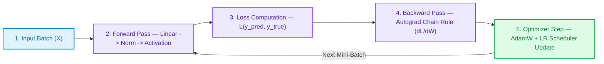

# Module 04: Deep Learning Fundamentals, PyTorch & Reinforcement Learning

> **Estimated Study Time:** 7–9 Hours | **Prerequisites:** [Module 02](../01-foundations/02_math_and_statistics.md), [Module 03](./03_classical_ml_and_recsys.md) | **Focus:** Representation Learning, Backprop, Normalization, Modern Optimizers & RL

[← Previous: Module 03 — Classical ML & RecSys](./03_classical_ml_and_recsys.md) | [Home](../../README.md) | [Next: Module 05 — NLP, CV & Multimodal →](../03-modern-ai-and-genai/05_nlp_cv_and_multimodal.md)

---

## Mental Model: Inside One Training Iteration

Deep Learning replaces hand-crafted feature engineering with **end-to-end differentiable representation learning** across unstructured modalities (text, images, audio, video). Every neural network — from a 2-layer MLP to a 400B-parameter LLM — repeats the exact same 5-step optimization cycle:



---

## Tier 1: Fresher Core (Neurons, Activations, Losses & PyTorch Loop)

### 1. Neurons, Layers & Non-Linearity

#### Q1: How does an artificial neuron compute its output, and why are Activation Functions mandatory?
**Answer:**
A neuron computes an affine dot product $z = \mathbf{w}^\top \mathbf{x} + b$ followed by a non-linear activation $\phi(z)$.
- **Why non-linearity is mandatory:** A stack of linear matrices without activations collapses into a single linear matrix: $W_2(W_1 \mathbf{x}) = (W_2 W_1)\mathbf{x} = W_{\text{eff}}\mathbf{x}$. Without non-linear activations, a 100-layer network has the exact same expressive power as 1-layer Linear Regression!

```python
import numpy as np

def relu_neuron(inputs: np.ndarray, weights: np.ndarray, bias: float) -> float:
    pre_activation = float(np.dot(inputs, weights) + bias)
    return max(0.0, pre_activation)

x = np.array([0.5, 0.8, 0.2])
w = np.array([0.4, 0.6, 0.9])
b = 0.1
# 0.5*0.4 + 0.8*0.6 + 0.2*0.9 + 0.1 = 0.20 + 0.48 + 0.18 + 0.10 = 0.96
out = relu_neuron(x, w, b)
assert np.isclose(out, 0.96)
print(f"Neuron output: {out:.2f}")  # 0.96 -> active!
```

---

#### Q2: Compare Sigmoid, Tanh, ReLU, GELU/SwiGLU, and Softmax
**Answer:**

| Activation | Formula / Behavior | Range | Where Used & Key Tradeoff |
|---|---|---|---|
| **Sigmoid** | $\frac{1}{1 + e^{-x}}$ | `(0, 1)` | Binary output probability; **saturates** for $|x| > 4$, causing vanishing gradients in hidden layers |
| **Tanh** | $\frac{e^x - e^{-x}}{e^x + e^{-x}}$ | `(-1, 1)` | Zero-centered (better than Sigmoid), still saturates at tails |
| **ReLU** | $\max(0, x)$ | `[0, ∞)` | Fast, non-saturating for $x > 0$ (CNN/MLP default); suffers from **Dying ReLU** if weights push $x < 0$ permanently |
| **GELU / SwiGLU** | Smooth gated non-linearities | `(-0.17, ∞)` | **Modern Transformer / LLM standard** (Llama, Gemini, GPT) — smooth gradients near zero |
| **Softmax** | $\frac{e^{z_i}}{\sum_j e^{z_j}}$ | `(0, 1)`, sums to `1` | Multi-class output layer & Attention weight normalization |

---

### 2. Loss Functions, Backpropagation & PyTorch Idioms

#### Q3: Match the Problem Type to the Right PyTorch Loss Function
**Answer:**
- **Regression:** `nn.MSELoss()` (penalizes large outliers quadratically) or `nn.HuberLoss()` (robust to outliers).
- **Binary Classification:** `nn.BCEWithLogitsLoss()` — takes **raw unnormalized logits** (fuses Sigmoid + log numerically stably; never apply `nn.Sigmoid()` manually before `BCELoss`!).
- **Multi-Class Classification / Next-Token Prediction:** `nn.CrossEntropyLoss()` — takes **raw logits** of shape `(B, C)` and integer targets `(B,)` (fuses `LogSoftmax` + `NLLLoss`).

---

#### Q4: Epoch vs. Batch Size vs. Iteration, and the Canonical PyTorch Training & Eval Loop
**Answer:**
If `N = 10,000` training samples and `batch_size = 100`, then **1 Epoch** (one full pass over the dataset) equals **`100` Iterations** (100 gradient updates).

```python
import torch
import torch.nn as nn

model = nn.Sequential(
    nn.Linear(64, 128),
    nn.LayerNorm(128),
    nn.GELU(),
    nn.Dropout(p=0.2),
    nn.Linear(128, 10),  # Raw logits for 10 classes
)
criterion = nn.CrossEntropyLoss()
optimizer = torch.optim.AdamW(model.parameters(), lr=3e-4, weight_decay=0.01)

# --- Training Step ---
model.train()  # Enables Dropout & BatchNorm running stats
x_batch = torch.randn(32, 64)
y_batch = torch.randint(0, 10, (32,))

optimizer.zero_grad(set_to_none=True)  # Clear stale gradients efficiently
logits = model(x_batch)
loss = criterion(logits, y_batch)
loss.backward()                        # Compute dL/dW via reverse-mode autograd
torch.nn.utils.clip_grad_norm_(model.parameters(), max_norm=1.0)
optimizer.step()

# --- Inference / Validation Step ---
model.eval()   # Disables Dropout! (Forgetting model.eval() is a top interview bug)
with torch.no_grad():                  # Disables autograd graph -> halves memory
    val_preds = model(x_batch).argmax(dim=-1)
```

---

## Tier 2: MNC Production Depth (Stability, Normalization, Optimizers & RL)

### 3. Vanishing/Exploding Gradients, Normalization & Modern Optimizers

#### Q5: What causes Vanishing & Exploding Gradients, and what 4 mechanisms solved them?
**Answer:**
By the Chain Rule, backpropagating through $L$ layers multiplies $L$ Jacobian matrices. If singular values are $< 1$, gradients shrink exponentially ($0.5^{50} \approx 10^{-15}$ — early layers freeze); if $> 1$, gradients explode to `NaN`.
**The 4 Engineering Fixes:**
1. **Non-saturating activations** (`ReLU`, `GELU`) instead of `Sigmoid`.
2. **Variance-preserving Initialization:** **He / Kaiming init** ($\text{Var}(W) = 2 / d_{\text{in}}$) for ReLU; **Xavier / Glorot init** for Tanh/Linear.
3. **Residual Skip Connections** ($x + \mathcal{F}(x)$) creating an identity gradient highway.
4. **Normalization Layers (`BatchNorm` / `LayerNorm` / `RMSNorm`)** + **Gradient Clipping** (`clip_grad_norm_`).

---

#### Q6: Batch Normalization vs. Layer Normalization (and `RMSNorm`) — Why do Transformers use `LayerNorm`?
**Answer:**

| Property | Batch Normalization (`BatchNorm`) | Layer Normalization (`LayerNorm` / `RMSNorm`) |
|---|---|---|
| **Normalization Axis** | Across the **batch** `(B, H, W)` per feature channel | Across the **feature dimension** `(D,)` independently per token |
| **Small Batch / Batch=1** | Breaks or becomes noisy at small batch sizes | Identical behavior at `batch_size = 1` and `batch_size = 1024` |
| **Train vs. Eval Behavior** | Uses batch stats at train time, running averages at eval | **Identical formula** at train and inference time |
| **Variable Sequence Lengths** | Fails on padded variable-length text tokens | Works naturally per token; **`RMSNorm`** drops mean-centering for faster LLM training |

---

#### Q7: `SGD` vs. `Adam` vs. `AdamW` + Learning Rate Warmup & Cosine Decay
**Answer:**
- **`Adam`:** Tracks exponentially decaying 1st moment (momentum $m_t$) and 2nd moment (per-parameter variance $v_t$) for adaptive step sizes.
- **Why `AdamW` beat `Adam`:** Classic `Adam` mixes L2 regularization into the adaptive gradient denominator, weakening weight decay for parameters with large historical gradients. **`AdamW` decouples weight decay** ($w \leftarrow w - \eta \lambda w$), dramatically improving generalization in ViTs and LLMs.
- **LR Schedule:** Modern training pairs **Linear Warmup** (first 3–5% of steps so early Adam variance estimates stabilize) with **Cosine Annealing Decay**.

---

### 4. Reinforcement Learning (RL) & Connection to Post-Training LLMs

#### Q8: How does Reinforcement Learning formalize sequential decision-making (MDP), and how does it power modern LLMs?
**Answer:**
An RL **Agent** interacts with an **Environment** modeled as a Markov Decision Process $(S, A, P, R, \gamma)$: at state $s_t$, policy $\pi_\theta(a_t \mid s_t)$ selects action $a_t$, transitioning to $s_{t+1}$ and receiving scalar reward $r_t$ to maximize discounted return $G_t = \sum_{k=0}^{\infty} \gamma^k r_{t+k}$.
- **Modern LLM Connection:** In **RLHF (`PPO`)** and **Reasoning RL (`GRPO` — Group Relative Policy Optimization)**, the prompt is the initial state, each generated token is an action, and a Reward Model (or deterministic unit-test/math verifier!) scores the completed response to teach models human alignment and multi-step reasoning.

---

## Mini Hands-On Lab (15-Minute Exercise)

Implement `LayerNorm` in pure NumPy and verify zero mean and unit variance per token across a `(Batch, SeqLen, HiddenDim)` tensor:

```python
import numpy as np

def layer_norm_forward(
    x: np.ndarray, gamma: np.ndarray, beta: np.ndarray, eps: float = 1e-5
) -> np.ndarray:
    mean = x.mean(axis=-1, keepdims=True)
    var = x.var(axis=-1, keepdims=True)
    x_hat = (x - mean) / np.sqrt(var + eps)
    return gamma * x_hat + beta

tokens = np.random.default_rng(0).normal(loc=5.0, scale=3.0, size=(2, 4, 16))
normed = layer_norm_forward(tokens, gamma=np.ones(16), beta=np.zeros(16))

assert normed.shape == (2, 4, 16)
assert np.allclose(normed.mean(axis=-1), 0.0, atol=1e-5)
assert np.allclose(normed.std(axis=-1), 1.0, atol=1e-4)
print("Lab 04 Passed! Output shape:", normed.shape)
```

---

## Key Takeaways for Interviews
- Always pair `nn.CrossEntropyLoss()` / `nn.BCEWithLogitsLoss()` with **raw unnormalized logits**, and switch `model.eval()` + `torch.no_grad()` during validation/inference.
- Explain **Vanishing Gradients** via repeated Jacobian multiplication and cite the 4 fixes: ReLU/GELU, He/Xavier init, Residual skip connections, and LayerNorm/BatchNorm.
- Know why **`LayerNorm`/`RMSNorm`** + **`AdamW`** + **Warmup-Cosine LR** is the universal recipe for Transformers.
- Connect **Reinforcement Learning (`PPO` / `GRPO`)** directly to LLM alignment and verifiable reasoning training.

---

[← Previous: Module 03 — Classical ML & RecSys](./03_classical_ml_and_recsys.md) | [Home](../../README.md) | [Next: Module 05 — NLP, CV & Multimodal →](../03-modern-ai-and-genai/05_nlp_cv_and_multimodal.md)
