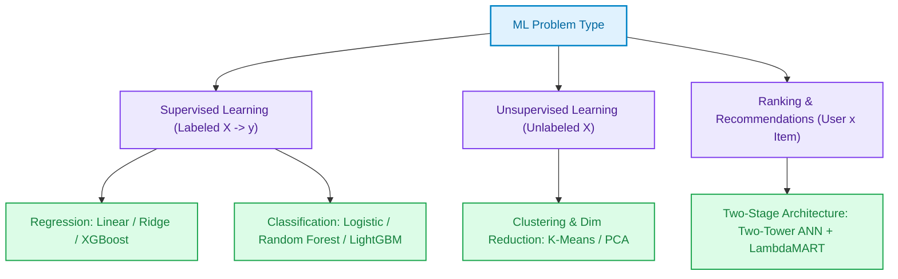
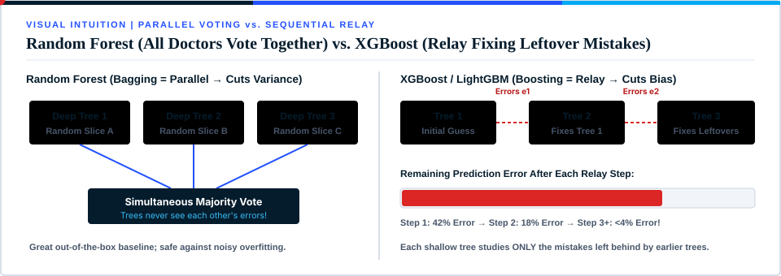
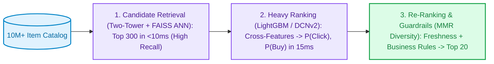

# Module 03: Classical Machine Learning, Ensembles & Recommendation Systems

> **Difficulty:** Intermediate | **Estimated Study Time:** 8-10 Hours | **Prerequisites:** [Module 01: Python & SQL](../01-foundations/01_python_sql_and_data_stack.md), [Module 02: Math & Statistics](../01-foundations/02_math_and_statistics.md)  
> **Focus:** Leak-free tabular preprocessing, gradient boosted decision trees (XGBoost/LightGBM), SHAP explainability, class imbalance, and two-stage recommendation funnels

[← Previous: Module 02: Math & Statistics](../01-foundations/02_math_and_statistics.md) | [Roadmap Index](../../README.md) | [Next: Module 04: Deep Learning & RL →](../03-deep-learning/04_deep_learning_and_rl.md)

---

## 1. Overview

While foundation models and LLMs dominate unstructured text, code, and images, **structured tabular datasets** (fraud detection, churn prediction, credit risk, dynamic pricing, and recommendation feeds) remain dominated by **gradient boosted decision trees (XGBoost, LightGBM, CatBoost)** and tabular foundation models. They execute in sub-10-millisecond latency budgets on commodity CPUs and handle heterogeneous data types with minimal feature engineering.



---

## 2. Learning Objectives

By the end of this module, you will be able to:
- **Design leak-free preprocessing pipelines** using `sklearn.pipeline.Pipeline`, fitting transformers strictly on training splits to prevent data snooping.
- **Formulate tree ensemble mechanics**, contrasting Bagging (Random Forest variance reduction) with Gradient Boosting (XGBoost/LightGBM residual reduction).
- **Evaluate models under severe class imbalance** ($< 1\%$ positive rates) using Precision-Recall AUC (PR-AUC) and business-aligned cost matrices.
- **Explain non-linear tree decisions** using Shapley Additive Explanations (SHAP) for audit compliance and feature importance attribution.
- **Architect scalable Two-Stage Recommendation Systems** pairing high-recall Approximate Nearest Neighbor (ANN) candidate retrieval with feature-rich ranking and diversity reranking.

---

## 3. Prerequisites

- **Vectorized Computing:** NumPy array transformations and Pandas DataFrames from [Module 01](../01-foundations/01_python_sql_and_data_stack.md).
- **Statistical Foundations:** Dot product, cosine similarity, ROC vs. PR curves, and p-values from [Module 02](../01-foundations/02_math_and_statistics.md).

---

## 4. Core Concepts

### 4.1 Supervised vs. Unsupervised vs. Ranking Paradigms
- **Supervised Learning:** Learns a mapping $f(X) \to y$. Evaluated via MSE/MAE for continuous regression, or Log-Loss/PR-AUC for discrete classification.
- **Unsupervised Learning:** Uncovers latent structures in unlabeled $X$, such as $K$-Means clustering or PCA dimensionality reduction.
- **Ranking Systems:** Predicts relative item order for a user ($User \times Item \to \text{Top-K}$), evaluated via Normalized Discounted Cumulative Gain (`NDCG@K`) and Mean Reciprocal Rank (`MRR`).

### 4.2 Linear & Logistic Regression Mechanics
- **Linear Regression:** Fits an affine hyper-plane $\hat{y} = \mathbf{w}^T \mathbf{x} + b$ by minimizing Mean Squared Error:
  $$\mathcal{L}_{\text{MSE}} = \frac{1}{N} \sum_{i=1}^N (y_i - \hat{y}_i)^2$$
- **Logistic Regression:** Passes the unbounded logit $z = \mathbf{w}^T \mathbf{x} + b$ through the logistic sigmoid function $\sigma(z) = \frac{1}{1 + e^{-z}}$, optimizing Binary Cross-Entropy (Log-Loss):
  $$\mathcal{L}_{\text{BCE}} = -\frac{1}{N} \sum_{i=1}^N \left[ y_i \ln(\hat{p}_i) + (1 - y_i) \ln(1 - \hat{p}_i) \right]$$

### 4.3 Leak-Free Preprocessing Pipelines
Fitting scalers or encoders on the entire dataset prior to splitting leaks test distribution parameters (mean, variance, category vocabularies) into training, creating artificial validation score inflation:

```python
from sklearn.pipeline import Pipeline
from sklearn.compose import ColumnTransformer
from sklearn.preprocessing import StandardScaler, OneHotEncoder
from sklearn.linear_model import LogisticRegression
from sklearn.model_selection import train_test_split

X_train, X_test, y_train, y_test = train_test_split(X, y, test_size=0.2, random_state=42)

preprocessor = ColumnTransformer(transformers=[
    ("num", StandardScaler(), ["age", "monthly_spend"]),
    ("cat", OneHotEncoder(handle_unknown="ignore"), ["country"]),
])

# Pipeline fits preprocessor ONLY on X_train during pipeline.fit()
pipeline = Pipeline([
    ("prep", preprocessor),
    ("model", LogisticRegression(penalty="l2", C=1.0)),
])
pipeline.fit(X_train, y_train)
```

---

## 5. Technical Deep Dive

### 5.1 Ensembles: Bagging vs. Boosting
<p align="center">
  
</p>

| Dimension | Random Forest (Bagging) | XGBoost / LightGBM (Boosting) |
|---|---|---|
| **Core Strategy** | Parallel independent trees trained on bootstrap samples | Sequential trees fitting the pseudo-residuals of previous trees |
| **Error Reduction** | Primary focus: **Reduces Variance** | Primary focus: **Reduces Bias** |
| **Outlier Sensitivity** | Low (outliers diluted across random sub-samples) | Higher (subsequent trees aggressively focus on hard residuals) |
| **Feature Scaling** | Invariant to monotonic feature scaling | Invariant to monotonic feature scaling |

### 5.2 Tree Explanations via SHAP (Shapley Additive Explanations)
Rooted in cooperative game theory, TreeSHAP attributes the contribution $\phi_i$ of each feature to the difference between the base expected prediction $\mathbb{E}[f(X)]$ and the instance prediction $f(x)$:
$$f(x) = \mathbb{E}[f(X)] + \sum_{i=1}^M \phi_i$$

Unlike legacy feature importance (Gini gain), SHAP guarantees efficiency, symmetry, and monotonicity.

### 5.3 Two-Stage Recommendation Architecture at Scale
When ranking 10 million items under a strict 30ms SLA, production systems decompose scoring into an efficient two-stage funnel:



1. **Stage 1: Retrieval (Sub-10ms):** Dual User and Item Two-Tower neural encoders retrieve the top 300 candidates via FAISS Hierarchical Navigable Small World (`HNSW`) vector indexing (`Recall@300`).
2. **Stage 2: Ranking (~15ms):** LightGBM LambdaMART or Deep & Cross Network (DCNv2) scores candidates on rich real-time cross-features (`NDCG@10`).
3. **Stage 3: Reranking & Diversity (~5ms):** Maximal Marginal Relevance (`MMR`) filters near-duplicate merchants and enforces commercial business rules.

---

## 6. Hands-on Implementation

Implement `NDCG@K` (Normalized Discounted Cumulative Gain) from scratch in pure NumPy:

```python
import numpy as np

def dcg_at_k(relevances: list[float], k: int) -> float:
    rel = np.asarray(relevances[:k], dtype=float)
    if rel.size == 0:
        return 0.0
    discounts = np.log2(np.arange(2, rel.size + 2))
    return float(np.sum((2.0 ** rel - 1.0) / discounts))

def ndcg_at_k(predicted_relevances: list[float], k: int) -> float:
    ideal = sorted(predicted_relevances, reverse=True)
    idcg = dcg_at_k(ideal, k)
    return dcg_at_k(predicted_relevances, k) / idcg if idcg > 0 else 0.0

# Perfect ranking yields 1.0; inverted ranking produces lower score
assert np.isclose(ndcg_at_k([3, 2, 1, 0], k=3), 1.0)
assert ndcg_at_k([0, 1, 2, 3], k=3) < 0.5
print("Lab 03 Passed! Inverted NDCG@3 =", round(ndcg_at_k([0, 1, 2, 3], k=3), 4))
```

---

## 7. Practical Exercises

### Exercise 1: Cost-Matrix Threshold Optimization
Given a binary churn classifier predicting probabilities $\hat{p} \in [0, 1]$ on a test set with true labels $y \in \{0, 1\}$:
- False Negative cost (lost customer): $\$500$.
- False Positive cost (unnecessary promotional incentive): $\$25$.
1. Write a Python function `optimal_decision_threshold(y_true, y_probs, cost_fn=500, cost_fp=25)` that scans thresholds from $0.01$ to $0.99$ in steps of $0.01$.
2. Identify the threshold minimizing total financial loss, comparing it to the naive $0.50$ probability threshold.

### Exercise 2: Time-Series Split Cross-Validation
1. Demonstrate how standard random $K$-Fold cross-validation leads to look-ahead bias on chronological sales data.
2. Implement a validation harness using `sklearn.model_selection.TimeSeriesSplit` and compare backtest error metrics against random split metrics.

---

## 8. Mini Project

### End-to-End Leak-Free Churn Pipeline with Safe Model Persistence
Build a self-contained tabular classification package:
- **Requirements:**
  1. Generate synthetic tabular records containing continuous, categorical, and missing columns.
  2. Implement a leak-free `sklearn.pipeline.Pipeline` with median imputation and standardization.
  3. Train a regularized logistic regression and calculate validation PR-AUC.
  4. Save model weights safely to disk using `.npz` (zero pickle deserialization vulnerabilities).
  5. Load weights and verify that predictions match within floating-point tolerance ($10^{-6}$).
- **Companion Starter:** Inspect the reference architecture in [`projects/intermediate/starter-local-mlops/`](../../projects/intermediate/starter-local-mlops/README.md).

---

## 9. Advanced Topics

- **Tabular Foundation Models (TabPFN):** In-context transformer architectures trained on millions of synthetic datasets capable of zero-shot Bayesian tabular predictions without backpropagation.
- **Histogram-Based Gradient Boosting:** How LightGBM and XGBoost bin continuous numerical features into discrete integer buckets (e.g. 256 bins), reducing split-finding complexity from $O(N \log N)$ to $O(K)$.
- **LambdaMART Loss:** Optimizing non-smooth ranking metrics (like NDCG) directly by computing virtual gradient updates ($\lambda$-gradients) representing the pairwise swap delta between ranked documents.

---

## 10. Common Mistakes & Gotchas

1. **Target Leakage via Preprocessing:** Imputing missing values with the median of the *entire* dataset before train-test split leaks test information into training.
2. **Evaluating Imbalance with Accuracy:** On a $0.1\%$ fraud dataset, predicting 0 for all records yields $99.9\%$ accuracy while detecting 0 fraud cases. Always evaluate PR-AUC.
3. **Ignoring Latency in RecSys Ranking:** Attempting to run a 50-layer neural network across all 10 million catalog items breaches real-time SLA limits. Always split into retrieval and ranking stages.

---

## 11. Interview Questions & System Design

### Q1: How does XGBoost handle missing values during training and inference?
XGBoost handles missing values natively through default split directions. At each tree node, all samples with missing values for the split feature are routed first to the left child and then to the right child. The algorithm calculates the split gain for both directions and permanently assigns the direction that maximizes gain as the default branch for missing values during inference.

### Q2: Why does LightGBM use Leaf-Wise (Best-First) tree growth instead of Depth-Wise?
Depth-wise growth splits all nodes on the same level regardless of gain, producing balanced but less optimal trees. LightGBM's leaf-wise strategy identifies the single leaf that minimizes loss the most across the entire tree and splits it, achieving lower loss with fewer leaves. It prevents overfitting via `max_depth` and `min_data_in_leaf`.

---

## 12. Recommended Resources

- **Book:** [Hands-On Machine Learning with Scikit-Learn, Keras, and PyTorch](https://www.oreilly.com/library/view/hands-on-machine-learning/9781098125967/) by Aurélien Géron (Chapters 2–7).
- **Paper:** [XGBoost: A Scalable Tree Boosting System](https://arxiv.org/abs/1603.02754) (Chen & Guestrin, 2016).
- **Documentation:** [LightGBM Features and Optimizations](https://lightgbm.readthedocs.io/en/latest/Features.html).

---

## 13. Completion Checklist

- [ ] Construct a leak-free scikit-learn pipeline using `ColumnTransformer` and cross-validation.
- [ ] Contrast the variance-reduction mechanism of Random Forest with the residual-fitting bias reduction of Gradient Boosting.
- [ ] Implement and evaluate `NDCG@K` on an arbitrary ranked relevance list in pure NumPy.
- [ ] Formulate a cost-matrix decision threshold optimizing business ROI rather than default $0.5$ probability.
- [ ] Diagram the three stages of an enterprise recommendation engine (ANN Retrieval, Ranking, MMR Diversity).

---

[← Previous: Module 02: Math & Statistics](../01-foundations/02_math_and_statistics.md) | [Home](../../README.md) | [Next: Module 04: Deep Learning & RL →](../03-deep-learning/04_deep_learning_and_rl.md)
