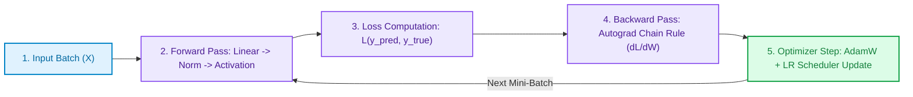
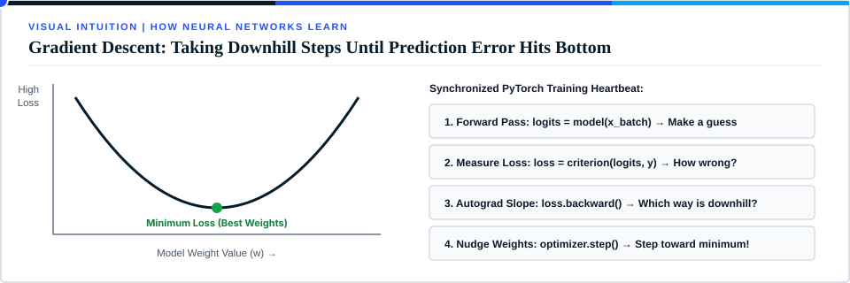
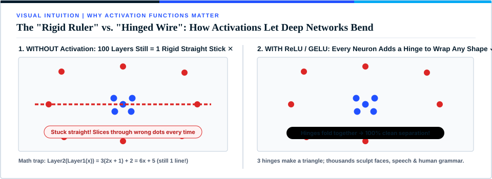

# Module 04: Deep Learning Fundamentals, PyTorch & Reinforcement Learning

> **Difficulty:** Intermediate | **Estimated Study Time:** 8-10 Hours | **Prerequisites:** [Module 02: Math & Statistics](../01-foundations/02_math_and_statistics.md), [Module 03: Classical ML](../02-machine-learning/03_classical_ml_and_recsys.md)  
> **Focus:** Computational graphs, reverse-mode autograd, vanishing gradients, LayerNorm/RMSNorm, AdamW optimization, and policy gradients in RL

[← Previous: Module 03: Classical ML & RecSys](../02-machine-learning/03_classical_ml_and_recsys.md) | [Roadmap Index](../../README.md) | [Next: Module 05: NLP, CV & Multimodal →](../04-generative-ai/05_nlp_cv_and_multimodal.md)

---

## 1. Overview

While classical tree ensembles excel on structured tabular data, unstructured domains (vision, audio, raw text, and reinforcement learning environments) require representation learning. **Deep Learning** replaces manual feature engineering with stacked parametric layers that discover hierarchical representations directly from raw inputs via the 5-step training heartbeat:



<p align="center">
  
</p>

---

## 2. Learning Objectives

By the end of this module, you will be able to:
- **Construct and execute robust PyTorch training loops** enforcing gradient zeroing, loss scaling, gradient clipping, and `eval()` context isolation.
- **Explain non-linear activation mechanics** (ReLU, GeLU, SwiGLU) and prove why stacking purely linear layers collapses mathematically to a single linear transformation.
- **Diagnose and resolve vanishing and exploding gradients** using residual skip connections, LayerNorm/RMSNorm, and Xavier/He parameter initialization.
- **Formulate the AdamW optimization algorithm**, distinguishing true decoupled weight decay from L2 regularization under adaptive moment tracking.
- **Calculate GPU VRAM requirements** for mixed-precision training (`BF16`), understanding Distributed Data Parallel (`DDP`) vs. Fully Sharded Data Parallel (`FSDP`).
- **Explain Policy Gradient RL foundations** (REINFORCE, PPO, GRPO) and their role in post-training LLM alignment.

---

## 3. Prerequisites

- **Vector Calculus & Linear Algebra:** Matrix multiplication, partial derivatives, and the chain rule from [Module 02](../01-foundations/02_math_and_statistics.md).
- **Python & NumPy:** Vectorized array operations and broadcasting from [Module 01](../01-foundations/01_python_sql_and_data_stack.md).

---

## 4. Core Concepts

### 4.1 Inside One Artificial Neuron
A biological-inspired artificial neuron performs an affine projection followed by a non-linear activation:
$$z = \mathbf{w}^T \mathbf{x} + b, \quad a = \phi(z)$$

Where $\mathbf{w}$ weights input signals, $b$ acts as a firing threshold, and $\phi(\cdot)$ acts as a non-linear activation function.

<p align="center">
  
</p>

### 4.2 Why Non-Linear Activations Are Mandatory
Without an activation $\phi$ between layers, deep networks collapse into a single shallow linear layer:
$$\mathbf{y} = W_2(W_1 \mathbf{x} + \mathbf{b}_1) + \mathbf{b}_2 = (W_2 W_1)\mathbf{x} + (W_2 \mathbf{b}_1 + \mathbf{b}_2) = W_{\text{eff}}\mathbf{x} + \mathbf{b}_{\text{eff}}$$
Non-linear activations break linearity, enabling neural networks to act as **Universal Approximators** capable of mapping arbitrarily complex decision boundaries.

### 4.3 Modern Activation Functions
- **ReLU:** $\max(0, z)$. Fast, non-saturating for $z > 0$, but suffers from "Dying ReLU" when neurons stay negative.
- **GELU (Gaussian Error Linear Unit):** $z \cdot \Phi(z) = z \cdot \frac{1}{2}\left[1 + \text{erf}\left(\frac{z}{\sqrt{2}}\right)\right]$. Smooth, probabilistic gating used in standard Transformers (BERT, GPT-2).
- **SwiGLU (Swish Gated Linear Unit):** $\text{Swish}_\beta(xW) \otimes (xV)$. Used in modern flagship LLMs (LLaMA, Mistral, Gemma) for superior empirical gradient flow.

---

## 5. Technical Deep Dive

### 5.1 The PyTorch Engine: Autograd & Computational Graph
PyTorch builds a dynamic directed acyclic graph (DAG) during the forward pass. Each tensor with `requires_grad=True` maintains a `grad_fn` tracking operations for reverse-mode automatic differentiation:

```python
import torch
import torch.nn as nn

class ProductionMLP(nn.Module):
    def __init__(self, in_features: int, hidden_dim: int, num_classes: int):
        super().__init__()
        self.net = nn.Sequential(
            nn.Linear(in_features, hidden_dim),
            nn.LayerNorm(hidden_dim),
            nn.GELU(),
            nn.Dropout(p=0.1),
            nn.Linear(hidden_dim, num_classes),
        )

    def forward(self, x: torch.Tensor) -> torch.Tensor:
        return self.net(x)  # Returns raw logits (unnormalized!)
```

#### Production Training Loop with Gradient Clipping
```python
model = ProductionMLP(in_features=32, hidden_dim=64, num_classes=2)
optimizer = torch.optim.AdamW(model.parameters(), lr=1e-3, weight_decay=1e-2)
criterion = nn.CrossEntropyLoss()

for epoch in range(5):
    model.train()
    for X_batch, y_batch in train_loader:
        optimizer.zero_grad(set_to_none=True)  # Memory efficient!
        logits = model(X_batch)
        loss = criterion(logits, y_batch)
        loss.backward()

        # Prevent gradient explosion
        torch.nn.utils.clip_grad_norm_(model.parameters(), max_norm=1.0)
        optimizer.step()
```

### 5.2 Layer Normalization vs. Batch Normalization
| Dimension | Batch Normalization (BatchNorm) | Layer Normalization (LayerNorm / RMSNorm) |
|---|---|---|
| **Normalization Axis** | Across the batch dimension for each channel independently | Across feature dimensions for each individual token independently |
| **Batch Size Dependency** | Fails on small batches ($B < 8$) due to noisy statistics | Completely invariant to batch size ($B=1$ works identically) |
| **Sequence Length** | Incompatible with variable sequence lengths | Standard architecture for all modern Transformers |

### 5.3 AdamW vs. Standard Adam: Decoupled Weight Decay
In standard Adam with L2 regularization, the weight penalty is added directly to the gradient $g_t$, which then gets scaled inversely by the historical second moment $\sqrt{v_t}$. In **AdamW**, weight decay is subtracted directly from the weight vector *after* the adaptive step, preventing heavily penalized weights from decaying slower than intended:
$$\theta_{t+1} = \theta_t - \eta_t \lambda \theta_t - \frac{\eta_t}{\sqrt{\hat{v}_t} + \epsilon} \hat{m}_t$$

### 5.4 GPU VRAM Math: Static vs. Dynamic Allocation
During mixed-precision `BF16` training with AdamW, **every 1B parameters requires ~16 GB of static GPU memory** before activations:
- $2\text{ GB}$: Model weights (`BF16`).
- $2\text{ GB}$: Gradients (`BF16`).
- $12\text{ GB}$: Optimizer states ($4\text{ GB}$ FP32 master weights + $4\text{ GB}$ momentum $m_t$ + $4\text{ GB}$ variance $v_t$).

---

## 6. Hands-on Implementation

Implement `LayerNorm` in pure NumPy and verify zero mean and unit variance per token across a batched tensor:

```python
import numpy as np

def layer_norm_forward(
    x: np.ndarray, gamma: np.ndarray, beta: np.ndarray, eps: float = 1e-5
) -> np.ndarray:
    mean = x.mean(axis=-1, keepdims=True)
    var = x.var(axis=-1, keepdims=True)
    x_hat = (x - mean) / np.sqrt(var + eps)
    return gamma * x_hat + beta

tokens = np.random.default_rng(0).normal(loc=5.0, scale=3.0, size=(2, 4, 16))
normed = layer_norm_forward(tokens, gamma=np.ones(16), beta=np.zeros(16))

assert normed.shape == (2, 4, 16)
assert np.allclose(normed.mean(axis=-1), 0.0, atol=1e-5)
assert np.allclose(normed.std(axis=-1), 1.0, atol=1e-4)
print("Lab 04 Passed! Output shape:", normed.shape)
```

---

## 7. Practical Exercises

### Exercise 1: Vanishing Gradient Simulation
1. Construct an $L=20$ layer feed-forward network in PyTorch using standard `nn.Sigmoid()` without residual connections.
2. Initialize weights with large variances and plot the gradient norms of the first layer $\frac{\partial \mathcal{L}}{\partial W_1}$ vs. the final layer $\frac{\partial \mathcal{L}}{\partial W_{20}}$ over 100 iterations.
3. Replace activations with `nn.GELU()` and residual additions $x + F(x)$, and observe how first-layer gradient vanishing is eliminated.

### Exercise 2: Implementing RMSNorm from Scratch
1. Implement Root Mean Square Normalization (RMSNorm) in PyTorch as used in LLaMA:
   $$\text{RMSNorm}(x) = \frac{x}{\sqrt{\frac{1}{d} \sum_{i=1}^d x_i^2 + \epsilon}} \odot \gamma$$
2. Benchmark runtime speed against standard `nn.LayerNorm` over 1,000 forward passes.

---

## 8. Mini Project

### Toy Autograd Engine & MLP Classifier in Pure NumPy
Build a minimal reverse-mode automatic differentiation engine from scratch:
- **Requirements:**
  1. Create a `Value` class tracking scalar numbers, children nodes, and local gradients.
  2. Implement forward and backward passes for addition, multiplication, and ReLU.
  3. Construct a 2-layer MLP and train it on a non-linear XOR dataset using gradient descent.
  4. Verify that loss drops to $< 0.01$ within 200 epochs.

---

## 9. Advanced Topics

- **Distributed Data Parallel (DDP) vs. FSDP:** Understanding how PyTorch DDP synchronizes gradients via ring-AllReduce, whereas Fully Sharded Data Parallel (FSDP / ZeRO-3) shards parameters, gradients, and optimizer states across worker GPUs.
- **FlashAttention & Kernel Fusion:** How tiling attention matrices into fast GPU on-chip SRAM avoids slow High-Bandwidth Memory (HBM) round-trips.
- **Group Relative Policy Optimization (GRPO):** How reasoning models (DeepSeek-R1) train verifiable problem-solving without a separate neural critic network.

---

## 10. Common Mistakes & Gotchas

1. **Passing Softmax Outputs to `CrossEntropyLoss`:** PyTorch's `nn.CrossEntropyLoss` combines `LogSoftmax` and `NLLLoss` in one numerically stable operation. Passing `F.softmax(logits)` applies softmax twice, distorting gradients.
2. **In-Place Operations Mutating Tensors:** Writing `x += y` instead of `x = x + y` overwrites intermediate memory buffers required by Autograd for backpropagation.
3. **Forgetting `model.eval()` and `torch.no_grad()`:** Running validation without `model.eval()` leaves Dropout active and updates BatchNorm running averages during evaluation.

---

## 11. Interview Questions & System Design

### Q1: Why does AdamW outperform standard Adam when using weight decay?
In standard Adam with L2 regularization, the weight penalty $\lambda \theta$ is added to the gradient, which subsequently gets divided by $\sqrt{v_t} + \epsilon$. Weights with large historical gradients receive smaller effective weight decay than weights with small gradients. AdamW decouples weight decay, applying it uniformly regardless of gradient magnitude.

### Q2: How does a Residual Connection mathematically prevent vanishing gradients?
In a residual network, layer output is $a_{l+1} = a_l + \mathcal{F}(a_l)$. The gradient of the loss with respect to activation $a_l$ is:
$$\frac{\partial \mathcal{L}}{\partial a_l} = \frac{\partial \mathcal{L}}{\partial a_{l+1}} \left( I + \frac{\partial \mathcal{F}(a_l)}{\partial a_l} \right) = \frac{\partial \mathcal{L}}{\partial a_{l+1}} + \frac{\partial \mathcal{L}}{\partial a_{l+1}} \frac{\partial \mathcal{F}(a_l)}{\partial a_l}$$
The identity term $I$ ensures that gradients can propagate directly back through layers without exponential dampening, even if $\frac{\partial \mathcal{F}}{\partial a_l}$ vanishes.

---

## 12. Recommended Resources

- **Interactive Course:** [Neural Networks: Zero to Hero](https://karpathy.ai/zero-to-hero.html) by Andrej Karpathy.
- **Free Textbook:** [Understanding Deep Learning](https://udlbook.github.io/udlbook/) by Simon J.D. Prince (Chapters 3–7).
- **Paper:** [Decoupled Weight Decay Regularization (AdamW)](https://arxiv.org/abs/1711.05101) (Loshchilov & Hutter, 2017).

---

## 13. Completion Checklist

- [ ] Implement the standard 5-step PyTorch training iteration with gradient clipping.
- [ ] Derive why multi-layer linear networks collapse to a single linear equation without activations.
- [ ] Explain the difference between LayerNorm and BatchNorm with respect to batch size sensitivity.
- [ ] Calculate the static VRAM footprint for a 7B parameter model under FP32 and BF16 AdamW training.
- [ ] Successfully implement and verify `layer_norm_forward` in pure NumPy.

---

[← Previous: Module 03: Classical ML & RecSys](../02-machine-learning/03_classical_ml_and_recsys.md) | [Home](../../README.md) | [Next: Module 05: NLP, CV & Multimodal →](../04-generative-ai/05_nlp_cv_and_multimodal.md)
