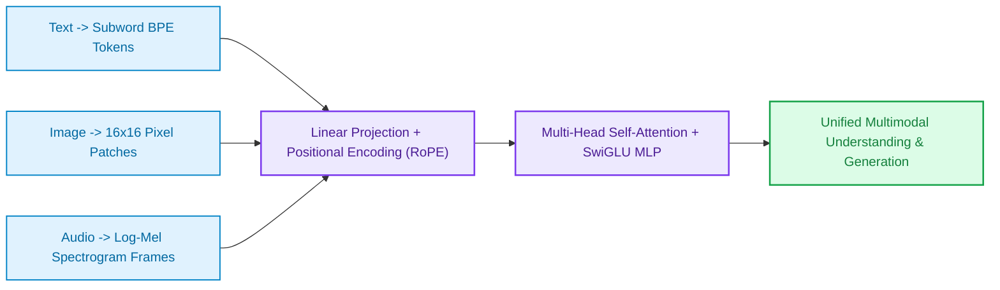
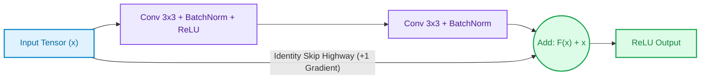

# Module 05: NLP, Transformers, Computer Vision & Multimodal AI

> **Estimated Study Time:** 9–11 Hours | **Prerequisites:** [Module 04](../02-core-ml-and-dl/04_deep_learning_and_rl.md) | **Lab:** [Mini-Transformer Attention Notebook](../../notebooks/03_mini_transformer_attention.ipynb) | **[Open in Colab](https://colab.research.google.com/github/FirdowsRahaman/ai-ml-fresher-roadmap/blob/main/notebooks/03_mini_transformer_attention.ipynb)**

[← Previous: Module 04 — Deep Learning & RL](../02-core-ml-and-dl/04_deep_learning_and_rl.md) | [Home](../../README.md) | [Next: Module 06 — LLMs, Fine-Tuning & Advanced RAG →](./06_llms_finetuning_and_rag.md)

---

## Mental Model: Convergence of Language, Vision & Audio

Historically, NLP used recurrent networks, Vision used CNNs, and Audio used signal-processing pipelines. Modern AI unifies **all three modalities** by converting raw signals into sequences of dense patch/subword/frame tokens projected into a shared **Transformer Self-Attention** backbone.



---

## Tier 1: Core Foundations (NLP Foundations, Transformers & CNNs)

### 1. Subword Tokenization, Lexical Baselines & Contextual Embeddings

#### 1.1 Subword Byte-Pair Encoding (`BPE`) vs. Lexical Weighting (`TF-IDF` / `BM25`)
> **2026 Scope Note:** Legacy preprocessing pipelines (manual regex stemming, stopword stripping, `CountVectorizer` Bag-of-Words, and static 2013 `Word2Vec` CBOW/Skip-gram tables) are obsolete in modern AI engineering. Focus on **subword tokenizers (`BPE`)** for neural models and **`TF-IDF` / `BM25`** for sparse hybrid search.

- **Byte-Pair Encoding (`BPE` / `Tiktoken`):** Modern LLMs preserve exact casing, punctuation, and syntax — iteratively merging frequent byte/character pairs into a fixed vocabulary (`~100k–200k` subword tokens) to represent arbitrary text, code, and multilingual scripts with **zero Out-Of-Vocabulary (`<UNK>`) failures**.
- **Sparse Lexical Scoring (`TF-IDF` & `BM25`):** Multiplies local term frequency by inverse corpus rarity:
  $$\text{TF-IDF}(t, d, D) = \text{TF}(t, d) \times \log\left(\frac{N}{|\{d \in D : t \in d\}|}\right)$$
  While purely lexical (zero semantic overlap between `"car"` and `"automobile"`), **Okapi `BM25`** (which adds saturating term frequency and document-length normalization) remains indispensable as the sparse half of **Hybrid RAG** (`Module 06`).
- **Contextual vs. Static Embeddings:** Unlike legacy static word tables that assigned one fixed vector to `"bank"` everywhere, Transformer encoders (`BERT`, `ModernBERT`, `BGE`) compute dynamic, context-sensitive token vectors via self-attention over the entire sequence.

---

### 2. Transformer Architecture & Self-Attention Mechanics

#### 2.1 Scaled Dot-Product Attention ($Q, K, V$), Causal Masking & `RoPE`
- **In Plain English (The Library Analogy):** When reading *"The server crashed because **it** ran out of RAM"*, how does the word **`"it"`** figure out it refers to `"server"` and not `"RAM"`? Every token creates three vectors:
  - **Query ($Q$):** A sticky note asking *"What am I looking for?"* (e.g., `"it"` looking for a singular noun subject).
  - **Key ($K$):** The label on every word's spine announcing *"Here is what I am!"*
  - **Value ($V$):** The actual meaning inside each word passed forward when its Key matches your Query.
- **Causal Masking (No Peeking Ahead):** During training, an LLM reads the whole sentence at once for speed, so we grey out future words (`-inf`) to stop word #3 from cheating by peeking at word #4.
- **`RoPE` (Word Order):** Since pure attention treats a sentence like an unordered bag, **Rotary Positional Embeddings (`RoPE`)** slightly rotate each word's Query/Key angle by its position (`1st, 2nd, 3rd...`) so the model feels exact word distance.

<details>
<summary><b>Deep Dive: Attention Equation & Why We Divide by $\sqrt{d_k}$</b></summary>

$$\text{Attention}(Q, K, V) = \text{softmax}\left(\frac{Q K^\top}{\sqrt{d_k}} + M\right) V$$

Why divide by $\sqrt{d_k}$? When head dimension $d_k$ is large (e.g., `64` or `128`), raw dot products $q \cdot k$ grow large in variance ($\propto d_k$), pushing `softmax` into extreme `0.9999 / 0.0001` saturation where gradients vanish to zero. Dividing by $\sqrt{d_k}$ keeps scores well-behaved with unit variance. **Multi-Head Attention (`MHA`)** runs $h$ independent $(Q,K,V)$ heads in parallel so one head tracks grammar while another tracks long-range facts.

</details>

---

#### 2.2 Encoder-Only vs. Decoder-Only vs. Encoder-Decoder Topologies

| Architecture | Attention Visibility | Representative Models | Primary Production Use Cases |
|---|---|---|---|
| **Encoder-Only** | Bidirectional (sees full text) | `BERT`, `DeBERTa`, `BGE`, `ModernBERT` | Dense embeddings, Cross-Encoder reranking, NER, fast classification |
| **Decoder-Only** | Causal / Autoregressive (left-to-right) | `GPT`, `Gemini`, `Claude`, `Llama`, `Qwen` | Generative chat, code generation, reasoning, autonomous agents |
| **Encoder-Decoder** | Bidirectional input + Causal output | `T5`, `BART`, `Whisper` (Audio->Text) | Sequence-to-sequence translation, speech recognition (`Whisper`) |

---

### 3. Computer Vision: CNNs, ResNet & Transfer Learning

#### 3.1 Spatial Convolutions, Residual Identity Highways & Transfer Learning
Flattening a `1000×1000×3` image into a 1,000-unit dense layer creates **3 billion weights** in layer 1 alone while destroying 2D spatial locality. **CNNs** use small sliding kernels (local receptive fields + weight sharing) with spatial output size:
$$W_{\text{out}} = \left\lfloor \frac{W_{\text{in}} - K + 2P}{S} \right\rfloor + 1$$

**ResNet Skip Connections (He et al., 2015):** Learn residual $\mathcal{F}(x)$ added to identity shortcut $x$:



Because $\frac{\partial (x + \mathcal{F}(x))}{\partial x} = 1 + \frac{\partial \mathcal{F}}{\partial x}$, gradients flow backward unimpeded through the `+1` identity path even across 150+ layers.

```python
import torch
import torch.nn as nn
from torchvision import models

# Production Transfer Learning: Freeze pretrained backbone, train lightweight head
model = models.resnet50(weights=models.ResNet50_Weights.DEFAULT)
for param in model.parameters():
    param.requires_grad = False

model.fc = nn.Sequential(
    nn.Linear(model.fc.in_features, 256),
    nn.ReLU(),
    nn.Dropout(0.3),
    nn.Linear(256, 2),
)
optimizer = torch.optim.AdamW(model.fc.parameters(), lr=1e-3)
```

---

## Tier 2: Production Architecture & Scale (Detection, ViT, CLIP & Audio AI)

### 4. Vision Hierarchy (`IoU`, `mAP`, `ViT`) & Multimodal Alignment (`CLIP`)

#### 4.1 Detection/Segmentation Metrics (`IoU`, `mAP`), Vision Transformers (`ViT`) & `CLIP`
- **Classification** (`ConvNeXt`, `ViT`) -> single image label; evaluated via Accuracy / Top-5.
- **Object Detection** (`YOLOv11`, `RT-DETR`) -> `[x, y, w, h, class, conf]` boxes; evaluated via **IoU** ($\frac{\text{Area}(B_p \cap B_{gt})}{\text{Area}(B_p \cup B_{gt})}$) and **mAP@0.5:0.95**.
- **Semantic vs. Instance Segmentation** (`SegFormer`, `SAM 2`) -> pixel-level class mask (`mIoU`) vs. distinct per-object instance masks (`Mask AP`).
- **`CNN` vs. `Vision Transformer (ViT)`:** CNNs have built-in "neighboring pixels belong together" intuition (win on smaller `<100k` image datasets); `ViT` chops an image into `16×16` square tiles like words in a sentence (wins at internet scale).
- **`CLIP` (Connecting Images & Text in One Map):** Imagine a memory-matching game with 32 photos and 32 captions on a table. `CLIP` trains an Image Encoder and a Text Encoder together so Photo #1's vector lands right on top of Caption #1's vector while pushing all 31 wrong captions away—unlocking instant image search and zero-shot labeling without retraining!

<details>
<summary><b>Deep Dive: `IoU` Formula & `CLIP` Symmetric `InfoNCE` Loss</b></summary>

- **Intersection over Union (`IoU`):** $\text{IoU} = \frac{\text{Area}(B_{\text{pred}} \cap B_{\text{gt}})}{\text{Area}(B_{\text{pred}} \cup B_{\text{gt}})}$. Predictions with $\text{IoU} \ge 0.5$ (or swept across `0.50:0.95` for `mAP`) count as True Positives.
- **`InfoNCE` Contrastive Objective:** Computes the $N \times N$ cosine similarity matrix across a batch of $N$ `(image, text)` pairs and applies symmetric cross-entropy along rows and columns to maximize the $N$ diagonal matches against $N^2 - N$ negatives.

</details>

---

### 5. Audio & Speech AI (`Mel Spectrograms`, `Whisper` & Native Audio Models)

#### 5.1 Log-Mel Spectrograms, `Whisper` ASR & Native Neural Audio Codecs
1. **Waveform to Log-Mel Spectrogram:** Raw 16 kHz 1D audio waveforms are windowed via Short-Time Fourier Transform (STFT) into 2D **Log-Mel Spectrograms** (`80` or `128` Mel frequency bins × time frames, matching human pitch perception).
2. **`Whisper` Architecture (OpenAI):** Passes the Log-Mel spectrogram through 2 `1D Conv` layers + a **Transformer Encoder**, then decodes timestamps, language IDs, and transcribed/translated text autoregressively via a **Transformer Decoder**.
3. **Native Multimodal Audio Tokens:** Frontier voice models (`Gemini Live`, `GPT-4o Realtime`) discretize audio directly into neural codec tokens (`SoundStream` / `EnCodec`), enabling low-latency speech-in, speech-out reasoning while preserving emotion, tone, and speaker prosody without a brittle `ASR -> Text LLM -> TTS` cascade.

---

## Mini Hands-On Lab (15-Minute Exercise)

Implement **Causal Scaled Dot-Product Self-Attention** in pure NumPy and verify that changing future tokens (`t = 3`) has **zero** effect on earlier token outputs (`t = 0, 1`):

```python
import numpy as np

def causal_self_attention(Q: np.ndarray, K: np.ndarray, V: np.ndarray) -> np.ndarray:
    seq_len, d_k = Q.shape
    scores = (Q @ K.T) / np.sqrt(d_k)
    # Upper-triangular mask (above main diagonal) set to -inf
    causal_mask = np.triu(np.ones((seq_len, seq_len), dtype=bool), k=1)
    scores = np.where(causal_mask, -1e9, scores)
    shifted = scores - np.max(scores, axis=-1, keepdims=True)
    weights = np.exp(shifted) / np.sum(np.exp(shifted), axis=-1, keepdims=True)
    return weights @ V

rng = np.random.default_rng(7)
Q1 = rng.normal(size=(4, 8))
K1 = rng.normal(size=(4, 8))
V1 = rng.normal(size=(4, 8))
out1 = causal_self_attention(Q1, K1, V1)

# Mutate the last future token (index 3) completely:
Q2, K2, V2 = Q1.copy(), K1.copy(), V1.copy()
K2[3] *= 999.0
V2[3] *= -999.0
out2 = causal_self_attention(Q2, K2, V2)

assert np.allclose(out1[:3], out2[:3]), "Causal mask leaked future tokens!"
print("Lab 05 Passed! Causal attention verified with zero future leakage.")
```

---

## Key Engineering Takeaways
- Know the **Scaled Dot-Product Attention** equation $\text{softmax}(QK^\top / \sqrt{d_k} + M)V$ cold — especially why $\frac{1}{\sqrt{d_k}}$ prevents softmax gradient saturation and how causal masking prevents future token leakage.
- Contrast **Encoder (`BERT` — embeddings/reranking)** vs. **Decoder (`GPT`/`Llama` — generation)** vs. **Encoder-Decoder (`Whisper`/`T5`)**.
- Explain **ResNet skip connections** via the `+1` identity gradient term, **`CLIP`** via symmetric InfoNCE contrastive alignment, and **Audio AI** via Log-Mel Spectrograms vs. native neural audio codecs.

---

[← Previous: Module 04 — Deep Learning & RL](../02-core-ml-and-dl/04_deep_learning_and_rl.md) | [Home](../../README.md) | [Next: Module 06 — LLMs, Fine-Tuning & Advanced RAG →](./06_llms_finetuning_and_rag.md)
