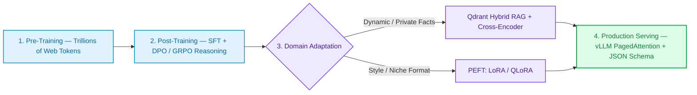
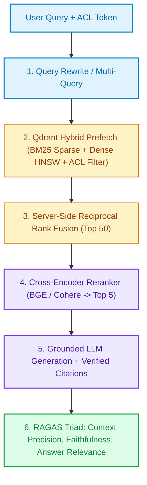

# Module 06: Generative AI, LLMs, Fine-Tuning (`LoRA`/`DPO`), `Qdrant` & Production RAG

> **Estimated Study Time:** 10–12 Hours | **Prerequisites:** [Module 05](./05_nlp_cv_and_multimodal.md) | **Focus:** LLM Post-Training, Structured Outputs, `Qdrant` Vector Indexing, Hybrid RAG & `vLLM` Serving

[← Previous: Module 05 — NLP, CV & Multimodal](./05_nlp_cv_and_multimodal.md) | [Home](../../README.md) | [Next: Module 07 — AI Agents Fundamentals →](../04-agentic-ai/07_ai_agents_fundamentals.md)

---

## Mental Model: How Base Models Become Grounded Enterprise Systems

A raw pre-trained LLM is merely a next-token internet autocomplete engine. Turning it into a reliable enterprise system requires **Post-Training Alignment (`SFT` + `DPO`/`GRPO`)**, **Structured Schema Constraints**, **Filterable Hybrid Vector Search (`Qdrant` + Reranking)**, and **Memory-Efficient Inference (`vLLM`)**.



---

## Tier 1: Core Foundations (LLM Mechanics, Structured Outputs, Chunking & Vector Stores)

### 1. LLM Landscape, VRAM Sizing & Quantization

#### 1.1 Discriminative vs. Generative Paradigms & GPU Memory Sizing
- **Discriminative Models** learn conditional boundaries $P(y \mid x)$ to classify or score inputs; **Generative Models** model autoregressive or diffusion distributions $P(x_t \mid x_{<t})$ to synthesize text, code, images, or audio.
- **Modern 2026 Model Ecosystem:**
  - *Frontier API Models:* **Google Gemini 3 / 3.1 Pro & Flash** (and `Gemini 2.5`), **OpenAI GPT-5 / GPT-5.4** (unified dynamic test-time reasoning), **Anthropic Claude 4.5 / 4.6 Opus & Sonnet**.
  - *Open-Weight Models (Self-Hostable):* **Meta Llama 4** (multimodal MoE), **Alibaba Qwen 3 / 3.5**, **DeepSeek-V3 / R1**, **Google Gemma 3 / Mistral**.
- **GPU VRAM Capacity Formula:**
  - `FP32` = 4 bytes/param | `FP16` / `BF16` = **2 bytes/param** | `INT8` / `FP8` = **1 byte/param** | `INT4` (`AWQ` / `GGUF`) = **0.5 bytes/param** (+ ~20% overhead for KV cache & activations).
  - *Sizing Example:* A **70B** model in `BF16` requires $70 \times 2 \times 1.2 \approx \mathbf{168\text{ GB VRAM}}$ (2× 80GB GPUs), whereas **4-bit quantization** shrinks it to $70 \times 0.5 \times 1.2 \approx \mathbf{42\text{ GB VRAM}}$.

---

### 2. Prompting, Structured Outputs & Hallucination Grounding

#### 2.1 Constrained Decoding & Guaranteed JSON Schemas
In production software, asking an LLM *"Please reply in valid JSON"* via plain-text prompting frequently fails on complex schemas due to markdown wrappers, trailing commas, or missing keys. Modern APIs and open-source engines (`Outlines`, `vLLM`) enforce **Grammar-Constrained Decoding** — masking invalid vocabulary tokens at every decoding step to achieve **100% structural schema compliance** ([OpenAI Structured Outputs Report, 2024](https://openai.com/index/introducing-structured-outputs-in-the-api/); [Willard & Louf, 2023](https://arxiv.org/abs/2307.09702)):

```python
from pydantic import BaseModel, Field

class InvoiceExtraction(BaseModel):
    vendor_name: str
    invoice_total_usd: float = Field(ge=0.0)
    line_items: list[str]
    requires_manual_audit: bool

# Passed directly to Gemini response_schema / OpenAI response_format / vLLM guided_json
json_schema = InvoiceExtraction.model_json_schema()
```

---

#### 2.2 Why Hallucinations Happen — and What RAG Actually Guarantees
LLMs optimize next-token likelihood rather than factual truth, smoothly extrapolating plausible-sounding fabrications when knowledge is missing or ambiguous.
- **Engineering Reality:** **RAG grounds the model in retrieved context and drastically reduces hallucinations, but NEVER 100% eliminates them.** If retrieval pulls noisy chunks, if key facts sit buried in the middle of a long context window, or if system prompts lack strict abstention rules, the model can still misinterpret context or fabricate citations. Always pair RAG with explicit abstention prompts (*"If unsupported by context, state insufficient information"*) and automated faithfulness checks.

---

### 3. Document Chunking & RAG vs. Fine-Tuning

#### 3.1 Document Chunking Strategies
Poor chunking destroys retrieval quality before embeddings even run:
1. **Fixed-Token with Overlap (e.g., `512` tokens, `64` overlap):** Simple baseline; risks slicing tables or clauses mid-sentence.
2. **Recursive Character / Markdown-Header Splitting:** Splits hierarchically by headings (`#`, `##`), paragraphs (`\n\n`), then sentences.
3. **Layout-Aware Parsing (`Docling`, `Marker`, AWS Textract):** Preserves multi-column PDFs, financial tables, and figures intact as structured Markdown/JSON.
4. **Contextual Retrieval:** Prepends a concise document-level summary (e.g., *"From Acme Corp Q3 2026 10-Q filing:"*) to every chunk prior to embedding and BM25 indexing — reducing top-20 chunk retrieval failure rates by **49%** (and **67%** when paired with reranking; [Anthropic Engineering, 2024](https://www.anthropic.com/news/contextual-retrieval)).

---

#### 3.2 Choosing Between RAG and Fine-Tuning (`LoRA`)

| Dimension | Retrieval-Augmented Generation (RAG) | Fine-Tuning (`LoRA` / `SFT`) |
|---|---|---|
| **Primary Purpose** | Dynamic facts, private knowledge bases, source citations, per-user ACLs | Teaching domain tone, compact output formats, specialized SQL/DSL syntax, or distilling a large teacher into a fast 8B student |
| **Data Freshness** | Instant (upsert/delete vectors in milliseconds) | Static until the next training job |
| **Hallucination Control** | High (verifiable chunk citations) | Low on unseen facts |

---

## Tier 2: Production Architecture & Scale (Post-Training, `Qdrant`, Hybrid RAG & `vLLM`)

### 4. Post-Training (`SFT`, `LoRA`/`QLoRA`, `DPO`/`GRPO`) & Test-Time Compute

#### 4.1 Parameter-Efficient Fine-Tuning & Alignment Mechanics
1. **`LoRA` (Low-Rank Adaptation):** Freezes pretrained weight matrix $W_0 \in \mathbb{R}^{d \times k}$ and injects trainable low-rank adapters $\Delta W = B A$ where $A \in \mathbb{R}^{r \times k}, B \in \mathbb{R}^{d \times r}$ with rank $r \ll d$ (e.g., $r = 16$) — reducing trainable parameters by up to **10,000× (>99.9%)** and GPU memory by **3×** ([Hu et al., ICLR 2022](https://arxiv.org/abs/2106.09685)). **`QLoRA`** ([Dettmers et al., NeurIPS 2023](https://arxiv.org/abs/2305.14314)) quantizes frozen $W_0$ to 4-bit `NF4` while training `BF16` LoRA adapters on a single consumer/24 GB GPU.
2. **Preference Alignment (`RLHF` vs. `DPO`):** **Direct Preference Optimization (`DPO`)** ([Rafailov et al., NeurIPS 2023](https://arxiv.org/abs/2305.18290)) optimizes the policy directly on `(prompt, chosen, rejected)` preference pairs via a closed-form loss without maintaining a separate `PPO` reward model.
3. **Reasoning Models (`GRPO` & Unified Test-Time Compute):** Frontier 2025–2026 architectures (`GPT-5`, `Gemini 3 Deep Think`, `Claude 4.5/4.6 Extended Thinking`, `DeepSeek-R1`) train via **Reinforcement Learning with Verifiable Rewards (`GRPO`)** ([Shao et al., 2024](https://arxiv.org/abs/2402.03300); [DeepSeek-AI, 2025](https://arxiv.org/abs/2501.12948)) against code/math verifiers, dynamically allocating **test-time thinking tokens** based on task difficulty.

---

### 5. Production Vector Databases & `Qdrant` Architecture

#### 5.1 Selecting the Right Vector Search Engine

| Engine | Architecture | Sweet Spot & Trade-Offs |
|---|---|---|
| **`Qdrant`** | Dedicated Rust engine (`HNSW` + Sparse + Payload Index) | **Top choice for Production RAG & Agents:** local `:memory:`/disk mode up to distributed cloud, **Filterable HNSW**, native Dense+Sparse RRF, and 32× Binary Quantization |
| **`pgvector`** | PostgreSQL extension (`HNSW` / `StreamingDiskANN`) | Great when vectors live alongside relational ACID tables at moderate scale (`<10M–50M` vectors) |
| **`FAISS`** | C++/GPU in-memory ANN library (Meta) | Ultra-fast raw ANN math inside custom Python/C++ services; **not** a database (no CRUD API, WAL durability, or metadata filtering engine out of the box) |
| **`OpenSearch`** | Distributed Lucene + `k-NN` cluster | Heavy enterprise log/search stacks already standardized on AWS OpenSearch |

---

#### 5.2 Why `Qdrant` Excels: Filterable HNSW, Native Hybrid RRF & Quantization
1. **Solving the Metadata Filtering Trap (`Filterable HNSW`):**
   - *Naive Post-Filtering* runs ANN `Top-K` first and drops unauthorized/mismatched tenant docs afterward — often returning **0 results** when a tenant owns `<1%` of the index!
   - *Naive Pre-Filtering* masks out nodes in an `HNSW` graph, severing graph edges and ruining recall.
   - **`Qdrant` Filterable HNSW** ([Qdrant Architecture Guide](https://qdrant.tech/articles/filtrable-hnsw/)) builds additional payload-indexed subgraph links directly inside `HNSW` (and switches automatically to exact/indexed scan at tiny filter cardinality), guaranteeing low-latency filtered recall for multi-tenant ACLs (`tenant_id`, `role`, `date_range`).
2. **Binary & Scalar Quantization:** Compresses `FP32` vectors to `INT8` (**4× less RAM**) or 1-bit **Binary Quantization** (**32× less RAM** and up to **40× faster retrieval** on high-dimensional embeddings $\ge 1024$d; [Qdrant Quantization Docs](https://qdrant.tech/documentation/concepts/quantization/)), oversampling candidates in RAM and rescoring top hits from disk.
3. **Single-Call Hybrid Search (`Prefetch` + Server-Side `RRF`):**

```python
from qdrant_client import QdrantClient, models

# Runs 100% in-process locally (swap url="https://..." for Docker / Qdrant Cloud!)
client = QdrantClient(":memory:")

client.create_collection(
    collection_name="enterprise_kb",
    vectors_config={"dense": models.VectorParams(size=4, distance=models.Distance.COSINE)},
    sparse_vectors_config={"bm25": models.SparseVectorParams()},
)

client.upsert(
    collection_name="enterprise_kb",
    points=[
        models.PointStruct(
            id=1,
            vector={
                "dense": [0.9, 0.1, 0.2, 0.0],
                "bm25": models.SparseVector(indices=[101, 409], values=[1.8, 3.2]),
            },
            payload={"tenant_id": "acme", "doc_id": "POL-409", "text": "OAuth token rotation policy."},
        )
    ],
)

# Native Hybrid Search (Dense + Sparse) with ACL Payload Filter & Server-Side RRF Fusion:
results = client.query_points(
    collection_name="enterprise_kb",
    prefetch=[
        models.Prefetch(query=[0.88, 0.12, 0.18, 0.0], using="dense", limit=20),
        models.Prefetch(
            query=models.SparseVector(indices=[409], values=[1.0]),
            using="bm25",
            limit=20,
        ),
    ],
    query=models.FusionQuery(fusion=models.Fusion.RRF),
    query_filter=models.Filter(
        must=[models.FieldCondition(key="tenant_id", match=models.MatchValue(value="acme"))]
    ),
    limit=5,
)
```

---

### 6. End-to-End Advanced RAG Pipeline & `RAGAS` Evaluation

#### 6.1 Hybrid Retrieval, Cross-Encoder Reranking & The `RAGAS` Triad
Dense embeddings capture semantic gist but blur exact part numbers, error codes (`ERR_409_AUTH`), and product SKUs. Combine `Qdrant` Hybrid `RRF` (`Top 50`) with a **Cross-Encoder Reranker (`BGE-Reranker` / `Cohere Rerank` -> `Top 5`)** and evaluate continuously using the **`RAGAS` Triad**:



---

### 7. LLM Inference Optimization: `TTFT`, `TPOT`, `KV Cache` & `vLLM`

#### 7.1 Prefill vs. Decode Bottlenecks & `PagedAttention`
- **`TTFT` (Time-To-First-Token — Prefill):** Processes all prompt tokens in parallel; **compute-bound**. Accelerated via **Prefix / Prompt Caching**.
- **`TPOT` (Time-Per-Output-Token — Decode):** Emits 1 token per step; **memory-bandwidth bound** (streams weights + KV cache from HBM every token). Accelerated via **Quantization (`FP8`/`AWQ`)** and **Speculative Decoding**.
- **`PagedAttention` (`vLLM`) & Continuous Batching:** Traditional contiguous KV-cache pre-allocation wastes **60%–80% of GPU memory** on internal/external fragmentation; `PagedAttention` stores `KV Cache` in non-contiguous fixed-size memory pages (cutting waste to **`<4%`**) and swaps finished requests at token granularity, increasing serving throughput **2×–4×** ([Kwon et al., SOSP 2023](https://arxiv.org/abs/2309.06180)).

---

## Mini Hands-On Lab (15-Minute Exercise)

Implement **Reciprocal Rank Fusion (`RRF`)** — the exact rank-merging algorithm running inside `Qdrant`'s `Fusion.RRF` — to combine lexical `BM25` hits and dense vector hits without brittle score normalization:

```python
def reciprocal_rank_fusion(
    ranked_lists: list[list[str]], k: int = 60, top_n: int = 3
) -> list[tuple[str, float]]:
    """RRF(d) = sum_{list} 1 / (k + rank_in_list(d)), 1-indexed."""
    rrf_scores: dict[str, float] = {}
    for ranking in ranked_lists:
        for rank_idx, doc_id in enumerate(ranking, start=1):
            rrf_scores[doc_id] = rrf_scores.get(doc_id, 0.0) + 1.0 / (k + rank_idx)
    return sorted(rrf_scores.items(), key=lambda item: item[1], reverse=True)[:top_n]

bm25_hits = ["doc_sku_99", "doc_refund", "doc_faq"]
dense_hits = ["doc_refund", "doc_policy", "doc_sku_99"]

fused = reciprocal_rank_fusion([bm25_hits, dense_hits], k=60, top_n=2)
top_ids = {doc for doc, _ in fused}
assert top_ids == {"doc_sku_99", "doc_refund"}
print("Lab 06 Passed! Top Hybrid RRF Results:", fused)
```

---

## Key Engineering Takeaways
- Size GPU memory fast: `BF16` $\approx 2$ bytes/param, `INT4` $\approx 0.5$ bytes/param (+ ~20% `KV Cache` overhead).
- Enforce **Structured Outputs (grammar-constrained JSON decoding)** in production pipelines rather than regex parsing.
- Use **`Qdrant` Filterable HNSW** (with payload ACL filters, native Dense+Sparse `RRF`, and Scalar/Binary Quantization) + **Cross-Encoder Reranking**, gated by the **`RAGAS` Triad**.
- Choose **RAG** for dynamic/cited facts, **`LoRA`/`QLoRA`** for domain formatting or distillation, and **`vLLM`** to optimize compute-bound **`TTFT`** and memory-bound **`TPOT`**.

---

[← Previous: Module 05 — NLP, CV & Multimodal](./05_nlp_cv_and_multimodal.md) | [Home](../../README.md) | [Next: Module 07 — AI Agents Fundamentals →](../04-agentic-ai/07_ai_agents_fundamentals.md)
