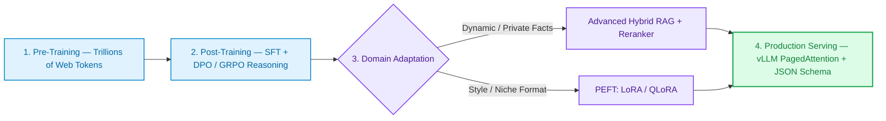
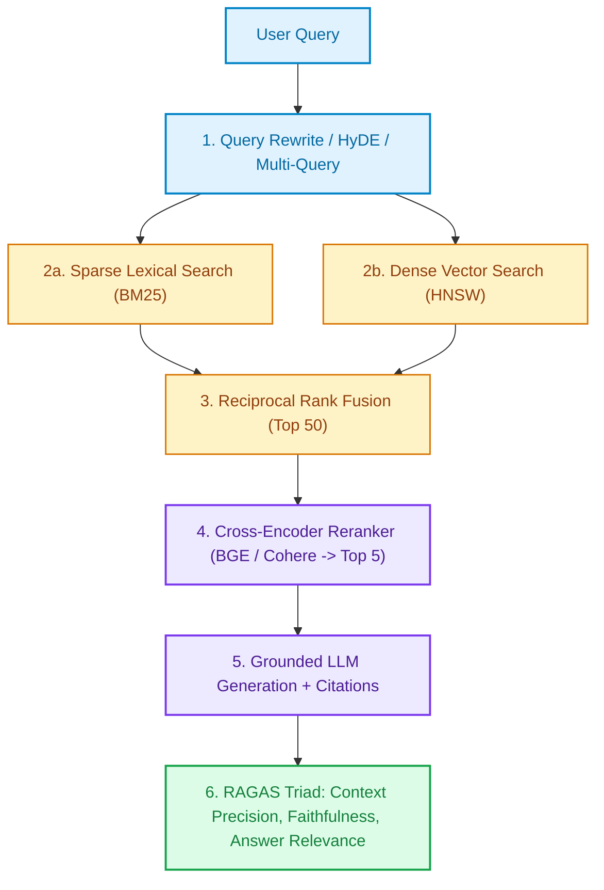

# Module 06: Generative AI, LLMs, Fine-Tuning (`LoRA`/`DPO`) & Production RAG

> **Estimated Study Time:** 10–12 Hours | **Prerequisites:** [Module 05](./05_nlp_cv_and_multimodal.md) | **Focus:** LLM Post-Training, Structured Outputs, Advanced RAG & `vLLM` Serving

[← Previous: Module 05 — NLP, CV & Multimodal](./05_nlp_cv_and_multimodal.md) | [Home](../../README.md) | [Next: Module 07 — AI Agents Fundamentals →](../04-agentic-ai/07_ai_agents_fundamentals.md)

---

## Mental Model: How Base Models Become Grounded Enterprise Systems

A raw pre-trained LLM is merely a next-token internet autocomplete engine. Turning it into a reliable enterprise system requires **Post-Training Alignment (`SFT` + `DPO`/`GRPO`)**, **Structured Schema Constraints**, **Hybrid Reranked RAG**, and **Memory-Efficient Inference (`vLLM`)**.



---

## Tier 1: Fresher Core (LLM Mechanics, Prompting, Structured Outputs & RAG)

### 1. LLM Landscape, VRAM Math & Quantization

#### Q1: Discriminative vs. Generative AI, Modern LLM Families, and GPU VRAM Back-of-the-Envelope Math
**Answer:**
- **Discriminative AI** models $P(y \mid x)$ to classify/score inputs; **Generative AI** models token distributions $P(x_t \mid x_{<t})$ to synthesize text, code, images, or audio.
- **Current LLM Ecosystem:**
  - *Frontier API Models:* **Google Gemini 2.5 Pro / Flash**, **OpenAI GPT-4.1 / o3 / o4-mini**, **Anthropic Claude 4 Opus / Sonnet**.
  - *Open-Weight Models (Self-Hostable):* **Meta Llama 3.3 / Llama 4**, **Qwen 3 / Qwen 2.5**, **DeepSeek-V3 / R1**, **Mistral / Gemma 3**.
- **Inference VRAM Formula (Interview Favorite):**
  - `FP32` = 4 bytes/param | `FP16` / `BF16` = **2 bytes/param** | `INT8` / `FP8` = **1 byte/param** | `INT4` (`AWQ` / `GGUF`) = **0.5 bytes/param** (+ ~20% overhead for KV cache & activations).
  - Example: A **70B** model in `BF16` needs $70 \times 2 \times 1.2 \approx \mathbf{168\text{ GB VRAM}}$ (2× A100-80GB), whereas **4-bit quantization** shrinks it to $70 \times 0.5 \times 1.2 \approx \mathbf{42\text{ GB VRAM}}$!

---

### 2. Prompting, Structured Outputs & Hallucinations

#### Q2: Zero-Shot vs. Few-Shot vs. Structured JSON Outputs (Constrained Decoding)
**Answer:**
In production pipelines, asking an LLM *"Please reply in JSON"* via prompt text still breaks 2–5% of the time with markdown wrappers or missing keys. Modern APIs and open-source engines (`Outlines`, `vLLM`) use **Structured Outputs (Grammar-Constrained Decoding)** — masking invalid vocabulary tokens at every decoding step so the output is **mathematically guaranteed** to match your `Pydantic` JSON Schema:

```python
from pydantic import BaseModel, Field

class InvoiceExtraction(BaseModel):
    vendor_name: str
    invoice_total_usd: float = Field(ge=0.0)
    line_items: list[str]
    requires_manual_audit: bool

# Passed directly to Gemini response_schema / OpenAI response_format / vLLM guided_json
json_schema = InvoiceExtraction.model_json_schema()
```

---

#### Q3: What causes Hallucinations, and why does RAG *reduce* — NOT completely eliminate — them?
**Answer:**
LLMs optimize next-token likelihood rather than factual truth, smoothly extrapolating plausible-sounding fabrications when knowledge is missing or ambiguous.
- **Critical Distinction:** **RAG grounds the model in retrieved context and drastically reduces hallucinations, but NEVER 100% eliminates them** — if retrieval pulls noisy chunks, if key facts sit lost in the middle of a massive context, or if instructions are lax, the LLM can still misinterpret or fabricate citations. Pair RAG with strict abstention prompts (*"If unsupported by context, state insufficient information"*) and faithfulness verification.

---

### 3. Chunking Strategies & RAG vs. Fine-Tuning

#### Q4: Compare Document Chunking Strategies in RAG Pipelines
**Answer:**
Bad chunking ruins retrieval before embeddings even run:
1. **Fixed-Token with Overlap (e.g., `512` tokens, `64` overlap):** Simple baseline; risks slicing tables or sentences mid-thought.
2. **Recursive Character / Markdown-Header Splitting:** Splits hierarchically by sections (`#`, `##`), paragraphs (`\n\n`), then sentences.
3. **Layout-Aware Parsing (`Docling`, `Marker`, AWS Textract):** Preserves multi-column PDFs, financial tables, and figures intact as Markdown/JSON tables.
4. **Contextual Retrieval (Anthropic pattern):** Prepends a 1-sentence document-level summary (e.g., *"From Acme Corp Q3 2026 10-Q filing:"*) to every chunk before embedding + BM25 indexing, cutting retrieval misses by ~49%.

---

#### Q5: RAG vs. Fine-Tuning — When do you choose each (or combine them)?
**Answer:**

| Dimension | Retrieval-Augmented Generation (RAG) | Fine-Tuning (`LoRA` / `SFT`) |
|---|---|---|
| **Best For** | Dynamic facts, private docs, strict source citations, ACL permissions | Teaching consistent domain tone, compact output format, specialized DSL/SQL dialect, or distilling a large model into a cheap 8B model |
| **Data Freshness** | Instant (upsert/delete vectors in milliseconds) | Static until next training run |
| **Hallucination Control** | High (verifiable chunk citations) | Low on unseen facts (can increase confident fabrication if misused for facts) |

---

## Tier 2: MNC Production Depth (Post-Training, Advanced RAG & `vLLM`)

### 4. Post-Training (`SFT`, `LoRA`/`QLoRA`, `DPO`/`GRPO`) & Reasoning Models

#### Q6: How do `LoRA` / `QLoRA`, `DPO`, and Reasoning RL (`GRPO`) work under the hood?
**Answer:**
1. **`LoRA` (Low-Rank Adaptation):** Freezes pretrained weight matrix $W_0 \in \mathbb{R}^{d \times k}$ and injects trainable low-rank adapters $\Delta W = B A$ where $A \in \mathbb{R}^{r \times k}, B \in \mathbb{R}^{d \times r}$ with rank $r \ll d$ (e.g., $r = 16$). Cuts trainable parameters by **99%+** and prevents catastrophic forgetting! **`QLoRA`** quantizes frozen $W_0$ to 4-bit `NF4` while training `BF16` LoRA adapters on a single 24 GB GPU.
2. **Alignment (`RLHF` vs. `DPO`):** Traditional `RLHF` requires training a separate Reward Model + unstable `PPO`. **Direct Preference Optimization (`DPO`)** optimizes the policy directly on `(prompt, chosen, rejected)` preference pairs using a closed-form classification loss.
3. **Reasoning Models & Test-Time Compute (`o3`, `Gemini 2.5 Thinking`, `DeepSeek-R1`):** Trained via **Reinforcement Learning with Verifiable Rewards (`GRPO`)** against unit tests and math checkers. At inference, spending **more test-time thinking tokens** allows self-verification, backtracking, and dramatic accuracy gains on code, math, and planning.

---

### 5. Advanced Production RAG Architecture & `RAGAS` Evaluation

#### Q7: Why does Naive Dense Vector Search fail in enterprise RAG, and what is the MNC Reference Stack?
**Answer:**
Dense embeddings capture semantic gist but miss exact part numbers, error codes (`ERR_409_AUTH`), and rare product SKUs.



---

### 6. LLM Inference Optimization: `TTFT`, `TPOT`, `KV Cache` & `vLLM`

#### Q8: Contrast `TTFT` vs. `TPOT`, explain `KV Cache` growth, and how `vLLM` optimizes throughput
**Answer:**
- **`TTFT` (Time-To-First-Token — Prefill):** Processes all prompt tokens in parallel; **compute-bound**. Optimized via **Prefix / Prompt Caching**.
- **`TPOT` (Time-Per-Output-Token — Decode):** Emits 1 token per step; **memory-bandwidth bound** (must stream model weights + KV cache from HBM every token). Optimized via **Quantization** and **Speculative Decoding** (fast draft model proposes 4–5 tokens verified in 1 parallel target-model pass).
- **`PagedAttention` (`vLLM`) & Continuous Batching:** Allocates `KV Cache` in non-contiguous fixed-size pages (eliminating 60%+ contiguous VRAM fragmentation) and swaps completed requests out at the token iteration level, boosting GPU concurrency **2x–4x**.

---

## Mini Hands-On Lab (15-Minute Exercise)

Implement **Reciprocal Rank Fusion (`RRF`)** to merge BM25 keyword rankings and Dense Vector rankings without score-scale calibration headaches:

```python
def reciprocal_rank_fusion(
    ranked_lists: list[list[str]], k: int = 60, top_n: int = 3
) -> list[tuple[str, float]]:
    """RRF(d) = sum_{list} 1 / (k + rank_in_list(d)), 1-indexed."""
    rrf_scores: dict[str, float] = {}
    for ranking in ranked_lists:
        for rank_idx, doc_id in enumerate(ranking, start=1):
            rrf_scores[doc_id] = rrf_scores.get(doc_id, 0.0) + 1.0 / (k + rank_idx)
    return sorted(rrf_scores.items(), key=lambda item: item[1], reverse=True)[:top_n]

bm25_hits = ["doc_sku_99", "doc_refund", "doc_faq"]
dense_hits = ["doc_refund", "doc_policy", "doc_sku_99"]

fused = reciprocal_rank_fusion([bm25_hits, dense_hits], k=60, top_n=2)
top_ids = {doc for doc, _ in fused}
assert top_ids == {"doc_sku_99", "doc_refund"}
print("Lab 06 Passed! Top Hybrid RRF Results:", fused)
```

---

## Key Takeaways for Interviews
- Memorize the **VRAM rule**: `BF16` $\approx 2$ bytes/param, `INT4` $\approx 0.5$ bytes/param (+ ~20% KV cache overhead).
- Enforce **Structured Outputs (JSON Schema constrained decoding)** in production APIs instead of brittle regex parsing.
- Combine **BM25 + Dense HNSW + RRF + Cross-Encoder Reranking**, evaluated via the **RAGAS Triad** (*Context Precision, Faithfulness, Answer Relevance*).
- Know when to use **RAG** (dynamic/verifiable facts) vs. **`LoRA` / `QLoRA`** (format/style/distillation) vs. **`DPO` / `GRPO`** (alignment & reasoning), and distinguish compute-bound **`TTFT`** from memory-bandwidth-bound **`TPOT`**.

---

[← Previous: Module 05 — NLP, CV & Multimodal](./05_nlp_cv_and_multimodal.md) | [Home](../../README.md) | [Next: Module 07 — AI Agents Fundamentals →](../04-agentic-ai/07_ai_agents_fundamentals.md)
