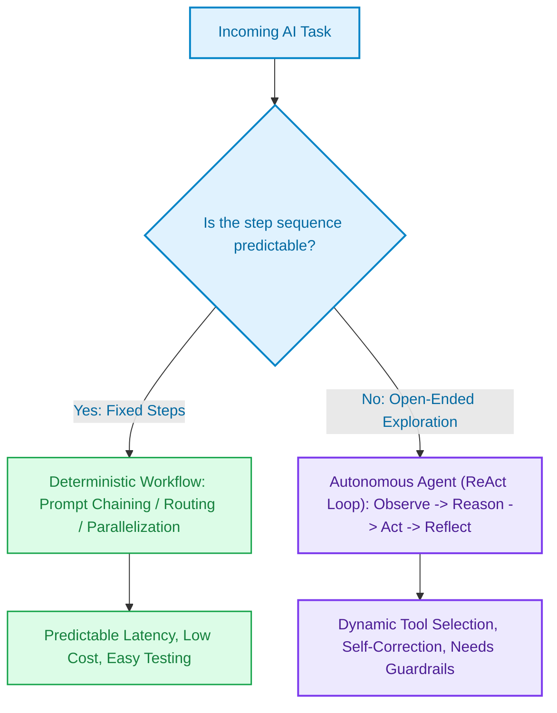
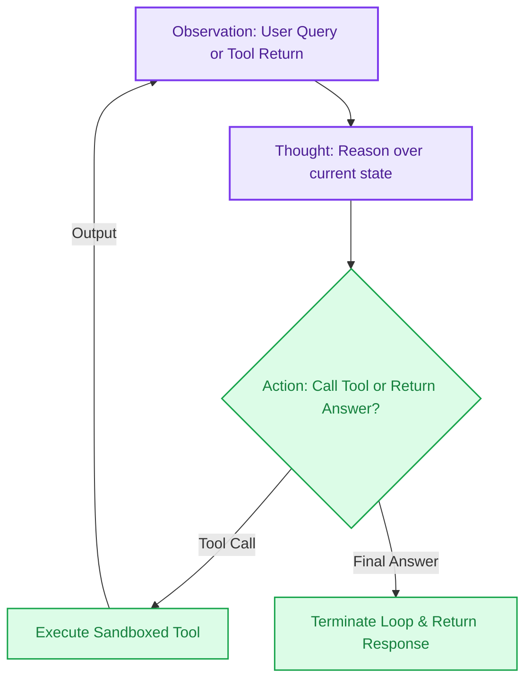

# Module 07: AI Agent Fundamentals & Architecture

[Phase 4 Index](./README.md) | [Roadmap](../../ROADMAP.md)

---

## 1. Overview

In [Module 06](../03-modern-ai-and-genai/06b_rag_engineering.md), retrieval followed a static single-turn pattern: *query vector store, retrieve passages, synthesize response*. What happens when a user asks: *"Investigate why Shipment #914 was delayed, check our SLA refund matrix, and calculate the account credit"*? The system must execute multi-step tool calls dynamically. Before implementing open-ended agent loops, engineers must distinguish between a **Deterministic Workflow** and an **Autonomous Agent**:
- **Workflow (Train on Tracks):** Deterministic engineering logic dictates tool sequencing: predictable, rapid, inexpensive, and easily unit-tested.
- **Autonomous Agent (Taxi with GPS):** The model itself dynamically decides which tools to invoke, inspects error returns, and iterates until the goal is achieved. **Golden Rule:** Never deploy an open-ended autonomous agent loop when a 3-step deterministic workflow solves the problem.



---

## 2. Audience

- **AI Application Engineers** transitioning from static prompt chaining into dynamic multi-step reasoning loops.
- **Backend Developers** needing robust tool execution sandboxes, strict iteration limits, and context memory managers.
- **System Architects** evaluating when to enforce deterministic workflows versus deploying autonomous ReAct agents.

---

## 3. Learning Objectives

By the end of this module, you will be able to:
- **Apply the Workflows vs. Agents decision framework**, selecting deterministic prompt chaining or autonomous loops based on task predictability.
- **Implement a safe ReAct (Reasoning + Acting) execution engine** with bounded iteration limits to prevent infinite tool loops.
- **Build sandboxed execution tools** using Python's `ast` module to evaluate arithmetic safely without allowing arbitrary code execution.
- **Manage working memory taxonomies**, distinguishing short-term sliding context windows from long-term vector store persistence.
- **Enforce production resilience patterns**, including token budget circuit breakers, tool timeouts, and structured error propagation.

---

## 4. Prerequisites

- **Structured LLM Generation:** Pydantic schemas, system prompts, and JSON outputs from [Module 06](../03-modern-ai-and-genai/06b_rag_engineering.md).
- **Python AST & Exception Handling:** Standard Python control flow and `ast` library basics.

---

## 5. Learning Levels

1. **Foundations (Level 1):** Workflows vs Agents taxonomy, ReAct reasoning steps (Thought-Action-Observation), short-term sliding context buffers.
2. **Applied (Level 2):** Bounded iteration execution loops, AST arithmetic sandbox, structured JSON schema tool definition.
3. **Production (Level 3):** Strict token budget circuit breakers, tool timeouts, and state persistence across restarts.

---

## 6. Core Concepts

### 4.1 The 4-Tier Agentic Taxonomy
1. **Single LLM Call:** Input $\to$ LLM $\to$ Output (Zero tool calls).
2. **Prompt Chaining / Router:** Step 1 output becomes Step 2 input via hardcoded Python conditionals.
3. **Parallel Sub-agent Dispatch:** Multiple independent prompts fired concurrently via `asyncio.gather` and summarized.
4. **Autonomous ReAct Agent:** Dynamic, cyclic graph loop where the LLM inspects environment feedback and chooses the next action until termination.

### 4.2 The ReAct Loop: Thought $\to$ Action $\to$ Observation $\to$ Reflection


### 4.3 Memory Management Taxonomy
- **Short-Term (Working Memory):** The active LLM context window. Managed via sliding token windows, message pruning, and summary compaction.
- **Episodic Memory:** Traces of previous interactions and user sessions stored in relational databases.
- **Long-Term (Semantic Memory):** Knowledge base embeddings stored in vector databases (e.g. Qdrant) retrieved on demand.

---

## 7. Technical Deep Dive

### 5.1 Safe Execution: Sandboxed AST Evaluator vs. Insecure `eval()`
Agents frequently need to perform arithmetic. Calling Python's raw `eval(expr)` exposes the host system to Remote Code Execution (`eval("__import__('os').system('rm -rf /')")`). A safe agent uses Abstract Syntax Tree parsing to whitelist safe mathematical operators:

```python
import ast
import operator

SAFE_OPS = {
    ast.Add: operator.add,
    ast.Sub: operator.sub,
    ast.Mult: operator.mul,
    ast.Div: operator.truediv,
}

def safe_calculate(expr: str) -> str:
    """Safely evaluates arithmetic expressions via AST without arbitrary code execution."""
    def _eval_node(node: ast.AST) -> float:
        if isinstance(node, ast.Constant) and isinstance(node.value, (int, float)):
            return float(node.value)
        if isinstance(node, ast.BinOp) and type(node.op) in SAFE_OPS:
            return SAFE_OPS[type(node.op)](_eval_node(node.left), _eval_node(node.right))
        raise ValueError(f"Disallowed expression node: {type(node).__name__}")

    try:
        tree = ast.parse(expr.strip(), mode="eval")
        return str(round(_eval_node(tree.body), 4))
    except Exception as exc:
        return f"CalculationError: {exc}"
```

### 5.2 Bounded Agent Loop Engine with Circuit Breakers
```python
class BoundedReActAgent:
    """Executes a bounded ReAct reasoning loop with iteration and token safety limits."""

    def __init__(self, tools: dict, max_steps: int = 5):
        self.tools = tools
        self.max_steps = max_steps

    def run(self, user_prompt: str) -> str:
        messages = [{"role": "user", "content": user_prompt}]
        for step in range(self.max_steps):
            # Simulate or call model tool-routing step
            action, action_input = self._plan_step(messages)
            if action == "FINISH":
                return action_input

            # Execute tool with exception guard
            if action in self.tools:
                try:
                    observation = self.tools[action](action_input)
                except Exception as err:
                    observation = f"ToolExecutionError: {err}"
            else:
                observation = f"Error: Unknown tool '{action}'"

            messages.append({"role": "assistant", "content": f"Action: {action}({action_input})"})
            messages.append({"role": "tool", "content": observation})

        return "CircuitBreaker: Maximum execution step budget exceeded."

    def _plan_step(self, history: list[dict]) -> tuple[str, str]:
        # Minimal rule-based mock for demonstration; replaced by LLM tool calls in production
        last = history[-1]["content"]
        if "ToolExecutionError" in last:
            return "FINISH", "Failed to resolve query safely."
        if "calculate" not in str(history):
            return "calculate", "100 * 1.15"
        return "FINISH", "The total after 15% tax is 115.0"
```

---

## 8. Hands-on Implementation

Verify the safe AST calculator against both legitimate mathematical expressions and malicious injection payloads:

```python
# Legitimate arithmetic
assert safe_calculate("2 + 3 * 4") == "14.0"
assert safe_calculate("(100 - 20) / 4") == "20.0"

# Malicious arbitrary code execution payload is blocked safely
malicious_payload = "__import__('os').system('echo pwned')"
result = safe_calculate(malicious_payload)
assert "Disallowed expression node" in result or "CalculationError" in result
print("Lab 07 Passed! AST sandbox safely isolated execution.")
```

---

## 9. Practical Exercises

### Exercise 1: Context Window Compaction Engine
1. Implement a message buffer manager that tracks token count using `tiktoken` (or approximate character count).
2. When the message history exceeds 4,000 tokens, automatically summarize messages older than the last 3 turns and prepend the summary as a system message.

### Exercise 2: Tool Execution Timeout Wrapper
Using Python's `asyncio` or `threading`:
1. Write a decorator `@with_timeout(seconds=2.0)` that terminates long-running or hanging tool calls and returns a structured timeout error back to the agent reasoning loop.

---

## 10. Mini Project

### Autonomous Customer Support Tier-1 Triage Agent
Construct a bounded triage agent equipped with three tools:
1. `lookup_order(order_id: str) -> dict`
2. `check_refund_eligibility(days_since_delivery: int, condition: str) -> bool`
3. `calculate_refund_amount(item_price: float, restocking_fee_pct: float) -> float`
- Ensure all tool inputs are validated with Pydantic, and the agent halts with a circuit breaker after at most 4 tool invocations.

---

## 11. Production Considerations

- **Plan-and-Solve Prompting:** Decoupling planning into an upfront decomposition step before executing individual actions, reducing compounding hallucination errors in multi-step reasoning.
- **Reflexion & Self-Correction:** Providing historical execution feedback to the agent so it can self-diagnose past test failures and modify its strategy.
- **Tree-of-Thoughts (ToT) Search:** Evaluating multiple candidate reasoning branches concurrently using breadth-first or depth-first search with lookahead verification.

---

## 12. Common Mistakes & Gotchas

1. **Unbounded Agent Loops:** Omitting strict iteration limits (`max_steps=5`), allowing an agent to loop endlessly when tools return unexpected errors, burning token budgets.
2. **Using Python `eval()` for Tool Arithmetic:** Allowing prompt-injected strings to execute raw arbitrary Python commands on the application host.
3. **Passing Raw Tool Stack Traces into Prompt Context:** Drowning the LLM context window with 500-line database stack traces instead of concise, structured error summaries.

---

## 13. Interview Questions & System Design

### Q1: What are the primary failure modes of autonomous agent loops in production?
1. **Infinite Looping / Hallucination Cycles:** Repeatedly calling the same tool with the same erroneous parameters when encountering an ambiguous response.
2. **Context Window Exhaustion:** Tool observations quickly fill the context, pushing the original user goal and system instructions out of memory.
3. **Cascading Hallucination:** A minor error in Step 1 compounds through Steps 2 and 3, driving the agent to a completely incorrect conclusion.
4. **Tool Permission Creep:** Giving an autonomous loop unrestricted write or delete privileges without human approval gates.

### Q2: When should you choose a deterministic workflow over an autonomous agent?
Choose a deterministic workflow whenever the sequence of operations is known in advance (e.g. document summarization, ETL transformations, structured form filing). Workflows provide sub-second latency, deterministic costs, straightforward unit testing, and zero risk of infinite looping. Reserve autonomous agents for open-ended exploration, variable-step code generation, and complex troubleshooting where the exact path cannot be hardcoded.

---

## 14. Recommended Resources

- **Guide:** [Building Effective Agents](https://www.anthropic.com/research/building-effective-agents) (Anthropic, 2024).
- **Landmark Paper:** [ReAct: Synergizing Reasoning and Acting in Language Models](https://arxiv.org/abs/2210.03629) (Yao et al., 2022).
- **Paper:** [Reflexion: Language Agents with Verbal Reinforcement Learning](https://arxiv.org/abs/2303.11366) (Shinn et al., 2023).

---

## 15. Completion Checklist

- [ ] Articulate the technical differences between single-turn calls, prompt chains, and autonomous ReAct loops.
- [ ] Implement a safe AST-based arithmetic evaluator resistant to arbitrary code execution injections.
- [ ] Build a bounded agent execution loop enforcing maximum step limits and circuit breakers.
- [ ] Design short-term context compaction strategies preventing context window blowouts.
- [ ] Pass all unit assertions verifying tool sandboxing and bounded iteration budgets.

---

## 16. Further Exploration

- Study emerging standards in autonomous agent protocols (W3C Agent Interoperability and decentralized A2A registries).
- Explore sandboxed container execution via Docker and WebAssembly for secure tool invocation.

---

[← Previous](../03-modern-ai-and-genai/06c_finetuning_and_serving.md) | [Phase 4 Index](./README.md) | [Roadmap](../../ROADMAP.md) | [Next →](./08_agent_orchestration.md)
