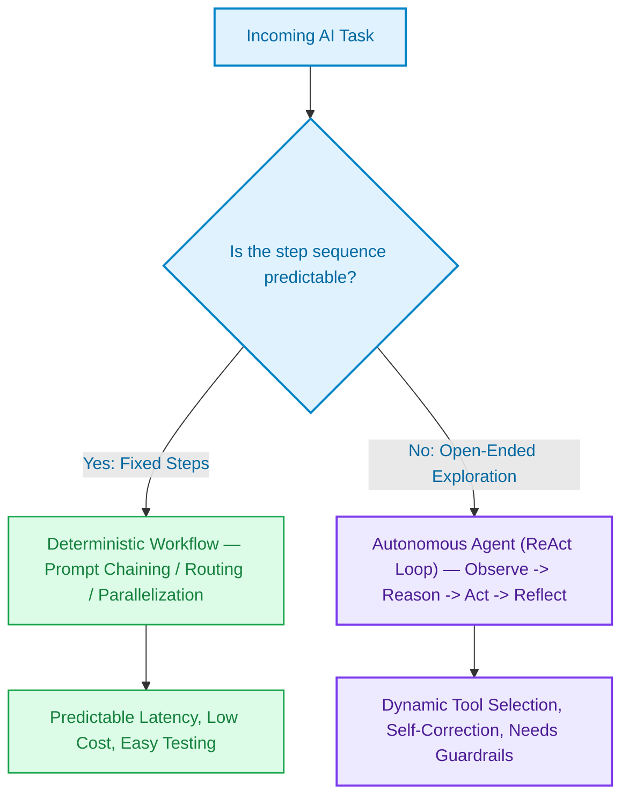

# Module 07: AI Agents Fundamentals, Workflows & Reasoning Loops

> **Estimated Study Time:** 6–8 Hours | **Prerequisites:** [Module 06](../03-modern-ai-and-genai/06_llms_finetuning_and_rag.md) | **Focus:** Workflows vs. Autonomous Agents, Safe `ReAct` Loops, Memory & Planning

[← Previous: Module 06 — LLMs, Fine-Tuning & RAG](../03-modern-ai-and-genai/06_llms_finetuning_and_rag.md) | [Home](../../README.md) | [Next: Module 08 — Tools, LangGraph & Google ADK →](./08_tools_langgraph_and_adk.md)

---

## Mental Model: Workflows (Trains on Tracks) vs. Agents (Taxis with GPS)

In [Module 06](../03-modern-ai-and-genai/06_llms_finetuning_and_rag.md), our RAG system followed one fixed recipe: *search `Qdrant`, then answer*. What happens when a user asks *"Check why Order #104 was delayed, verify our refund policy, and calculate the partial credit"*? Now the system must take **multiple actions**. Before reaching for complex autonomous agents, always distinguish between a **Workflow** and an **Agent**:
- **Workflow (Train on Fixed Tracks):** Your Python `if/else` code decides the exact sequence of steps—fast, cheap, predictable, and easy to test.
- **Autonomous Agent (Taxi with GPS):** You give a goal, and the **LLM itself decides** which tools to call, reads error messages, and detours dynamically until it arrives. **Golden Rule:** Never hire an open-ended taxi when a 3-stop train track solves the problem!



---

## Tier 1: Core Foundations (Architecture, Workflows vs. Agents & Safe ReAct)

### 1. Workflows vs. Agents Decision Rubric

#### 1.1 Single LLM Calls vs. Deterministic Workflows vs. Autonomous Agents
In practice, production teams climb a 4-rung ladder of autonomy—starting at rung 1 and only stepping up when simpler code cannot predict the required steps ahead of time:

| Pattern | Who Controls the Loop? | Best Production Use Case |
|---|---|---|
| **Single LLM Call** | None (1-shot generation) | Summarization, translation, structured JSON extraction |
| **Workflow: Prompt Chaining / Routing** | **Application code** (`if/else`, `asyncio.gather`) | Classify support ticket -> route to Billing Chain vs. Tech Support Chain |
| **Workflow: Evaluator-Optimizer** | Bounded generator + critic loop | Draft SQL query -> run linter -> refine once |
| **Autonomous AI Agent** | **The LLM dynamically decides** tools, retries, and termination | Resolving a GitHub issue across unknown files, multi-step research |

#### 1.2 The Four Architectural Pillars of an Agent System
When a problem genuinely requires that 4th rung—an **Autonomous AI Agent**—every reliable agent is built out of four interlocking parts:
1. **Core Brain (Reasoning LLM):** Plans steps, selects tools, and interprets error messages.
2. **Planning & Reflection:** Decomposes goals (`ReAct`, `Plan-and-Execute`) and critiques intermediate results.
3. **Multi-Tier Memory:** Working scratchpad (in-context), conversational short-term buffer, and external long-term episodic/semantic memory.
4. **Sandboxed Tools:** Deterministic functions (SQL read views, search APIs, isolated code runners) interacting with external state.

### 2. The `ReAct` Framework & Secure Zero-Dependency Implementation

How do those four pillars talk to each other turn by turn? Through the **`ReAct` (Reason + Act)** loop:

#### 2.1 Interleaved Reasoning & Action (`ReAct`)
- **Pure Chain-of-Thought (Yao et al., 2022 comparison):** Reasons coherently in its head, but has zero access to live external facts—hallucinating prices, APIs, or database state.
- **Pure Action Generation:** Fires tool calls blindly without thinking about *why* the previous call failed.
- **`ReAct`:** Interleaves explicit `Thought -> Action -> Observation`, grounding every reasoning step in real feedback from your tools.

#### 2.2 Building a Zero-Dependency `ReAct` Runtime with Safe `AST` Evaluation
Let's wire a complete `ReAct` loop in ~40 lines of pure Python so you see there is zero magic inside agent frameworks—while avoiding the #1 beginner security bug (`eval()`):
> **Security Rule:** Never pass LLM-generated strings into Python's raw `eval()` — an indirect prompt injection like `__import__('os').system(...)` compromises the host server! Use an **AST (Abstract Syntax Tree) whitelist evaluator** for math tools.

```python
import ast
import operator
import re

SAFE_OPS = {
    ast.Add: operator.add,
    ast.Sub: operator.sub,
    ast.Mult: operator.mul,
    ast.Div: operator.truediv,
}

def safe_calculate(expr: str) -> str:
    """Safely evaluates arithmetic expressions via AST without arbitrary code execution."""
    def _eval_node(node: ast.AST) -> float:
        if isinstance(node, ast.Constant) and isinstance(node.value, (int, float)):
            return float(node.value)
        if isinstance(node, ast.BinOp) and type(node.op) in SAFE_OPS:
            return SAFE_OPS[type(node.op)](_eval_node(node.left), _eval_node(node.right))
        raise ValueError(f"Disallowed expression node: {type(node).__name__}")

    try:
        tree = ast.parse(expr.strip(), mode="eval")
        return str(round(_eval_node(tree.body), 4))
    except Exception as exc:
        return f"CalculationError: {exc}"

def lookup_price(product: str) -> str:
    catalog = {"MacBook Air": "1099", "Pixel 9": "799"}
    return catalog.get(product.strip(), "Error: Product not found")

TOOLS = {"lookup_price": lookup_price, "calculate": safe_calculate}

def mock_llm(scratchpad: str, step: int) -> str:
    if step == 0:
        return "Thought: Fetch Pixel 9 unit price.\nAction: lookup_price\nAction Input: Pixel 9"
    if step == 1:
        return "Thought: Multiply 799 by 3.\nAction: calculate\nAction Input: 799 * 3"
    return "Thought: Calculation verified.\nFinal Answer: 3 Pixel 9 units cost $2397.0."

def run_react_agent(goal: str, max_steps: int = 5) -> str:
    scratchpad = f"Goal: {goal}\n"
    for step in range(max_steps):
        llm_out = mock_llm(scratchpad, step)
        if "Final Answer:" in llm_out:
            return llm_out.split("Final Answer:", 1)[1].strip()

        act = re.search(r"Action:\s*(\w+)", llm_out)
        inp = re.search(r"Action Input:\s*(.+)", llm_out)
        if act and inp:
            fn = TOOLS.get(act.group(1))
            obs = fn(inp.group(1)) if fn else f"Error: Unknown tool '{act.group(1)}'"
            scratchpad += f"{llm_out}\nObservation: {obs}\n"
    return "Terminated: max_steps budget exhausted."

assert "2397.0" in run_react_agent("Total cost of 3 Pixel 9 phones?")
assert "CalculationError" in safe_calculate("__import__('os').system('whoami')")
```

---

## Tier 2: Production Architecture & Scale (Memory Taxonomy, Planning & Failure Modes)

Our 40-line `ReAct` loop works cleanly for a 2-step price check—but on a 15-step research job across multiple days, the `scratchpad` string overflows, forgets past users, or gets stuck repeating a broken tool call forever. **Tier 2** adds structured **Memory**, **Upfront Planning**, and **Circuit Breakers**.

### 3. Production Agent Memory & Planning Topologies

#### 3.1 Multi-Tier Memory Architecture (Working, Episodic, Semantic & Procedural)
Just like humans separate short-term sticky notes from long-term life memories, production agents split memory into four distinct layers:
1. **Working Memory (Context Window Scratchpad):** Active trajectory of tool calls and observations; pruned/compressed via rolling summarization once context crosses budget thresholds.
2. **Episodic Memory:** Vector-indexed past interaction trajectories (*"How did the agent successfully resolve this user's build failure last week?"*) for dynamic few-shot recall.
3. **Semantic / Entity Memory:** Structured user facts and preferences stored in key-value stores or knowledge graphs (`user_timezone="Asia/Kolkata"`, `preferred_stack="PyTorch"`).
4. **Procedural Memory:** System instructions, tool definitions, and versioned skill playbooks.

#### 3.2 Planning Strategies (`Plan-and-Execute`) & Production Failure Mitigations
With memory organized, how do we keep long 15-step tasks cheap and prevent runaway loops?
- **`ReAct` (Single-Step Greedy):** Low upfront latency, adapts immediately to surprises, but lacks global foresight on 15-step tasks.
- **`Plan-and-Execute`:** Planner model drafts a complete DAG/checklist upfront; cheaper fast worker models execute each step, only invoking the heavy Re-Planner if an observation invalidates the plan (cuts frontier token spend by 50%+).
- **Top 3 Production Failure Modes & Fixes:**
  1. *Infinite Tool Thrashing:* Hard `max_iterations` cap + consecutive identical `(tool, args)` circuit breaker.
  2. *Context Bloat:* Truncate/summarize giant HTML or SQL tool payloads before appending to working memory.
  3. *Schema Drift:* Feed `Pydantic` validation errors back as structured `Observation` messages so the LLM self-repairs malformed tool arguments.

---

## Mini Hands-On Lab (15-Minute Exercise)

Implement a **Tool-Thrashing Circuit Breaker** that halts an agent loop immediately if the exact same `(tool_name, args_json)` pair is invoked twice within a sliding window:

```python
import json

class LoopCircuitBreaker:
    def __init__(self, max_steps: int = 6):
        self.max_steps = max_steps
        self.seen_calls: set[str] = set()
        self.steps = 0

    def check_and_record(self, tool_name: str, args: dict) -> tuple[bool, str]:
        self.steps += 1
        if self.steps > self.max_steps:
            return False, "HALT: max_steps exceeded"
        signature = f"{tool_name}:{json.dumps(args, sort_keys=True)}"
        if signature in self.seen_calls:
            return False, f"HALT: duplicate tool call detected ({signature})"
        self.seen_calls.add(signature)
        return True, "ALLOW"

breaker = LoopCircuitBreaker(max_steps=5)
assert breaker.check_and_record("query_db", {"id": 10})[0] is True
assert breaker.check_and_record("query_db", {"id": 10})[0] is False
print("Lab 07 Passed! Duplicate tool loop tripped safely.")
```

---

## Key Engineering Takeaways
- Default to **deterministic workflows** (routing, chaining, parallelization) when steps are known; reserve **autonomous agents** for open-ended, dynamic trajectories.
- Never use `eval()` inside agent tools — sandbox code execution (Docker/WASM/gVisor) or restrict via AST/schema whitelists.
- Separate **Working, Episodic, and Semantic memory**, and pair `Plan-and-Execute` with hard step/repetition circuit breakers.

> **Next in the Journey:** Notice how our toy `ReAct` loop parsed `"Action: lookup_price"` using fragile `regex` and vanished if the server restarted mid-task! In real production, we replace regex with **native JSON Function Calling** and replace `for` loops with durable state graphs (**`LangGraph`** & **`Google ADK`**) in **[Module 08: Function Calling, LangGraph & Google ADK](./08_tools_langgraph_and_adk.md)**.

---

[← Previous: Module 06 — LLMs, Fine-Tuning & RAG](../03-modern-ai-and-genai/06_llms_finetuning_and_rag.md) | [Home](../../README.md) | [Next: Module 08 — Tools, LangGraph & Google ADK →](./08_tools_langgraph_and_adk.md)
