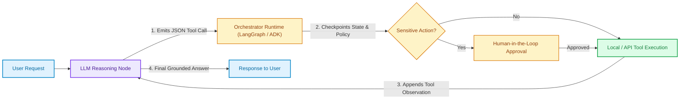

# Module 08: Function Calling, LangGraph & Google Agent Development Kit (ADK)

> **Estimated Study Time:** 6–8 Hours | **Prerequisites:** [Module 07](./07_ai_agents_fundamentals.md) | **Focus:** Strict Tool Schemas, Stateful Cyclical Graphs (`LangGraph`), `Google ADK` & `HITL` Checkpoints

[← Previous: Module 07 — AI Agents Fundamentals](./07_ai_agents_fundamentals.md) | [Home](../../README.md) | [Next: Module 09 — Multi-Agent Systems & MCP →](./09_multi_agent_and_mcp.md)

---

## Mental Model: From Stateless JSON Contracts to Durable Agent Graphs

An LLM never executes HTTP calls or SQL queries itself — it emits a **structured JSON intent** that your **runtime orchestrator** validates, executes, checkpoints to durable storage, and feeds back into state.



---

## Tier 1: Core Foundations (Function Calling & Strict Tool Schemas)

### 1. Function Calling Mechanics & Schema Engineering

#### 1.1 The Function Calling Lifecycle & Strict JSON Schema Contracts
1. **Declaration:** Your client sends tool definitions (JSON Schemas) in the request payload.
2. **Selection:** The model emits a structured `tool_calls` object (`name` + `arguments` JSON) instead of plain text.
3. **Execution & Return:** Your backend validates the arguments, runs the Python/REST function, appends a `tool` message correlated by `tool_call_id`, and invokes the LLM to synthesize the final answer.

```python
# Strict OpenAI / Gemini-compatible Function Schema
WEATHER_TOOL_SCHEMA = {
    "type": "function",
    "function": {
        "name": "get_weather_forecast",
        "description": (
            "Fetches real-time weather for a city. Use ONLY when the user asks about "
            "current or upcoming weather; do NOT use for historical climate averages."
        ),
        "strict": True,
        "parameters": {
            "type": "object",
            "properties": {
                "city": {
                    "type": "string",
                    "description": "City and country/state, e.g., 'Bengaluru, IN' or 'Seattle, WA'.",
                },
                "unit": {
                    "type": "string",
                    "enum": ["celsius", "fahrenheit"],
                },
            },
            "required": ["city", "unit"],
            "additionalProperties": False,
        },
    },
}
```
> **Schema Design Rule:** Tool `description` strings act as **system prompts** — explicitly stating *when* and *when NOT* to call a tool + setting `"strict": True` and `"additionalProperties": False` enforces **100% structural argument compliance** via constrained decoding ([OpenAI Structured Outputs, 2024](https://openai.com/index/introducing-structured-outputs-in-the-api/)).

---

### 2. Stateful Cyclical Orchestration with `LangGraph`

#### 2.1 Cyclical State Graphs, Reducers & Conditional Routing in `LangGraph`
Classic ETL/Chain pipelines are **Directed Acyclic Graphs (DAGs)** — data flows strictly forward with no cycles. Agents require **controlled loops** (call tool -> inspect error -> retry with refined query -> terminate).
**`LangGraph` Primitives:**
- **`State` (`TypedDict` / `Pydantic`):** Single typed source of truth passed across nodes, using reducer annotations (`Annotated[list, operator.add]`) so nodes append messages cleanly rather than overwriting history.
- **`Nodes`:** Pure Python/async functions `(state) -> partial_state_update`.
- **`Conditional Edges`:** Deterministic Python routers inspecting state to branch to `tool_node`, `human_review`, or `END`.

```python
import operator
from typing import Annotated, TypedDict

class AgentState(TypedDict):
    messages: Annotated[list[str], operator.add]
    iterations: int
    needs_tool: bool

def reasoning_node(state: AgentState) -> dict:
    last = state["messages"][-1].lower()
    if "stock" in last and state["iterations"] < 3:
        return {
            "messages": ["tool_call:get_price(NVDA)"],
            "iterations": state["iterations"] + 1,
            "needs_tool": True,
        }
    return {"messages": ["Final: NVDA is trading at $138.50."], "needs_tool": False}

def tool_node(state: AgentState) -> dict:
    return {"messages": ["observation:NVDA=$138.50"], "needs_tool": False}

def route_after_reasoning(state: AgentState) -> str:
    return "tool_node" if state["needs_tool"] else "__end__"

# In production with langgraph.graph.StateGraph:
# graph = StateGraph(AgentState)
# graph.add_node("agent", reasoning_node); graph.add_node("tool_node", tool_node)
# graph.add_conditional_edges("agent", route_after_reasoning)
# graph.add_edge("tool_node", "agent")
```

---

## Tier 2: Production Architecture & Scale (`Google ADK` & Durable `HITL` Interrupts)

### 3. Code-First Enterprise Agents with Google Agent Development Kit (`ADK`)

#### 3.1 Code-First Agent Engineering, Visual Debugging (`adk web`) & Cloud Run Deployment
**Google Agent Development Kit (`ADK`)** treats agents as modular, testable Python software artifacts with built-in evaluation, trace inspection, and serverless deployment:
- **Native Python Functions as Tools:** Automatically infers parameter schemas and docstrings directly from typed Python functions.
- **Developer CLI Workflow:**
  - `adk create support_agent` — scaffolds standardized agent package structure.
  - `adk web` — spins up a local browser UI showing live token streams, tool payloads, state diffs, and latency spans.
  - `adk eval` — runs regression datasets against expected tool trajectories.
  - `adk deploy cloud_run` — containerizes and deploys straight to Google Cloud Run.

```python
from google.adk.agents.llm_agent import Agent

def get_order_status(order_id: str) -> dict[str, str]:
    """Fetches real-time shipment status for a validated customer order ID."""
    return {"order_id": order_id, "status": "Out for Delivery", "eta": "Today 18:00"}

root_agent = Agent(
    model="gemini-2.5-flash",
    name="logistics_copilot",
    description="Handles customer shipment tracking inquiries.",
    instruction=(
        "Always verify order status via 'get_order_status' before answering. "
        "Never guess delivery dates."
    ),
    tools=[get_order_status],
)
```

---

### 4. Durable Persistence & Human-in-the-Loop (`HITL`) Interrupts

#### 4.1 Durable State Checkpointing & Asynchronous `HITL` Approval Flows
Holding a `time.sleep()` or open WebSocket for 4 hours while a manager reviews a `\$5,000` refund crashes worker pools! Production frameworks (`LangGraph Checkpointers` backed by Postgres/Redis, or `Google ADK` session state) use **Durable State Serialization**:
1. Before running a mutating tool (`issue_refund`, `delete_user`, `send_external_email`), an **`interrupt_before`** hook serializes the exact graph state + `thread_id` to Postgres and **releases all compute resources**.
2. A webhook notifies a Slack/UI review queue with the proposed tool name and arguments.
3. Hours later, when the reviewer clicks **Approve** (or edits the refund amount), the runtime rehydrates `thread_id` from Postgres and resumes execution from that exact node!

---

## Mini Hands-On Lab (15-Minute Exercise)

Build a lightweight tool-argument validator and dispatcher that rejects hallucinated fields (`additionalProperties: False` behavior) and returns structured self-correction errors to the agent:

```python
from pydantic import BaseModel, ConfigDict, Field, ValidationError

class RefundArgs(BaseModel):
    model_config = ConfigDict(extra="forbid")  # Rejects hallucinated extra keys!
    order_id: str = Field(pattern=r"^ORD-\d{4}$")
    amount_usd: float = Field(gt=0.0, le=500.0)

def dispatch_refund_tool(raw_json: str) -> dict[str, str | bool]:
    try:
        args = RefundArgs.model_validate_json(raw_json)
        if args.amount_usd > 100.0:
            return {"executed": False, "status": "HITL_INTERRUPT_REQUIRED"}
        return {"executed": True, "status": f"Refunded ${args.amount_usd:.2f} for {args.order_id}"}
    except ValidationError as exc:
        return {"executed": False, "status": f"ToolSchemaError: {exc.errors()[0]['msg']}"}

assert dispatch_refund_tool('{"order_id": "ORD-1024", "amount_usd": 45.0}')["executed"] is True
assert dispatch_refund_tool('{"order_id": "ORD-1024", "amount_usd": 250.0}')["status"] == "HITL_INTERRUPT_REQUIRED"
assert "ToolSchemaError" in str(dispatch_refund_tool('{"order_id": "ORD-1024", "amount_usd": 20.0, "hack": 1}')["status"])
print("Lab 08 Passed! Strict schema validation + HITL threshold verified.")
```

---

## Key Engineering Takeaways
- Function Calling is a **two-party protocol**: the LLM proposes a strict JSON call; the client validates, executes, and returns the observation.
- Use **`LangGraph`** when you need explicit cyclical state machines, reducer-managed state, and Postgres-backed checkpointing.
- Use **`Google ADK`** for code-first agent definitions, visual trace debugging (`adk web`), trajectory evaluation (`adk eval`), and serverless Cloud Run deployment.
- Implement **`HITL` via durable state checkpoints (`thread_id`)**, never blocking threads in memory.

---

[← Previous: Module 07 — AI Agents Fundamentals](./07_ai_agents_fundamentals.md) | [Home](../../README.md) | [Next: Module 09 — Multi-Agent Systems & MCP →](./09_multi_agent_and_mcp.md)
