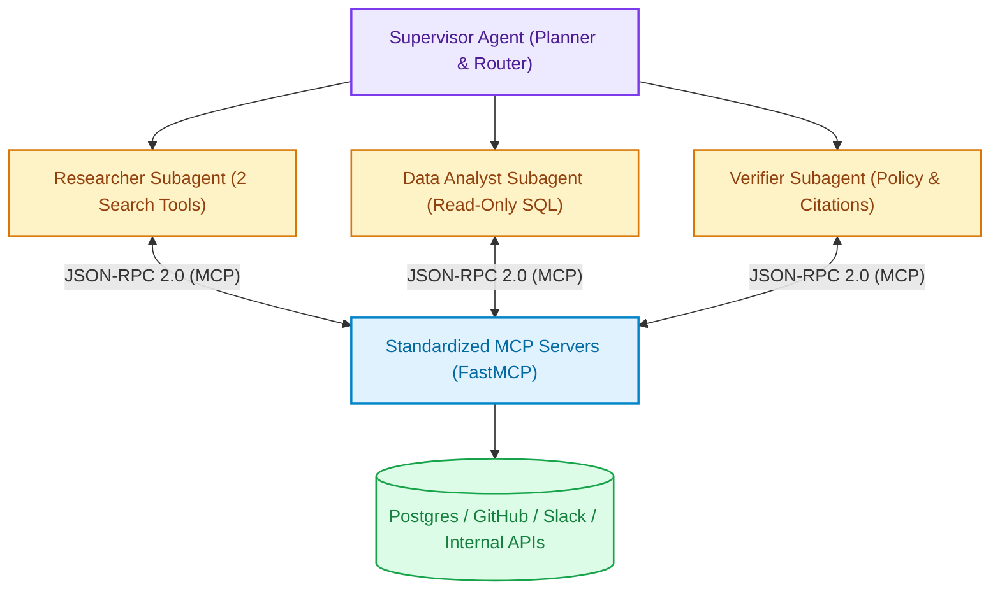

# Module 09: Multi-Agent Systems & Model Context Protocol (MCP)

> **Estimated Study Time:** 6–7 Hours | **Prerequisites:** [Module 08](./08_tools_langgraph_and_adk.md) | **Focus:** Multi-Agent Topologies, Subagent Context Isolation & Modern MCP (`stdio` / `Streamable HTTP`)

[← Previous: Module 08 — Tools, LangGraph & ADK](./08_tools_langgraph_and_adk.md) | [Home](../../README.md) | [Next: Module 10 — Agent Evaluation, Safety & Governance →](./10_agent_evals_and_safety.md)

---

## Mental Model: Specialist Teams, USB-C Cables (`MCP`) & Phone Lines (`A2A`)

- **In Plain English:**
  - **Why Multi-Agent?** Handing one single agent 40 tools and 50 pages of instructions is like asking one overwhelmed intern to run Legal, Finance, and IT simultaneously—they mix up rules and hallucinate. Splitting into **focused Subagents** gives each worker a clean desk and just 2–3 tools.
  - **`MCP` vs. `A2A`:** **`MCP`** is the **universal USB-C cable** plugging an agent into its *own* databases and tools; **`A2A`** is the **inter-office phone line** letting your Finance Agent ask another team's Supply-Chain Agent for help without peeking inside its private database.



---

## Tier 1: Core Foundations (Multi-Agent Topologies & Subagent Delegation)

### 1. Why & When to Use Multi-Agent Systems

#### 1.1 Tool-Count Degradation, Context Isolation & Multi-Agent Trade-Offs
1. **Tool Selection Confusion:** Tool-routing accuracy drops sharply once an LLM must discriminate among 20+ overlapping JSON schemas.
2. **Context Pollution:** Raw logs from step 1 pollute reasoning at step 6. Subagents run in **isolated context windows** and return only a distilled 200-token artifact to the supervisor!
3. **Model Heterogeneity:** Pair a frontier model (`Gemini 2.5 Pro` / `Claude Sonnet`) as the **Supervisor** with fast, low-cost workers (`Gemini 2.5 Flash` / local `Qwen 7B`) for high-volume extraction.
> **Tradeoff Warning:** Multi-agent handoffs multiply token usage and latency — only split into multiple agents when tool count (`>10–15`), security privilege boundaries, or context isolation genuinely require it.

---

#### 1.2 Sequential, Hierarchical Supervisor, Parallel Map-Reduce & Critic Topologies

| Architecture | Control Flow | Production SDKs | Best Fit |
|---|---|---|---|
| **1. Sequential Handoff** | `Researcher -> Writer -> Verifier` | `LangGraph`, `Google ADK`, `PydanticAI` | Deterministic ETL, report, or code-gen pipelines |
| **2. Hierarchical Supervisor** | Central coordinator delegates to workers & synthesizes | `Google ADK`, `LangGraph Supervisor` | Enterprise support copilots, multi-domain analytics |
| **3. Parallel Fan-Out / Map-Reduce** | Spawns $K$ concurrent workers on shards, merges results | `LangGraph Send()`, `ADK ParallelAgent` | Auditing 20 files or 5 security angles simultaneously |
| **4. Generator–Critic Loop** | Coder <-> Test/Security Verifier iterate up to `max_steps` | `LangGraph`, `OpenAI Agents SDK` | Code synthesis, SQL/math verification |

```python
from google.adk.agents.llm_agent import Agent

# Specialized Worker Subagents with isolated instructions & minimal toolsets
sql_analyst = Agent(
    model="gemini-2.5-flash",
    name="sql_analyst",
    description="Executes read-only analytical SQL queries on sales tables.",
    instruction="Return concise metric tables with exact query filters used.",
)

policy_auditor = Agent(
    model="gemini-2.5-flash",
    name="policy_auditor",
    description="Checks compliance rules and refund eligibility.",
    instruction="Cite exact policy section numbers for every decision.",
)

# Hierarchical Supervisor delegating to subagents
supervisor = Agent(
    model="gemini-2.5-pro",
    name="ops_supervisor",
    description="Coordinates analytics and compliance specialists.",
    instruction="Delegate data lookups to 'sql_analyst' and policy checks to 'policy_auditor'.",
    subagents=[sql_analyst, policy_auditor],
)
```

---

## Tier 2: Production Architecture & Scale (Model Context Protocol & MCP Security)

### 2. Model Context Protocol (`MCP`) Architecture & Transports

#### 2.1 `MCP` Primitives (`Tools`, `Resources`, `Prompts`) & Transports (`stdio` / `Streamable HTTP`)
Open-sourced by Anthropic and adopted across IDEs, cloud platforms, and agent SDKs, **MCP** uses **JSON-RPC 2.0** between an **MCP Host/Client** and an **MCP Server**, exposing three standardized primitives:
1. **`Tools` (Model-Controlled):** Executable functions (`query_postgres`, `create_jira_issue`) invoked by the LLM.
2. **`Resources` (Application-Controlled):** Read-only structured context (`postgres://schema/users`, documentation files) attached like REST `GET` endpoints.
3. **`Prompts` (User-Controlled):** Reusable workflow templates/slash commands parameterized by the server.

**Standard Transports:**
- **`stdio` (Standard Input/Output):** Local subprocess communication on the user's machine — zero network overhead, ideal for IDE/desktop tools.
- **`Streamable HTTP`:** Modern remote production transport (superseding legacy dual-endpoint HTTP+SSE) supporting stateless load-balanced servers, OAuth 2.1 authorization headers, and optional streaming responses over a single HTTP endpoint.

```python
from mcp.server.fastmcp import FastMCP

mcp = FastMCP("Orders Analytics MCP")

@mcp.resource("schema://orders")
def get_orders_schema() -> str:
    """Exposes read-only table schema context to MCP clients."""
    return "orders(order_id TEXT PK, user_id TEXT, amount_usd NUMERIC, status TEXT)"

@mcp.tool()
def fetch_order_summary(order_id: str) -> dict[str, str | float]:
    """Fetches validated summary for a specific order_id (read-only)."""
    mock_rows = {"ORD-101": {"order_id": "ORD-101", "amount_usd": 89.99, "status": "Delivered"}}
    return mock_rows.get(order_id, {"error": "Order not found"})

# Local CLI mode: mcp.run(transport="stdio")
# Remote microservice mode: mcp.run(transport="streamable-http")
```

---

#### 2.2 Securing `MCP` Ecosystems Against Tool Poisoning & Schema Rug-Pulls
1. **Tool Description Poisoning:** A malicious MCP server hides covert prompt-injection instructions inside its tool `description` metadata (invisible to the human user, read directly by the LLM), tricking the agent into exfiltrating `~/.ssh` keys or environment variables via another legitimate MCP server!
2. **Dynamic Tool Rug-Pulls:** An unpinned remote MCP server passes security review on Day 1, then silently mutates its tool definitions on Day 5.
3. **Production Defenses:** Pin and cryptographic-hash MCP tool schemas, scope OAuth 2.1 tokens per server with least privilege, isolate local `stdio` servers in containers, and require explicit `HITL` consent whenever cross-server data flows to external network endpoints.

---

### 3. `A2A` (Agent-to-Agent Protocol) vs. `MCP`

#### 3.1 Complementary Protocols: Vertical Tooling (`MCP`) vs. Horizontal Federation (`A2A`)
In modern enterprise architectures, agents built on different stacks (e.g., a `LangGraph` Billing Agent in Finance and a `Google ADK` Inventory Agent in Supply Chain) must collaborate without sharing internal prompts, memory, or database credentials. The **[Agent2Agent (`A2A`) Protocol](https://github.com/a2aproject/A2A)** (introduced by Google and governed by the Linux Foundation) pairs directly with `MCP`:

| Dimension | `MCP` (Model Context Protocol) | `A2A` (Agent-to-Agent Protocol) |
|---|---|---|
| **Integration Axis** | **Vertical (`Agent ↔ Tools, DBs & Resources`)** | **Horizontal (`Client Agent ↔ Remote Peer Agent`)** |
| **Abstraction Model** | White-box deterministic function/schema invocation | **Opaque ("Black-Box") peer agent** — hides internal prompts, weights & private tools |
| **Discovery & Transport** | Server capability handshake over `stdio` or `Streamable HTTP` | Publishes JSON **Agent Card** at `/.well-known/agent-card.json`; communicates via HTTPS + JSON-RPC 2.0 + `SSE` task streams |

```json
// Example /.well-known/agent-card.json for A2A Peer Discovery
{
  "name": "supply_chain_inventory_agent",
  "url": "https://inventory-agent.internal.example/a2a",
  "version": "1.0.0",
  "capabilities": { "streaming": true, "pushNotifications": false },
  "authentication": { "schemes": ["Bearer"] },
  "skills": [
    {
      "id": "check_warehouse_stock",
      "name": "Warehouse Stock & Restock ETA",
      "description": "Verifies SKU stock levels and restock schedules across regional warehouses."
    }
  ]
}
```

---

## Mini Hands-On Lab (15-Minute Exercise)

Implement a lightweight **Supervisor Intent Router & Context Isolator** demonstrating how raw worker logs stay isolated from the supervisor's clean context window:

```python
def sql_worker(task: str) -> dict[str, str]:
    raw_internal_trace = "SELECT ... [5,000 rows scanned] ... intermediate debug logs ..."
    distilled_summary = "Q3 Revenue = $1.42M (+12% QoQ)."
    # Worker keeps raw_internal_trace private, returning ONLY distilled summary!
    _ = raw_internal_trace
    return {"worker": "sql_worker", "summary": distilled_summary}

def security_worker(task: str) -> dict[str, str]:
    return {"worker": "security_worker", "summary": "0 PII leaks detected in Q3 export."}

def run_supervisor(user_request: str) -> str:
    supervisor_context: list[str] = [f"User: {user_request}"]
    for worker_fn in (sql_worker, security_worker):
        artifact = worker_fn(user_request)
        supervisor_context.append(f"[{artifact['worker']}]: {artifact['summary']}")
    return " | ".join(supervisor_context[1:])

final_report = run_supervisor("Prepare Q3 executive compliance report")
assert "5,000 rows scanned" not in final_report
assert "$1.42M" in final_report and "0 PII leaks" in final_report
print("Lab 09 Passed! Distilled Supervisor Output:", final_report)
```

---

## Key Engineering Takeaways
- Use **Multi-Agent Subagents** primarily for **context isolation**, **tool-count reduction (`<10` tools/agent)**, and **privilege separation** — not for simple tasks solvable by a 2-step workflow.
- Know the **3 MCP Primitives (`Tools`, `Resources`, `Prompts`)** and **2 Transports (`stdio` for local, `Streamable HTTP` with OAuth 2.1 for remote production)**.
- Call out **MCP Tool Poisoning** (prompt injection hidden inside tool schemas) when auditing third-party tool integrations.

---

[← Previous: Module 08 — Tools, LangGraph & ADK](./08_tools_langgraph_and_adk.md) | [Home](../../README.md) | [Next: Module 10 — Agent Evaluation, Safety & Governance →](./10_agent_evals_and_safety.md)
