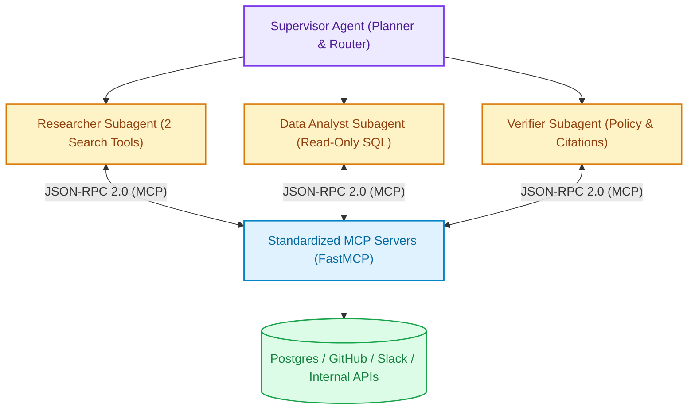
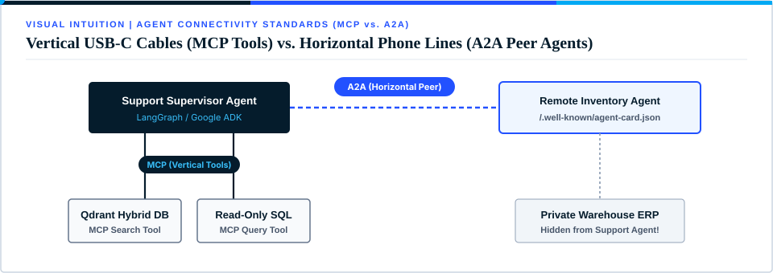

# Module 09: Multi-Agent Systems, MCP & A2A

[Phase 4 Index](./README.md) | [Roadmap](../../ROADMAP.md)

---

## 1. Overview

In [Module 08](./08_agent_orchestration.md), you constructed a durable single-agent state machine. However, as an agent scales beyond 15–20 tools, its routing accuracy degrades severely: foundation models struggle to discriminate among dozens of overlapping JSON schemas in a single prompt. **Multi-Agent Systems** resolve this by decomposing bloated generalists into focused specialist subagents:
- **Subagent Context Isolation:** Each worker agent operates in a clean, isolated context window with only 2–3 dedicated tools.
- **Model Context Protocol (MCP):** Acts as the **universal USB-C standard** connecting agents to external databases, tools, and environments via standardized JSON-RPC 2.0 messages.
- **Agent-to-Agent (A2A):** Acts as the **communication bus** allowing independent specialized agents to collaborate and negotiate without exposing internal raw execution state.



---

## 2. Learning Objectives

By the end of this module, you will be able to:
- **Analyze multi-agent topologies** (Supervisor, Hierarchical, Peer-to-Peer, Consensus), selecting optimal coordination patterns for complex engineering tasks.
- **Implement context isolation** between subagents, preventing intermediate tool observations from overflowing the root supervisor context.
- **Apply the Model Context Protocol (MCP) specification**, implementing standardized JSON-RPC 2.0 requests (`tools/list`, `tools/call`, `resources/read`).
- **Build and deploy production MCP tool servers** using Python `FastMCP` over stdio and Streamable HTTP transports.
- **Enforce least-privilege security controls** across tool servers, isolating file system access and database privileges.

---

## 3. Prerequisites

- **Function Calling & LangGraph:** Strict JSON schemas and cyclical state machines from [Module 08](./08_agent_orchestration.md).
- **Asynchronous Python & Networking:** HTTP verbs, JSON serialization, and `asyncio` from [Module 01](../01-foundations/01_python_sql_and_data_stack.md).

---

## 4. Core Concepts

### 4.1 Multi-Agent Topologies
1. **Supervisor Pattern (Hub-and-Spoke):** A central coordinator analyzes the user request, delegates sub-tasks to specialized worker agents, and synthesizes final results.
2. **Sequential Pipeline (Chain):** Output of Agent A becomes the structured input for Agent B (e.g. Researcher $\to$ Drafter $\to$ Fact-Checker).
3. **Hierarchical Multi-Tier:** Supervisors manage team leads, who in turn coordinate leaf worker agents.
4. **Peer-to-Peer Collaborative (A2A):** Autonomous agents communicate directly over message buses using standard protocols without a central bottleneck.

<p align="center">
  
</p>

### 4.2 Subagent Context Isolation
When a generalist agent executes 10 tool calls, its context fills with intermediate JSON returns, SQL schemas, and stack traces, driving up latency and cost while causing the model to forget original instructions. Subagents receive isolated prompt instructions and return only a synthesized summary to the supervisor:

```python
# Specialized Worker Subagent with isolated instructions & minimal toolsets
researcher_agent = {
    "system_prompt": "You are a specialized search agent. Retrieve factual citations only. Return concise bullet summaries.",
    "tools": ["web_search", "document_lookup"],
}
```

---

## 5. Technical Deep Dive

### 5.1 Model Context Protocol (MCP) Specification
MCP (introduced by Anthropic in late 2024 and standardized across the AI industry) establishes a clean client-host-server separation using JSON-RPC 2.0. Rather than hardcoding custom API wrappers for every database and SaaS provider, tool providers build standard MCP servers.

#### Core JSON-RPC 2.0 Messages:
- `initialize`: Client and server exchange protocol versions and capabilities.
- `tools/list`: Server returns available tools and their JSON Schema parameters.
- `tools/call`: Client requests tool execution with validated arguments.
- `resources/read`: Client reads static documents, files, or application logs.

```json
{
  "jsonrpc": "2.0",
  "id": "req-001",
  "method": "tools/call",
  "params": {
    "name": "query_database",
    "arguments": {
      "sql": "SELECT order_id, status FROM orders WHERE user_id = 'u_42'"
    }
  }
}
```

### 5.2 Building an MCP Server with FastMCP
```python
from mcp.server.fastmcp import FastMCP

# Initialize FastMCP Server
mcp = FastMCP("EnterpriseAnalytics")

@mcp.tool()
def get_order_status(order_id: str) -> dict:
    """Retrieves real-time fulfillment status and tracking numbers for an order."""
    # Production database or API lookup
    return {"order_id": order_id, "status": "SHIPPED", "carrier": "FedEx"}

@mcp.resource("config://sla")
def get_sla_policy() -> str:
    """Returns company refund and SLA compliance policies."""
    return "Refunds allowed within 30 days of confirmed delivery."

if __name__ == "__main__":
    # Runs over stdio transport by default
    mcp.run()
```

### 5.3 MCP Security: Tool Scoping & Sandboxing
Connecting models to tools introduces prompt injection and data exfiltration risks:
1. **Transport Isolation:** Stdio transport runs tools in isolated subprocesses or Docker containers.
2. **Read-Only Enforcers:** Database tools must strictly reject destructive queries (`DROP`, `DELETE`, `UPDATE`, `ALTER`).
3. **Path Traversal Guards:** File tools must strictly validate that requested paths remain within a designated root directory (`path.resolve().is_relative_to(ROOT_DIR)`).

---

## 6. Hands-on Implementation

Implement a minimal JSON-RPC 2.0 dispatcher simulating an MCP tool execution server:

```python
import json

class MockMCPServer:
    def __init__(self):
        self.tools = {}

    def register_tool(self, name: str, func):
        self.tools[name] = func

    def handle_message(self, request_json: str) -> str:
        req = json.loads(request_json)
        req_id = req.get("id")
        method = req.get("method")

        if method == "tools/list":
            return json.dumps({
                "jsonrpc": "2.0",
                "id": req_id,
                "result": {"tools": list(self.tools.keys())}
            })

        if method == "tools/call":
            params = req.get("params", {})
            name = params.get("name")
            args = params.get("arguments", {})
            if name in self.tools:
                try:
                    res = self.tools[name](**args)
                    return json.dumps({"jsonrpc": "2.0", "id": req_id, "result": res})
                except Exception as err:
                    return json.dumps({"jsonrpc": "2.0", "id": req_id, "error": {"message": str(err)}})
            return json.dumps({"jsonrpc": "2.0", "id": req_id, "error": {"message": "Tool not found"}})

        return json.dumps({"jsonrpc": "2.0", "id": req_id, "error": {"message": "Method not supported"}})

server = MockMCPServer()
server.register_tool("add", lambda a, b: a + b)

# Verify tools/call
req = json.dumps({"jsonrpc": "2.0", "id": 1, "method": "tools/call", "params": {"name": "add", "arguments": {"a": 10, "b": 25}}})
resp = json.loads(server.handle_message(req))
assert resp["result"] == 35
print("Lab 09 Passed! JSON-RPC 2.0 MCP dispatcher verified.")
```

---

## 7. Practical Exercises

### Exercise 1: Hierarchical Multi-Agent Orchestration
1. Implement a Supervisor agent using LangGraph that routes incoming queries to either a `MathSpecialist` or a `TextSpecialist`.
2. Ensure each specialist operates in its own sub-graph state without sharing raw prompt traces.

### Exercise 2: Secure File Reading MCP Server
Using `FastMCP` or standard Python:
1. Write an MCP tool `read_log_file(filename: str)` that reads files only from `./safe_logs/`.
2. Implement strict path normalization and verify that path traversal attempts (e.g. `../../etc/passwd`) raise a security error.

---

## 8. Mini Project

### Autonomous E-Commerce Copilot with FastMCP & Google ADK
Build a multi-agent operations suite:
- **Supervisor Agent:** Analyzes customer requests and delegates tasks.
- **Order Tracking Subagent:** Uses an MCP tool server to inspect shipment databases.
- **Refund Policy Subagent:** Evaluates refund eligibility and triggers human approval gates if refund $> \$100$.
- **Companion Blueprint:** Inspect the full architecture in [Project 7: Google ADK & MCP Copilot](../../projects/advanced/README.md).

---

## 9. Advanced Topics

- **Streamable HTTP Transports (SSE):** Streaming MCP tool calls and intermediate progress updates over HTTP Server-Sent Events for remote cloud deployments.
- **Dynamic MCP Discovery:** Configuring client agents to query an enterprise MCP registry and load server tools on-the-fly based on permissions.
- **Consensus & Multi-Agent Debates:** Having multiple distinct foundation models critique each other's reasoning to reduce hallucinations in critical legal and medical evaluations.

---

## 10. Common Mistakes & Gotchas

1. **Monolithic Agent Bloat:** Forcing 30 tools into one single agent, causing model reasoning degradation.
2. **Ignoring JSON-RPC Error Formats:** Returning raw HTTP error codes instead of structured `{"jsonrpc": "2.0", "error": {...}}` responses, breaking client parsing.
3. **Sharing Mutable State Across Subagents:** Allowing subagents to mutate the supervisor's global state concurrently, causing race conditions.

---

## 11. Interview Questions & System Design

### Q1: What problem does the Model Context Protocol (MCP) solve for enterprise AI?
Before MCP, every developer wrote bespoke integration code to connect LLMs to databases, GitHub, or internal APIs. Each framework (LangChain, LlamaIndex, Semantic Kernel) had proprietary tool wrappers. MCP establishes an open, vendor-neutral standard using JSON-RPC 2.0. Any MCP-compliant tool server can immediately connect to any MCP client (Claude Desktop, Cursor, Antigravity, or custom agents) without modifying client code.

### Q2: How do you prevent context window pollution in multi-agent workflows?
Context pollution is prevented through strict **context isolation**:
1. Leaf worker agents receive only the specific instructions and data needed for their subtask.
2. Worker agents perform iterative tool calls in their own private context.
3. Upon task completion, workers return only a concise, structured final response to the supervisor agent.
4. The supervisor incorporates the summary into the primary context, keeping memory compact and costs low.

---

## 12. Recommended Resources

- **Specification:** [Model Context Protocol (MCP) Official Documentation](https://modelcontextprotocol.io/).
- **Repository:** [Model Context Protocol Python SDK](https://github.com/modelcontextprotocol/python-sdk).
- **Architecture Guide:** [Anthropic: Multi-Agent Systems & Tool Orchestration](https://www.anthropic.com/research/building-effective-agents).

---

## 13. Completion Checklist

- [ ] Diagram the difference between Supervisor, Sequential, and Peer-to-Peer multi-agent topologies.
- [ ] Implement subagent context isolation preventing tool intermediate traces from leaking into the parent.
- [ ] Describe the structure of MCP JSON-RPC 2.0 messages (`initialize`, `tools/list`, `tools/call`).
- [ ] Build and verify a minimal FastMCP tool server with input validation.
- [ ] Enforce path traversal and read-only database security guards on tool executions.

---

[← Previous: Module 08: Tools, LangGraph & ADK](./08_agent_orchestration.md) | [Home](../../README.md) | [Next: Module 10: Agent Evaluation, Safety & Governance →](./10_agent_evaluation_and_safety.md)

---

## 16. Further Exploration

- Study emerging standards in autonomous agent protocols (W3C Agent Interoperability and decentralized A2A registries).
- Explore sandboxed container execution via Docker and WebAssembly for secure tool invocation.
