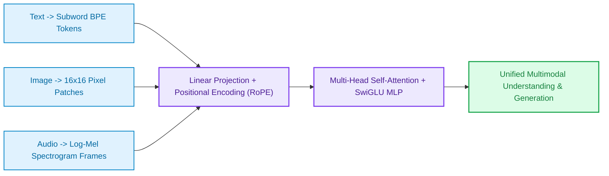
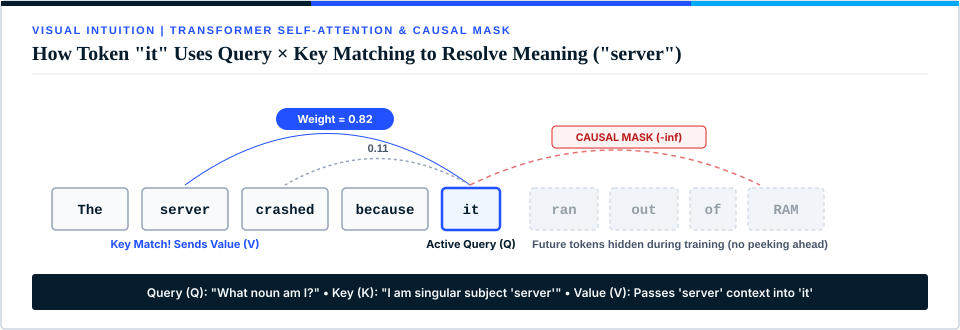

# Module 05: NLP, Transformers, Computer Vision & Multimodal AI

> **Difficulty:** Intermediate | **Estimated Study Time:** 9-11 Hours | **Prerequisites:** [Module 04: Deep Learning & PyTorch](../03-deep-learning/04_deep_learning_and_rl.md) | **Lab:** [Mini-Transformer Attention Notebook](../../notebooks/deep-learning/03_mini_transformer_attention.ipynb) | **[Open in Colab](https://colab.research.google.com/github/FirdowsRahaman/agentic-ai-and-ml-roadmap/blob/main/notebooks/deep-learning/03_mini_transformer_attention.ipynb)**  
> **Focus:** BPE tokenizers, scaled dot-product attention, Rotary Positional Embeddings (RoPE), Vision Transformers (ViT), and CLIP multimodal alignment

[← Previous: Module 04: Deep Learning & RL](../03-deep-learning/04_deep_learning_and_rl.md) | [Roadmap Index](../../README.md) | [Next: Module 06: LLMs, Fine-Tuning & Advanced RAG →](./06_llms_finetuning_and_rag.md)

---

## 1. Overview

In [Module 04](../03-deep-learning/04_deep_learning_and_rl.md), you learned how PyTorch trains deep layers of tensors. Historically, natural language, computer vision, and speech audio required completely disparate neural architectures (RNNs, CNNs, and HMMs). Modern AI engineering unifies all three modalities under a single core computational paradigm: tokenize inputs into vectors, add positional encodings, and process them through the **Transformer Self-Attention** engine:



---

## 2. Learning Objectives

By the end of this module, you will be able to:
- **Implement Scaled Dot-Product Attention** with causal masking in NumPy, explaining the mathematical role of $\frac{1}{\sqrt{d_k}}$ in preventing softmax gradient saturation.
- **Compare subword tokenization strategies** (BPE, WordPiece, Tiktoken) against lexical representations (BM25, TF-IDF).
- **Explain positional encoding mechanics**, contrasting absolute sinusoidal embeddings with modern relative schemes like Rotary Positional Embeddings (RoPE).
- **Formulate Vision Transformer (ViT) architecture**, tracking how 2D images are patched, flattened, projected, and processed as sequence tokens.
- **Explain contrastive multimodal alignment (CLIP)** via symmetric InfoNCE loss across joint image-text vector spaces.
- **Trace audio representation pipelines** from raw waveforms to Log-Mel spectrograms and autoregressive neural audio codecs.

---

## 3. Prerequisites

- **Deep Learning Mechanics:** Computational graphs, backpropagation, and PyTorch training loops from [Module 04](../03-deep-learning/04_deep_learning_and_rl.md).
- **Linear Algebra:** Matrix products, eigenvalues, and cosine similarity from [Module 02](../01-foundations/02_math_and_statistics.md).

---

## 4. Core Concepts

### 4.1 Subword Byte-Pair Encoding (BPE) vs. Lexical BM25
- **Byte-Pair Encoding (BPE):** Iteratively merges the most frequent pairs of bytes or characters into a fixed vocabulary (typically 50,000–256,000 tokens). Ensures zero out-of-vocabulary (`<UNK>`) errors across arbitrary text, source code, and multilingual corpora.
- **Okapi BM25:** Lexical scoring function incorporating term saturation and document length penalization:
  $$\text{BM25}(q, d) = \sum_{t \in q} \text{IDF}(t) \cdot \frac{f(t, d) \cdot (k_1 + 1)}{f(t, d) + k_1 \cdot \left(1 - b + b \cdot \frac{|d|}{\text{avgdl}}\right)}$$
  Serves as the sparse retrieval pillar in modern Enterprise Hybrid RAG.

### 4.2 Scaled Dot-Product Attention ($Q, K, V$)
Each token creates three vector projections via learned weight matrices:
- **Query ($Q = X W_Q$):** What this token is seeking.
- **Key ($K = X W_K$):** What this token contains / offers.
- **Value ($V = X W_V$):** The actual contextual information payload.

$$\text{Attention}(Q, K, V) = \text{Softmax}\left(\frac{Q K^T}{\sqrt{d_k}} + M\right) V$$

<p align="center">
  
</p>

### 4.3 Positional Encodings: Sinusoidal vs. RoPE
Because self-attention is permutation-invariant ($\text{Attention}(\pi(X)) = \pi(\text{Attention}(X))$), sequence order must be explicitly injected:
- **Absolute Positional Encodings:** Adds fixed sinusoidal or learned vector coordinates directly to input token embeddings.
- **Rotary Position Embedding (RoPE):** Multiplies query and key vectors by a 2D rotation matrix in the complex plane, capturing relative distance $\mathbf{q}_m^T \mathbf{k}_n = g(\mathbf{x}_m, \mathbf{x}_n, m - n)$ naturally.

---

## 5. Technical Deep Dive

### 5.1 Vision Transformers (ViT) & Edge Object Detection
- **ViT Mechanics:** An image $X \in \mathbb{R}^{H \times W \times C}$ is sliced into non-overlapping $P \times P$ pixel patches (e.g. $16 \times 16$), flattened into 1D vectors, linearly projected into embedding dimension $D$, prepended with a `[CLS]` token, and processed through standard Transformer encoder blocks.
- **Edge Object Detection Architectures:**
  - Modern NMS-free edge models (such as **YOLOv10** and **RT-DETR**) eliminate the traditional non-maximum suppression (NMS) post-processing bottleneck by employing dual label assignments and Hungarian bipartite matching during training.
  - General edge vision flagships (such as Ultralytics **YOLO11**) provide sub-5ms latency on consumer CPU and edge ONNX runtimes.

```python
# Production Transfer Learning: Freeze pretrained backbone, train lightweight head
import torch
import torch.nn as nn
from torchvision.models import vit_b_16, ViT_B_16_Weights

weights = ViT_B_16_Weights.DEFAULT
model = vit_b_16(weights=weights)

for param in model.parameters():
    param.requires_grad = False  # Freeze pretrained weights

# Replace standard 1000-class ImageNet head with custom classification head
num_classes = 5
model.heads = nn.Sequential(
    nn.Linear(model.heads.head.in_features, 256),
    nn.ReLU(),
    nn.Dropout(0.2),
    nn.Linear(256, num_classes)
)
```

### 5.2 Multimodal Alignment via CLIP & Contrastive InfoNCE Loss
CLIP (Contrastive Language-Image Pre-Training) jointly trains an Image Encoder and a Text Encoder using a symmetric InfoNCE loss over batches of $(I_k, T_k)$ pairs:
$$\mathcal{L}_{\text{InfoNCE}} = -\frac{1}{2N} \sum_{i=1}^N \left[ \log \frac{e^{\text{sim}(I_i, T_i)/\tau}}{\sum_{j=1}^N e^{\text{sim}(I_i, T_j)/\tau}} + \log \frac{e^{\text{sim}(T_i, I_i)/\tau}}{\sum_{j=1}^N e^{\text{sim}(T_i, I_j)/\tau}} \right]$$

This projects images and text captions into a shared embedding space, enabling zero-shot classification and cross-modal search.

### 5.3 Audio Representations: Mel Spectrograms & Whisper
1. **Waveform to Log-Mel Spectrogram:** Continuous 16 kHz audio is transformed via Short-Time Fourier Transform (STFT) into 80–128 human-ear frequency bands (Mel bins).
2. **Whisper Architecture:** Feeds the Log-Mel spectrogram into 1D convolutional layers followed by a Transformer Encoder, and autoregressively generates transcribed text and timestamps via a Transformer Decoder.

---

## 6. Hands-on Implementation

Implement **Causal Scaled Dot-Product Self-Attention** in pure NumPy and verify that future token mutations have zero impact on past outputs:

```python
import numpy as np

def causal_self_attention(Q: np.ndarray, K: np.ndarray, V: np.ndarray) -> np.ndarray:
    seq_len, d_k = Q.shape
    scores = (Q @ K.T) / np.sqrt(d_k)
    # Upper-triangular mask (above main diagonal) set to -1e9
    causal_mask = np.triu(np.ones((seq_len, seq_len), dtype=bool), k=1)
    scores = np.where(causal_mask, -1e9, scores)
    shifted = scores - np.max(scores, axis=-1, keepdims=True)
    weights = np.exp(shifted) / np.sum(np.exp(shifted), axis=-1, keepdims=True)
    return weights @ V

rng = np.random.default_rng(7)
Q1 = rng.normal(size=(4, 8))
K1 = rng.normal(size=(4, 8))
V1 = rng.normal(size=(4, 8))
out1 = causal_self_attention(Q1, K1, V1)

# Mutate the future token at index 3 completely
Q2, K2, V2 = Q1.copy(), K1.copy(), V1.copy()
K2[3] *= 999.0
V2[3] *= -999.0
out2 = causal_self_attention(Q2, K2, V2)

assert np.allclose(out1[:3], out2[:3]), "Causal mask leaked future tokens!"
print("Lab 05 Passed! Causal attention verified with zero future leakage.")
```

---

## 7. Practical Exercises

### Exercise 1: Multi-Head Projection Reshaping
In multi-head attention with hidden dimension $D=768$ and $H=12$ heads ($d_k = 64$):
1. Given an input tensor $X \in \mathbb{R}^{B \times T \times D}$, write the PyTorch tensor reshaping operations to split and transpose $Q, K, V$ into shape `(B, H, T, d_k)`.
2. Compute the batched attention scores and transpose the output back to `(B, T, D)`.

### Exercise 2: Implementing a Minimal Byte-Pair Encoding Merger
1. Write a Python function `bpe_train(text, vocab_size=300)` that starts with character-level tokens and iteratively merges the most frequent adjacent bigram until the target vocabulary size is reached.

---

## 8. Mini Project

### Cross-Modal Semantic Search Engine using Pretrained CLIP
Build a local multimodal image-text search prototype:
- **Requirements:**
  1. Load a pretrained CLIP model (or sentence-transformers open-weights).
  2. Embed a directory of 50 sample images into 512-dimensional vectors.
  3. Accept arbitrary text queries (e.g. `"a photo of a golden retriever playing in snow"`), embed the query, and return top-3 matching images via cosine similarity.
  4. Benchmark search latency on local CPU and assert average retrieval time is $< 25\text{ ms}$.

---

## 9. Advanced Topics

- **KV Caching in Autoregressive Generation:** Storing past keys and values $K, V$ across decoding steps to avoid redundant $O(T^2)$ recomputation of prefix tokens.
- **Grouped-Query Attention (GQA):** Sharing single key and value heads across multiple query heads to reduce KV cache memory by 4x–8x during high-concurrency LLM serving.
- **Patch Merging in Swin Transformers:** Hierarchical vision representations that progressively merge neighboring patches, reducing spatial resolution and enabling linear computation scaling.

---

## 10. Common Mistakes & Gotchas

1. **Omitting the $\frac{1}{\sqrt{d_k}}$ Scaling Factor:** As $d_k$ grows large, unscaled dot products grow in magnitude, driving softmax outputs into saturation where gradients vanish to zero.
2. **Causal Masking in Bidirectional Encoders:** Applying causal upper-triangular masking in BERT or ViT degrades performance, as bidirectional contexts are intentionally required.
3. **Resizing Non-Square Images without Aspect Ratio Padding:** Naively stretching non-square images to $224 \times 224$ distorts aspect ratios and degrades CNN/ViT spatial recognition.

---

## 11. Interview Questions & System Design

### Q1: Why did Vision Transformers (ViT) require much larger pretraining datasets than ResNets?
CNNs possess inductive biases: translation equivariance (a cat in the corner is still a cat) and local connectivity (adjacent pixels share semantic meaning). ViTs have no innate spatial inductive bias; self-attention allows any patch to attend to any other patch globally from layer 1. ViTs must learn spatial adjacency from scratch, requiring massive pretraining datasets (JFT-300M or ImageNet-21k) to outperform CNNs.

### Q2: What is the computational complexity difference between full attention and RoPE?
Full scaled dot-product attention has $O(T^2 \cdot d)$ computational complexity. Rotary Positional Embeddings (RoPE) add negligible overhead ($O(T \cdot d)$) because rotary transformations are applied element-wise as 2D complex multiplications directly to query and key vectors before the dot product, requiring zero additions to the quadratic attention matrix itself.

---

## 12. Recommended Resources

- **Landmark Paper:** [Attention Is All You Need](https://arxiv.org/abs/1706.03762) (Vaswani et al., 2017).
- **Vision Transformers Paper:** [An Image is Worth 16x16 Words: Transformers for Image Recognition at Scale](https://arxiv.org/abs/2010.11929) (Dosovitskiy et al., 2020).
- **CLIP Paper:** [Learning Transferable Visual Models From Natural Language Supervision](https://arxiv.org/abs/2103.00020) (Radford et al., 2021).

---

## 13. Completion Checklist

- [ ] Write the mathematical definition of Scaled Dot-Product Attention from memory.
- [ ] Implement and verify causal attention masking preventing future token leakage.
- [ ] Explain how BPE avoids out-of-vocabulary (`<UNK>`) tokens across code and natural languages.
- [ ] Detail the forward pass of a Vision Transformer from 2D image patches to `[CLS]` prediction.
- [ ] Describe the contrastive InfoNCE objective used to align image and text encoders in CLIP.
- [ ] Successfully complete and pass the [`03_mini_transformer_attention.ipynb`](../../notebooks/deep-learning/03_mini_transformer_attention.ipynb) lab.

---

[← Previous: Module 04: Deep Learning & RL](../03-deep-learning/04_deep_learning_and_rl.md) | [Home](../../README.md) | [Next: Module 06: LLMs, Fine-Tuning & Advanced RAG →](./06_llms_finetuning_and_rag.md)
