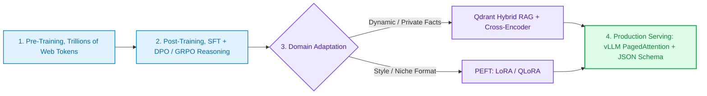

# Module 06: Generative AI, LLMs, Fine-Tuning (`LoRA`/`DPO`), `Qdrant` & Production RAG

> **Difficulty:** Advanced | **Estimated Study Time:** 10-12 Hours | **Prerequisites:** [Module 05](./05_nlp_cv_and_multimodal.md)
> **Focus:** LoRA/QLoRA fine-tuning, DPO alignment, hybrid vector search (Qdrant), RRF reranking, and vLLM serving

[← Previous: Module 05: NLP, CV & Multimodal](./05_nlp_cv_and_multimodal.md) | [Roadmap Index](../../README.md) | [Next: Module 07: AI Agents Fundamentals →](../05-agentic-ai/07_ai_agents_fundamentals.md)

---

## Mental Model: How Base Models Become Grounded Enterprise Systems

In [Module 05](./05_nlp_cv_and_multimodal.md), you built the causal self-attention engine inside every Decoder LLM. Yet a raw pre-trained LLM is merely a next-token internet autocomplete engine: it doesn't know your company's private policies, can break JSON syntax, and gobbles GPU memory. Turning it into a reliable enterprise product follows a clear 4-stage pipeline: **Post-Training Alignment (`SFT` + `DPO`/`GRPO`)**, **Context & Schema Engineering**, **Filterable Hybrid Vector Search (`Qdrant` + Reranking)**, and **Memory-Efficient Serving (`vLLM`)**.



---

## Tier 1: Core Foundations (LLM Mechanics, Structured Outputs, Chunking & Vector Stores)

### 1. LLM Landscape, VRAM Sizing & Quantization

#### 1.1 Discriminative vs. Generative AI & Quick GPU Memory Math
- **In Plain English:** A **Discriminative model** acts like a referee sorting existing items into buckets (*"Is this email spam?"*); a **Generative model** acts like an author writing new content one token (word piece) at a time (*autoregressive generation*).
- **Modern 2026 Model Ecosystem:**
  - *Frontier API Models:* **Google Gemini 3 / 3.1 Pro & Flash**, **OpenAI GPT-5 / GPT-5.4** (unified dynamic test-time reasoning), **Anthropic Claude 4.5 / 4.6 Opus & Sonnet**.
  - *Open-Weight Models (Self-Hostable):* **Meta Llama 4** (multimodal MoE), **Alibaba Qwen 3 / 3.5**, **DeepSeek-V3 / R1**, **Google Gemma 3 / Mistral**.
- **Rule-of-Thumb GPU Memory (`VRAM`) Math:**
  - Full `FP16`/`BF16` precision = **2 GB per 1B parameters** | Compressed `4-bit` (`INT4` / `AWQ` / `GGUF`) = **0.5 GB per 1B parameters** (+ ~20% breathing room for active chat memory).
  - *Quick Example:* A **70B** model needs $70 \times 2 \times 1.2 \approx \mathbf{168\text{ GB VRAM}}$ in `BF16`, or just **$\sim 42\text{ GB VRAM}$** in `4-bit`!

<details>
<summary><b>Deep Dive: Probabilistic Formulation ($P(y \mid x)$ vs. $P(x_t \mid x_{<t})$)</b></summary>

Discriminative classifiers directly estimate decision boundaries $P(y \mid x)$, whereas autoregressive decoder LLMs factorize joint sequence likelihood via the chain rule $P(x_1, \dots, x_T) = \prod_{t=1}^{T} P(x_t \mid x_{<t})$, sampling or beam-searching tokens sequentially.

</details>

### 2. Context Engineering, Structured Outputs & Hallucination Grounding

Once you pick an API or open-weight model that fits your budget and VRAM, your first job is controlling *what goes into its context window* and *what shape comes out*:

#### 2.1 Context Engineering (Replacing Legacy "Prompt Tweaking")
Standalone single-turn "prompt engineering" has evolved into **Context Engineering**: architecting the exact information payload, token budget, and KV-cache layout fed into a model across multi-step execution:
1. **Prefix-Cache-Friendly Ordering:** Place **100% static content first** (`System Policy -> Tool JSON Schemas -> Static Few-Shot Examples -> Domain Docs`) and **dynamic per-turn state last** (`Recent History -> User Query`). Even a 1-token timestamp change at the top invalidates the entire GPU `KV` prefix cache: costing **2×-10× higher latency and API spend** ([Anthropic Prompt Caching](https://docs.anthropic.com/en/docs/build-with-claude/prompt-caching); [Gemini Context Caching](https://ai.google.dev/gemini-api/docs/caching)).
2. **Signal-to-Noise & Context Budgeting:** Even with `1M+` token windows, stuffing raw HTML or 50 unranked chunks degrades reasoning accuracy via *Lost-in-the-Middle* attention dilution ([Liu et al., TACL 2024](https://arxiv.org/abs/2307.03172)). Compress verbose tool observations, strip boilerplate fields, and inject only reranked `Top-5` evidence.

#### 2.2 Constrained Decoding & Guaranteed JSON Schemas
Careful context ordering controls the *input*; how do you guarantee the *output* won't crash your downstream Python code?
- **In Plain English:** Asking an LLM *"Please reply in valid JSON"* in a prompt is just a polite request: it can still add extra chat text or miss a comma and crash your app. **Constrained Decoding (Structured Outputs)** acts like a smart keyboard that physically greys out any letter/token that would violate your `Pydantic` JSON schema, guaranteeing **100% valid JSON** every single call ([OpenAI Structured Outputs, 2024](https://openai.com/index/introducing-structured-outputs-in-the-api/); [Willard & Louf, 2023](https://arxiv.org/abs/2307.09702)):

```python
from pydantic import BaseModel, Field

class InvoiceExtraction(BaseModel):
    vendor_name: str
    invoice_total_usd: float = Field(ge=0.0)
    line_items: list[str]
    requires_manual_audit: bool

# Passed directly to Gemini response_schema / OpenAI response_format / vLLM guided_json
json_schema = InvoiceExtraction.model_json_schema()
```

#### 2.3 Why Hallucinations Happen: and What RAG Actually Guarantees
Even 100% valid JSON can still contain **invented facts**! Why? Because LLMs optimize next-token likelihood rather than factual truth, smoothly extrapolating plausible-sounding fabrications when knowledge is missing or ambiguous.
- **Engineering Reality:** **RAG grounds the model in retrieved context and drastically reduces hallucinations, but NEVER 100% eliminates them.** If retrieval pulls noisy chunks, if key facts sit buried in the middle of a long context window, or if system prompts lack strict abstention rules, the model can still misinterpret context or fabricate citations. Always pair RAG with explicit abstention prompts (*"If unsupported by context, state insufficient information"*) and automated faithfulness checks.

### 3. Document Chunking & `RAG` vs. Fine-Tuning

Since grounding factual answers depends on feeding the right private paragraphs into that context window, let's trace how **`RAG`** slices documents and when to use `RAG` vs. Fine-Tuning:

> **What is `RAG` (Retrieval-Augmented Generation)?** Think of a closed-book exam vs. an **open-book exam**: instead of hoping an LLM memorized your company's 2026 refund PDF during training, `RAG` searches your private database for the 5 most relevant paragraphs first, pastes them into the prompt, and tells the LLM: *"Answer ONLY using these paragraphs and cite page numbers."*

#### 3.1 Document Chunking Strategies (Slicing Long PDFs Cleanly)
Poor chunking destroys retrieval quality before embeddings even run:
1. **Fixed-Token with Overlap (e.g., `512` tokens, `64` overlap):** Simple baseline; risks slicing tables or clauses mid-sentence.
2. **Recursive Character / Markdown-Header Splitting:** Splits hierarchically by headings (`#`, `##`), paragraphs (`\n\n`), then sentences.
3. **Layout-Aware Parsing (`Docling`, `Marker`, AWS Textract):** Preserves multi-column PDFs, financial tables, and figures intact as structured Markdown/JSON.
4. **Contextual Retrieval:** Prepends a concise document-level summary (e.g., *"From Acme Corp Q3 2026 10-Q filing:"*) to every chunk prior to embedding and BM25 indexing, reducing top-20 chunk retrieval failure rates by **49%** (and **67%** when paired with reranking; [Anthropic Engineering, 2024](https://www.anthropic.com/news/contextual-retrieval)).

#### 3.2 Choosing Between RAG and Fine-Tuning (`LoRA`)
Newcomers often ask: *"Why build a RAG search pipeline at all: can't we just fine-tune the LLM on our PDFs?"* Here is the crisp engineering boundary:

| Dimension | Retrieval-Augmented Generation (RAG) | Fine-Tuning (`LoRA` / `SFT`) |
|---|---|---|
| **Primary Purpose** | Dynamic facts, private knowledge bases, source citations, per-user ACLs | Teaching domain tone, compact output formats, specialized SQL/DSL syntax, or distilling a large teacher into a fast 8B student |
| **Data Freshness** | Instant (upsert/delete vectors in milliseconds) | Static until the next training job |
| **Hallucination Control** | High (verifiable chunk citations) | Low on unseen facts |

---

## Tier 2: Production Architecture & Scale (Post-Training, `Qdrant`, Hybrid RAG & `vLLM`)

Now that the roles of Context Engineering, RAG, and Fine-Tuning are clear, **Tier 2** dives under the hood of all three in production: how to fine-tune weights cheaply (`LoRA`/`DPO`), how to index millions of multi-tenant chunks in **`Qdrant`**, and how to serve thousands of concurrent users smoothly on **`vLLM`**.

### 4. Post-Training (`SFT`, `LoRA`/`QLoRA`, `DPO`/`GRPO`) & Test-Time Compute

#### 4.1 Parameter-Efficient Fine-Tuning (`LoRA` / `QLoRA`) & Alignment (`DPO` / `GRPO`)
- **In Plain English:**
  1. **`LoRA` & `QLoRA` (Sticky Notes on a Locked Encyclopedia):** Full fine-tuning rewrites all 70 billion weights (expensive and risks erasing general intelligence). **`LoRA`** locks the encyclopedia shut and trains tiny "sticky-note" adapter layers alongside it (`<0.1%` of weights!). **`QLoRA`** shrinks that locked encyclopedia to `4-bit` so you can fine-tune a large model on a single 24 GB GPU.
  2. **`DPO` (Learning from Side-by-Side Preferences):** Shows the model pairs of answers `(Winner vs. Loser)` for the same prompt and nudges it to sound more like the Winner.
  3. **`GRPO` & Test-Time Thinking:** Used by modern reasoning models (`GPT-5`, `Gemini 3 Deep Think`, `Claude 4.5/4.6`, `DeepSeek-R1`), letting the model "think out loud" on scratch paper and rewarding answers that pass real code/math checks.

<details>
<summary><b>Deep Dive: Low-Rank Matrix Math ($\Delta W = BA$) & Primary Papers</b></summary>

- **`LoRA`** ([Hu et al., ICLR 2022](https://arxiv.org/abs/2106.09685)): Freezes $W_0 \in \mathbb{R}^{d \times k}$ and learns $\Delta W = B A$ with $A \in \mathbb{R}^{r \times k}, B \in \mathbb{R}^{d \times r}$ ($r \ll d$, e.g., $r = 16$), cutting trainable parameters up to **10,000×** and VRAM by **3×**. **`QLoRA`** ([Dettmers et al., NeurIPS 2023](https://arxiv.org/abs/2305.14314)) stores $W_0$ in 4-bit NormalFloat (`NF4`).
- **`DPO`** ([Rafailov et al., NeurIPS 2023](https://arxiv.org/abs/2305.18290)) & **`GRPO`** ([Shao et al., 2024](https://arxiv.org/abs/2402.03300); [DeepSeek-AI, 2025](https://arxiv.org/abs/2501.12948)): Eliminate the separate critic/reward model overhead of classic `PPO` RLHF.

</details>

### 5. Production Vector Databases & `Qdrant` Architecture

While `LoRA` shapes *how* the model speaks, **`Qdrant`** stores the live facts it reads. Let's see how vector databases index meaning alongside security filters:

> **What is a `Vector Database`?** A traditional SQL database searches for exact spelling (`WHERE text LIKE '%refund%'`), missing `"money-back guarantee"` completely. A **Vector Database (`Qdrant`)** stores meaning vectors (`embeddings`) alongside normal metadata fields (`tenant_id`, `date`) so you can search by **meaning + keywords + security filters** in a few milliseconds.

#### 5.1 Selecting the Right Vector Search Engine

| Engine | Architecture | Sweet Spot & Trade-Offs |
|---|---|---|
| **`Qdrant`** | Dedicated Rust engine (`HNSW` + Sparse + Payload Index) | **Top choice for Production RAG & Agents:** local `:memory:`/disk mode up to distributed cloud, **Filterable HNSW**, native Dense+Sparse RRF, and 32× Binary Quantization |
| **`pgvector`** | PostgreSQL extension (`HNSW` / `StreamingDiskANN`) | Great when vectors live alongside relational ACID tables at moderate scale (`<10M-50M` vectors) |
| **`FAISS`** | C++/GPU in-memory ANN library (Meta) | Ultra-fast raw ANN math inside custom Python/C++ services; **not** a database (no CRUD API, WAL durability, or metadata filtering engine out of the box) |
| **`OpenSearch`** | Distributed Lucene + `k-NN` cluster | Heavy enterprise log/search stacks already standardized on AWS OpenSearch |

#### 5.2 Why `Qdrant` Excels: Filterable HNSW, Native Hybrid RRF & Quantization
Why do production engineering teams reach for `Qdrant` specifically when scaling multi-tenant RAG? Because naive vector search breaks the moment you add customer security filters:
- **In Plain English (The Multi-Tenant Filtering Trap):** Suppose 500 companies share one vector database, and tiny Client `"Acme"` owns only `0.2%` of the documents.
  - *If you search Top-10 globally first, then filter for `"Acme"` (`Post-Filtering`):* All 10 results belong to bigger clients: `"Acme"` gets **0 results**!
  - *If you cross out non-Acme nodes before walking the search graph (`Naive Pre-Filtering`):* You chop up the highway bridges connecting the graph, breaking search accuracy!
  - **How `Qdrant` Solves It (`Filterable HNSW`):** `Qdrant` pre-builds dedicated mini-bridges per tenant/tag right inside the graph ([Qdrant Filterable HNSW Guide](https://qdrant.tech/articles/filtrable-hnsw/)), giving fast, accurate filtered results every time.
- **32× Memory Compression (`Binary Quantization`):** Turns bulky 32-bit decimal numbers into tiny `1-bit` (`+` or `-`) signs in RAM (**32× smaller** and up to **40× faster**; [Qdrant Quantization Docs](https://qdrant.tech/documentation/concepts/quantization/)), then double-checks the top few finalists from disk so accuracy barely budges.
- **Single-Call Hybrid Search (`Prefetch` + Server-Side `RRF`):**

```python
from qdrant_client import QdrantClient, models

# Runs 100% in-process locally (swap url="https://..." for Docker / Qdrant Cloud!)
client = QdrantClient(":memory:")

client.create_collection(
    collection_name="enterprise_kb",
    vectors_config={"dense": models.VectorParams(size=4, distance=models.Distance.COSINE)},
    sparse_vectors_config={"bm25": models.SparseVectorParams()},
)

client.upsert(
    collection_name="enterprise_kb",
    points=[
        models.PointStruct(
            id=1,
            vector={
                "dense": [0.9, 0.1, 0.2, 0.0],
                "bm25": models.SparseVector(indices=[101, 409], values=[1.8, 3.2]),
            },
            payload={"tenant_id": "acme", "doc_id": "POL-409", "text": "OAuth token rotation policy."},
        )
    ],
)

# Native Hybrid Search (Dense + Sparse) with ACL Payload Filter & Server-Side RRF Fusion:
results = client.query_points(
    collection_name="enterprise_kb",
    prefetch=[
        models.Prefetch(query=[0.88, 0.12, 0.18, 0.0], using="dense", limit=20),
        models.Prefetch(
            query=models.SparseVector(indices=[409], values=[1.0]),
            using="bm25",
            limit=20,
        ),
    ],
    query=models.FusionQuery(fusion=models.Fusion.RRF),
    query_filter=models.Filter(
        must=[models.FieldCondition(key="tenant_id", match=models.MatchValue(value="acme"))]
    ),
    limit=5,
)
```

### 6. End-to-End Advanced RAG Pipeline & `RAGAS` Evaluation

Pulling `Top-50` candidates from `Qdrant` gets high recall, but handing all 50 chunks straight to the LLM wastes tokens and dilutes attention. Let's snap a **Cross-Encoder Reranker** and **`RAGAS` quality gates** onto `Qdrant` to complete the retrieval pipeline:

#### 6.1 Hybrid Retrieval, Cross-Encoder Reranking & The `RAGAS` Triad
Dense embeddings (`Qwen3-Embedding`, `BGE-M3` with Matryoshka dimension compression) capture semantic gist but blur exact part numbers, error codes (`ERR_409_AUTH`), and product SKUs. Combine `Qdrant` Hybrid `RRF` (`Top 50`) with a **Cross-Encoder Reranker (`Qwen3-Reranker` / `ModernBERT` / `Cohere Rerank 4` -> `Top 5`)** and evaluate continuously using the **`RAGAS` Triad**:

<p align="center">
  
</p>

### 7. LLM Inference Optimization: `TTFT`, `TPOT`, `KV Cache` & `vLLM`

Once your RAG pipeline retrieves the exact right `Top-5` chunks, the final bottleneck is **GPU serving speed** when 500 users ask questions at the same moment:

> **What is the `KV Cache`?** Without a memory cache, typing word #500 of an essay would force the LLM to re-read and re-calculate math for words #1 through #499 from scratch every single step! The **`KV Cache`** saves past words' Key and Value vectors in GPU memory so each new word only calculates *itself*, making generation 10×+ faster, at the cost of growing GPU RAM as chats get longer.

#### 7.1 Prefill (`TTFT`) vs. Decode (`TPOT`) & Why `vLLM` Exists
- **Two Phases of Every LLM Reply:**
  1. **`TTFT` (Time-To-First-Token: Reading Your Prompt):** Reads all input words at once; bottlenecked by **GPU math speed** (*compute-bound*). Speed up with **Prefix Caching**.
  2. **`TPOT` (Time-Per-Output-Token: Typing the Reply):** Emits 1 word at a time; bottlenecked by **shipping giant weight matrices from GPU RAM into compute cores for every single word** (*memory-bandwidth bound*). Speed up with **Quantization** or **Speculative Decoding**.
- **Why `vLLM` (`PagedAttention`) Multiplies Throughput 2×-4×:** Imagine a restaurant blocking off a 12-seat table for every solo diner *"just in case 11 friends show up later"*: most seats sit empty! Standard GPU serving wastes **60%-80% of VRAM** reserving contiguous chat-history (`KV Cache`) blocks the exact same way. **`vLLM`** hands out memory **one small page at a time** as a chat grows and frees seats the instant a reply finishes (**Continuous Batching**).

<p align="center">
  
</p>

<details>
<summary><b>Deep Dive: OS-Style `PagedAttention` Block Tables & Citation</b></summary>

Modeled on operating-system virtual memory, `PagedAttention` maps logical `KV Cache` blocks to non-contiguous physical GPU HBM blocks via a lightweight block table, slashing memory waste below **`4%`** and unlocking zero-copy shared system-prompt prefixes across concurrent users ([Kwon et al., SOSP 2023](https://arxiv.org/abs/2309.06180)).

</details>

---

## Mini Hands-On Lab (15-Minute Exercise)

Implement **Reciprocal Rank Fusion (`RRF`)**: the exact rank-merging algorithm running inside `Qdrant`'s `Fusion.RRF`: to combine lexical `BM25` hits and dense vector hits without brittle score normalization:

```python
def reciprocal_rank_fusion(
    ranked_lists: list[list[str]], k: int = 60, top_n: int = 3
) -> list[tuple[str, float]]:
    """RRF(d) = sum_{list} 1 / (k + rank_in_list(d)), 1-indexed."""
    rrf_scores: dict[str, float] = {}
    for ranking in ranked_lists:
        for rank_idx, doc_id in enumerate(ranking, start=1):
            rrf_scores[doc_id] = rrf_scores.get(doc_id, 0.0) + 1.0 / (k + rank_idx)
    return sorted(rrf_scores.items(), key=lambda item: item[1], reverse=True)[:top_n]

bm25_hits = ["doc_sku_99", "doc_refund", "doc_faq"]
dense_hits = ["doc_refund", "doc_policy", "doc_sku_99"]

fused = reciprocal_rank_fusion([bm25_hits, dense_hits], k=60, top_n=2)
top_ids = {doc for doc, _ in fused}
assert top_ids == {"doc_sku_99", "doc_refund"}
print("Lab 06 Passed! Top Hybrid RRF Results:", fused)
```

---

## Key Engineering Takeaways
- Size GPU memory fast: `BF16` $\approx 2$ bytes/param, `INT4` $\approx 0.5$ bytes/param (+ ~20% `KV Cache` overhead).
- Enforce **Structured Outputs (grammar-constrained JSON decoding)** in production pipelines rather than regex parsing.
- Use **`Qdrant` Filterable HNSW** (with payload ACL filters, native Dense+Sparse `RRF`, and Scalar/Binary Quantization) + **Cross-Encoder Reranking**, gated by the **`RAGAS` Triad**.
- Choose **RAG** for dynamic/cited facts, **`LoRA`/`QLoRA`** for domain formatting or distillation, and **`vLLM`** to optimize compute-bound **`TTFT`** and memory-bound **`TPOT`**.

> **Next in the Journey:** Our `Qdrant` RAG pipeline can now read documents and answer questions accurately, but it is still **passive** (it can't check live order statuses in SQL, run calculations, or recover when a query fails). Let's give our LLM **hands, memory, and reasoning loops** in **[Module 07: AI Agents Fundamentals, Workflows & Reasoning Loops](../05-agentic-ai/07_ai_agents_fundamentals.md)**.

---

[← Previous: Module 05: NLP, CV & Multimodal](./05_nlp_cv_and_multimodal.md) | [Home](../../README.md) | [Next: Module 07: AI Agents Fundamentals →](../05-agentic-ai/07_ai_agents_fundamentals.md)
