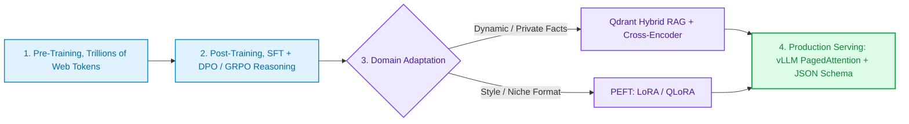
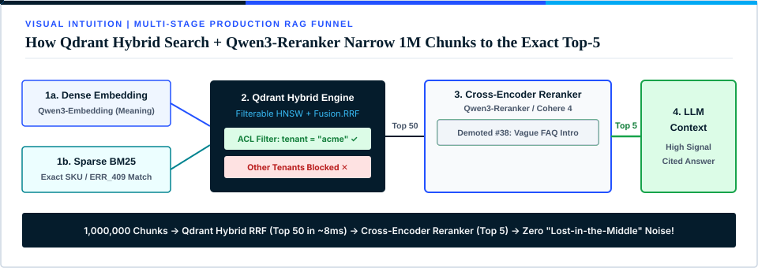

# Module 06: Generative AI, LLMs, Fine-Tuning (`LoRA`/`DPO`), `Qdrant` & Production RAG

> **Difficulty:** Advanced | **Estimated Study Time:** 10-12 Hours | **Prerequisites:** [Module 05: NLP & Transformers](./05_nlp_cv_and_multimodal.md)  
> **Focus:** LoRA/QLoRA parameter math, Direct Preference Optimization (DPO), Qdrant hybrid vector search (BM25 + Dense Cosine), Reciprocal Rank Fusion (RRF), and vLLM PagedAttention serving

[← Previous: Module 05: NLP, CV & Multimodal](./05_nlp_cv_and_multimodal.md) | [Roadmap Index](../../README.md) | [Next: Module 07: AI Agents Fundamentals →](../05-agentic-ai/07_ai_agents_fundamentals.md)

---

## 1. Overview

In [Module 05](./05_nlp_cv_and_multimodal.md), you explored the causal self-attention engine powering autoregressive decoders. However, a raw pre-trained foundation model is merely an ungrounded internet completion engine: it lacks proprietary enterprise knowledge, hallucinates facts, and generates unstructured text. Converting a foundation model into a production enterprise system requires four integrated capabilities: **Post-Training Alignment (SFT + DPO/GRPO)**, **Schema-Constrained Generation**, **Filterable Hybrid Vector Search (Qdrant + Reciprocal Rank Fusion)**, and **High-Throughput Serving (vLLM PagedAttention)**.



---

## 2. Learning Objectives

By the end of this module, you will be able to:
- **Calculate static and KV-cache GPU memory budgets** for model weights across FP16, INT8, and INT4 (AWQ/GPTQ) quantization regimes.
- **Enforce guaranteed valid JSON output schemas** using Pydantic and regex context-free grammar (CFG) constraints at decoding time.
- **Implement Parameter-Efficient Fine-Tuning (LoRA / QLoRA)**, computing trainable adapter parameter counts and forward rank-decomposition math ($\Delta W = \frac{\alpha}{r} B A$).
- **Contrast RLHF with Direct Preference Optimization (DPO)**, deriving how implicit rewards bypass separate neural reward models.
- **Construct an Enterprise Hybrid RAG Pipeline** fusing dense vector search with sparse BM25 via Reciprocal Rank Fusion (RRF) and payload filtering in Qdrant.
- **Configure high-throughput inference serving** using vLLM PagedAttention, continuous batching, and prefix caching.

---

## 3. Prerequisites

- **Transformer Attention:** Multi-head attention and causal masking from [Module 05](./05_nlp_cv_and_multimodal.md).
- **Deep Learning Training Loops:** PyTorch optimization, AdamW, and loss functions from [Module 04](../03-deep-learning/04_deep_learning_and_rl.md).

---

## 4. Core Concepts

### 4.1 VRAM Sizing & Quantization Math
To fit a model in GPU memory for inference:
$$\text{Weight VRAM (GB)} = \text{Parameters (Billions)} \times \text{Bytes per Parameter}$$
- **FP16 / BF16 (16-bit):** 2.0 Bytes / param (e.g. 7B model requires $\approx 14\text{ GB}$).
- **INT8 (8-bit):** 1.0 Byte / param (e.g. 7B model requires $\approx 7\text{ GB}$).
- **INT4 (4-bit AWQ / GGUF):** 0.5–0.6 Bytes / param (e.g. 7B model requires $\approx 4.5\text{ GB}$, running on commodity laptops).

### 4.2 Guaranteed Structured Outputs via Pydantic & CFG
Enterprise systems require valid machine-readable JSON. Relying on prompting alone (*"output only valid JSON"*) fails under production edge cases. Modern engines use **Context-Free Grammar (CFG) / Logit Masking**: during autoregressive generation, invalid transition tokens that violate the JSON schema receive a logit mask of $-\infty$:

```python
from pydantic import BaseModel, Field

class OrderExtraction(BaseModel):
    order_id: str = Field(pattern=r"^ORD-\d{5}$")
    items: list[str] = Field(min_length=1)
    total_usd: float = Field(gt=0.0)
    express_shipping: bool

# Schema passed directly to guided_json / response_schema
json_schema = OrderExtraction.model_json_schema()
```

### 4.3 Chunking Strategies & Vector Embeddings
- **Fixed-Size Chunking with Overlap:** 512 tokens with 50-token overlap; simple but splits semantic paragraphs.
- **Semantic Chunking:** Computes cosine similarity between consecutive sentences and places chunk boundaries where semantic similarity drops sharply.
- **Document Chunking with Metadata:** Attaching `user_id`, `tenant_id`, and `created_at` timestamps to vectors for payload filtering.

---

## 5. Technical Deep Dive

### 5.1 Low-Rank Adaptation (LoRA) & QLoRA
Instead of updating the full weight matrix $W_0 \in \mathbb{R}^{d \times k}$, LoRA freezes $W_0$ and decomposes updates into two low-rank matrices $B \in \mathbb{R}^{d \times r}$ and $A \in \mathbb{R}^{r \times k}$ where rank $r \ll \min(d, k)$:
$$W = W_0 + \Delta W = W_0 + \frac{\alpha}{r} (B \cdot A)$$

For $d = 4096, k = 4096, r = 16$:
- Full parameter count: $4096 \times 4096 = 16,777,216$ parameters.
- LoRA parameter count: $(4096 \times 16) + (16 \times 4096) = 131,072$ parameters (**$> 99\%$ parameter reduction!**).

### 5.2 Direct Preference Optimization (DPO) vs. RLHF
Standard RLHF trains a separate Reward Model and runs unstable PPO reinforcement learning. DPO derives an analytical relationship between the reward function and optimal policy, optimizing likelihood directly over preference pairs $(x, y_w, y_l)$ (where $y_w$ is preferred and $y_l$ is dispreferred):
$$\mathcal{L}_{\text{DPO}}(\theta; \pi_{\text{ref}}) = -\mathbb{E}_{(x, y_w, y_l)} \left[ \log \sigma \left( \beta \log \frac{\pi_\theta(y_w \mid x)}{\pi_{\text{ref}}(y_w \mid x)} - \beta \log \frac{\pi_\theta(y_l \mid x)}{\pi_{\text{ref}}(y_l \mid x)} \right) \right]$$

### 5.3 Qdrant Hybrid RAG & Reciprocal Rank Fusion (RRF)
Pure dense vector search fails on precise part numbers, SKU codes, and rare acronyms. Pure BM25 fails on semantic paraphrasing. **Hybrid Search** executes both in parallel and fuses ranks via Reciprocal Rank Fusion:

<p align="center">
  
</p>

```python
from qdrant_client import QdrantClient, models

client = QdrantClient(path="./qdrant_local")

# Setup hybrid collection with Dense + Sparse vectors
client.create_collection(
    collection_name="enterprise_docs",
    vectors_config={
        "dense": models.VectorParams(size=768, distance=models.Distance.COSINE)
    },
    sparse_vectors_config={
        "sparse": models.SparseVectorParams()
    }
)
```

### 5.4 High-Throughput Serving with vLLM & PagedAttention
Traditional LLM inference allocates contiguous GPU memory for the maximum possible sequence length, wasting 60%–80% of VRAM due to internal fragmentation. **PagedAttention** partitions the KV cache into fixed-size virtual memory blocks (e.g. 16 tokens per block), enabling non-contiguous physical page allocation:

<p align="center">
  
</p>

---

## 6. Hands-on Implementation

Implement Reciprocal Rank Fusion (RRF) in pure Python to merge sparse lexical and dense semantic rankings:

```python
from collections import defaultdict

def reciprocal_rank_fusion(
    ranked_lists: list[list[str]], k: int = 60, top_n: int = 3
) -> list[tuple[str, float]]:
    rrf_scores: dict[str, float] = defaultdict(float)
    for ranked_docs in ranked_lists:
        for rank, doc_id in enumerate(ranked_docs, start=1):
            rrf_scores[doc_id] += 1.0 / (k + rank)

    sorted_docs = sorted(rrf_scores.items(), key=lambda item: item[1], reverse=True)
    return sorted_docs[:top_n]

# Dense neural embeddings top-ranked docs
dense_results = ["doc_A", "doc_B", "doc_C", "doc_D"]
# Sparse BM25 keyword matching top-ranked docs
bm25_results  = ["doc_B", "doc_E", "doc_A", "doc_F"]

fused = reciprocal_rank_fusion([dense_results, bm25_results], k=60, top_n=3)
# doc_B (ranked #2 in dense, #1 in BM25) and doc_A score highest
assert fused[0][0] in ("doc_B", "doc_A")
print("Lab 06 Passed! Fused Rankings:", fused)
```

---

## 7. Practical Exercises

### Exercise 1: LoRA Parameter Calculation Script
Write a Python script that takes a Transformer configuration (`num_layers=32, d_model=4096, num_heads=32`) and target rank $r \in [4, 8, 16, 64]$:
1. Compute total base model parameters in the $W_Q, W_K, W_V, W_O$ attention projections.
2. Compute the exact parameter count and percentage footprint of the LoRA adapter matrices.

### Exercise 2: RAG Pipeline with Document Metadata Filters
Using `projects/intermediate/starter-local-rag-agent`:
1. Index documents tagged with `department` (`"legal"`, `"engineering"`, `"hr"`).
2. Execute a hybrid search query with an exact payload metadata filter restricting results to `"legal"` documents.

---

## 8. Mini Project

### Air-Gapped Hybrid RAG & SQL Assistant
Run and inspect the production local starter project:
- **Location:** [`projects/intermediate/starter-local-rag-agent/`](../../projects/intermediate/starter-local-rag-agent/README.md)
- **Features:** Okapi BM25 sparse index + dense cosine vectors with in-memory SQLite analytical query routing.
- **Verification Command:**
  ```bash
  python projects/intermediate/starter-local-rag-agent/app.py
  pytest projects/intermediate/starter-local-rag-agent
  ```

---

## 9. Advanced Topics

- **Speculative Decoding:** Accelerating inference latency by having a small draft model (e.g. 1B) generate candidate tokens that a large target model (e.g. 70B) verifies in a single forward pass.
- **Chunking with Late Interaction (ColBERT):** Preserving individual token embeddings per chunk and computing MaxSim late interactions for state-of-the-art retrieval accuracy.
- **Long-Context KV Cache Compression:** StreamingLLM and RoPE frequency interpolation enabling 100k+ token context windows without OOM crashes.

---

## 10. Common Mistakes & Gotchas

1. **Relying Solely on Dense Vector Search:** Dense embeddings frequently fail on SKU numbers, error codes, and exact user IDs. Always use Hybrid Search with BM25.
2. **Chunking without Context Headers:** Slicing a table into 500-token chunks leaves subsequent chunks without table headers or column definitions.
3. **Merging LoRA Weights in Non-Matching Datatypes:** Merging FP16 LoRA adapters into quantized INT4 base weights without dequantizing causes irreversible numerical corruption.

---

## 11. Interview Questions & System Design

### Q1: How does PagedAttention eliminate memory fragmentation in LLM serving?
Standard GPU memory allocation requires contiguous memory for each request's KV cache based on maximum output sequence length ($T_{\max}$), causing internal fragmentation (allocated but unused memory) and external fragmentation. PagedAttention divides the KV cache into fixed-size physical blocks and maps them using virtual block tables, allowing non-contiguous allocation and shared prompt prefix memory across parallel generation branches.

### Q2: What is the mathematical and architectural difference between SFT and DPO?
Supervised Fine-Tuning (SFT) trains with standard cross-entropy loss over demonstrations, optimizing conditional log-likelihood $\sum \log P(y_t \mid x, y_{<t})$. DPO optimizes human preference over paired completions $(y_w, y_l)$, increasing the likelihood ratio of the preferred completion relative to a frozen reference model $\pi_{\text{ref}}$ while penalizing divergence via an implicit KL constraint parameter $\beta$.

---

## 12. Recommended Resources

- **LoRA Paper:** [LoRA: Low-Rank Adaptation of Large Language Models](https://arxiv.org/abs/2106.09685) (Hu et al., 2021).
- **DPO Paper:** [Direct Preference Optimization: Your Language Model is Secretly a Reward Model](https://arxiv.org/abs/2305.18290) (Rafailov et al., 2023).
- **vLLM Paper:** [Efficient Memory Management for Large Language Model Serving with PagedAttention](https://arxiv.org/abs/2309.06180) (Kwon et al., 2023).
- **Documentation:** [Qdrant Hybrid Search Guide](https://qdrant.tech/documentation/concepts/hybrid-queries/).

---

## 13. Completion Checklist

- [ ] Calculate GPU VRAM requirements for FP16 and INT4 quantized LLM inference.
- [ ] Implement guaranteed JSON schema enforcement using Pydantic.
- [ ] Derive the forward update formula for LoRA rank decomposition ($\Delta W = \frac{\alpha}{r} B A$).
- [ ] Explain how Reciprocal Rank Fusion fuses disparate rank lists without score calibration.
- [ ] Describe how PagedAttention solves the memory fragmentation problem in high-concurrency LLM serving.
- [ ] Run the test suite in [`projects/intermediate/starter-local-rag-agent/`](../../projects/intermediate/starter-local-rag-agent/README.md).

---

[← Previous: Module 05: NLP, CV & Multimodal](./05_nlp_cv_and_multimodal.md) | [Home](../../README.md) | [Next: Module 07: AI Agents Fundamentals →](../05-agentic-ai/07_ai_agents_fundamentals.md)
