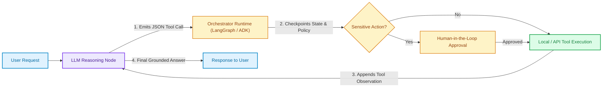
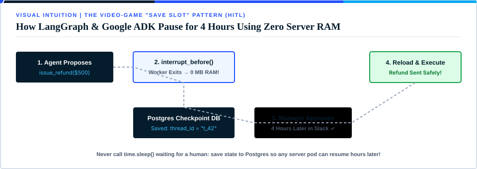

# Module 08: Function Calling, LangGraph & Google Agent Development Kit (ADK)

> **Difficulty:** Advanced | **Estimated Study Time:** 6-8 Hours | **Prerequisites:** [Module 07: AI Agents Fundamentals](./07_ai_agents_fundamentals.md)  
> **Focus:** Strict tool schemas (JSON Schema), cyclical StateGraphs (LangGraph), Google Agent Development Kit (ADK), state persistence, and durable Human-in-the-Loop (HITL) checkpoints

[← Previous: Module 07: AI Agents Fundamentals](./07_ai_agents_fundamentals.md) | [Roadmap Index](../../README.md) | [Next: Module 09: Multi-Agent Systems & MCP →](./09_multi_agent_and_mcp.md)

---

## 1. Overview

In [Module 07](./07_ai_agents_fundamentals.md), we constructed a foundational ReAct loop using in-memory execution. In production systems, in-memory loops fail if a container pod restarts, and text-based tool parsing is fragile. Modern agent platforms operate on a core architectural principle: **foundation models never execute external tools directly**; they generate structured **JSON function-calling declarations** that a deterministic **graph runtime (LangGraph or Google ADK)** validates, checkpoints to durable storage, authorizes via safety gates, and executes:



---

## 2. Learning Objectives

By the end of this module, you will be able to:
- **Design strict JSON Schema tool contracts** enforcing explicit parameter typing, enum constraints, and required fields.
- **Build cyclical multi-actor state machines** using LangGraph `StateGraph`, defining nodes, edges, conditional routers, and reducers.
- **Implement durable state persistence** with checkpoint savers (e.g. SQLite, PostgreSQL), allowing agents to resume execution seamlessly across server restarts.
- **Integrate Google Agent Development Kit (ADK)** workflows using declarative agent configurations and visual debugging tools (`adk web`).
- **Construct Human-in-the-Loop (HITL) authorization gates** that pause workflow execution before irreversible mutations (e.g. database updates, payments, external emails).

---

## 3. Prerequisites

- **Agent Loops & ReAct:** Thought-action-observation cycles and memory management from [Module 07](./07_ai_agents_fundamentals.md).
- **Type Annotations & Schemas:** Python `TypedDict`, `dataclasses`, and `Pydantic` models from [Module 01](../01-foundations/01_python_sql_and_data_stack.md).

---

## 4. Core Concepts

### 4.1 Strict Function Calling Contract
When defining tools for foundation models (OpenAI, Gemini, Anthropic), parameters must be specified as valid JSON Schema:

```json
{
  "name": "lookup_customer_balance",
  "description": "Retrieves the current pending balance and currency for a customer account.",
  "parameters": {
    "type": "object",
    "properties": {
      "account_id": {
        "type": "string",
        "description": "The unique customer account ID (e.g., ACC-12345)"
      },
      "include_pending": {
        "type": "boolean",
        "description": "Whether to include unposted pending transactions"
      }
    },
    "required": ["account_id"],
    "additionalProperties": false
  }
}
```

### 4.2 The 4-Step Function Calling Lifecycle
1. **Declaration:** Client sends the user query alongside tool declarations to the LLM.
2. **Intent Emission:** LLM outputs a structured `tool_calls` payload (`function_name`, `arguments`) instead of a text response.
3. **Execution:** The application runtime validates arguments, executes the physical function, and formats the result.
4. **Resolution:** Client sends the tool result back to the model as a `tool` role message, and the model synthesizes a final user-facing answer.

---

## 5. Technical Deep Dive

### 5.1 LangGraph State Machine Architecture
LangGraph represents agent logic as a directed cyclical graph:
- **State:** A shared data structure (`TypedDict` with reducers) holding conversation history and runtime flags.
- **Nodes:** Python functions that accept the current state and return state updates.
- **Edges:** Deterministic transitions from one node to the next.
- **Conditional Edges:** Dynamic routers that inspect model outputs to determine whether to call another tool or terminate.

```python
from typing import Annotated, Literal, TypedDict
from langgraph.graph import StateGraph, START, END
from langgraph.graph.message import add_messages

class AgentState(TypedDict):
    # 'add_messages' appends new messages to history instead of overwriting
    messages: Annotated[list[dict], add_messages]
    retry_count: int

def call_model(state: AgentState) -> dict:
    # Simulates model evaluation
    last_msg = state["messages"][-1]["content"]
    if "lookup" in last_msg.lower():
        return {"messages": [{"role": "assistant", "tool_call": "lookup_user"}]}
    return {"messages": [{"role": "assistant", "content": "Query resolved."}]}

def execute_tool(state: AgentState) -> dict:
    return {"messages": [{"role": "tool", "content": "User balance: $450.00"}]}

def router(state: AgentState) -> Literal["execute_tool", "__end__"]:
    last = state["messages"][-1]
    if "tool_call" in last:
        return "execute_tool"
    return END

# Build graph
builder = StateGraph(AgentState)
builder.add_node("call_model", call_model)
builder.add_node("execute_tool", execute_tool)

builder.add_edge(START, "call_model")
builder.add_conditional_edges("call_model", router)
builder.add_edge("execute_tool", "call_model")
graph = builder.compile()
```

### 5.2 Human-in-the-Loop (HITL) Checkpoints & Pauses
In financial, enterprise, or medical workflows, destructive actions must never execute without explicit human authorization:

<p align="center">
  
</p>

1. **State Suspension:** When the model routes to a protected action (`refund_amount > $100`), the graph suspends execution before entering the target node via `interrupt_before=["process_refund"]`.
2. **Durable Persistence:** The exact graph state is serialized to a persistent checkpointer (e.g., PostgreSQL or SQLite).
3. **Resume on Approval:** An admin reviews the pending proposal in a dashboard and dispatches `graph.invoke(Command(resume=True))`, allowing execution to proceed.

---

## 6. Hands-on Implementation

Implement a deterministic mock cyclical router in Python verifying state transitions and loop termination:

```python
def run_minimal_agent(query: str) -> list[str]:
    state = {"query": query, "steps": [], "status": "PENDING"}

    # Step 1: Analyze query
    state["steps"].append("ANALYZING")
    if "balance" in query.lower():
        state["steps"].append("CALLING_TOOL:get_balance")
        # Step 2: Tool execution
        tool_result = "$500.00"
        state["steps"].append(f"OBSERVATION:{tool_result}")
        # Step 3: Synthesis
        state["steps"].append("SYNTHESIZING")
        state["status"] = "COMPLETED"
    else:
        state["steps"].append("DIRECT_ANSWER")
        state["status"] = "COMPLETED"

    return state["steps"]

res = run_minimal_agent("Check my balance")
assert "CALLING_TOOL:get_balance" in res
assert "COMPLETED" in run_minimal_agent("Hello")
print("Lab 08 Passed! Cyclical transitions validated.")
```

---

## 7. Practical Exercises

### Exercise 1: Building a Validated Pydantic Tool Converter
1. Write a Python function `tool_to_json_schema(func)` that inspects a Python function's docstring and type hints and generates a compliant OpenAI/Gemini JSON Schema dictionary.
2. Verify that optional parameters are excluded from the `required` list.

### Exercise 2: Implementing a StateGraph Reducer
1. Construct an `AgentState` with custom reducers that merge dictionary entries rather than overwriting them.
2. Verify that state attributes persist across multiple iterative node updates.

---

## 8. Mini Project

### Google ADK Operations Support Copilot
Scaffold a multi-tool customer operations agent:
- **Tools:**
  - `query_database(sql: str) -> list[dict]`
  - `send_customer_email(to: str, body: str) -> bool` (Protected action requiring HITL)
- **Requirements:**
  1. Define strict JSON Schemas for both tools.
  2. Implement a LangGraph / ADK graph that prompts for human authorization when `send_customer_email` is called.
  3. Verify that the agent halts safely if authorization is rejected.

---

## 9. Advanced Topics

- **Time-Travel Debugging:** Replaying and editing previous state checkpoints in LangGraph to fork conversations and debug agent logic branches.
- **Dynamic Few-Shot In-Context Tool Selection:** When an agent has 100+ tools, embedding tool schemas into a vector database and injecting only the top-5 most relevant tool definitions into the prompt.
- **Sub-Graph Nesting:** Encapsulating specialized sub-agents as isolated sub-graphs within a parent orchestrator graph.

---

## 10. Common Mistakes & Gotchas

1. **Letting Models Execute Code Unchecked:** Assuming the model executed an API call because it output `{"status": "success"}` in text. The model only outputs text; your runtime executes actions.
2. **Overwriting Conversation State:** Using standard dictionary assignment instead of message reducers (`add_messages`), resulting in message history being truncated on every node step.
3. **Missing Tool Schema Types:** Omitting parameter descriptions in JSON Schemas, leaving the model to guess argument formats.

---

## 11. Interview Questions & System Design

### Q1: What is the architectural role of a Checkpointer in LangGraph?
A Checkpointer saves the complete state of the graph (memory, messages, variables, and next edge transitions) at every super-step to a persistent datastore (PostgreSQL, SQLite, Redis). This enables three capabilities:
1. **Fault Tolerance:** Workflows automatically recover and resume from the exact failure step if a worker node crashes.
2. **Human-in-the-Loop:** Workflows can pause indefinitely waiting for asynchronous human approval.
3. **Time-Travel:** Developers can rewind state to previous execution checkpoints for debugging.

### Q2: How does Google Agent Development Kit (ADK) structure agent collaboration?
Google ADK structures systems using hierarchical supervisors and specialized worker subagents. A root supervisor model cascades tasks to worker agents equipped with isolated tool subsets. Subagents report structured output back to the root agent, keeping individual context windows compact and preventing prompt pollution.

---

## 12. Recommended Resources

- **Documentation:** [LangGraph Conceptual Guides](https://langchain-ai.github.io/langgraph/).
- **Repository:** [Google Agent Development Kit (ADK) Python](https://github.com/google/adk-python).
- **Specification:** [OpenAI Function Calling Reference](https://platform.openai.com/docs/guides/function-calling).

---

## 13. Completion Checklist

- [ ] Write a compliant JSON Schema specification for an arbitrary Python function.
- [ ] Diagram a cyclical StateGraph with nodes, conditional edges, and reducers.
- [ ] Explain how LangGraph checkpointers persist state across machine boundaries.
- [ ] Implement a Human-in-the-Loop authorization gate that pauses execution before a sensitive operation.
- [ ] Successfully run the minimal agent transition state machine in Python.

---

[← Previous: Module 07: AI Agents Fundamentals](./07_ai_agents_fundamentals.md) | [Home](../../README.md) | [Next: Module 09: Multi-Agent Systems & MCP →](./09_multi_agent_and_mcp.md)
