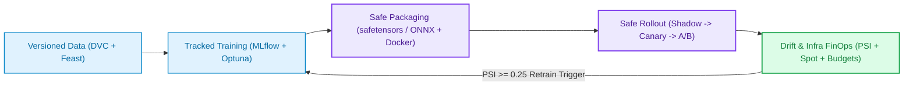

# Module 11: Production MLOps, AI Engineering, Drift & Cloud FinOps

> **Estimated Study Time:** 8–10 Hours | **Prerequisites:** [Module 03](../02-core-ml-and-dl/03_classical_ml_and_recsys.md), [Module 10](../04-agentic-ai/10_agent_evals_and_safety.md) | **Starter Repo:** [Local MLOps Starter Template](../../projects/starter-local-mlops/)

[← Previous: Module 10 — Agent Evaluation & Safety](../04-agentic-ai/10_agent_evals_and_safety.md) | [Home](../../README.md) | [Next: Module 12 — Practical Troubleshooting Scenarios →](./12_system_troubleshooting_scenarios.md)

---

## Mental Model: ML Modeling Code Is Only ~5%–10% of a Production System

As Google researchers famously documented in *[Hidden Technical Debt in Machine Learning Systems](https://papers.nips.cc/paper_files/paper/2015/hash/86df7dcfd896fcaf2674f757a2463eba-Abstract.html)* (Sculley et al., NeurIPS 2015), core ML training code makes up **only a tiny fraction (~5%–10%)** of real-world ML infrastructure. A model scoring `0.94 AUC` in a local notebook delivers zero business value until surrounded by safe serialization, containerization, data/model versioning, feature stores, drift monitoring, and cloud FinOps guardrails.



---

## Tier 1: Core Foundations (Serialization, `FastAPI`, `Docker`, `MLflow` & `DVC`)

### 1. Safe Model Serialization & Serving via `FastAPI`

#### 1.1 Safe Model Serialization (`safetensors`, `ONNX`) & Startup-Loaded `FastAPI` Services
- **Security Trap (`pickle` / `torch.load` default):** `pickle` executes arbitrary Python bytecode during deserialization — loading an untrusted `.pkl` file can compromise your production server!
- **`safetensors` (Hugging Face / PyTorch standard):** Zero-copy, memory-mapped tensor format that stores **pure weights + JSON header** with **zero arbitrary code execution** and 2x–4x faster GPU loading.
- **`ONNX` (Open Neural Network Exchange):** Framework-agnostic computation graph enabling graph fusion and quantized CPU/GPU inference via **ONNX Runtime** (`2x–5x` speedup over eager PyTorch).
- **`joblib`:** Efficient NumPy buffer compression for trusted internal `scikit-learn` pipelines.

```python
from contextlib import asynccontextmanager
from fastapi import FastAPI
from pydantic import BaseModel, Field
import joblib

models: dict = {}

@asynccontextmanager
async def lifespan(app: FastAPI):
    # Load model ONCE at startup (never inside the request handler!)
    models["churn"] = joblib.load("artifacts/churn_pipeline.joblib")
    yield
    models.clear()

app = FastAPI(title="Churn Inference Service", lifespan=lifespan)

class ChurnFeatures(BaseModel):
    tenure_months: int = Field(ge=0)
    monthly_spend: float = Field(ge=0.0)

@app.get("/health")
def health_check() -> dict[str, str]:
    return {"status": "healthy"}

@app.post("/predict")
def predict_churn(payload: ChurnFeatures) -> dict[str, float | bool]:
    X = [[payload.tenure_months, payload.monthly_spend]]
    prob = float(models["churn"].predict_proba(X)[0, 1])
    return {"churn_probability": round(prob, 4), "high_risk": prob >= 0.5}
```

---

### 2. Containerization (`Docker`) & Experiment/Data Versioning (`MLflow` + `DVC`)

#### 2.1 Layered Container Caching & Non-Root `Docker` Hardening
- **Image:** Immutable layered filesystem blueprint. **Container:** Isolated running process instantiated from an image.
- **Production Dockerfile Best Practices:** Pin a slim base image (`python:3.12-slim`), copy `requirements.txt`/`pyproject.toml` *before* source code to maximize Docker layer caching, drop root privileges (`USER appuser`), and expose a `/health` probe.

```dockerfile
FROM python:3.12-slim
WORKDIR /app

# 1. Cache dependencies separately from fast-changing application code
COPY requirements.txt .
RUN pip install --no-cache-dir -r requirements.txt

# 2. Run as non-root user for container security
RUN useradd --create-home appuser
COPY --chown=appuser:appuser src/ ./src/
USER appuser

EXPOSE 8000
CMD ["uvicorn", "src.app:app", "--host", "0.0.0.0", "--port", "8000"]
```

---

#### 2.2 Synchronizing Code, Datasets & Artifacts with `Git`, `DVC` & `MLflow`
- **`Git`:** Versions source code, configs, and small `.dvc` pointer files.
- **`DVC` (Data Version Control):** Stores 50 GB Parquet/image datasets in S3/GCS content-addressed storage while committing tiny SHA-256 pointer files into Git.
- **`MLflow`:** Logs hyperparameters, validation metrics (`PR-AUC`, `p99` latency), Git commit SHA, and versioned model artifacts in a central **Model Registry** (`Staging -> Champion`).

---

## Tier 2: Production Architecture & Scale (Serving Architectures, `Feast`, `PSI` Drift, Rollouts & Infra FinOps)

### 3. Classical ML Serving vs. LLM Serving, and Feature Stores (`Feast`)

#### 3.1 Stateless CPU Model Serving vs. Stateful GPU `KV Cache` Serving

| Dimension | Classical ML (`XGBoost` / `LightGBM`) | LLM Serving (`vLLM` / `TensorRT-LLM`) |
|---|---|---|
| **Compute & State** | Stateless CPU pods (`<500 MB` RAM), `5ms` inference | Stateful `KV Cache` on high-VRAM GPUs (`24–80 GB`), streaming `SSE` tokens |
| **Batching** | Simple request or micro-batching | **Continuous iteration-level batching** + `PagedAttention` |
| **Autoscaling Signal** | CPU utilization / RPS | **KV Cache VRAM % utilization** + waiting queue depth (CPU % stays near 0 on GPU pods!) |

---

#### 3.2 Eliminating Training-Serving Skew with Dual Offline/Online Feature Stores (`Feast`)
**Training-Serving Skew** occurs when offline training features (computed in batch SQL/Pandas) subtly diverge from live inference features (re-implemented in Go/Python microservices with different null handling or window boundaries).
- **`Feast` Dual-Store Architecture:** Defines feature transformations **once**:
  1. **Offline Store (`BigQuery` / `Snowflake` / `Parquet`):** Generates historical training sets using **point-in-time joins** (preventing future label leakage).
  2. **Online Store (`Redis` / `DynamoDB`):** Materializes the exact same latest feature values for `<5ms` real-time inference lookups.

---

#### 3.3 Real-Time `SSE` Token/Tool Streaming (`FastAPI`) & User Feedback Data Flywheels
Production GenAI and agent frontends never block on a synchronous 12-second `POST` request — they stream typed **Server-Sent Events (`SSE`)** so users see live tool progress (`"Querying Qdrant..."`) and sub-second `TTFT` tokens, then capture explicit/implicit user feedback into a **Data Flywheel**:

```python
import json
from collections.abc import AsyncIterator
from fastapi import FastAPI
from fastapi.responses import StreamingResponse

stream_app = FastAPI()

async def agent_event_stream(session_id: str, prompt: str) -> AsyncIterator[str]:
    # 1. Emit live tool-status frame for UI progress indicator
    yield f"event: status\ndata: {json.dumps({'step': 'qdrant_hybrid_search'})}\n\n"
    # 2. Stream incremental answer tokens as they decode
    for tok in ("Refund ", "approved ", "under ", "Policy ", "[POL-101]."):
        yield f"event: token\ndata: {json.dumps({'text': tok})}\n\n"
    # 3. Emit trace_id so frontend thumbs-up/down binds to the exact OpenTelemetry span!
    yield f"event: done\ndata: {json.dumps({'trace_id': f'tr_{session_id}'})}\n\n"

@stream_app.get("/chat/stream")
async def chat_stream(session_id: str, q: str) -> StreamingResponse:
    return StreamingResponse(agent_event_stream(session_id, q), media_type="text/event-stream")
```
- **Closing the Data Flywheel:** Binding frontend thumbs-up/down, copy events, and human-edited replies to `trace_id` automatically populates (a) **hard-negative regression tests** for your `EDD` Golden Set (`Module 10`) and (b) `(prompt, human_edited_chosen, model_rejected)` preference pairs for **`DPO` fine-tuning** (`Module 06`).

---

### 4. Statistical Drift (`PSI`), Safe Deployments & Cloud GPU FinOps

#### 4.1 Detecting Covariate Shift (`PSI`, K-S) vs. Concept Drift
- **Data / Covariate Drift ($P(X)$ shifts):** Input distribution changes (e.g., inflation shifts transaction amounts upward). Quantified via **Kolmogorov-Smirnov (K-S) test** or **PSI**:
  $$\text{PSI} = \sum_{i=1}^{B} (p_{\text{prod}, i} - p_{\text{train}, i}) \cdot \ln\left(\frac{p_{\text{prod}, i}}{p_{\text{train}, i}}\right)$$
  - Standard credit-risk & MLOps thresholds (*Siddiqi, Credit Risk Scorecards*): `PSI < 0.10`: Stable | `0.10 <= PSI < 0.25`: Moderate shift (investigate) | **`PSI >= 0.25`: Significant shift -> trigger automated CI/CD retraining**.
- **Concept Drift ($P(Y \mid X)$ shifts):** Input histograms look identical (`PSI < 0.05`), yet fraudsters changed tactics so precision collapses — detected via delayed ground-truth label monitoring and business KPIs.

---

#### 4.2 Progressive Delivery: Shadow Traffic, Canary Rollouts & Online A/B Tests
1. **Shadow (Dark Traffic):** Mirror 100% of live requests to the Challenger model asynchronously; discard Challenger outputs from user responses while verifying latency, memory, and prediction distributions at **zero user risk**.
2. **Canary Rollout:** Route `1% -> 10% -> 50% -> 100%` of live traffic with automated rollback if `5xx` error rates or `p99` latency breach guardrails.
3. **Online A/B Test:** Randomize by `user_id` (`50/50`), measuring **Primary Business KPI** statistical lift ($p < 0.05$) alongside strict **Guardrail Metrics** (latency, unsubscribe rate).

---

#### 4.3 Preemptible Spot GPU Checkpointing & Automated Cloud Cost Kill-Switches
1. **Spot / Preemptible GPUs + Emergency Checkpointing:** Rent spare cloud GPU capacity at **up to 60%–91% discount** compared to On-Demand rates ([AWS EC2 Spot](https://aws.amazon.com/ec2/spot/); [Google Cloud Spot VMs](https://cloud.google.com/spot-vms)). Save checkpoints to S3/GCS every $N$ steps and trap the cloud `SIGTERM` preemption signal to flush optimizer + model state cleanly so replacement nodes resume automatically.
2. **Automated Cloud Infrastructure Kill-Switches:**
   - Cap Kubernetes autoscalers (`maxReplicas`), enforce idle-GPU auto-shutdown (`GPU utilization < 5%` for 30 mins), and wire **AWS Budgets -> SNS -> Lambda** (or **GCP Billing Budgets -> Pub/Sub -> Cloud Function**) to automatically scale non-prod GPU groups to zero when spend crosses threshold.

---

## Mini Hands-On Lab (15-Minute Exercise)

Implement **Population Stability Index (`PSI`)** in NumPy to detect production covariate shift:

```python
import numpy as np

def compute_psi(expected: np.ndarray, actual: np.ndarray, bins: int = 10) -> float:
    breakpoints = np.percentile(expected, np.linspace(0, 100, bins + 1))
    breakpoints[0], breakpoints[-1] = -np.inf, np.inf

    exp_pct = np.histogram(expected, bins=breakpoints)[0] / len(expected)
    act_pct = np.histogram(actual, bins=breakpoints)[0] / len(actual)

    exp_pct = np.clip(exp_pct, 1e-6, None)
    act_pct = np.clip(act_pct, 1e-6, None)
    return float(np.sum((act_pct - exp_pct) * np.log(act_pct / exp_pct)))

rng = np.random.default_rng(42)
train_dist = rng.normal(loc=50.0, scale=10.0, size=5000)
stable_prod = rng.normal(loc=50.5, scale=10.0, size=5000)
drifted_prod = rng.normal(loc=65.0, scale=14.0, size=5000)

assert compute_psi(train_dist, stable_prod) < 0.10
assert compute_psi(train_dist, drifted_prod) >= 0.25
print(f"Lab 11 Passed! Stable PSI={compute_psi(train_dist, stable_prod):.3f}, Drifted PSI={compute_psi(train_dist, drifted_prod):.3f}")
```

---

## Key Engineering Takeaways
- Load models **once inside `FastAPI` `lifespan`** (never per request), prefer **`safetensors` / `ONNX`** over unsafe `pickle`, and run Docker containers as a non-root user.
- Autoscale LLM GPU pods on **KV Cache VRAM utilization & queue depth**, not CPU %.
- Prevent Training-Serving Skew with **`Feast`**, detect covariate shift with **`PSI >= 0.25`**, roll out via **Shadow -> Canary -> A/B**, and train on **Spot GPUs with preemption checkpointing**.

---

[← Previous: Module 10 — Agent Evaluation & Safety](../04-agentic-ai/10_agent_evals_and_safety.md) | [Home](../../README.md) | [Next: Module 12 — Practical Troubleshooting Scenarios →](./12_system_troubleshooting_scenarios.md)
