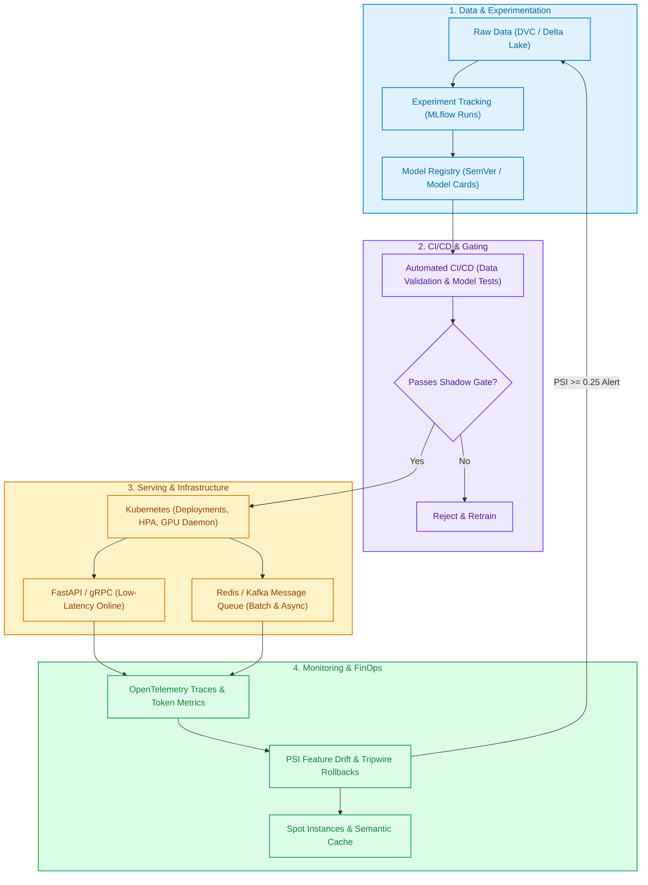

# Module 11: Production ML, GenAI & AgentOps: The Complete Engineering Lifecycle

[Phase 5 Index](./README.md) | [Roadmap](../../ROADMAP.md) | [Next: Module 12: Incident & Troubleshooting Labs →](./12_incident_and_troubleshooting_labs.md)

---

## 1. Overview

As documented in Google's landmark paper *[Hidden Technical Debt in Machine Learning Systems](https://papers.nips.cc/paper_files/paper/2015/hash/86df7dcfd896fcaf2674f757a2463eba-Abstract.html)* (Sculley et al., NeurIPS 2015), core modeling code comprises **only ~5%–10%** of an enterprise AI system. A model with high offline accuracy delivers zero business value until surrounded by production infrastructure: experiment tracking, data versioning, automated CI/CD gating, containerized Kubernetes microservices, message queues, feature stores, drift detection, and cloud FinOps:



---

## 2. Audience

- **AI/ML Engineers** transitioning models from ad-hoc notebooks to hardened, auto-scaling cloud microservices.
- **Backend & Platform Engineers** deploying high-throughput model inference APIs, feature stores, and asynchronous worker queues.
- **MLOps & DevOps Engineers** designing automated deployment pipelines (Canary/Shadow), Kubernetes GPU scheduling, and cost monitoring.

---

## 3. Learning Objectives

By the end of this module, you will be able to:
- **Track experiments and govern models with MLflow**: Log parameters, metrics, artifacts, and promote versioned models through staging to production.
- **Version training datasets**: Use DVC (Data Version Control) and Delta Lake to ensure 100% reproducible training pipelines.
- **Implement automated ML CI/CD**: Build GitHub Actions workflows that execute schema validation, regression tests, and shadow performance gating.
- **Architect batch and online inference**: Build low-latency FastAPI/gRPC synchronous endpoints and asynchronous Celery/Redis/Kafka workers.
- **Deploy containerized models on Kubernetes**: Write Kubernetes manifests with Resource Requests/Limits, Horizontal Pod Autoscaling (HPA), and NVIDIA GPU plugins.
- **Enforce zero-pickle security & non-root containers**: Eliminate remote code execution vulnerabilities via SafeTensors, ONNX, and `.npz` storage.
- **Execute Canary and Shadow deployments**: Route live production traffic across candidate models and automate rollback tripwires on error spikes.
- **Calculate Population Stability Index (PSI)**: Monitor production data drift and trigger automated retraining pipelines when PSI $\ge 0.25$.
- **Control cloud GPU FinOps**: Optimize inference costs using Spot instances, dynamic micro-batching, and semantic response caching.

---

## 4. Prerequisites

- **Mandatory:**
  - [Module 03: Classical Machine Learning & RecSys](../02-core-ml-and-dl/03_classical_ml_and_recsys.md) (Model evaluation, pipelines).
  - [Module 08: Agent Orchestration & Workflows](../04-agentic-ai/08_agent_orchestration.md) (Stateful service invocation).
- **Recommended:**
  - [Module 06C: Fine-Tuning & Serving](../03-modern-ai-and-genai/06c_finetuning_and_serving.md) (vLLM, continuous batching).
  - [Module 10: Agent Evaluation, Safety & FinOps](../04-agentic-ai/10_agent_evaluation_and_safety.md) (Token budgets, tracing).

---

## 5. Learning Levels

1. **Foundations (Level 1):** Zero-pickle model serialization, basic FastAPI serving, multi-stage Docker builds, MLflow parameter logging.
2. **Applied (Level 2):** Feast feature store integrations, Redis async queues, MLflow model registry stage transitions, Kubernetes manifests with resource limits.
3. **Production (Level 3):** Shadow deployment gating, automated canary rollouts with Prometheus metric tripwires, PSI drift calculations, and cloud GPU Spot orchestration.

---

## 6. Core Concepts

### 6.1 The Complete MLOps Lifecycle
The modern production AI lifecycle consists of 5 strict stages:
1. **Data Management:** Raw data versioned via DVC / Lakehouse tables, transformed via feature stores (Feast) to prevent training-serving skew.
2. **Experiment Tracking:** Hyperparameters, evaluation curves, and model weights tracked in MLflow.
3. **Model Governance:** Models registered with semantic versioning (`v1.2.0`), model cards, and signed approval gates.
4. **Automated CI/CD:** Continuous integration runs unit tests, input fuzzing, and latency benchmarks against shadow traffic.
5. **Continuous Serving & Monitoring:** Scaled via Kubernetes, buffered via Redis, and monitored for PSI drift and token cost.

### 6.2 Safe Model Serialization vs. Insecure Pickle
Python's standard `pickle.load` deserializes arbitrary bytecode streams, allowing malicious actors to embed remote shellcode in model files:
- **NumPy `.npz` (with `allow_pickle=False`):** Safe, structured numerical arrays for weights, biases, and normalization parameters.
- **SafeTensors (HuggingFace):** Zero-copy memory mapping for transformer tensors with pure JSON metadata and zero executable bytecode.
- **ONNX (Open Neural Network Exchange):** Portable computational graph format executable on high-speed C++ runtimes (ONNX Runtime, TensorRT).

---

## 7. Technical Deep Dive

### 7.1 Experiment Tracking & Model Registry with MLflow
MLflow standardizes reproducibility across training runs and controls model lifecycle progression:

```python
import mlflow
import mlflow.sklearn
from sklearn.ensemble import RandomForestClassifier
from sklearn.metrics import roc_auc_score

mlflow.set_experiment("fraud_detection_production")

with mlflow.start_run(run_name="rf_hyperopt_v2") as run:
    params = {"n_estimators": 150, "max_depth": 8, "class_weight": "balanced"}
    mlflow.log_params(params)

    clf = RandomForestClassifier(**params, random_state=42)
    clf.fit(X_train, y_train)

    val_preds = clf.predict_proba(X_val)[:, 1]
    auc = roc_auc_score(y_val, val_preds)
    mlflow.log_metric("val_roc_auc", auc)

    # Log model artifact with input example and signature
    mlflow.sklearn.log_model(
        sk_model=clf,
        artifact_path="model",
        registered_model_name="FraudDetectionModel"
    )
```

#### Model Registry Governance
- **Staging:** Candidates deployed to shadow environments for 48 hours to evaluate latency and error rates.
- **Production:** The single authoritative model serving live inference traffic.
- **Archived:** Deprecated historical models kept for compliance and rollback capabilities.

### 7.2 Data & Model Versioning with DVC & Delta Lake
Code version control (Git) cannot efficiently track multi-gigabyte datasets. **DVC (Data Version Control)** decouples metadata pointers from raw cloud storage:
```bash
# Track raw dataset in DVC
dvc add data/training_transactions.parquet
git add data/training_transactions.parquet.dvc .gitignore
git commit -m "chore: version Q3 transaction training data"

# Push raw bytes to remote S3/GCS bucket while keeping lightweight pointers in Git
dvc push
```

### 7.3 Batch vs. Online Inference Architectures
| Metric / Pattern | Synchronous Online (FastAPI / gRPC) | Asynchronous Batch / Event-Driven (Celery / Kafka) |
|---|---|---|
| **Latency SLA** | 10ms – 200ms | Minutes to Hours |
| **Throughput** | 100 – 10,000 requests/sec | Millions of records / run |
| **Communication** | Direct HTTP REST / gRPC | Redis, RabbitMQ, Kafka message broker |
| **Failure Handling** | Immediate HTTP 429/503 response | Dead-letter queues, automatic exponential retry |
| **Typical Use Case** | Real-time fraud scoring, search ranking | Nightly credit limit updates, bulk embedding generation |

### 7.4 Kubernetes Fundamentals for AI Serving
In production, models run as stateless microservice pods managed by a Kubernetes Deployment with strict hardware limits:

```yaml
apiVersion: apps/v1
kind: Deployment
metadata:
  name: ml-fraud-service
  labels:
    app: fraud-api
spec:
  replicas: 3
  selector:
    matchLabels:
      app: fraud-api
  template:
    metadata:
      labels:
        app: fraud-api
    spec:
      containers:
      - name: inference-container
        image: ghcr.io/org/fraud-service:v1.2.0
        resources:
          requests:
            cpu: "1000m"
            memory: "2Gi"
          limits:
            cpu: "2000m"
            memory: "4Gi"
        ports:
        - containerPort: 8000
        readinessProbe:
          httpGet:
            path: /health
            port: 8000
          initialDelaySeconds: 5
          periodSeconds: 10
        securityContext:
          runAsNonRoot: true
          readOnlyRootFilesystem: true
          allowPrivilegeEscalation: false
```

### 7.5 Deployment Strategies & Automated Rollbacks
1. **Shadow Deployment (Dark Launch):** Production requests are mirrored to candidate model $B$ without returning its outputs to users. Validates runtime latency, memory stability, and prediction distribution before user exposure.
2. **Canary Rollout:** Route 5% of traffic to candidate model $B$, keeping 95% on model $A$.
3. **Automated Rollback Tripwires:** Prometheus and Grafana alert managers continuously monitor error rate and latency. If P99 latency $> 150\text{ms}$ or HTTP 5xx errors $> 0.5\%$ over 5 minutes, Kubernetes automatically rolls back the deployment:
   ```bash
   kubectl rollout undo deployment/ml-fraud-service
   ```

### 7.6 Population Stability Index (PSI) Drift Calculation
PSI measures statistical divergence between baseline reference training features $E$ (Expected) and live production inference features $A$ (Actual):

$$\text{PSI} = \sum_{i=1}^k (A_i - E_i) \times \ln\left(\frac{A_i}{E_i}\right)$$

<p align="center">
  
</p>

- $\text{PSI} < 0.10$: **Stable:** No significant change in input distribution.
- $0.10 \le \text{PSI} < 0.25$: **Moderate Drift:** Log warning, inspect feature trends.
- $\text{PSI} \ge 0.25$: **Severe Drift:** Trigger automated alert and model retraining pipeline.

---

## 8. Hands-on Implementation: FastAPI Service with PSI Drift Telemetry

Build a hardened, production FastAPI microservice featuring safe `.npz` model loading, health probes, and continuous PSI drift tracking:

```python
import numpy as np
from contextlib import asynccontextmanager
from fastapi import FastAPI, HTTPException
from pydantic import BaseModel, Field

# 1. Pydantic Request & Response Schemas
class PredictionRequest(BaseModel):
    features: list[float] = Field(..., min_length=5, max_length=5)

class PredictionResponse(BaseModel):
    prediction: float
    is_anomaly: bool
    model_version: str

# 2. State storage and lifespan context manager
model_state = {}

def calculate_psi(expected: np.ndarray, actual: np.ndarray, num_buckets: int = 10) -> float:
    """Calculates Population Stability Index between reference and production features."""
    quantiles = np.linspace(0, 100, num_buckets + 1)
    bins = np.percentile(expected, quantiles)
    bins[0] = -np.inf
    bins[-1] = np.inf

    expected_counts, _ = np.histogram(expected, bins=bins)
    actual_counts, _ = np.histogram(actual, bins=bins)

    # Add smoothing to avoid division by zero
    expected_pct = np.maximum(expected_counts, 1) / len(expected)
    actual_pct = np.maximum(actual_counts, 1) / len(actual)

    psi = np.sum((actual_pct - expected_pct) * np.log(actual_pct / expected_pct))
    return float(psi)

@asynccontextmanager
async def lifespan(app: FastAPI):
    # Safe model initialization (Zero-Pickle)
    model_state["weights"] = np.array([0.15, -0.25, 0.45, 0.10, -0.30], dtype=np.float32)
    model_state["bias"] = 0.05
    model_state["reference_distribution"] = np.random.default_rng(42).standard_normal(1000)
    model_state["production_feature_buffer"] = []
    model_state["version"] = "1.0.0"
    yield
    model_state.clear()

app = FastAPI(title="Production AI Scoring Service", lifespan=lifespan)

@app.get("/health")
async def health_check():
    if "weights" not in model_state:
        raise HTTPException(status_code=503, detail="Model weights uninitialized")
    return {"status": "HEALTHY", "version": model_state["version"]}

@app.post("/predict", response_model=PredictionResponse)
async def predict(payload: PredictionRequest):
    x = np.array(payload.features, dtype=np.float32)
    logit = float(np.dot(x, model_state["weights"]) + model_state["bias"])
    prob = 1.0 / (1.0 + np.exp(-logit))

    # Buffer features for real-time drift evaluation
    model_state["production_feature_buffer"].append(x[0])

    return PredictionResponse(
        prediction=round(prob, 4),
        is_anomaly=prob > 0.85,
        model_version=model_state["version"]
    )

@app.get("/telemetry/drift")
async def get_drift_metrics():
    buffer = model_state["production_feature_buffer"]
    if len(buffer) < 50:
        return {"status": "BUFFERING", "sample_count": len(buffer), "psi": None}

    psi_score = calculate_psi(
        expected=model_state["reference_distribution"],
        actual=np.array(buffer)
    )
    return {
        "status": "DRIFT_DETECTED" if psi_score >= 0.25 else "HEALTHY",
        "sample_count": len(buffer),
        "psi": round(psi_score, 4)
    }
```

---

## 9. Practical Exercises

### Exercise 1: Asynchronous Worker Queue with Redis
1. Set up an in-memory or Dockerized Redis instance.
2. Implement an asynchronous prediction worker that consumes JSON inference tasks from a Redis queue (`BRPOP`), computes batched predictions across 32 records, and stores the results under a task ID key.
3. Verify that worker restarts do not lose pending tasks.

### Exercise 2: Zero-Pickle ONNX Model Export & Inference
1. Train a scikit-learn classifier on synthetic data.
2. Convert the trained estimator to ONNX format using `skl2onnx`.
3. Load and execute the `.onnx` graph using `onnxruntime.InferenceSession` and benchmark the throughput improvement against native Python.

---

## 10. Mini Project: Full-Lifecycle MLOps Pipeline Starter

Deploy and test our production MLOps starter kit:
- **[Starter Project: Full-Lifecycle Production MLOps & PSI Drift Engine](../../projects/intermediate/starter-local-mlops/README.md)**
- Features safe `.npz` model persistence, non-root Docker builds, FastAPI REST endpoints, and automated population stability index tests.

---

## 11. Production Considerations

1. **GPU Memory Allocation in Serving:** When deploying PyTorch or HuggingFace models under FastAPI with multiple workers, each worker attempts to preallocate full GPU VRAM, triggering CUDA OOM errors. Use Triton Inference Server, vLLM, or set `torch.cuda.set_per_process_memory_fraction()`.
2. **Feature Store Time-Travel:** Always verify that feature store queries for training set construction use Point-in-Time joins (`timestamp <= label_timestamp`). Merging latest entity values creates silent lookahead data leakage.
3. **Cloud IAM Least Privilege:** Model training and serving containers should never mount root cloud provider credentials. Use Kubernetes ServiceAccounts bound to IAM Roles (AWS IRSA, GCP Workload Identity) granting read-only access to specific model buckets.

---

## 12. Common Mistakes & Gotchas

1. **Using Python `pickle` for Production Weights:** Serializing models with `pickle` creates severe remote code execution (RCE) vulnerabilities. Always use SafeTensors, ONNX, or `.npz`.
2. **Reloading Models Inside Endpoint Functions:** Initializing a model within an API route reloads multi-gigabyte weights on every single HTTP request, exhausting RAM and spiking latency. Always load models once using application lifespans.
3. **Omitting Dead-Letter Queues in Asynchronous Inference:** If an unhandled corrupted payload enters an inference worker queue, the worker crashes in an infinite restart loop. Always route failing tasks to a Dead-Letter Queue (DLQ) after 3 retries.

---

## 13. Interview Questions & System Design

### Q1: How do you prevent training-serving feature skew in production?
Training-serving skew is prevented using a centralized Feature Store (such as Feast). The feature store defines a single authoritative feature calculation logic. For training, it executes point-in-time joins against historical data lakes (preventing lookahead leakage); for inference, it materializes the exact same features to a low-latency key-value store (Redis) accessible by the online serving container.

### Q2: Explain the mechanics of a Shadow Deployment and its advantages over Canary Rollouts.
In a Shadow Deployment, live production traffic is duplicated at the API gateway: request traffic goes to the current production model, and an identical copy is sent asynchronously to the candidate model. The candidate model's predictions are logged for evaluation but discarded without affecting users. This allows stress-testing candidate latency, throughput, and error rates against 100% of real-world traffic with zero business risk.

### Q3: How does the Population Stability Index (PSI) detect data drift?
PSI calculates the symmetric Kullback-Leibler divergence between a reference training feature distribution (Expected) and live production inference distributions (Actual) binned into quantiles. A $\text{PSI} < 0.1$ indicates stability, $0.1 \le \text{PSI} < 0.25$ indicates moderate drift, and $\text{PSI} \ge 0.25$ indicates significant drift requiring model retraining.

---

## 14. Recommended Resources

- **Paper:** *[Hidden Technical Debt in Machine Learning Systems](https://papers.nips.cc/paper_files/paper/2015/hash/86df7dcfd896fcaf2674f757a2463eba-Abstract.html)* (Sculley et al., Google, NeurIPS 2015).
- **Book:** *Reliable Machine Learning: Applying SRE Principles to ML Systems* by Cathy Chen et al. (O'Reilly).
- **Documentation:** [MLflow Documentation on Model Registry & Tracking](https://mlflow.org/docs/latest/index.html).
- **Documentation:** [Feast Feature Store Architecture Guide](https://docs.feast.dev/).

---

## 15. Completion Checklist

- [ ] Log parameters, metrics, and models using MLflow experiment tracking.
- [ ] Export and load a model using zero-pickle SafeTensors, ONNX, or `.npz` serialization.
- [ ] Implement a FastAPI serving microservice using lifespan context managers.
- [ ] Build a multi-stage Dockerfile running as an unprivileged non-root user.
- [ ] Calculate Population Stability Index (PSI) over streaming input features.
- [ ] Write a Kubernetes deployment manifest specifying CPU/RAM resource limits and probes.
- [ ] Execute the test suite in [`projects/intermediate/starter-local-mlops/`](../../projects/intermediate/starter-local-mlops/README.md).

---

## 16. Further Exploration

- **Triton Inference Server:** Deploy dynamic batching and multi-model concurrent execution using NVIDIA Triton.
- **OpenTelemetry & Prometheus Tracing:** Instrument distributed tracing to capture request-level token latencies and P99 service level objectives (SLOs).
- **Kubeflow Pipelines:** Author end-to-end containerized ML training DAGs on Kubernetes clusters.

---

[Phase 5 Index](./README.md) | [Roadmap](../../ROADMAP.md) | [Next: Module 12: Incident & Troubleshooting Labs →](./12_incident_and_troubleshooting_labs.md)
