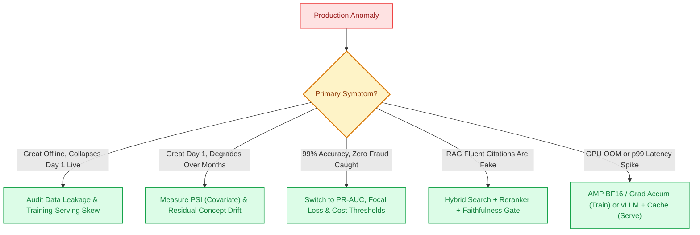

# Module 12: Real-World ML & GenAI System Troubleshooting Scenarios

> **Estimated Study Time:** 6-8 Hours | **Prerequisites:** Modules 01-11 | **Focus:** Diagnostic Thinking, Production Incidents, Leakage, Hallucinations, OOMs & Trade-Offs

[← Previous: Module 11: MLOps, Cloud & FinOps](./11_mlops_cloud_and_finops.md) | [Home](../../README.md) | [Next: Module 13: Hands-On Algorithms from Scratch →](./13_algorithms_from_scratch.md)

---

## Mental Model: Production ML Diagnostic Decision Tree

Now that you have built and deployed the full stack across [Modules 01-11](./11_mlops_cloud_and_finops.md), it is time to think like an on-call Staff AI Engineer. Real-world ML systems rarely fail with a loud Python crash, instead, they fail **silently** through leaked future columns, shifted user behavior, ungrounded RAG chunks, or GPU memory bottlenecks. Walk through these 9 connected war-room scenarios in order from data bugs up to executive cost-latency trade-offs:



---

## Tier 1: Core Foundations Scenarios (Data, Metrics, Leakage & Overfitting)

We start right where every ML bug starts, in the **data, metrics, and training curves**, before moving up to GenAI, GPUs, and business trade-offs in Tier 2.

### Scenario 1: *"Your fraud classifier hit 99.8% test accuracy. Should we ship it today?"*
**Diagnosis & Remediation:**
**Never ship on accuracy!** With `0.2%` base-rate fraud, predicting `"Legitimate"` for every row scores `99.8%` accuracy with `0.0` Recall.
1. Inspect the **Confusion Matrix** and switch offline optimization to **PR-AUC (`average_precision_score`)** and **Recall at fixed False Positive Rate** (e.g., `Recall @ FPR <= 0.5%`).
2. Train with `class_weight="balanced"` or `scale_pos_weight` (`XGBoost`) / **Focal Loss**.
3. Tune the probability threshold $\tau$ against a **business cost matrix** (e.g., a missed `\$500` chargeback costs 50x more than a `\$10` SMS verification friction).

### Scenario 2: *"Suppose you switched to PR-AUC and hit `0.99` offline yet live shadow traffic collapses to `0.54` on Day 1. Why?"*
**Diagnosis & Remediation:**
Day-1 collapse (before any time passes for customer drift) is the textbook signature of **Silent Data Leakage** or **Training-Serving Skew**:
1. **Target Proxy Feature:** A column updated *after* the target event (e.g., `refund_processed_date` or `account_cancel_reason`) accidentally entered `X_train`.
2. **Pre-Split Transformation:** `StandardScaler`, `SimpleImputer`, or Target Encoding was fit on the full DataFrame before `train_test_split`. Wrap inside `sklearn.pipeline.Pipeline`.
3. **Entity / Temporal Leakage:** Multiple rows from the same patient/user split randomly across train and test (use `GroupKFold`), or future timestamps leaked into past folds (use `TimeSeriesSplit`).

### Scenario 3: *"While auditing those columns for leakage, you notice a key feature has 42% missing (`NaN`) values. Do you drop it?"*
**Diagnosis & Remediation:**
Never drop it blindly: diagnose **why** it is missing first:
- **MCAR (Missing Completely at Random):** Sensor glitch; median imputation is safe.
- **MAR (Missing at Random):** Depends on observed columns (e.g., enterprise accounts skip consumer fields); impute with **group medians** (`groupby('segment').transform('median')`).
- **MNAR (Missing Not at Random):** Missingness itself carries signal (e.g., distressed borrowers skip optional income verification). **Add a binary indicator column (`income_is_missing = 1`)** alongside median imputation, or rely on `XGBoost`/`LightGBM` native missing-value split directions.

### Scenario 4: *"Now your data is clean and leak-free, yet training loss hits `0.01` while validation loss climbs after epoch 6."*
**Diagnosis & Remediation:**
Classic **High-Variance Overfitting**: your model stopped learning general patterns and started memorizing training rows. Fix in order of engineering ROI:
1. **Early Stopping** at epoch 6 checkpoint.
2. **Data Augmentation / More Data** (MixUp/RandAugment for vision, synthetic hard-negatives for NLP).
3. **Regularization:** Decoupled weight decay (`AdamW`), `Dropout`, label smoothing, or shallower `max_depth` / `min_child_weight` in trees.

---

## Tier 2: Production & Scale Scenarios (GenAI, Serving, RecSys & System Design)

Once classical data and training bugs are under control, **Tier 2** steps into live GenAI, LLM fine-tuning, GPU memory limits, recommendation feedback loops, and executive budget trade-offs.

### Scenario 5: *"Your enterprise RAG bot answers confidently using facts that do not exist in the retrieved chunks."*
**Diagnosis & Remediation:**
1. **Retrieval Failure:** Pure cosine vector search missed exact policy/SKU strings -> switch to **Hybrid Search (`Qdrant` `BM25 + Dense + RRF`)** + **Cross-Encoder Reranker (`Top 50 -> Top 5`)** to eliminate **"Lost-in-the-Middle"** long-context attention degradation ([Liu et al., TACL 2024](https://arxiv.org/abs/2307.03172)).
2. **Generation Ungroundedness:** Enforce strict abstention system prompts + **Structured Citation Schema** requiring exact `chunk_id` quotes verified programmatically before display; gate releases on **`RAGAS Faithfulness >= 0.90`**.

### Scenario 6: *"To teach domain tone alongside RAG, someone full fine-tuned an 8B LLM and ruined its JSON formatting and general reasoning."*
**Diagnosis & Remediation:**
**Catastrophic Forgetting**: updating 100% of weights overwrote pre-trained representations.
- Switch to **`LoRA` / `QLoRA`** (`r=16`, freezing 99%+ of base weights), mix **10-15% general instruction replay data** into the fine-tuning dataset, lower the learning rate (`1e-4` for LoRA, `1e-5` for full SFT), and add a KL-divergence anchor if running RL post-training.

### Scenario 7: *"When running that `LoRA` training job on a single 24 GB GPU, PyTorch throws `CUDA out of memory`."*
**Diagnosis & Remediation:**
Apply the 4-step VRAM rescue toolkit without changing mathematical batch dynamics:
1. **Gradient Accumulation:** Micro-batch `8` × `8` accumulation steps = effective batch size `64`:
   ```python
   with torch.amp.autocast("cuda", dtype=torch.bfloat16):
       loss = criterion(model(x_micro), y_micro) / accum_steps
   loss.backward()
   if (step + 1) % accum_steps == 0:
       optimizer.step()
       optimizer.zero_grad(set_to_none=True)
   ```
2. **Mixed Precision (`BF16`):** Halves activation & gradient memory while doubling Tensor Core throughput.
3. **Activation (Gradient) Checkpointing:** Recomputes intermediate activations on the backward pass, reducing activation memory from $O(L)$ to $O(\sqrt{L})$ at the cost of one extra forward pass (~20%-33% compute overhead; [Chen et al., 2016](https://arxiv.org/abs/1604.06174)).
4. **8-bit Adam (`bitsandbytes`) / `QLoRA` / `FSDP`** across multi-GPU nodes.

### Scenario 8: *"Meanwhile on your recommendation feed, engagement rose 6% in week 1, then user diversity collapsed into an echo chamber."*
**Diagnosis & Remediation:**
**Position & Exposure Feedback Loop**: items ranked #1 get clicked because of position bias, causing retrained models to rank popular items even higher while starving fresh/long-tail inventory.
- Debias training logs via **Inverse Propensity Scoring (`IPS`)** or a shallow position-bias tower (zeroed at serving), apply **Maximal Marginal Relevance (`MMR`)** post-ranking diversity, and reserve **5% exploration traffic** via **contextual bandits (`Thompson Sampling` / $\epsilon$-greedy)**.

### Scenario 9: *"Finally, leadership steps in: Product wants higher accuracy, Infra wants `p99 < 150ms`, and Finance wants 60% lower GPU spend."*
**Diagnosis & Remediation:**
Frame as **Constrained Optimization**:
- Pick **one North Star objective** (e.g., Task Resolution Rate) and lock Latency (`p99 <= 150ms`) and Cost (`<= $0.002/query`) as **hard guardrail constraints**.
- Deploy **Knowledge Distillation + Model Cascading**: distill your heavy teacher LLM into a quantized 4B/8B student model served via `vLLM` + Redis semantic cache to handle 85% of traffic under `80ms`, escalating only low-confidence queries to the large model.

---

## Mini Hands-On Lab (15-Minute Exercise)

Implement **Cost-Sensitive Threshold Optimization**: finding the exact probability threshold $\tau^*$ that minimizes expected financial loss when False Negatives (`\$200` fraud chargeback) cost 20× more than False Positives (`\$10` review friction):

```python
import numpy as np

def find_cost_optimal_threshold(
    y_true: np.ndarray, y_prob: np.ndarray, fn_cost: float = 200.0, fp_cost: float = 10.0
) -> tuple[float, float]:
    best_tau, min_cost = 0.5, float("inf")
    for tau in np.linspace(0.05, 0.95, 91):
        preds = (y_prob >= tau).astype(int)
        fp = int(np.sum((y_true == 0) & (preds == 1)))
        fn = int(np.sum((y_true == 1) & (preds == 0)))
        total_cost = fp * fp_cost + fn * fn_cost
        if total_cost < min_cost:
            min_cost, best_tau = total_cost, float(round(tau, 2))
    return best_tau, min_cost

y_gt = np.array([0, 0, 0, 0, 1, 1])
probs = np.array([0.05, 0.12, 0.25, 0.35, 0.28, 0.85])

opt_tau, opt_cost = find_cost_optimal_threshold(y_gt, probs)
default_preds = (probs >= 0.50).astype(int)
default_cost = np.sum((y_gt == 1) & (default_preds == 0)) * 200.0
assert opt_cost < default_cost and opt_tau <= 0.28
print(f"Lab 12 Passed! Optimal threshold={opt_tau} cuts cost from ${default_cost:.0f} to ${opt_cost:.0f}.")
```

---

## Key Engineering Takeaways
- **Day-1 live collapse** = Data Leakage or Training-Serving Skew; **gradual multi-month decay** = Covariate/Concept Drift.
- Never hardcode `0.5` as your classification threshold: optimize $\tau^*$ against asymmetric business FP/FN costs.
- Memorize the **CUDA OOM rescue stack**: `BF16` Mixed Precision -> Gradient Accumulation -> Activation Checkpointing -> `QLoRA` / `FSDP`.
- Resolve latency-accuracy-cost conflicts with **Distillation + Semantic Caching + Confidence-Routed Model Cascades**.

> **Next in the Journey:** You can now architect, deploy, and debug end-to-end AI systems! To lock in true first-principles mastery, so no library ever feels like a black box, let's code 8 core algorithms from this entire roadmap (`Linear/Logistic Regression`, `Stable Softmax`, `K-Means`, `Top-K Vector Search`, `BM25`, and `Jittered Backoff`) in pure Python & `NumPy` in **[Module 13: Hands-On Algorithms from Scratch](./13_algorithms_from_scratch.md)**.

---

[← Previous: Module 11: MLOps, Cloud & FinOps](./11_mlops_cloud_and_finops.md) | [Home](../../README.md) | [Next: Module 13: Hands-On Algorithms from Scratch →](./13_algorithms_from_scratch.md)
