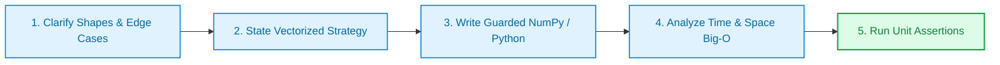

# Module 13: Hands-On Coding Challenges & ML Algorithms from Scratch

> **Estimated Study Time:** 8-10 Hours | **Prerequisites:** Modules 01-06 | **Interactive Lab:** [Open Scratch Challenges Notebook](../../notebooks/02_ml_from_scratch_challenges.ipynb) | **[Open in Colab](https://colab.research.google.com/github/FirdowsRahaman/agentic-ai-and-ml-roadmap/blob/main/notebooks/02_ml_from_scratch_challenges.ipynb)**

[← Previous: Module 12: Practical Troubleshooting Scenarios](./12_system_troubleshooting_scenarios.md) | [Home](../../README.md) | [Explore Portfolio Projects →](../../projects/README.md)

---

## Mental Model: The 5-Step Algorithm Implementation Protocol

Welcome to the hands-on finale of the 13-module curriculum! Across [Modules 01-12](./12_system_troubleshooting_scenarios.md), you saw how `NumPy`, `Scikit-Learn`, `PyTorch`, and `Qdrant` work together in production. Nothing cements those concepts deeper, or prepares you better for live engineering rounds, than building the core algorithms yourself in **clean, vectorized, numerically stable Python** with zero `NaN` explosions or slow nested loops:



---

## Tier 1: Core ML & Deep Learning from Scratch (Pure NumPy)

Notice how Challenges 1 through 5 build directly on one another: we start with a continuous line (**Linear Regression**), wrap it in a Sigmoid for binary `0/1` labels (**Logistic Regression**), grade those `0/1` predictions (**Confusion Matrix & F1**), expand to multi-class probabilities (**Stable Softmax**), and finally group unlabeled points (**`K-Means`**).

### Challenge 1: Vectorized Multivariate Linear Regression (Gradient Descent)
**Problem:** Fit $y = X\mathbf{w} + b$ on $X \in \mathbb{R}^{N \times D}$ using vectorized batch gradient descent without `scikit-learn`.
- **Complexity:** Time $O(\text{epochs} \cdot N \cdot D)$ | Space $O(D)$.

```python
import numpy as np

class LinearRegressionScratch:
    def __init__(self, lr: float = 0.02, epochs: int = 2000):
        self.lr = lr
        self.epochs = epochs
        self.weights: np.ndarray | None = None
        self.bias: float = 0.0

    def fit(self, X: np.ndarray, y: np.ndarray) -> "LinearRegressionScratch":
        n_samples, n_features = X.shape
        self.weights = np.zeros(n_features, dtype=float)
        self.bias = 0.0

        for _ in range(self.epochs):
            error = (X @ self.weights + self.bias) - y
            dw = (2.0 / n_samples) * (X.T @ error)
            db = (2.0 / n_samples) * float(np.sum(error))
            self.weights -= self.lr * dw
            self.bias -= self.lr * db
        return self

    def predict(self, X: np.ndarray) -> np.ndarray:
        assert self.weights is not None, "Call fit() before predict()."
        return X @ self.weights + self.bias

X_tr = np.array([[1.0, 2.0], [2.0, 3.0], [3.0, 4.0], [4.0, 5.0]])
y_tr = np.array([5.0, 8.0, 11.0, 14.0])  # y = 1*x1 + 2*x2
pred = LinearRegressionScratch().fit(X_tr, y_tr).predict(np.array([[5.0, 6.0]]))[0]
assert np.isclose(pred, 17.0, atol=1e-2)
```

### Challenge 2: Vectorized Logistic Regression (Binary Cross-Entropy)
Now pass that exact linear score `X @ w + b` through a clipped Sigmoid curve so we can predict `0` vs. `1` probabilities instead of unbounded numbers:
- **Complexity:** Time $O(\text{epochs} \cdot N \cdot D)$ | Space $O(D)$.

```python
import numpy as np

class LogisticRegressionScratch:
    def __init__(self, lr: float = 0.1, epochs: int = 1000):
        self.lr = lr
        self.epochs = epochs
        self.weights: np.ndarray | None = None
        self.bias: float = 0.0

    @staticmethod
    def _sigmoid(z: np.ndarray) -> np.ndarray:
        return 1.0 / (1.0 + np.exp(-np.clip(z, -500.0, 500.0)))

    def fit(self, X: np.ndarray, y: np.ndarray) -> "LogisticRegressionScratch":
        n_samples, n_features = X.shape
        self.weights = np.zeros(n_features, dtype=float)
        self.bias = 0.0
        for _ in range(self.epochs):
            probs = self._sigmoid(X @ self.weights + self.bias)
            diff = probs - y
            self.weights -= self.lr * ((X.T @ diff) / n_samples)
            self.bias -= self.lr * float(np.mean(diff))
        return self

    def predict(self, X: np.ndarray, threshold: float = 0.5) -> np.ndarray:
        assert self.weights is not None
        return (self._sigmoid(X @ self.weights + self.bias) >= threshold).astype(int)

X_cls = np.array([[0.5], [1.0], [4.0], [5.0]])
y_cls = np.array([0, 0, 1, 1])
preds = LogisticRegressionScratch().fit(X_cls, y_cls).predict(X_cls)
assert np.array_equal(preds, y_cls)
```

### Challenge 3: Safe Classification Metrics & Confusion Matrix (Zero-Division Guarded)
Once Logistic Regression outputs `0` and `1` predictions, we need a safe evaluator that computes `Precision`, `Recall`, and `F1` without crashing on division-by-zero edge cases:

```python
def compute_binary_metrics(y_true: list[int], y_pred: list[int]) -> dict[str, float | dict]:
    if len(y_true) != len(y_pred):
        raise ValueError("Length mismatch between y_true and y_pred.")
    tp = sum(1 for yt, yp in zip(y_true, y_pred) if yt == 1 and yp == 1)
    tn = sum(1 for yt, yp in zip(y_true, y_pred) if yt == 0 and yp == 0)
    fp = sum(1 for yt, yp in zip(y_true, y_pred) if yt == 0 and yp == 1)
    fn = sum(1 for yt, yp in zip(y_true, y_pred) if yt == 1 and yp == 0)

    total = len(y_true)
    acc = (tp + tn) / total if total else 0.0
    prec = tp / (tp + fp) if (tp + fp) else 0.0
    rec = tp / (tp + fn) if (tp + fn) else 0.0
    f1 = (2 * prec * rec) / (prec + rec) if (prec + rec) else 0.0
    return {
        "confusion_matrix": {"TP": tp, "TN": tn, "FP": fp, "FN": fn},
        "accuracy": round(acc, 4),
        "precision": round(prec, 4),
        "recall": round(rec, 4),
        "f1": round(f1, 4),
    }

m = compute_binary_metrics([1, 1, 0, 1, 0, 0, 1, 0], [1, 0, 0, 1, 0, 1, 1, 0])
assert m["precision"] == 0.75 and m["f1"] == 0.75
assert compute_binary_metrics([1, 1], [0, 0])["precision"] == 0.0  # Zero-division safe!
```

### Challenge 4: Numerically Stable Softmax & Categorical Cross-Entropy
Moving from 2 classes (`Sigmoid`) to 10 or 100,000 token classes (`Softmax`) hits a famous floating-point trap: `exp(1000)` overflows to `inf` and `NaN`! Subtracting `max(logits)` first keeps numbers 100% stable without changing a single probability:

```python
import numpy as np

def stable_softmax(logits: np.ndarray) -> np.ndarray:
    shifted = logits - np.max(logits, axis=-1, keepdims=True)
    exps = np.exp(shifted)
    return exps / np.sum(exps, axis=-1, keepdims=True)

def cross_entropy_loss(probs: np.ndarray, targets: np.ndarray) -> float:
    clipped = np.clip(probs, 1e-15, 1.0)
    return float(-np.mean(np.log(clipped[np.arange(len(targets)), targets])))

huge_logits = np.array([[1000.0, 1001.0, 1002.0]])
p = stable_softmax(huge_logits)
assert not np.isnan(p).any() and np.isclose(p.sum(), 1.0)
assert cross_entropy_loss(p, np.array([2])) < 0.5
```

### Challenge 5: Vectorized `K-Means` Clustering from Scratch
What if your dataset has no labels (`y`) at all? Let's use `NumPy` 3D broadcasting `(N, 1, D) - (1, K, D)` to group points into $K$ clusters with zero nested point loops:
- **Complexity:** Time $O(\text{iters} \cdot N \cdot K \cdot D)$ | Space $O(N \cdot K)$.

```python
import numpy as np

class KMeansScratch:
    def __init__(self, k: int = 2, max_iters: int = 100, seed: int = 42):
        self.k = k
        self.max_iters = max_iters
        self.seed = seed
        self.centroids: np.ndarray | None = None

    def fit(self, X: np.ndarray) -> "KMeansScratch":
        rng = np.random.default_rng(self.seed)
        self.centroids = X[rng.choice(len(X), size=self.k, replace=False)].copy()
        for _ in range(self.max_iters):
            dists = np.linalg.norm(X[:, None, :] - self.centroids[None, :, :], axis=-1)
            labels = np.argmin(dists, axis=1)
            updated = np.array([
                X[labels == i].mean(axis=0) if np.any(labels == i) else self.centroids[i]
                for i in range(self.k)
            ])
            if np.allclose(self.centroids, updated):
                break
            self.centroids = updated
        return self

    def predict(self, X: np.ndarray) -> np.ndarray:
        assert self.centroids is not None
        return np.argmin(np.linalg.norm(X[:, None, :] - self.centroids[None, :, :], axis=-1), axis=1)

pts = np.array([[1.0, 1.0], [1.2, 1.1], [9.0, 9.0], [9.2, 8.9]])
lbls = KMeansScratch(k=2).fit(pts).predict(pts)
assert lbls[0] == lbls[1] and lbls[2] == lbls[3] and lbls[0] != lbls[2]
```

---

## Tier 2: Retrieval, Vector Search & Production LLM Infrastructure

Now let's build the three core building blocks behind every modern **Hybrid RAG & Agent service** (`Modules 06-11`): fast **Dense Vector Search** (`Challenge 6`), **Sparse `BM25` Keyword Search** (`Challenge 7`), and **Resilient API Retries** (`Challenge 8`).

### Challenge 6: Vectorized Top-$K$ Cosine Similarity Search (`O(N)` `argpartition`)
Sorting 1,000,000 document scores takes $O(N \log N)$: when you only want the `Top-5` chunks, `np.argpartition` grabs them in linear $O(N)$ time:

```python
import numpy as np

def top_k_vector_search(query: np.ndarray, corpus: np.ndarray, k: int = 2) -> tuple[np.ndarray, np.ndarray]:
    q_norm = max(float(np.linalg.norm(query)), 1e-12)
    c_norms = np.maximum(np.linalg.norm(corpus, axis=1), 1e-12)
    sims = (corpus @ query) / (c_norms * q_norm)

    k = min(k, len(sims))
    cand_idx = np.argpartition(-sims, kth=k - 1)[:k]
    ordered = cand_idx[np.argsort(-sims[cand_idx])]
    return ordered, sims[ordered]

docs = np.array([[1.0, 0.0, 1.0], [0.0, 1.0, 0.0], [1.0, 0.95, 1.0], [0.1, 0.0, 0.0]])
top_ids, _ = top_k_vector_search(np.array([1.0, 1.0, 1.0]), docs, k=2)
assert top_ids[0] == 2
```

### Challenge 7: Inverted Index & `BM25` Lexical Search Engine from Scratch
Dense cosine search catches semantic meaning; now let's code the **sparse keyword half** of `Qdrant` Hybrid RAG (`Okapi BM25`) so exact error codes and SKUs never slip through:

```python
import math
from collections import Counter, defaultdict

class BM25Index:
    def __init__(self, k1: float = 1.5, b: float = 0.75):
        self.k1, self.b = k1, b
        self.doc_len: dict[int, int] = {}
        self.avgdl: float = 0.0
        self.postings: dict[str, dict[int, int]] = defaultdict(dict)

    def fit(self, corpus: dict[int, str]) -> "BM25Index":
        for doc_id, text in corpus.items():
            tokens = text.lower().split()
            self.doc_len[doc_id] = len(tokens)
            for term, tf in Counter(tokens).items():
                self.postings[term][doc_id] = tf
        self.avgdl = sum(self.doc_len.values()) / max(len(corpus), 1)
        return self

    def search(self, query: str, top_k: int = 3) -> list[tuple[int, float]]:
        n_docs = len(self.doc_len)
        scores: dict[int, float] = defaultdict(float)
        for term in query.lower().split():
            if term not in self.postings:
                continue
            df = len(self.postings[term])
            idf = math.log((n_docs - df + 0.5) / (df + 0.5) + 1.0)
            for doc_id, tf in self.postings[term].items():
                norm = 1.0 - self.b + self.b * (self.doc_len[doc_id] / self.avgdl)
                scores[doc_id] += idf * ((tf * (self.k1 + 1.0)) / (tf + self.k1 * norm))
        return sorted(scores.items(), key=lambda x: x[1], reverse=True)[:top_k]

idx = BM25Index().fit({
    1: "python pandas sql data pipelines",
    2: "vllm pagedattention kv cache llm serving",
    3: "hybrid search bm25 and vector embeddings",
})
assert idx.search("vllm kv cache")[0][0] == 2
```

### Challenge 8: Jittered Exponential Backoff API Client (Surviving HTTP `429` Storms)
Finally, once Hybrid Search hands its top chunks to an LLM API under heavy traffic, rate-limit `429` errors are inevitable: let's add exponential backoff + **random jitter** so 100 workers don't retry at the exact same millisecond (**thundering herd**):

```python
import random
import time
from typing import Any, Callable

def call_with_backoff(
    fn: Callable[[], Any],
    max_attempts: int = 4,
    base_delay: float = 0.05,
) -> Any:
    delay = base_delay
    for attempt in range(1, max_attempts + 1):
        try:
            return fn()
        except (TimeoutError, ConnectionError) as exc:
            if attempt == max_attempts:
                raise exc
            time.sleep(delay * (1.0 + random.uniform(0.0, 0.3)))
            delay *= 2.0

calls = 0
def transient_endpoint() -> str:
    global calls
    calls += 1
    if calls < 3:
        raise ConnectionError("HTTP 429 Too Many Requests")
    return "200_OK"

assert call_with_backoff(transient_endpoint) == "200_OK" and calls == 3
```

---

## Key Engineering Takeaways
- Vectorize with `@` and broadcasting (`[:, None, :]`), guard `log` and division against `0` (`1e-12`), and shift logits by `max` before `exp`.
- Use **`np.argpartition`** to cut top-$K$ search from $O(N \log N)$ to $O(N)$.
- Always add **random jitter** to exponential backoff to prevent thundering-herd retry storms against rate-limited LLM endpoints.

> **Where the River Flows Next: Build & Ship!** You have completed all 13 modules from raw SQL/NumPy foundations to Transformers, `Qdrant` Hybrid RAG, `MCP`/`A2A` Agents, and Production MLOps. Next, see how every piece connects inside **one single product** in the **[End-to-End AI Engineering Lifecycle Playbook](../../projects/end_to_end_lifecycle_playbook.md)**, run the **[Portfolio Starter Kits](../../projects/README.md)** locally, and test your skills in the **[Interview & Code-Audit Kits](../../interview-kits/ml_system_design_framework.md)**!

---

[← Previous: Module 12: Practical Troubleshooting Scenarios](./12_system_troubleshooting_scenarios.md) | [Home](../../README.md) | [Explore Portfolio Projects →](../../projects/README.md)
