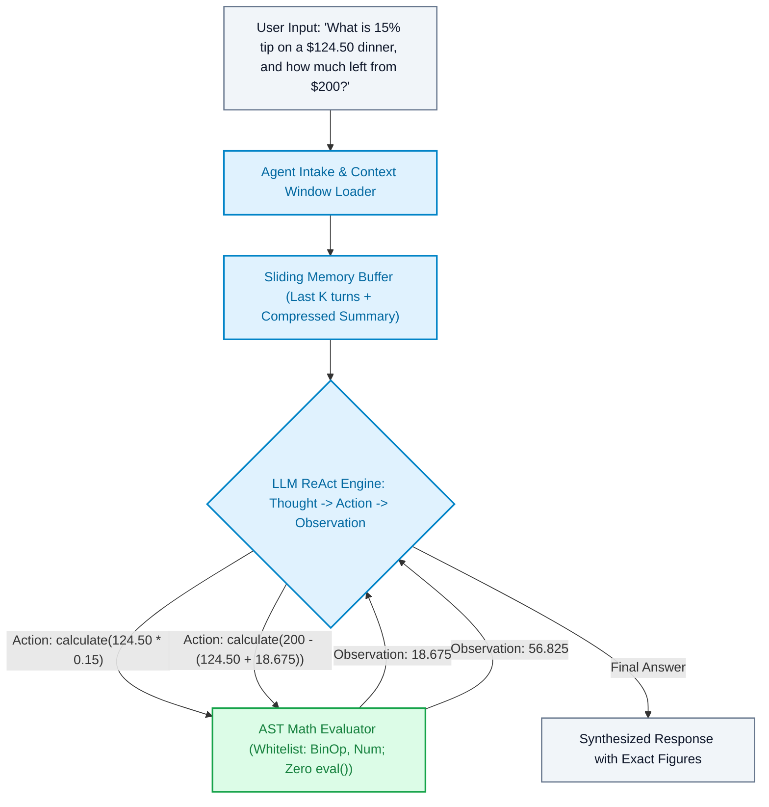

# Challenge 14.1: Production AI Assistant with Sandboxed Tools & Memory

[← Back to Challenges Overview](./README.md) | [Next Challenge: 14.2 Research Agent →](./02_research_agent.md)

---

## 1. Problem Statement & Real-World Scenario

Most prototype AI assistants are fragile: they pass raw user strings to Python's dangerous `eval()`, crash when tools return unhandled exceptions, loop indefinitely when encountering ambiguous inputs, and exhaust LLM context windows because they lack sliding memory management.

In this challenge, you will construct a hardened **Production AI Assistant** capable of multi-step reasoning (ReAct), safe mathematical and analytical tool execution via Abstract Syntax Tree (AST) sandboxing, sliding-window conversation memory, and strict loop termination guards.



---

## 2. Technical Requirements & SLA Specifications

1. **Tool Sandboxing:** Implement a `calculate(expression: str)` tool using Python's `ast` module. The tool must parse expressions into syntax trees and execute only whitelisted nodes (`ast.Constant`, `ast.BinOp`, `ast.UnaryOp`, `ast.Add`, `ast.Sub`, `ast.Mult`, `ast.Div`, `ast.Pow`). Reject any function calls (`__import__`, `os.system`), attribute lookups, or string operations.
2. **Execution Bounds:** Enforce a hard maximum step limit (`max_steps=5`). If the agent fails to reach a final answer within 5 steps, cleanly abort with a structured fallback response.
3. **Sliding Memory Buffer:** Maintain conversation state across turns. When history exceeds `max_messages=10`, automatically truncate the oldest turns while retaining system instructions and the initial user objective.
4. **Resilient Error Handling:** If a tool raises an error (e.g. `ZeroDivisionError` or invalid syntax), capture the exception as a structured observation (`Observation: Error: Division by zero`) and allow the agent to self-correct on the next iteration.

---

## 3. Complete Runnable Implementation

```python
import ast
import operator
from typing import Any, Callable

# 1. AST Mathematical Sandbox (Zero eval())
SAFE_OPERATORS: dict[type, Callable[[Any, Any], Any]] = {
    ast.Add: operator.add,
    ast.Sub: operator.sub,
    ast.Mult: operator.mul,
    ast.Div: operator.truediv,
    ast.Pow: operator.pow,
    ast.USub: operator.neg,
}

def safe_calculate(expression: str) -> float:
    """Evaluates mathematical expressions safely using an AST whitelist.

    Rejects arbitrary function execution, attribute lookups, and system calls.
    """
    try:
        tree = ast.parse(expression, mode="eval")
    except SyntaxError as e:
        raise ValueError(f"Invalid mathematical syntax: {e}")

    def _eval_node(node: ast.AST) -> float:
        if isinstance(node, ast.Expression):
            return _eval_node(node.body)
        elif isinstance(node, ast.Constant) and isinstance(node.value, (int, float)):
            return float(node.value)
        elif isinstance(node, ast.BinOp):
            left = _eval_node(node.left)
            right = _eval_node(node.right)
            op_type = type(node.op)
            if op_type in SAFE_OPERATORS:
                if op_type is ast.Div and right == 0.0:
                    raise ZeroDivisionError("Division by zero")
                return float(SAFE_OPERATORS[op_type](left, right))
            raise ValueError(f"Unsupported binary operator: {op_type.__name__}")
        elif isinstance(node, ast.UnaryOp):
            operand = _eval_node(node.operand)
            op_type = type(node.op)
            if op_type in SAFE_OPERATORS:
                return float(SAFE_OPERATORS[op_type](operand))
            raise ValueError(f"Unsupported unary operator: {op_type.__name__}")
        else:
            raise SecurityError(f"Prohibited AST node detected: {type(node).__name__}")

    return _eval_node(tree)

class SecurityError(Exception):
    """Raised when an expression attempts to execute prohibited syntax."""
    pass

# 2. Production Assistant Agent
class ProductionAssistant:
    def __init__(self, max_steps: int = 5, max_history: int = 10):
        self.max_steps = max_steps
        self.max_history = max_history
        self.history: list[dict[str, str]] = []
        self.tools = {
            "calculate": safe_calculate
        }

    def add_message(self, role: str, content: str):
        self.history.append({"role": role, "content": content})
        if len(self.history) > self.max_history:
            # Retain system prompt if present, truncate oldest conversational turns
            self.history = [self.history[0]] + self.history[-(self.max_history - 1):]

    def execute_mock_reasoning(self, query: str) -> tuple[str, list[str]]:
        """Simulates ReAct reasoning loop with tool execution and bounds checking."""
        self.add_message("user", query)
        steps_taken: list[str] = []

        # Example deterministic ReAct simulation for query processing
        for step in range(1, self.max_steps + 1):
            if "tip" in query.lower() and "calculate" not in "".join(steps_taken):
                steps_taken.append("Thought: Need to calculate 15% tip on $124.50")
                try:
                    tip = self.tools["calculate"]("124.50 * 0.15")
                    steps_taken.append(f"Action: calculate(124.50 * 0.15) -> Observation: {tip:.2f}")
                except Exception as err:
                    steps_taken.append(f"Observation: Error: {err}")
                    continue

                steps_taken.append("Thought: Now calculate remaining amount from $200")
                try:
                    rem = self.tools["calculate"](f"200 - (124.50 + {tip:.2f})")
                    steps_taken.append(f"Action: calculate(...) -> Observation: {rem:.2f}")
                    final_ans = f"The 15% tip is ${tip:.2f}, leaving you with ${rem:.2f} from $200."
                    self.add_message("assistant", final_ans)
                    return final_ans, steps_taken
                except Exception as err:
                    steps_taken.append(f"Observation: Error: {err}")
                    continue

        fallback = "Execution step budget exceeded without resolution."
        self.add_message("assistant", fallback)
        return fallback, steps_taken
```

---

## 4. Automated Test Suite (Pytest)

Save the following test suite as `test_challenge_14_1.py`:

```python
import pytest
from test_challenge_14_1_impl import safe_calculate, SecurityError, ProductionAssistant

def test_ast_safe_arithmetic():
    assert safe_calculate("124.50 * 0.15") == pytest.approx(18.675)
    assert safe_calculate("200 - (124.50 + 18.675)") == pytest.approx(56.825)
    assert safe_calculate("2 ** 3 + 5") == 13.0

def test_ast_rejects_division_by_zero():
    with pytest.raises(ZeroDivisionError):
        safe_calculate("100 / 0")

def test_ast_rejects_remote_code_execution():
    malicious_inputs = [
        "__import__('os').system('ls')",
        "eval('2 + 2')",
        "open('/etc/passwd').read()",
        "().__class__.__bases__[0].__subclasses__()",
    ]
    for payload in malicious_inputs:
        with pytest.raises((SecurityError, ValueError)):
            safe_calculate(payload)

def test_assistant_sliding_memory():
    agent = ProductionAssistant(max_steps=5, max_history=4)
    for i in range(6):
        agent.add_message("user", f"Message {i}")
    assert len(agent.history) == 4
    assert agent.history[-1]["content"] == "Message 5"

def test_assistant_react_flow():
    agent = ProductionAssistant()
    response, steps = agent.execute_mock_reasoning("What is the tip on $124.50 and remainder from $200?")
    assert "$18.68" in response
    assert "$56.82" in response
    assert any("Action: calculate" in s for s in steps)
```

---

## 5. Production-Readiness Checklist

- [ ] Zero occurrence of `eval()`, `exec()`, or unrestricted shell execution anywhere in the codebase.
- [ ] Bounded iteration ceiling (`max_steps`) prevents runaway cost explosions on tool failure loops.
- [ ] Sliding context window or hierarchical summarizer prevents token context window overflow.
- [ ] All tool inputs and outputs are validated with Pydantic v2 schemas.
- [ ] Pytest suite achieves 100% branch coverage across benign, boundary, and malicious injection payloads.
