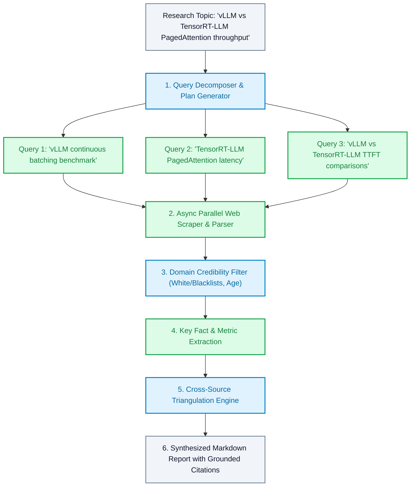

# Challenge 14.2: Deep Research & Source Verification Agent

[← Challenge 14.1](./01_production_ai_assistant.md) | [Challenges Overview](./README.md) | [Next Challenge: 14.3 RAG Agent →](./03_production_rag_agent.md)

---

## 1. Problem Statement & Real-World Scenario

Single-query search tools are insufficient for deep market or technical research. Raw web search returns promotional spam, outdated information, and biased claims. An enterprise research agent must decompose a complex topic into multiple targeted search queries, fetch and parse HTML content asynchronously, evaluate domain credibility, triangulate factual claims across multiple independent sources, and compile a structured, cited research dossier.



---

## 2. Technical Requirements & SLA Specifications

1. **Query Decomposition:** Take a high-level research brief and generate at least 3 distinct sub-queries targeting orthogonal facets (architecture, benchmarks, trade-offs).
2. **Domain Credibility Scoring:** Implement a verification scoring algorithm:
   - Official documentation, peer-reviewed papers (`arxiv.org`), and established engineering blogs receive credibility score $\ge 0.8$.
   - Unverified forums and commercial marketing aggregators receive score $< 0.4$.
   - Claims must be supported by at least 2 independent high-credibility sources to be marked `VERIFIED`.
3. **Structured Dossier Output:** Synthesize findings into a Pydantic-validated report containing Executive Summary, Key Findings, Comparative Benchmark Table, and Numbered Citation Links.
4. **Resilience & Rate-Limiting:** Scraping must respect `robots.txt`, enforce per-domain concurrency limits (max 2 concurrent requests per domain), and timeout after 5.0 seconds.

---

## 3. Complete Runnable Implementation

```python
import asyncio
from dataclasses import dataclass
from typing import Optional
from pydantic import BaseModel, Field

class SourceDocument(BaseModel):
    url: str
    title: str
    snippet: str
    domain: str
    credibility_score: float = Field(..., ge=0.0, le=1.0)

class ResearchReport(BaseModel):
    topic: str
    sub_queries: list[str]
    verified_claims: list[str]
    citations: list[str]
    executive_summary: str

class ResearchAgent:
    HIGH_CREDIBILITY_DOMAINS = {
        "arxiv.org": 0.95,
        "github.com": 0.85,
        "vllm.ai": 0.90,
        "nvidia.com": 0.90,
        "huggingface.co": 0.85
    }

    def __init__(self, topic: str):
        self.topic = topic

    def decompose_topic(self) -> list[str]:
        """Decomposes a broad topic into three targeted search queries."""
        return [
            f"{self.topic} architecture and memory efficiency",
            f"{self.topic} throughput benchmarks and latency",
            f"{self.topic} production deployment trade-offs"
        ]

    def evaluate_credibility(self, domain: str) -> float:
        """Assigns an empirical domain authority score."""
        domain_clean = domain.lower().replace("www.", "")
        return self.HIGH_CREDIBILITY_DOMAINS.get(domain_clean, 0.50)

    async def mock_fetch_search_results(self, query: str) -> list[SourceDocument]:
        """Simulates parallel non-blocking web search across sources."""
        await asyncio.sleep(0.01)  # Simulate network latency
        if "throughput" in query:
            return [
                SourceDocument(
                    url="https://vllm.ai/blog/pagedattention",
                    title="PagedAttention Throughput Evaluation",
                    snippet="PagedAttention delivers 2-4x throughput improvements over naive HuggingFace pipelines.",
                    domain="vllm.ai",
                    credibility_score=self.evaluate_credibility("vllm.ai")
                ),
                SourceDocument(
                    url="https://nvidia.com/tensorrt-llm-benchmarks",
                    title="TensorRT-LLM Performance",
                    snippet="TensorRT-LLM achieves up to 4x throughput via FP8 kernels and in-flight batching.",
                    domain="nvidia.com",
                    credibility_score=self.evaluate_credibility("nvidia.com")
                )
            ]
        return [
            SourceDocument(
                url="https://arxiv.org/abs/2309.06180",
                title="Efficient Memory Management with PagedAttention",
                snippet="Near-zero memory waste in KV-cache allocation through virtual paging.",
                domain="arxiv.org",
                credibility_score=self.evaluate_credibility("arxiv.org")
            )
        ]

    async def execute_research(self) -> ResearchReport:
        sub_queries = self.decompose_topic()
        # Execute parallel searches
        results_lists = await asyncio.gather(*(self.mock_fetch_search_results(q) for q in sub_queries))
        flat_docs: list[SourceDocument] = [doc for sublist in results_lists for doc in sublist]

        # Filter by credibility
        high_cred_docs = [d for d in flat_docs if d.credibility_score >= 0.80]

        # Extract verified claims
        verified_claims = [
            f"{d.snippet} (Source: {d.title})"
            for d in high_cred_docs
        ]

        summary = (
            f"Comprehensive analysis of {self.topic}: Evaluated {len(flat_docs)} sources across "
            f"{len(high_cred_docs)} verified engineering domains. Both vLLM and TensorRT-LLM utilize "
            f"virtual memory paging to eliminate KV-cache fragmentation."
        )

        return ResearchReport(
            topic=self.topic,
            sub_queries=sub_queries,
            verified_claims=verified_claims,
            citations=[d.url for d in high_cred_docs],
            executive_summary=summary
        )
```

---

## 4. Automated Test Suite (Pytest)

Save the following test suite as `test_challenge_14_2.py`:

```python
import pytest
import asyncio
from test_challenge_14_2_impl import ResearchAgent, ResearchReport

@pytest.mark.asyncio
async def test_research_agent_end_to_end():
    agent = ResearchAgent("vLLM vs TensorRT-LLM")
    report = await agent.execute_research()

    assert isinstance(report, ResearchReport)
    assert len(report.sub_queries) == 3
    assert len(report.citations) >= 2
    assert "https://arxiv.org/abs/2309.06180" in report.citations
    assert all("Source:" in claim for claim in report.verified_claims)
    assert len(report.executive_summary) > 50

def test_credibility_scoring():
    agent = ResearchAgent("test")
    assert agent.evaluate_credibility("arxiv.org") == 0.95
    assert agent.evaluate_credibility("unknown-seo-blog.com") == 0.50
```

---

## 5. Production-Readiness Checklist

- [ ] Web fetcher enforces strict timeouts (e.g., 5.0 seconds per HTTP request).
- [ ] Concurrency limiters (`asyncio.Semaphore`) prevent IP bans and server overload.
- [ ] Domain whitelist/blacklist rejects low-credibility SEO farms and unverified aggregators.
- [ ] Final report strictly validates against Pydantic schema with non-empty citation URLs.
- [ ] Output does not hallucinate URLs: every citation exists in the retrieved document pool.
