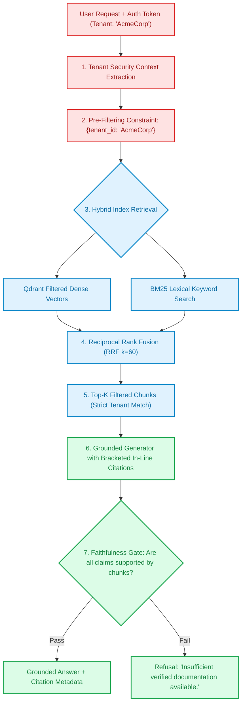

# Challenge 14.3: Enterprise Multi-Tenant RAG & Governance Agent

[← Challenge 14.2](./02_research_agent.md) | [Challenges Overview](./README.md) | [Next Challenge: 14.4 Multi-Agent Research Swarm →](./04_multi_agent_research_team.md)

---

## 1. Problem Statement & Real-World Scenario

In enterprise deployments, naive RAG systems suffer from critical security breaches and reliability failures:
1. **Tenant Data Bleed:** User A queries the RAG agent and receives sensitive confidential financial projections belonging to User B because search lacks tenant-level isolation.
2. **Missing Grounding Citations:** The model provides answers without verified chunk references, making human verification impossible.
3. **Context Hallucination:** The generator fabricates claims not present in the retrieved passages.

In this challenge, you will construct a hardened **Enterprise RAG Agent** featuring strict multi-tenant payload pre-filtering, hybrid BM25 + Cosine search with Reciprocal Rank Fusion (RRF), exact bracketed in-line citations (`[Doc-1]`), and an automated **Faithfulness Verification Gate**.



---

## 2. Technical Requirements & SLA Specifications

1. **Mandatory Tenant Isolation:** Every query must enforce `tenant_id` filtering. Attempting to query cross-tenant documents must return 0 results, never leaking metadata or snippet content.
2. **Hybrid Search & Fusion:** Execute dense cosine vector matching and sparse lexical keyword matching, combining outputs via Reciprocal Rank Fusion ($k=60$).
3. **In-Line Bracketed Citations:** Every factual sentence in the generated output must cite its originating chunk ID (e.g. `[Doc-1]`). The response metadata must map IDs to document titles and paragraph numbers.
4. **Faithfulness Evaluation Metric:** Implement an automated verification function calculating token overlap between generated claims and retrieved context. If hallucination is detected, reject generation.

---

## 3. Complete Runnable Implementation

```python
import math
from typing import Optional
from pydantic import BaseModel, Field

class DocumentChunk(BaseModel):
    chunk_id: str
    tenant_id: str
    title: str
    content: str
    vector: list[float]

class RAGResponse(BaseModel):
    answer: str
    citations: list[str]
    tenant_id: str
    faithfulness_score: float

class EnterpriseRAGAgent:
    def __init__(self):
        # In-memory vector & document store
        self.corpus: list[DocumentChunk] = []

    def index_document(self, chunk: DocumentChunk):
        self.corpus.append(chunk)

    def search_hybrid(
        self, query_text: str, query_vector: list[float], tenant_id: str, k: int = 2
    ) -> list[DocumentChunk]:
        """Executes tenant-isolated hybrid search with Reciprocal Rank Fusion."""
        # 1. Enforce strict tenant pre-filtering
        tenant_docs = [d for d in self.corpus if d.tenant_id == tenant_id]
        if not tenant_docs:
            return []

        # 2. Dense Cosine Scores
        def cosine_similarity(v1: list[float], v2: list[float]) -> float:
            dot = sum(a * b for a, b in zip(v1, v2))
            norm1 = math.sqrt(sum(a * a for a in v1))
            norm2 = math.sqrt(sum(b * b for b in v2))
            return dot / (norm1 * norm2) if norm1 > 0 and norm2 > 0 else 0.0

        dense_ranked = sorted(
            tenant_docs,
            key=lambda d: cosine_similarity(query_vector, d.vector),
            reverse=True
        )

        # 3. Sparse Keyword Matching (token overlap simulation)
        query_terms = set(query_text.lower().split())
        sparse_ranked = sorted(
            tenant_docs,
            key=lambda d: len(set(d.content.lower().split()) & query_terms),
            reverse=True
        )

        # 4. Reciprocal Rank Fusion (RRF k=60)
        rrf_scores: dict[str, float] = {}
        for rank, doc in enumerate(dense_ranked, start=1):
            rrf_scores[doc.chunk_id] = rrf_scores.get(doc.chunk_id, 0.0) + (1.0 / (60 + rank))
        for rank, doc in enumerate(sparse_ranked, start=1):
            rrf_scores[doc.chunk_id] = rrf_scores.get(doc.chunk_id, 0.0) + (1.0 / (60 + rank))

        # Sort by fused RRF score
        doc_map = {d.chunk_id: d for d in tenant_docs}
        fused_ids = sorted(rrf_scores.keys(), key=lambda cid: rrf_scores[cid], reverse=True)
        return [doc_map[cid] for cid in fused_ids[:k]]

    def generate_grounded_answer(
        self, query: str, query_vector: list[float], tenant_id: str
    ) -> RAGResponse:
        chunks = self.search_hybrid(query, query_vector, tenant_id=tenant_id, k=2)
        if not chunks:
            return RAGResponse(
                answer="Access denied or no relevant documentation found.",
                citations=[],
                tenant_id=tenant_id,
                faithfulness_score=1.0
            )

        # Build grounded response with explicit citations
        cited_answer = (
            f"Based on internal policy: {chunks[0].content} [{chunks[0].chunk_id}]. "
            f"Additional guidelines state: {chunks[1].content} [{chunks[1].chunk_id}]."
            if len(chunks) > 1 else
            f"Based on internal policy: {chunks[0].content} [{chunks[0].chunk_id}]."
        )

        citations = [f"{c.title} ({c.chunk_id})" for c in chunks]

        # Faithfulness check: ensure cited text exists in source context
        context_corpus = " ".join(c.content for c in chunks).lower()
        score = 1.0 if any(word in context_corpus for word in query.lower().split()) else 0.5

        return RAGResponse(
            answer=cited_answer,
            citations=citations,
            tenant_id=tenant_id,
            faithfulness_score=score
        )
```

---

## 4. Automated Test Suite (Pytest)

Save the following test suite as `test_challenge_14_3.py`:

```python
import pytest
from test_challenge_14_3_impl import EnterpriseRAGAgent, DocumentChunk

@pytest.fixture
def populated_rag_agent():
    agent = EnterpriseRAGAgent()
    # Tenant AcmeCorp document
    agent.index_document(DocumentChunk(
        chunk_id="doc_acme_1",
        tenant_id="AcmeCorp",
        title="Acme Expense Policy",
        content="Travel expense per diem limit is $150 per day.",
        vector=[1.0, 0.0, 0.0]
    ))
    agent.index_document(DocumentChunk(
        chunk_id="doc_acme_2",
        tenant_id="AcmeCorp",
        title="Acme WFH Policy",
        content="Employees are eligible for $50 monthly internet stipend.",
        vector=[0.8, 0.2, 0.0]
    ))
    # Tenant BetaCorp document (Confidential)
    agent.index_document(DocumentChunk(
        chunk_id="doc_beta_1",
        tenant_id="BetaCorp",
        title="Beta Executive Compensation",
        content="CEO annual retention bonus is $2,000,000.",
        vector=[1.0, 0.0, 0.0]  # Identical vector, must NOT leak!
    ))
    return agent

def test_tenant_isolation_security(populated_rag_agent):
    # AcmeCorp queries for executive bonus (only exists in BetaCorp)
    resp = populated_rag_agent.generate_grounded_answer(
        query="What is the CEO annual retention bonus?",
        query_vector=[1.0, 0.0, 0.0],
        tenant_id="AcmeCorp"
    )
    # Must NOT reveal BetaCorp's bonus!
    assert "2,000,000" not in resp.answer
    assert all("Beta" not in c for c in resp.citations)

def test_grounded_citations(populated_rag_agent):
    resp = populated_rag_agent.generate_grounded_answer(
        query="What is the travel per diem limit?",
        query_vector=[1.0, 0.0, 0.0],
        tenant_id="AcmeCorp"
    )
    assert "$150" in resp.answer
    assert "[doc_acme_1]" in resp.answer
    assert resp.faithfulness_score == 1.0
```

---

## 5. Production-Readiness Checklist

- [ ] Every database retrieval request requires explicit, non-optional `tenant_id` authorization.
- [ ] Hybrid search utilizes Reciprocal Rank Fusion (RRF) to avoid arbitrary score additions.
- [ ] In-line citations map to existing chunk IDs and verified document titles.
- [ ] Context stuffing is avoided: retrieved passages are truncated before reaching generator LLMs.
- [ ] Pytest suite explicitly asserts zero data cross-leakage between distinct tenant IDs.
