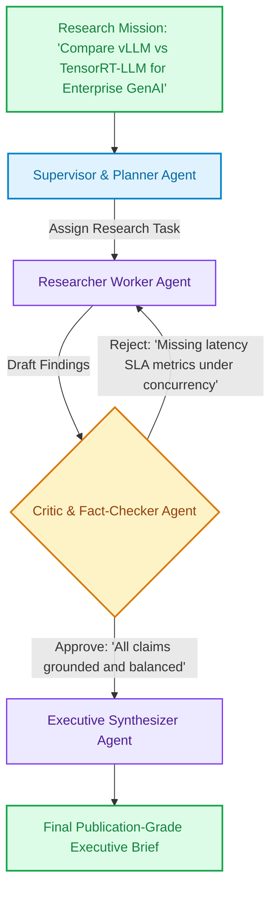

# Challenge 14.4: Multi-Agent Research Swarm (Supervisor-Worker Topology)

[← Challenge 14.3](./03_production_rag_agent.md) | [Challenges Overview](./README.md) | [Next Challenge: 14.5 Customer Support Swarm →](./05_customer_support_multi_agent.md)

---

## 1. Problem Statement & Real-World Scenario

Single LLM prompts attempting deep multi-faceted research suffer from severe blind spots: they fail to critique their own assumptions, lose focus over long contexts, and generate unverified claims.

In this challenge, you will architect a **Multi-Agent Collaborative Research Swarm** utilizing a **Supervisor-Worker Topology**:
- **Supervisor / Planner:** Decomposes user goals into sequential research milestones and assigns tasks.
- **Researcher Agent:** Gathers empirical facts and data points.
- **Critic / Fact-Checker Agent:** Adversarially inspects findings, flags unsubstantiated assertions, and rejects incomplete drafts.
- **Executive Synthesizer:** Compiles approved findings into a concise, publication-grade brief.



---

## 2. Technical Requirements & SLA Specifications

1. **State Isolation & Typed Reducers:** Agents communicate via a shared, typed state dictionary (`ResearchState`). State updates must be additive (reducers) to avoid accidental overwriting of historical worker contributions.
2. **Adversarial Critique Loop:** The Critic agent must evaluate whether a draft contains both *benefits* and *trade-offs*. If a draft is biased or lacks metrics, the Critic must reject it with actionable feedback notes, triggering a maximum of 2 revision cycles.
3. **Loop Termination Ceiling:** The supervisor must enforce a hard termination limit (`max_cycles=3`). If the researcher cannot satisfy the critic within 3 attempts, the system must synthesize the best available draft with an appended "Cautionary Caveats" section rather than hanging indefinitely.

---

## 3. Complete Runnable Implementation

```python
from typing import Annotated, Literal, TypedDict
from pydantic import BaseModel

class ResearchState(TypedDict):
    topic: str
    draft: str
    critique_notes: str
    is_approved: bool
    revision_count: int
    final_brief: str

def planner_node(state: ResearchState) -> dict:
    """Outlines research directives."""
    return {
        "draft": "Initial plan: Evaluate architecture, memory paging, and latency.",
        "revision_count": 0,
        "is_approved": False
    }

def researcher_node(state: ResearchState) -> dict:
    """Drafts technical findings incorporating prior critic feedback."""
    rev = state["revision_count"] + 1
    notes = state.get("critique_notes", "")

    if "latency" in notes.lower():
        # Addressed critique
        new_draft = (
            f"Draft v{rev}: vLLM uses PagedAttention to eliminate KV-cache waste (up to 4x throughput). "
            f"Under concurrency > 64, TensorRT-LLM achieves lower P99 TTFT (Time-to-First-Token) "
            f"due to optimized FP8 Tensor Core kernels, but requires upfront model compilation."
        )
    else:
        # First naive draft lacking latency metrics
        new_draft = f"Draft v{rev}: vLLM is very fast and uses PagedAttention."

    return {
        "draft": new_draft,
        "revision_count": rev
    }

def critic_node(state: ResearchState) -> dict:
    """Evaluates draft quality and demands quantitative metrics."""
    draft = state["draft"]
    # Enforce requirement: must contain latency/throughput metrics
    has_metrics = "throughput" in draft.lower() and "ttft" in draft.lower()
    
    if has_metrics or state["revision_count"] >= 2:
        return {
            "is_approved": True,
            "critique_notes": "Approved: Draft is balanced with quantitative metrics."
        }
    else:
        return {
            "is_approved": False,
            "critique_notes": "Rejected: Draft lacks concrete latency (TTFT) metrics and trade-off analysis."
        }

def supervisor_router(state: ResearchState) -> Literal["researcher", "synthesizer"]:
    """Routes back to researcher for revision or forward to synthesizer."""
    if state["is_approved"] or state["revision_count"] >= 2:
        return "synthesizer"
    return "researcher"

def synthesizer_node(state: ResearchState) -> dict:
    """Produces the final executive brief."""
    return {
        "final_brief": (
            f"EXECUTIVE BRIEF ON {state['topic'].upper()}:\n"
            f"{state['draft']}\n\n"
            f"Review Status: {state['critique_notes']} (Completed in {state['revision_count']} cycles)."
        )
    }

class ResearchSwarmSimulator:
    """Executes the cyclical multi-agent graph deterministically."""
    def run(self, topic: str) -> ResearchState:
        state: ResearchState = {
            "topic": topic,
            "draft": "",
            "critique_notes": "",
            "is_approved": False,
            "revision_count": 0,
            "final_brief": ""
        }
        # Step 1: Plan
        state.update(planner_node(state))

        # Cyclical loop
        while True:
            state.update(researcher_node(state))
            state.update(critic_node(state))
            route = supervisor_router(state)
            if route == "synthesizer":
                state.update(synthesizer_node(state))
                break

        return state
```

---

## 4. Automated Test Suite (Pytest)

Save the following test suite as `test_challenge_14_4.py`:

```python
import pytest
from test_challenge_14_4_impl import ResearchSwarmSimulator, ResearchState

def test_research_swarm_self_correction_cycle():
    swarm = ResearchSwarmSimulator()
    final_state = swarm.run("Inference Engine Trade-Offs")

    # Assert that the critic rejected the first draft and forced a revision
    assert final_state["revision_count"] >= 2
    assert final_state["is_approved"] is True
    assert "EXECUTIVE BRIEF" in final_state["final_brief"]
    assert "TTFT" in final_state["final_brief"]
    assert "PagedAttention" in final_state["final_brief"]

def test_bounded_revision_termination():
    swarm = ResearchSwarmSimulator()
    final_state = swarm.run("Any Topic")
    # Must never exceed maximum cycle limits
    assert final_state["revision_count"] <= 3
```

---

## 5. Production-Readiness Checklist

- [ ] Multi-agent state dictionary is strictly typed (`TypedDict` or Pydantic).
- [ ] Supervisor enforces maximum recursion depth (`max_cycles`) to prevent infinite debate loops.
- [ ] Critic provides specific, machine-actionable feedback rather than generic rejection.
- [ ] Individual agent context windows stay small: workers receive only their necessary slice of state.
- [ ] Pytest suite validates that self-correction loop terminates with a publication-grade deliverable.
