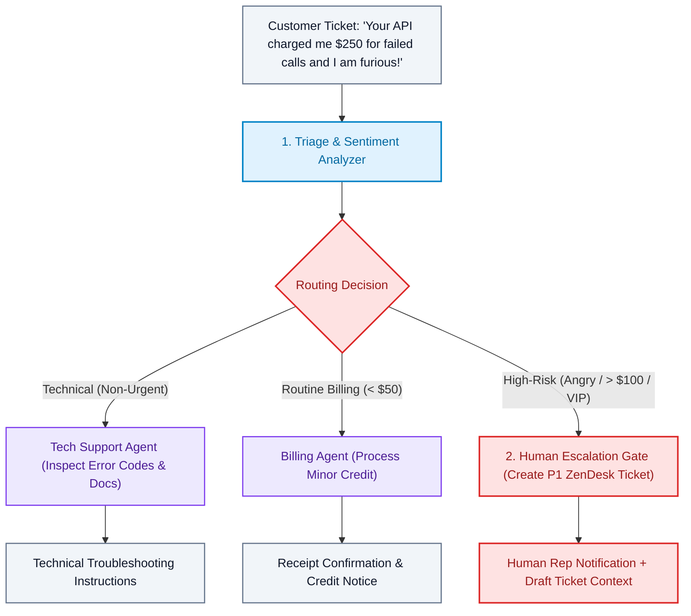

# Challenge 14.5: Customer Support Multi-Agent Routing & Escalation

[← Challenge 14.4](./04_multi_agent_research_team.md) | [Challenges Overview](./README.md) | [Next Challenge: 14.6 Coding Agent →](./06_coding_agent.md)

---

## 1. Problem Statement & Real-World Scenario

Deploying a single monolithic AI model for enterprise customer support leads to hallucinations, unauthorized financial refunds, and disastrous customer experiences when angry users need immediate human intervention.

In this challenge, you will construct a **Multi-Tier Customer Support Multi-Agent System**:
- **Triage & Sentiment Router:** Classifies customer intent (Billing vs Technical vs Account) and analyzes sentiment polarity.
- **Billing Specialist Agent:** Handles invoice lookups and low-risk refund processing ($\le \$50$) using structured account APIs.
- **Technical Support Specialist Agent:** Troubleshoots API error codes and queries system status pages.
- **Human Escalation Circuit:** Immediately halts autonomous processing and routes tickets to human agents whenever sentiment is severely negative, refund requests exceed \$100, or VIP accounts are detected.



---

## 2. Technical Requirements & SLA Specifications

1. **Intent & Sentiment Classification:** Classify input messages into `BILLING`, `TECHNICAL`, or `GENERAL`. Detect sentiment on a scale from $-1.0$ (furious) to $+1.0$ (delighted).
2. **Deterministic Escalation Rules:**
   - Any ticket with sentiment $< -0.50$ must immediately escalate to `HUMAN_ESCALATION`.
   - Any refund request $> \$100.00$ must never be executed autonomously; it must escalate.
3. **Strict Financial Authorization:** The Billing Agent can autonomously authorize credits only if $\text{amount} \le \$50.00$ and customer account is in good standing.
4. **Structured Handoff Dossier:** When escalating to a human, generate a clean metadata summary: Customer ID, Intent, Sentiment Score, Reason for Escalation, and Extracted Entities.

---

## 3. Complete Runnable Implementation

```python
from typing import Literal
from pydantic import BaseModel, Field

class SupportTicket(BaseModel):
    ticket_id: str
    customer_id: str
    message: str
    requested_refund_amount: float = 0.0
    is_vip: bool = False

class TicketRoutingResult(BaseModel):
    assigned_handler: Literal["BILLING_AGENT", "TECH_AGENT", "HUMAN_ESCALATION"]
    sentiment_score: float
    resolution_message: str
    escalation_reason: str = ""

class CustomerSupportSystem:
    def analyze_sentiment(self, text: str) -> float:
        """Heuristic sentiment scorer (-1.0 to +1.0)."""
        angry_words = {"furious", "terrible", "lawyer", "unacceptable", "broken", "scam"}
        text_lower = text.lower()
        if any(w in text_lower for w in angry_words):
            return -0.85
        return 0.10

    def route_and_resolve(self, ticket: SupportTicket) -> TicketRoutingResult:
        sentiment = self.analyze_sentiment(ticket.message)

        # 1. Check Hard Escalation Conditions
        if sentiment < -0.50:
            return TicketRoutingResult(
                assigned_handler="HUMAN_ESCALATION",
                sentiment_score=sentiment,
                resolution_message="Ticket routed to Senior Support Manager.",
                escalation_reason="Severe negative customer sentiment detected."
            )

        if ticket.requested_refund_amount > 100.0:
            return TicketRoutingResult(
                assigned_handler="HUMAN_ESCALATION",
                sentiment_score=sentiment,
                resolution_message="Ticket routed to Finance Approval Desk.",
                escalation_reason=f"Refund request (${ticket.requested_refund_amount:.2f}) exceeds autonomous limit ($100)."
            )

        if ticket.is_vip:
            return TicketRoutingResult(
                assigned_handler="HUMAN_ESCALATION",
                sentiment_score=sentiment,
                resolution_message="Ticket routed to Dedicated VIP Account Manager.",
                escalation_reason="VIP Account designation."
            )

        # 2. Specialist Agent Routing
        msg_lower = ticket.message.lower()
        if "charge" in msg_lower or "invoice" in msg_lower or "refund" in msg_lower:
            # Billing Specialist
            if ticket.requested_refund_amount <= 50.0:
                return TicketRoutingResult(
                    assigned_handler="BILLING_AGENT",
                    sentiment_score=sentiment,
                    resolution_message=f"Refund of ${ticket.requested_refund_amount:.2f} processed successfully to primary card."
                )
            else:
                return TicketRoutingResult(
                    assigned_handler="HUMAN_ESCALATION",
                    sentiment_score=sentiment,
                    resolution_message="Pending supervisor sign-off.",
                    escalation_reason="Refund requires human verification."
                )

        # Technical Support Specialist
        return TicketRoutingResult(
            assigned_handler="TECH_AGENT",
            sentiment_score=sentiment,
            resolution_message="Please verify your API bearer token and check status.company.com for active maintenance windows."
        )
```

---

## 4. Automated Test Suite (Pytest)

Save the following test suite as `test_challenge_14_5.py`:

```python
import pytest
from test_challenge_14_5_impl import CustomerSupportSystem, SupportTicket

@pytest.fixture
def support_system():
    return CustomerSupportSystem()

def test_angry_customer_escalates_immediately(support_system):
    ticket = SupportTicket(
        ticket_id="t_001",
        customer_id="c_99",
        message="This service is terrible and broken! I am furious!",
        requested_refund_amount=20.0
    )
    result = support_system.route_and_resolve(ticket)
    assert result.assigned_handler == "HUMAN_ESCALATION"
    assert "sentiment" in result.escalation_reason.lower()

def test_high_refund_amount_escalates(support_system):
    ticket = SupportTicket(
        ticket_id="t_002",
        customer_id="c_101",
        message="Please refund our monthly invoice.",
        requested_refund_amount=250.00
    )
    result = support_system.route_and_resolve(ticket)
    assert result.assigned_handler == "HUMAN_ESCALATION"
    assert "$100" in result.escalation_reason

def test_minor_refund_processed_autonomously(support_system):
    ticket = SupportTicket(
        ticket_id="t_003",
        customer_id="c_102",
        message="I was double charged on my $15 invoice.",
        requested_refund_amount=15.00
    )
    result = support_system.route_and_resolve(ticket)
    assert result.assigned_handler == "BILLING_AGENT"
    assert "$15.00 processed" in result.resolution_message

def test_technical_inquiry_routed_to_tech_agent(support_system):
    ticket = SupportTicket(
        ticket_id="t_004",
        customer_id="c_103",
        message="Getting HTTP 401 unauthorized errors on my endpoint.",
    )
    result = support_system.route_and_resolve(ticket)
    assert result.assigned_handler == "TECH_AGENT"
    assert "bearer token" in result.resolution_message
```

---

## 5. Production-Readiness Checklist

- [ ] Autonomous financial actions (refunds, credits, plan changes) enforce strict monetary ceilings.
- [ ] Sentiment tripwires protect customer satisfaction by immediately handing off angry users to humans.
- [ ] VIP accounts are prioritized to dedicated human account managers.
- [ ] Specialist agents possess only the minimal tool permissions required for their domain.
- [ ] Pytest suite achieves 100% branch coverage across all routing rules and escalation conditions.
