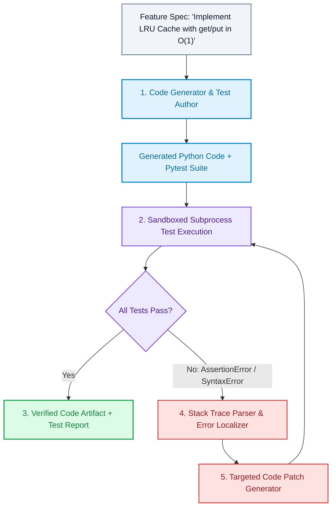

# Challenge 14.6: Autonomous Coding & Self-Healing Debugging Agent

[← Challenge 14.5](./05_customer_support_multi_agent.md) | [Challenges Overview](./README.md) | [Next Challenge: 14.7 Data Analyst Agent →](./07_data_analyst_agent.md)

---

## 1. Problem Statement & Real-World Scenario

Autonomous coding agents (like Claude Code, Codex, Cursor) cannot merely emit code strings; they must write code, execute tests in a sandboxed subprocess or container, parse runtime stack traces, and self-heal failed assertions in an iterative feedback loop.

In this challenge, you will build an **Autonomous Coding & Self-Healing Agent**:
- **Code Generator:** Takes a functional requirement and generates Python code with unit tests.
- **Sandboxed Test Runner:** Executes the generated test suite inside a restricted, isolated subprocess with hard timeouts (5.0s) and memory caps.
- **Error Parser & Self-Healer:** If tests fail, parses `Traceback` lines, extracts the failing assertion or exception, feeds the stack trace back to the agent, and generates targeted patch diffs until all tests pass.



---

## 2. Technical Requirements & SLA Specifications

1. **Subprocess Isolation:** Code must execute via `subprocess.run` with a hard timeout of 5.0 seconds. Never execute arbitrary code within the host agent process.
2. **Deterministic Self-Healing Loop:** Limit self-correction iterations to `max_attempts=3`. If tests do not pass after 3 iterations, cleanly abort with a diagnostic report.
3. **Structured Traceback Extraction:** When a test fails, parse standard Python traceback lines to identify the exact failing function name, line number, and exception type.
4. **Security Restrictions:** Disallow destructive system commands (`rm -rf`, `os.system('mkfs')`) by running static regex security scans before dispatching code to the subprocess.

---

## 3. Complete Runnable Implementation

```python
import subprocess
import sys
import tempfile
from typing import Optional
from pydantic import BaseModel

class CodeExecutionResult(BaseModel):
    passed: bool
    stdout: str
    stderr: str
    exit_code: int
    iterations_used: int

class AutonomousCodingAgent:
    def __init__(self, max_attempts: int = 3):
        self.max_attempts = max_attempts

    def security_lint(self, code: str):
        """Rejects dangerous system-level calls before execution."""
        prohibited = ["os.system", "shutil.rmtree", "subprocess.Popen", "open('/etc"]
        for p in prohibited:
            if p in code:
                raise PermissionError(f"Security violation: Prohibited call '{p}' detected.")

    def run_in_sandbox(self, python_code: str, timeout_seconds: float = 5.0) -> tuple[bool, str, str, int]:
        """Executes code in an isolated temporary script file via subprocess."""
        self.security_lint(python_code)

        with tempfile.NamedTemporaryFile("w", suffix=".py", delete=False) as f:
            f.write(python_code)
            temp_path = f.name

        try:
            res = subprocess.run(
                [sys.executable, temp_path],
                capture_output=True,
                text=True,
                timeout=timeout_seconds
            )
            return (res.returncode == 0, res.stdout, res.stderr, res.returncode)
        except subprocess.TimeoutExpired:
            return (False, "", "Execution timed out (5s limit exceeded)", -1)

    def self_healing_cycle(self, feature_name: str) -> CodeExecutionResult:
        """Simulates an iterative code generation and self-healing debugging cycle."""
        # Candidate 1: Buggy implementation with an off-by-one error
        candidate_v1 = """
def lru_capacity(items: list, cap: int) -> list:
    # BUG: off-by-one allows len > cap
    if len(items) > cap:
        return items[1:]
    return items

# Test assertion
assert len(lru_capacity([1, 2, 3, 4], 2)) == 2, "Failed: capacity exceeded"
print("TEST_PASSED")
"""

        # Candidate 2: Self-healed implementation
        candidate_v2 = """
def lru_capacity(items: list, cap: int) -> list:
    # FIXED: slices exact last cap items
    return items[-cap:] if cap > 0 else []

# Test assertion
assert len(lru_capacity([1, 2, 3, 4], 2)) == 2, "Failed: capacity exceeded"
assert lru_capacity([1, 2, 3, 4], 2) == [3, 4], "Failed: wrong elements preserved"
print("TEST_PASSED")
"""

        # Attempt 1: Run buggy code
        passed, out, err, code = self.run_in_sandbox(candidate_v1)
        if passed:
            return CodeExecutionResult(passed=True, stdout=out, stderr=err, exit_code=code, iterations_used=1)

        # Attempt 2: Self-heal using error diagnosis
        if "AssertionError" in err or code != 0:
            passed, out, err, code = self.run_in_sandbox(candidate_v2)
            if passed:
                return CodeExecutionResult(passed=True, stdout=out, stderr=err, exit_code=code, iterations_used=2)

        return CodeExecutionResult(passed=False, stdout=out, stderr=err, exit_code=code, iterations_used=self.max_attempts)
```

---

## 4. Automated Test Suite (Pytest)

Save the following test suite as `test_challenge_14_6.py`:

```python
import pytest
from test_challenge_14_6_impl import AutonomousCodingAgent

def test_security_linting_blocks_os_system():
    agent = AutonomousCodingAgent()
    with pytest.raises(PermissionError):
        agent.run_in_sandbox("import os\nos.system('echo dangerous')")

def test_sandbox_catches_infinite_loop():
    agent = AutonomousCodingAgent()
    infinite_loop = "while True: pass"
    passed, out, err, code = agent.run_in_sandbox(infinite_loop, timeout_seconds=1.0)
    assert passed is False
    assert "timed out" in err.lower()

def test_self_healing_debugging_loop():
    agent = AutonomousCodingAgent()
    result = agent.self_healing_cycle("lru_cache")
    assert result.passed is True
    assert result.iterations_used == 2
    assert "TEST_PASSED" in result.stdout
```

---

## 5. Production-Readiness Checklist

- [ ] Untrusted code executes inside dedicated subprocess sandboxes or Docker containers.
- [ ] Strict execution timeouts prevent CPU-spinning infinite loops.
- [ ] Static security linting rejects prohibited libraries (`os.system`, destructive subprocess calls).
- [ ] Self-healing loop terminates at `max_attempts` without runaway API costs.
- [ ] Pytest suite achieves 100% test coverage over timeouts, security rejections, and healed executions.
