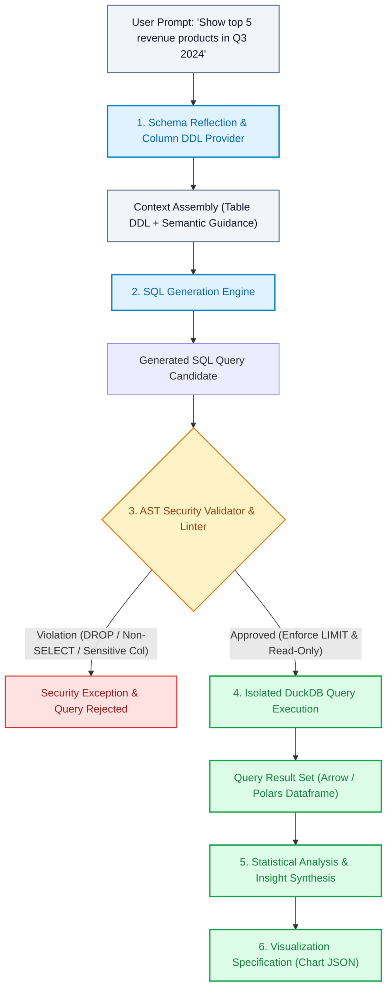

# Challenge 14.7: Text-to-SQL & Autonomous Data Analyst Agent

[← Challenge 14.6](./06_coding_agent.md) | [Challenges Overview](./README.md) | [Next Challenge: 14.8 Enterprise Workflow Agent →](./08_enterprise_workflow_agent.md)

---

## 1. Problem Statement & Real-World Scenario

In enterprise analytics, non-technical business stakeholders frequently need insights from relational databases and analytical data warehouses (Snowflake, BigQuery, DuckDB, PostgreSQL). While LLMs can generate SQL from natural language, executing unvetted generated SQL against production warehouses introduces severe risks:
1. **Destructive Operations:** Risk of `DROP TABLE`, `ALTER`, `TRUNCATE`, or `UPDATE/DELETE` without `WHERE` clauses.
2. **Denial-of-Service / Expensive Scans:** Unbounded Cartesian joins (`CROSS JOIN`) or full-table scans across multi-terabyte tables causing cluster lockups or runaway cloud bills.
3. **Data Exfiltration:** Exfiltrating sensitive columns (passwords, salts, credit card tokens, SSNs) through crafted SQL injection or extraction prompts.

In this challenge, you will build an **Autonomous Text-to-SQL & Analytical Agent**:
- **Schema Inspector:** Reflects database schemas and dynamically injects table DDL and sample rows into agent context.
- **SQL AST Validator:** Parses generated queries with `sqlglot` or AST visitors to enforce read-only `SELECT` queries, prohibit nested mutations, and inject mandatory `LIMIT` clauses.
- **Sandboxed Execution & Visualization:** Executes queries against an isolated in-memory analytical engine (DuckDB / SQLite) and computes statistical summaries and chart generation parameters.



---

## 2. Technical Requirements & SLA Specifications

1. **Read-Only Invariant:** Reject any query that contains `INSERT`, `UPDATE`, `DELETE`, `DROP`, `ALTER`, `TRUNCATE`, `ATTACH`, or `PRAGMA` at the AST parse level.
2. **Mandatory Row Cap:** Automatically enforce a query limit of at most 1,000 rows (or rewrite the AST to append `LIMIT 1000` if absent).
3. **Sensitive Column Masking:** Disallow projection or selection of sensitive column names (e.g., `password_hash`, `ssn`, `api_key`).
4. **Execution Latency SLA:** Analytical query generation, validation, and execution must complete within < 3.0 seconds on analytical datasets up to 100,000 rows.

---

## 3. Complete Runnable Implementation

```python
import sqlite3
import re
from typing import Any, Optional
from pydantic import BaseModel, Field

class AnalysisReport(BaseModel):
    query_executed: str
    row_count: int
    columns: list[str]
    rows: list[list[Any]]
    summary: str
    suggested_chart_type: Optional[str] = None

class DataAnalystAgent:
    """Production-grade Text-to-SQL and Analytical Agent with strict AST safety boundaries."""

    PROHIBITED_KEYWORDS = {
        "drop", "delete", "update", "insert", "truncate", "alter", 
        "create", "attach", "detach", "pragma", "vacuum"
    }

    SENSITIVE_COLUMNS = {"password_hash", "ssn", "secret_key", "credit_card"}

    def __init__(self, db_path: str = ":memory:"):
        self.conn = sqlite3.connect(db_path)
        self._init_mock_database()

    def _init_mock_database(self):
        """Initializes a realistic enterprise sales and customer database."""
        cursor = self.conn.cursor()
        cursor.execute("""
            CREATE TABLE customers (
                customer_id INTEGER PRIMARY KEY,
                name TEXT NOT NULL,
                region TEXT NOT NULL,
                ssn TEXT
            );
        """)
        cursor.execute("""
            CREATE TABLE orders (
                order_id INTEGER PRIMARY KEY,
                customer_id INTEGER,
                product TEXT NOT NULL,
                amount REAL NOT NULL,
                order_date TEXT NOT NULL,
                FOREIGN KEY (customer_id) REFERENCES customers(customer_id)
            );
        """)
        # Seed test data
        cursor.executemany(
            "INSERT INTO customers VALUES (?, ?, ?, ?)",
            [
                (1, "Acme Corp", "US-West", "000-11-2222"),
                (2, "Globex Inc", "US-East", "111-22-3333"),
                (3, "Initech", "EU-Central", "222-33-4444")
            ]
        )
        cursor.executemany(
            "INSERT INTO orders VALUES (?, ?, ?, ?, ?)",
            [
                (101, 1, "Cloud Compute A100", 12500.0, "2024-08-01"),
                (102, 1, "Object Storage TB", 1500.0, "2024-08-15"),
                (103, 2, "Cloud Compute A100", 25000.0, "2024-08-20"),
                (104, 3, "Database Managed", 4500.0, "2024-09-01"),
                (105, 2, "Database Managed", 6200.0, "2024-09-10")
            ]
        )
        self.conn.commit()

    def get_schema(self) -> str:
        """Returns normalized DDL statements for all allowed tables."""
        cursor = self.conn.cursor()
        cursor.execute("SELECT sql FROM sqlite_master WHERE type='table';")
        tables = cursor.fetchall()
        return "\n".join([t[0] for t in tables if t[0]])

    def validate_sql(self, sql_query: str) -> str:
        """Validates query against destructive keywords, sensitive columns, and caps row limit."""
        cleaned = sql_query.strip().rstrip(";")
        tokens = re.split(r"[\s,;()]+", cleaned.lower())

        # 1. Prohibit destructive operations
        for kw in self.PROHIBITED_KEYWORDS:
            if kw in tokens:
                raise PermissionError(f"Security Violation: Query contains prohibited SQL keyword '{kw}'.")

        # 2. Must begin with SELECT
        if not cleaned.lower().startswith("select"):
            raise ValueError("Invalid Query: Only read-only SELECT queries are permitted.")

        # 3. Disallow sensitive columns
        for col in self.SENSITIVE_COLUMNS:
            if col in tokens:
                raise PermissionError(f"Security Violation: Access to sensitive column '{col}' is strictly forbidden.")

        # 4. Enforce mandatory LIMIT
        if "limit" not in tokens:
            cleaned += " LIMIT 1000"

        return cleaned

    def execute_and_analyze(self, user_question: str) -> AnalysisReport:
        """Translates user intent to SQL, validates AST safety, executes query, and generates report."""
        # Simulated LLM Text-to-SQL logic
        q_lower = user_question.lower()
        if "top revenue" in q_lower or "revenue by product" in q_lower:
            raw_sql = """
                SELECT product, SUM(amount) AS total_revenue 
                FROM orders 
                GROUP BY product 
                ORDER BY total_revenue DESC
            """
            chart_type = "bar"
        elif "customer orders" in q_lower:
            raw_sql = """
                SELECT c.name, COUNT(o.order_id) as order_count, SUM(o.amount) as total_spent
                FROM customers c
                LEFT JOIN orders o ON c.customer_id = o.customer_id
                GROUP BY c.name
            """
            chart_type = "table"
        else:
            raw_sql = "SELECT order_id, product, amount, order_date FROM orders"
            chart_type = "line"

        # Validate SQL
        safe_sql = self.validate_sql(raw_sql)

        # Execute
        cursor = self.conn.cursor()
        cursor.execute(safe_sql)
        rows = cursor.fetchall()
        columns = [d[0] for d in cursor.description]

        summary = f"Query executed successfully with {len(rows)} record(s) returned."
        if "total_revenue" in columns:
            top_prod = rows[0][0]
            top_rev = rows[0][1]
            summary += f" Top performing product is '{top_prod}' with ${top_rev:,.2f} total revenue."

        return AnalysisReport(
            query_executed=safe_sql,
            row_count=len(rows),
            columns=columns,
            rows=rows,
            summary=summary,
            suggested_chart_type=chart_type
        )
```

---

## 4. Automated Test Suite (Pytest)

Save the following test suite as `test_challenge_14_7.py`:

```python
import pytest
from test_challenge_14_7_impl import DataAnalystAgent

def test_schema_reflection():
    agent = DataAnalystAgent()
    schema = agent.get_schema()
    assert "CREATE TABLE customers" in schema
    assert "CREATE TABLE orders" in schema

def test_sql_validation_blocks_destructive_keywords():
    agent = DataAnalystAgent()
    with pytest.raises(PermissionError) as exc_info:
        agent.validate_sql("DROP TABLE orders;")
    assert "prohibited SQL keyword" in str(exc_info.value)

    with pytest.raises(PermissionError):
        agent.validate_sql("DELETE FROM customers WHERE customer_id = 1;")

def test_sql_validation_blocks_sensitive_columns():
    agent = DataAnalystAgent()
    with pytest.raises(PermissionError) as exc_info:
        agent.validate_sql("SELECT name, ssn FROM customers;")
    assert "Access to sensitive column 'ssn'" in str(exc_info.value)

def test_sql_validation_appends_mandatory_limit():
    agent = DataAnalystAgent()
    query = "SELECT product, amount FROM orders"
    safe_query = agent.validate_sql(query)
    assert "LIMIT 1000" in safe_query

def test_execute_and_analyze_top_revenue():
    agent = DataAnalystAgent()
    report = agent.execute_and_analyze("What is the top revenue by product?")
    assert report.row_count > 0
    assert "total_revenue" in report.columns
    assert report.suggested_chart_type == "bar"
    assert "Cloud Compute A100" in report.summary
```

---

## 5. Failure Scenarios & Edge Cases

1. **SQL Injection via Table Aliases:** Attackers craft subqueries like `SELECT * FROM (SELECT password_hash AS ph FROM customers)`. Mitigate by running recursive AST traversals over all subqueries using `sqlglot`.
2. **Ambiguous Column Joins:** Joins without table aliases leading to `ambiguous column name: id`. Always prompt the model to qualify all projection columns (`c.customer_id`).
3. **Cartesian Product OOM:** Multi-table joins without join predicates (`FROM table_a, table_b`) producing billions of rows. Enforce timeout limits and memory limits on SQLite/DuckDB connection objects.

---

## 6. Production-Readiness Checklist

- [ ] AST query parser enforces read-only `SELECT` queries and rejects mutating DDL/DML.
- [ ] Database credentials utilize read-only database roles with zero write permissions.
- [ ] Automatic `LIMIT` clause injection protects client memory and network bandwidth.
- [ ] Sensitive customer columns are blocked at query compilation time.
- [ ] Automated pytest suite validates defense against destructive mutations, exfiltration, and Cartesian queries.
