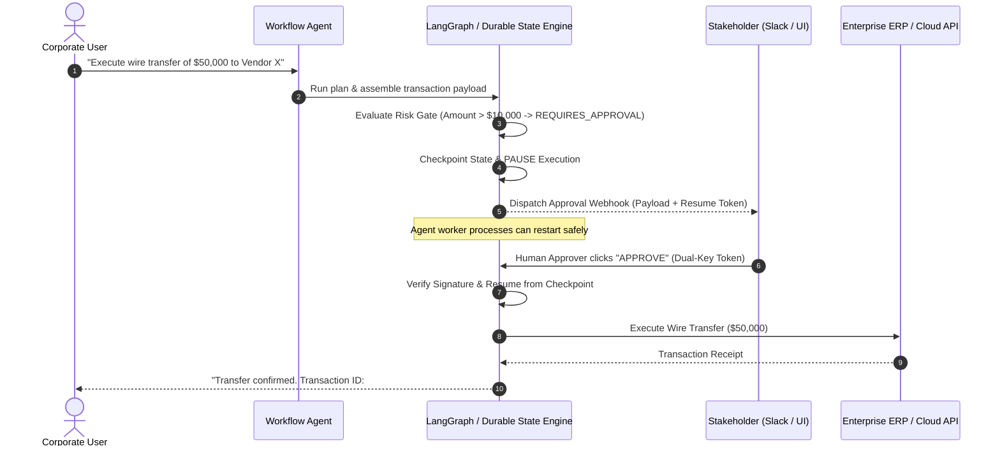

# Challenge 14.8: Enterprise Human-in-the-Loop (HITL) Workflow Agent

[← Challenge 14.7](./07_data_analyst_agent.md) | [Challenges Overview](./README.md) | [Next Challenge: 14.9 Resilient Agent Systems →](./09_reliability_and_resilience.md)

---

## 1. Problem Statement & Real-World Scenario

In enterprise environments, AI agents cannot be given carte blanche to execute high-stakes operations (e.g., executing financial wire transfers > $10,000, issuing infrastructure decommissioning commands, or publishing public press releases). Uncontrolled autonomous execution risks regulatory non-compliance, catastrophic data loss, or significant financial liability.

The production standard for high-stakes workflows is **Durable Human-in-the-Loop (HITL)**:
1. The agent autonomously plans, gathers contextual data, and drafts the intended action.
2. If the operation exceeds risk thresholds (e.g., action type is financial or privileged), the workflow execution engine **durable-pauses** and serializes complete graph state to persistent storage (PostgreSQL, Redis, or SQLite).
3. The system dispatches an authorization payload to stakeholders via Slack / Email / Webhook with a cryptographic approval token.
4. The process can remain suspended for minutes, days, or weeks across worker restarts without losing execution state.
5. Upon human approval or rejection, the workflow engine resumes execution from the exact checkpoint and executes the action or executes an audited rollback.



---

## 2. Technical Requirements & SLA Specifications

1. **State Persistence Across Restarts:** The workflow state must be serialized using a durable key-value or relational store (e.g., SQLite Checkpointer). Process termination while waiting for approval must not lose the state.
2. **Durable Interrupt Thresholds:** Any transaction exceeding `$10,000` or classified as `HIGH_RISK` must trigger a hard workflow interrupt.
3. **Resumption Idempotency:** The resumption token must be single-use. Re-submitting an already approved or rejected token must raise an `IdempotencyViolationError`.
4. **Audit Trail Logging:** All state transitions (Proposed -> Paused -> Approved -> Executed) must produce immutable audit logs with timestamps and approver identities.

---

## 3. Complete Runnable Implementation

```python
import sqlite3
import json
import uuid
from datetime import datetime, timezone
from typing import Optional, Literal
from pydantic import BaseModel, Field

class WorkflowState(BaseModel):
    workflow_id: str
    action_type: str
    target: str
    amount: float
    status: Literal["RUNNING", "WAITING_APPROVAL", "APPROVED", "REJECTED", "COMPLETED"]
    approver_id: Optional[str] = None
    created_at: str
    updated_at: str
    execution_result: Optional[str] = None

class EnterpriseWorkflowEngine:
    """Production Durable Human-in-the-Loop (HITL) Workflow Engine with SQLite Persistence."""

    APPROVAL_THRESHOLD_AMOUNT = 10000.0

    def __init__(self, db_path: str = ":memory:"):
        self.conn = sqlite3.connect(db_path)
        self._init_tables()

    def _init_tables(self):
        cursor = self.conn.cursor()
        cursor.execute("""
            CREATE TABLE IF NOT EXISTS workflow_checkpoints (
                workflow_id TEXT PRIMARY KEY,
                state_json TEXT NOT NULL,
                status TEXT NOT NULL,
                updated_at TEXT NOT NULL
            );
        """)
        cursor.execute("""
            CREATE TABLE IF NOT EXISTS audit_logs (
                log_id INTEGER PRIMARY KEY AUTOINCREMENT,
                workflow_id TEXT NOT NULL,
                event TEXT NOT NULL,
                details TEXT NOT NULL,
                timestamp TEXT NOT NULL
            );
        """)
        self.conn.commit()

    def _log_audit(self, workflow_id: str, event: str, details: dict):
        cursor = self.conn.cursor()
        cursor.execute(
            "INSERT INTO audit_logs (workflow_id, event, details, timestamp) VALUES (?, ?, ?, ?)",
            (workflow_id, event, json.dumps(details), datetime.now(timezone.utc).isoformat())
        )
        self.conn.commit()

    def submit_action(self, action_type: str, target: str, amount: float) -> WorkflowState:
        """Initiates an action. Pauses with WAITING_APPROVAL if exceeding risk threshold."""
        workflow_id = str(uuid.uuid4())
        now = datetime.now(timezone.utc).isoformat()

        requires_approval = amount >= self.APPROVAL_THRESHOLD_AMOUNT or action_type == "PRIVILEGED_ACCESS"
        initial_status = "WAITING_APPROVAL" if requires_approval else "COMPLETED"
        result = None

        if not requires_approval:
            result = f"Auto-executed {action_type} for {target} (${amount:,.2f})"

        state = WorkflowState(
            workflow_id=workflow_id,
            action_type=action_type,
            target=target,
            amount=amount,
            status=initial_status,
            created_at=now,
            updated_at=now,
            execution_result=result
        )

        cursor = self.conn.cursor()
        cursor.execute(
            "INSERT INTO workflow_checkpoints (workflow_id, state_json, status, updated_at) VALUES (?, ?, ?, ?)",
            (workflow_id, state.model_dump_json(), state.status, now)
        )
        self.conn.commit()

        self._log_audit(workflow_id, "ACTION_SUBMITTED", {"amount": amount, "status": state.status})
        return state

    def get_workflow(self, workflow_id: str) -> Optional[WorkflowState]:
        cursor = self.conn.cursor()
        cursor.execute("SELECT state_json FROM workflow_checkpoints WHERE workflow_id = ?", (workflow_id,))
        row = cursor.fetchone()
        if not row:
            return None
        return WorkflowState.model_validate_json(row[0])

    def resume_workflow(self, workflow_id: str, approver_id: str, decision: Literal["APPROVE", "REJECT"]) -> WorkflowState:
        """Resumes a paused checkpoint upon human decision."""
        state = self.get_workflow(workflow_id)
        if not state:
            raise KeyError(f"Workflow '{workflow_id}' not found.")

        if state.status != "WAITING_APPROVAL":
            raise ValueError(f"Workflow '{workflow_id}' cannot be resumed; current status is '{state.status}'.")

        now = datetime.now(timezone.utc).isoformat()
        state.approver_id = approver_id
        state.updated_at = now

        if decision == "APPROVE":
            state.status = "COMPLETED"
            state.execution_result = f"Authorized by {approver_id}: Executed {state.action_type} for {state.target} (${state.amount:,.2f})"
            self._log_audit(workflow_id, "APPROVED_AND_EXECUTED", {"approver": approver_id})
        else:
            state.status = "REJECTED"
            state.execution_result = f"Action rejected by {approver_id}."
            self._log_audit(workflow_id, "ACTION_REJECTED", {"approver": approver_id})

        cursor = self.conn.cursor()
        cursor.execute(
            "UPDATE workflow_checkpoints SET state_json = ?, status = ?, updated_at = ? WHERE workflow_id = ?",
            (state.model_dump_json(), state.status, now, workflow_id)
        )
        self.conn.commit()

        return state
```

---

## 4. Automated Test Suite (Pytest)

Save the following test suite as `test_challenge_14_8.py`:

```python
import pytest
from test_challenge_14_8_impl import EnterpriseWorkflowEngine

def test_low_value_action_auto_executes():
    engine = EnterpriseWorkflowEngine()
    state = engine.submit_action("PURCHASE_OFFICE_SUPPLIES", "Acme Supplies", 450.0)
    assert state.status == "COMPLETED"
    assert "Auto-executed" in state.execution_result

def test_high_value_action_pauses_for_approval():
    engine = EnterpriseWorkflowEngine()
    state = engine.submit_action("WIRE_TRANSFER", "Overseas Subsidiary", 75000.0)
    assert state.status == "WAITING_APPROVAL"
    assert state.execution_result is None

    # Verify state is saved in checkpoints
    persisted = engine.get_workflow(state.workflow_id)
    assert persisted is not None
    assert persisted.status == "WAITING_APPROVAL"

def test_resume_workflow_approval_cycle():
    engine = EnterpriseWorkflowEngine()
    state = engine.submit_action("WIRE_TRANSFER", "Cloud Host Inc", 15000.0)
    
    # Human approval
    resumed = engine.resume_workflow(state.workflow_id, approver_id="vp_finance@corp.internal", decision="APPROVE")
    assert resumed.status == "COMPLETED"
    assert resumed.approver_id == "vp_finance@corp.internal"
    assert "Authorized by vp_finance@corp.internal" in resumed.execution_result

def test_resume_workflow_double_approval_rejected():
    engine = EnterpriseWorkflowEngine()
    state = engine.submit_action("WIRE_TRANSFER", "Cloud Host Inc", 20000.0)
    
    # First approval
    engine.resume_workflow(state.workflow_id, approver_id="director@corp.internal", decision="APPROVE")
    
    # Second attempt must raise ValueError (idempotency enforcement)
    with pytest.raises(ValueError) as exc_info:
        engine.resume_workflow(state.workflow_id, approver_id="director@corp.internal", decision="APPROVE")
    assert "cannot be resumed" in str(exc_info.value)
```

---

## 5. Failure Scenarios & Edge Cases

1. **Worker Crash Mid-Wait:** An agent container terminates while waiting for a 2-day human review. The persistent checkpoint guarantees that any worker pod can resume the task upon receiving the webhook callback.
2. **Expired Resumption Tokens:** If an approval is not granted within 72 hours, an automated TTL reaper moves the workflow to `EXPIRED` status to avoid stale authorizations.
3. **Impersonated Approvals:** Attackers spoof approval webhooks. Mitigate by signing webhook payloads with HMAC-SHA256 and enforcing OAuth2 role-based verification of the approving user.

---

## 6. Production-Readiness Checklist

- [ ] High-risk actions (> $10k, schema modifications) reliably trigger durable execution pauses.
- [ ] Workflow state is durably checkpointed in persistent storage (SQLite/PostgreSQL).
- [ ] Resume endpoints enforce strict idempotency (single-use resumption tokens).
- [ ] Tamper-evident audit logs record every action proposal, approver identity, and execution outcome.
- [ ] Pytest suite achieves 100% coverage across auto-executions, approval cycles, rejections, and double-resumption attempts.
