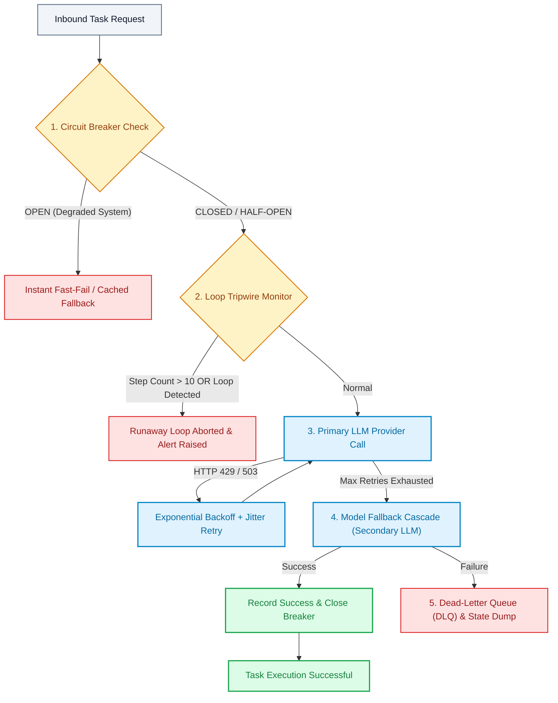

# Challenge 14.9: Production Resilience, Circuit Breakers & Self-Healing Agents

[← Challenge 14.8](./08_enterprise_workflow_agent.md) | [Challenges Overview](./README.md) | [Next Challenge: 14.10 Production Deployment & Observability →](./10_deployment_and_observability.md)

---

## 1. Problem Statement & Real-World Scenario

In production environments, external APIs and downstream LLMs fail unpredictably:
- **Rate Limit Spikes (HTTP 429):** Providers throttle high-volume agent workloads during traffic peaks.
- **Provider Outages & Degradations (HTTP 500/503):** Primary LLM APIs experience downtime, timeouts, or degraded reasoning quality.
- **Runaway Agent Loops & Cost Explosions:** Agents get caught in infinite tool loops or repetitive failure cycles, burning hundreds of dollars in minutes without producing output.
- **Poison Messages:** Malformed prompts or unparseable payloads crash worker threads repeatedly.

In this challenge, you will build a **Production Resilience Engine for AI Agents**:
- **Exponential Backoff with Full Jitter:** Retries transient API errors (429, 503) safely without causing thundering herd problems.
- **Dynamic Fallback Model Cascading:** Automatically switches from primary model (e.g., Claude 3.5 Sonnet / GPT-4o) to secondary provider (Gemini 1.5 Pro / Mistral Large) upon persistent failure.
- **Circuit Breaker Pattern:** Monitors error rates over a sliding window; automatically trips open to protect downstream systems and shed load.
- **Runaway Loop Tripwires:** Enforces hard step bounds (`max_steps=10`) and detects identical repeated tool-call signatures to kill infinite cycles instantly.



---

## 2. Technical Requirements & SLA Specifications

1. **Jittered Backoff Formula:** Implement decorrelated or full jitter: $t_{wait} = \text{random}(0, \min(cap, base \times 2^{attempt}))$.
2. **Circuit Breaker States:** Maintain standard `CLOSED`, `OPEN`, and `HALF-OPEN` states with a failure threshold of 3 consecutive errors and a reset timeout of 5.0 seconds.
3. **Loop Detection:** Reject execution if the same tool is called with identical arguments more than twice in sequence.
4. **Dead-Letter Handling:** Any permanently failed task must be serialized to a Dead-Letter Queue with its error stack trace, step count, and payload.

---

## 3. Complete Runnable Implementation

```python
import time
import random
from typing import Callable, Any, Optional
from pydantic import BaseModel

class CircuitBreakerOpenException(Exception):
    pass

class RunawayLoopException(Exception):
    pass

class CircuitBreaker:
    def __init__(self, failure_threshold: int = 3, recovery_time: float = 5.0):
        self.failure_threshold = failure_threshold
        self.recovery_time = recovery_time
        self.failure_count = 0
        self.state: str = "CLOSED"  # CLOSED, OPEN, HALF_OPEN
        self.last_failure_time: float = 0.0

    def record_success(self):
        self.failure_count = 0
        self.state = "CLOSED"

    def record_failure(self):
        self.failure_count += 1
        self.last_failure_time = time.time()
        if self.failure_count >= self.failure_threshold:
            self.state = "OPEN"

    def can_execute(self) -> bool:
        if self.state == "CLOSED":
            return True
        if self.state == "OPEN":
            if time.time() - self.last_failure_time > self.recovery_time:
                self.state = "HALF_OPEN"
                return True
            return False
        return True  # HALF_OPEN allows single test probe

class ResilientAgentRunner:
    """Agent execution harness with retries, fallback cascading, circuit breaking, and loop tripwires."""

    def __init__(self, max_steps: int = 10):
        self.max_steps = max_steps
        self.breaker = CircuitBreaker()
        self.dlq: list[dict] = []

    def execute_with_jitter_retry(
        self, 
        func: Callable[[], str], 
        max_retries: int = 3, 
        base_delay: float = 0.1, 
        max_delay: float = 2.0
    ) -> str:
        """Executes a function with exponential backoff and randomized full jitter."""
        for attempt in range(max_retries):
            try:
                result = func()
                self.breaker.record_success()
                return result
            except Exception as e:
                if attempt == max_retries - 1:
                    self.breaker.record_failure()
                    raise e
                # Full Jitter calculation
                sleep_cap = min(max_delay, base_delay * (2 ** attempt))
                jitter_sleep = random.uniform(0, sleep_cap)
                time.sleep(jitter_sleep)
        raise RuntimeError("Retry loop exhausted without returning.")

    def run_with_fallback(self, primary_call: Callable[[], str], fallback_call: Callable[[], str]) -> str:
        """Invokes primary LLM call; cascades to fallback if primary exhausts retries."""
        if not self.breaker.can_execute():
            raise CircuitBreakerOpenException("Circuit breaker is OPEN. Fast-failing downstream request.")

        try:
            return self.execute_with_jitter_retry(primary_call)
        except Exception as primary_error:
            # Cascade to secondary model
            try:
                fallback_result = fallback_call()
                self.breaker.record_success()
                return f"[FALLBACK_SUCCESS] {fallback_result}"
            except Exception as fallback_error:
                self.breaker.record_failure()
                self.dlq.append({
                    "primary_error": str(primary_error),
                    "fallback_error": str(fallback_error),
                    "timestamp": time.time()
                })
                raise RuntimeError(f"All model providers failed: Primary={primary_error}; Fallback={fallback_error}")

    def run_agent_loop(self, step_action_generator: list[tuple[str, str]]) -> list[str]:
        """Monitors step execution for runaway infinite loops and step limits."""
        history: list[tuple[str, str]] = []
        executed: list[str] = []

        for step_idx, (tool, arg) in enumerate(step_action_generator, start=1):
            if step_idx > self.max_steps:
                raise RunawayLoopException(f"Runaway Loop: Max steps limit ({self.max_steps}) exceeded.")

            # Detect repeated tool+arg signatures in sequence
            if len(history) >= 2 and history[-1] == (tool, arg) and history[-2] == (tool, arg):
                raise RunawayLoopException(f"Runaway Loop: Detected repeated identical action '{tool}({arg})' 3 times.")

            history.append((tool, arg))
            executed.append(f"Step {step_idx}: Executed {tool}({arg})")

        return executed
```

---

## 4. Automated Test Suite (Pytest)

Save the following test suite as `test_challenge_14_9.py`:

```python
import pytest
import time
from test_challenge_14_9_impl import ResilientAgentRunner, CircuitBreakerOpenException, RunawayLoopException

def test_exponential_backoff_succeeds_after_transient_failure():
    runner = ResilientAgentRunner()
    attempts = [0]

    def flaky_llm():
        attempts[0] += 1
        if attempts[0] < 3:
            raise ConnectionError("Simulated 429 Rate Limit")
        return "Model completion response"

    result = runner.execute_with_jitter_retry(flaky_llm, max_retries=3, base_delay=0.01)
    assert result == "Model completion response"
    assert attempts[0] == 3

def test_model_fallback_cascade_on_primary_failure():
    runner = ResilientAgentRunner()

    def dead_primary():
        raise TimeoutError("Primary provider gateway timeout 504")

    def working_fallback():
        return "Response from Fallback Provider"

    res = runner.run_with_fallback(dead_primary, working_fallback)
    assert "[FALLBACK_SUCCESS]" in res
    assert "Response from Fallback Provider" in res

def test_circuit_breaker_trips_after_consecutive_failures():
    runner = ResilientAgentRunner()
    runner.breaker.failure_threshold = 2
    runner.breaker.recovery_time = 0.5

    def failing():
        raise ValueError("Critical crash")

    # First 2 failures trip the breaker
    with pytest.raises(RuntimeError):
        runner.run_with_fallback(failing, failing)
    with pytest.raises(RuntimeError):
        runner.run_with_fallback(failing, failing)

    assert runner.breaker.state == "OPEN"

    # Fast-fail while open
    with pytest.raises(CircuitBreakerOpenException):
        runner.run_with_fallback(failing, failing)

def test_runaway_loop_tripwire_detects_repeated_actions():
    runner = ResilientAgentRunner()
    bad_cycle = [
        ("fetch_page", "https://site.com"),
        ("fetch_page", "https://site.com"),
        ("fetch_page", "https://site.com")
    ]
    with pytest.raises(RunawayLoopException) as exc_info:
        runner.run_agent_loop(bad_cycle)
    assert "repeated identical action" in str(exc_info.value)

def test_runaway_loop_tripwire_caps_max_steps():
    runner = ResilientAgentRunner(max_steps=5)
    long_cycle = [("tool", f"arg_{i}") for i in range(10)]
    with pytest.raises(RunawayLoopException) as exc_info:
        runner.run_agent_loop(long_cycle)
    assert "Max steps limit (5) exceeded" in str(exc_info.value)
```

---

## 5. Production-Readiness Checklist

- [ ] Transient API errors (429, 503) retry using exponential backoff with full randomized jitter.
- [ ] Fallback LLM cascade recovers instantly when primary foundation models experience outages.
- [ ] Circuit breaker fast-fails downstream calls during prolonged provider downtime to conserve threads.
- [ ] Runaway loop tripwires terminate repeated action oscillations and step limit violations.
- [ ] All unrecoverable failures are written to a Dead-Letter Queue (DLQ) with execution trace metadata.
