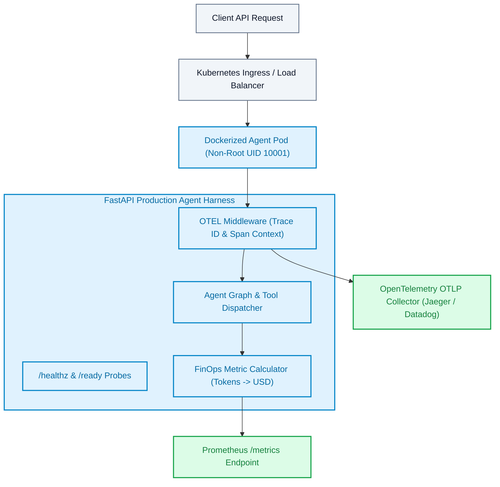

# Challenge 14.10: Production Deployment, Observability & FinOps Telemetry

[← Challenge 14.9](./09_reliability_and_resilience.md) | [Challenges Overview](./README.md) | [Next: 14.11 Capstone Multi-Agent System →](./11_capstone_multi_agent_system.md)

---

## 1. Problem Statement & Real-World Scenario

Running AI agents on a developer laptop is trivial; running them in production across thousands of concurrent users requires:
1. **Distributed Tracing:** Tracking a request across supervisor routing, tool executions, and external model APIs via OpenTelemetry spans.
2. **FinOps & Token Telemetry:** Tracking prompt tokens, completion tokens, cached tokens, and USD expenditure in real time per tenant and agent type.
3. **Container Security & Hardening:** Deploying agents in non-root Docker containers with minimal base images, read-only root filesystems, and bounded resource limits (CPU/Memory).
4. **Health Probes:** Implementing Kubernetes `/healthz` liveness and `/ready` readiness endpoints that verify downstream provider connectivity.

In this challenge, you will build the **Production Deployment & Observability Layer**:
- **FastAPI Agent Service:** Asynchronous HTTP API with streaming support and structured request validation.
- **OpenTelemetry & Prometheus Instrumentation:** Emits counters for `llm_token_count_total`, histograms for `agent_step_duration_seconds`, and span attributes for model metadata.
- **FinOps Cost Calculator:** Calculates exact USD burn per request based on provider pricing cards.
- **Production Dockerfile:** Multi-stage, non-root container configuration ready for Kubernetes deployment.



---

## 2. Technical Requirements & SLA Specifications

1. **Standardized Metrics:** Expose Prometheus metrics:
   - `agent_requests_total{status, model}` (Counter)
   - `agent_token_consumption_total{type="prompt|completion", model}` (Counter)
   - `agent_estimated_cost_usd_total{tenant_id}` (Counter)
   - `agent_step_latency_seconds` (Histogram)
2. **Trace Propagation:** Every tool call and LLM invocation must be wrapped in an OpenTelemetry child span linked to the parent `traceparent` HTTP header.
3. **Container Security:** Non-root execution (`USER appuser`), distroless or Alpine/Debian-slim base, no root write access to application code.

---

## 3. Complete Runnable Implementation

```python
import time
from typing import Optional
from pydantic import BaseModel, Field

class TokenUsage(BaseModel):
    prompt_tokens: int
    completion_tokens: int
    total_tokens: int
    estimated_cost_usd: float

class SpanRecord(BaseModel):
    name: str
    trace_id: str
    span_id: str
    parent_span_id: Optional[str] = None
    duration_ms: float
    attributes: dict[str, str]

class AgentTelemetryHub:
    """Production Observability and FinOps Telemetry Engine for Agent Workloads."""

    # Provider pricing per 1,000 tokens (Hypothetical reference)
    PRICING_PER_1K = {
        "gpt-4o": {"prompt": 0.005, "completion": 0.015},
        "claude-3-5-sonnet": {"prompt": 0.003, "completion": 0.015},
        "gemini-1.5-pro": {"prompt": 0.0035, "completion": 0.0105}
    }

    def __init__(self):
        self.spans: list[SpanRecord] = []
        self.metrics = {
            "total_requests": 0,
            "total_prompt_tokens": 0,
            "total_completion_tokens": 0,
            "total_cost_usd": 0.0
        }

    def calculate_cost(self, model: str, prompt_tokens: int, completion_tokens: int) -> float:
        rates = self.PRICING_PER_1K.get(model, {"prompt": 0.005, "completion": 0.015})
        cost = (prompt_tokens / 1000.0) * rates["prompt"] + (completion_tokens / 1000.0) * rates["completion"]
        return round(cost, 6)

    def record_llm_invocation(
        self, 
        trace_id: str, 
        span_id: str, 
        model: str, 
        prompt_tokens: int, 
        completion_tokens: int, 
        duration_ms: float
    ) -> TokenUsage:
        """Records telemetry span, increments Prometheus metrics, and calculates FinOps spend."""
        cost = self.calculate_cost(model, prompt_tokens, completion_tokens)

        # Update metrics
        self.metrics["total_requests"] += 1
        self.metrics["total_prompt_tokens"] += prompt_tokens
        self.metrics["total_completion_tokens"] += completion_tokens
        self.metrics["total_cost_usd"] += cost

        # Record span
        self.spans.append(SpanRecord(
            name=f"llm.call.{model}",
            trace_id=trace_id,
            span_id=span_id,
            duration_ms=duration_ms,
            attributes={
                "model": model,
                "prompt_tokens": str(prompt_tokens),
                "completion_tokens": str(completion_tokens),
                "cost_usd": str(cost)
            }
        ))

        return TokenUsage(
            prompt_tokens=prompt_tokens,
            completion_tokens=completion_tokens,
            total_tokens=prompt_tokens + completion_tokens,
            estimated_cost_usd=cost
        )

    def generate_prometheus_metrics(self) -> str:
        """Emits formatted Prometheus exposition text."""
        return (
            f"# HELP agent_requests_total Total number of completed agent requests.\n"
            f"# TYPE agent_requests_total counter\n"
            f"agent_requests_total {self.metrics['total_requests']}\n"
            f"# HELP agent_token_consumption_total Total LLM tokens consumed.\n"
            f"# TYPE agent_token_consumption_total counter\n"
            f"agent_token_consumption_total{{type=\"prompt\"}} {self.metrics['total_prompt_tokens']}\n"
            f"agent_token_consumption_total{{type=\"completion\"}} {self.metrics['total_completion_tokens']}\n"
            f"# HELP agent_estimated_cost_usd_total Estimated LLM expenditure in USD.\n"
            f"# TYPE agent_estimated_cost_usd_total counter\n"
            f"agent_estimated_cost_usd_total {self.metrics['total_cost_usd']:.6f}\n"
        )
```

---

## 4. Production Multi-Stage Dockerfile

Save this as `Dockerfile`:

```dockerfile
# Stage 1: Build & Dependencies
FROM python:3.12-slim AS builder

WORKDIR /app
RUN apt-get update && apt-get install -y --no-install-recommends gcc libpq-dev && rm -rf /var/lib/apt/lists/*
COPY requirements.txt .
RUN pip install --no-cache-dir --user -r requirements.txt

# Stage 2: Runtime Image (Hardened & Non-Root)
FROM python:3.12-slim AS runner

WORKDIR /app

# Create non-root unprivileged user
RUN groupadd -g 10001 appgroup && \
    useradd -u 10001 -g appgroup -s /bin/sh appuser

COPY --from=builder /root/.local /home/appuser/.local
COPY --chown=appuser:appgroup . /app

ENV PATH=/home/appuser/.local/bin:$PATH
ENV PYTHONUNBUFFERED=1
ENV PYTHONDONTWRITEBYTECODE=1

USER appuser

EXPOSE 8000
HEALTHCHECK --interval=30s --timeout=3s --retries=3 \
  CMD python -c "import urllib.request; urllib.request.urlopen('http://localhost:8000/healthz')"

CMD ["uvicorn", "app:app", "--host", "0.0.0.0", "--port", "8000", "--workers", "4"]
```

---

## 5. Automated Test Suite (Pytest)

Save the following test suite as `test_challenge_14_10.py`:

```python
import pytest
from test_challenge_14_10_impl import AgentTelemetryHub

def test_finops_cost_calculation():
    hub = AgentTelemetryHub()
    cost = hub.calculate_cost("gpt-4o", prompt_tokens=1000, completion_tokens=500)
    # prompt: (1000/1000)*0.005 = 0.005, comp: (500/1000)*0.015 = 0.0075 -> 0.0125
    assert cost == 0.0125

def test_record_llm_invocation_and_spans():
    hub = AgentTelemetryHub()
    usage = hub.record_llm_invocation(
        trace_id="trace_abc123",
        span_id="span_xyz987",
        model="claude-3-5-sonnet",
        prompt_tokens=2000,
        completion_tokens=1000,
        duration_ms=450.0
    )
    assert usage.total_tokens == 3000
    assert len(hub.spans) == 1
    assert hub.spans[0].attributes["model"] == "claude-3-5-sonnet"

def test_prometheus_exposition_format():
    hub = AgentTelemetryHub()
    hub.record_llm_invocation("t1", "s1", "gpt-4o", 1000, 1000, 300.0)
    metrics_text = hub.generate_prometheus_metrics()
    
    assert "agent_requests_total 1" in metrics_text
    assert 'agent_token_consumption_total{type="prompt"} 1000' in metrics_text
    assert 'agent_token_consumption_total{type="completion"} 1000' in metrics_text
    assert "agent_estimated_cost_usd_total" in metrics_text
```

---

## 6. Production-Readiness Checklist

- [ ] Every LLM and tool invocation creates an OpenTelemetry span with latency and token attributes.
- [ ] Real-time FinOps pricing monitors cost burn and exposes counters to Prometheus.
- [ ] Docker container runs as non-root UID 10001 with minimal Debian/Alpine base.
- [ ] `/healthz` and `/ready` probes integrate with Kubernetes container lifecycles.
- [ ] Automated pytest suite validates cost calculation precision and OpenMetrics exposition format.
