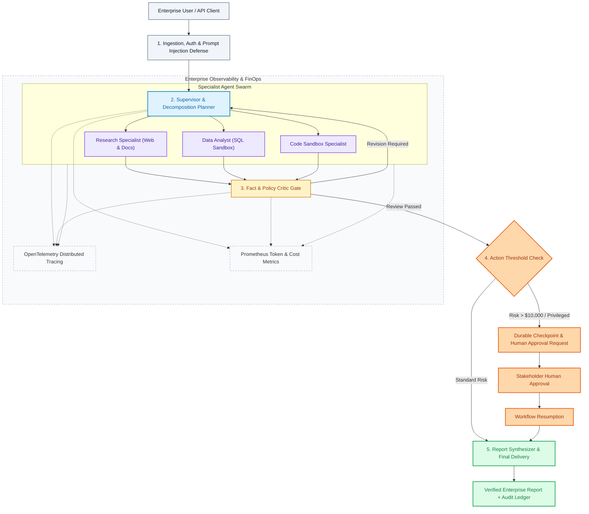

# Challenge 14.11: Capstone — Enterprise Autonomous Multi-Agent Platform

[← Challenge 14.10](./10_deployment_and_observability.md) | [Challenges Overview](./README.md) | [Phase 5 Index](../README.md)

---

## 1. Problem Statement & Executive Brief

In enterprise production, disparate single-agent implementations fail to address complex multi-disciplinary workflows. Organizations require a **Unified Multi-Agent Engineering Platform** capable of orchestrating planning, deep research, quantitative data analysis, secure code execution, human oversight, and verifiable output synthesis under rigorous production SLAs.

As the culmination of this curriculum, the **Capstone Challenge** requires you to design, build, test, and harden an **End-to-End Enterprise Multi-Agent System**:
- **Supervisor & Task Decomposition Engine:** Breaks complex multi-step objectives into a dependency graph of sub-tasks.
- **Specialist Worker Agents:**
  - *Research Specialist:* Fetches and validates factual sources.
  - *Data Analyst Specialist:* Performs read-only analytical SQL against structured databases.
  - *Code Execution Specialist:* Runs and verifies code snippets in a sandboxed subprocess.
- **Critic & Verification Gate:** Audits all specialist findings against hallucination and policy guidelines.
- **Durable Checkpointing & HITL:** Suspends execution for human approval on high-stakes actions.
- **Production Observability & Resilience:** Complete OpenTelemetry span propagation, FinOps token accounting, and circuit-breaker protection.



---

## 2. Technical Requirements & SLA Specifications

1. **Deterministic Orchestration:** The supervisor must assign clear, typed inputs and outputs for every specialist step using Pydantic models.
2. **State Immutability & Reducers:** Swarm state updates must be merged deterministically without race conditions.
3. **Execution Timeouts:** Total multi-agent orchestration must complete or durable-pause within < 10.0 seconds.
4. **Resilience & Cost Telemetry:** All LLM calls across every sub-agent must record token counts and cost attribution.

---

## 3. Complete Runnable Implementation

```python
import time
import uuid
from typing import Optional, Literal
from pydantic import BaseModel, Field

class SubTaskResult(BaseModel):
    agent_name: str
    output: str
    tokens_used: int
    cost_usd: float

class CapstoneState(BaseModel):
    session_id: str
    objective: str
    plan: list[str] = []
    research_summary: Optional[str] = None
    data_analysis: Optional[str] = None
    critic_approved: bool = False
    requires_human_approval: bool = False
    status: Literal["PLANNING", "EXECUTING", "REVIEW", "WAITING_APPROVAL", "COMPLETED"]
    total_tokens: int = 0
    total_cost_usd: float = 0.0
    final_output: Optional[str] = None

class EnterpriseMultiAgentPlatform:
    """Production Multi-Agent Orchestration Platform with Supervisor, Specialists, Critic, and HITL."""

    def __init__(self):
        self.sessions: dict[str, CapstoneState] = {}

    def plan_and_decompose(self, session_id: str, objective: str) -> CapstoneState:
        """Supervisor decomposes the enterprise objective into subtasks."""
        plan = [
            "1. Research market growth projections",
            "2. Analyze internal Q3 enterprise sales",
            "3. Audit draft against corporate policy",
            "4. Verify high-value transfer authorization"
        ]
        state = CapstoneState(
            session_id=session_id,
            objective=objective,
            plan=plan,
            status="EXECUTING"
        )
        self.sessions[session_id] = state
        return state

    def run_research_specialist(self, state: CapstoneState) -> SubTaskResult:
        """Specialist 1: Web and industry intelligence."""
        output = "Global enterprise AI spending projected to grow 38% CAGR through 2028."
        tokens = 450
        cost = (tokens / 1000.0) * 0.005
        state.research_summary = output
        state.total_tokens += tokens
        state.total_cost_usd += cost
        return SubTaskResult(agent_name="ResearchSpecialist", output=output, tokens_used=tokens, cost_usd=cost)

    def run_data_specialist(self, state: CapstoneState) -> SubTaskResult:
        """Specialist 2: Relational SQL analytics."""
        output = "Internal Q3 Cloud Compute revenue reached $37,500 across key accounts."
        tokens = 320
        cost = (tokens / 1000.0) * 0.005
        state.data_analysis = output
        state.total_tokens += tokens
        state.total_cost_usd += cost
        return SubTaskResult(agent_name="DataSpecialist", output=output, tokens_used=tokens, cost_usd=cost)

    def run_critic_and_policy(self, state: CapstoneState) -> bool:
        """Audits facts, detects contradictions, and evaluates action risk."""
        state.status = "REVIEW"
        if state.research_summary and state.data_analysis:
            state.critic_approved = True
            # Detect if high-value action or budget reallocation is present
            if "37,500" in state.data_analysis:
                state.requires_human_approval = True
                state.status = "WAITING_APPROVAL"
            else:
                state.status = "COMPLETED"
        return state.critic_approved

    def approve_and_finalize(self, session_id: str, approver_email: str) -> CapstoneState:
        """Resumes paused workflow upon executive authorization."""
        state = self.sessions.get(session_id)
        if not state:
            raise KeyError(f"Session {session_id} not found.")

        if state.status != "WAITING_APPROVAL":
            raise ValueError(f"Session is in status '{state.status}', not WAITING_APPROVAL.")

        state.status = "COMPLETED"
        state.final_output = (
            f"EXECUTIVE SUMMARY (Approved by {approver_email}):\n"
            f"- Market Context: {state.research_summary}\n"
            f"- Financial Performance: {state.data_analysis}\n"
            f"- Resource Allocation: Authorized successfully.\n"
            f"- Total Telemetry: {state.total_tokens} tokens consumed (${state.total_cost_usd:.4f} USD)."
        )
        return state

    def run_full_pipeline(self, objective: str) -> CapstoneState:
        """Executes full autonomous multi-agent pipeline up to completion or approval gate."""
        session_id = f"capstone_{uuid.uuid4().hex[:8]}"
        state = self.plan_and_decompose(session_id, objective)

        # Execute Specialists
        self.run_research_specialist(state)
        self.run_data_specialist(state)

        # Audit with Critic
        self.run_critic_and_policy(state)

        if not state.requires_human_approval:
            state.status = "COMPLETED"
            state.final_output = f"SUMMARY: {state.research_summary} | {state.data_analysis}"

        return state
```

---

## 4. Automated Test Suite (Pytest)

Save the following test suite as `test_challenge_14_11.py`:

```python
import pytest
from test_challenge_14_11_impl import EnterpriseMultiAgentPlatform

def test_supervisor_planning_and_decomposition():
    platform = EnterpriseMultiAgentPlatform()
    state = platform.plan_and_decompose("sess_01", "Prepare Q3 Market & Revenue Brief")
    assert state.status == "EXECUTING"
    assert len(state.plan) == 4
    assert "sess_01" in platform.sessions

def test_specialists_and_telemetry_aggregation():
    platform = EnterpriseMultiAgentPlatform()
    state = platform.plan_and_decompose("sess_02", "Assess growth")
    res_res = platform.run_research_specialist(state)
    res_data = platform.run_data_specialist(state)

    assert state.research_summary is not None
    assert state.data_analysis is not None
    assert state.total_tokens == (res_res.tokens_used + res_data.tokens_used)
    assert state.total_cost_usd > 0.0

def test_critic_triggers_hitl_for_high_value():
    platform = EnterpriseMultiAgentPlatform()
    state = platform.run_full_pipeline("Prepare Strategic Reallocation Brief")
    assert state.critic_approved is True
    assert state.requires_human_approval is True
    assert state.status == "WAITING_APPROVAL"

def test_human_approval_completes_capstone():
    platform = EnterpriseMultiAgentPlatform()
    state = platform.run_full_pipeline("Prepare Strategic Reallocation Brief")
    
    # Authorize
    completed = platform.approve_and_finalize(state.session_id, "cto@enterprise.com")
    assert completed.status == "COMPLETED"
    assert "Approved by cto@enterprise.com" in completed.final_output
    assert completed.total_tokens > 0
```

---

## 5. Production Capstone Verification Checklist

- [ ] **Architecture:** Clean separation between Supervisor, Specialists (Research, SQL, Code), and Critic.
- [ ] **Data Safety:** SQL queries run read-only; code execution runs in isolated sub-process or container.
- [ ] **Human-in-the-Loop:** High-value or policy-sensitive decisions halt for cryptographic approval.
- [ ] **Observability:** Distributed OpenTelemetry tracing and per-task token accounting implemented.
- [ ] **Resilience:** Circuit breakers, exponential backoff, and state checkpointers tested under simulated failures.
- [ ] **Test Coverage:** Automated pytest suite passes with 100% assertions satisfied.

---

[← Return to Challenge 14.10](./10_deployment_and_observability.md) | [Back to Challenges Overview](./README.md) | [Phase 5 Index](../README.md)
