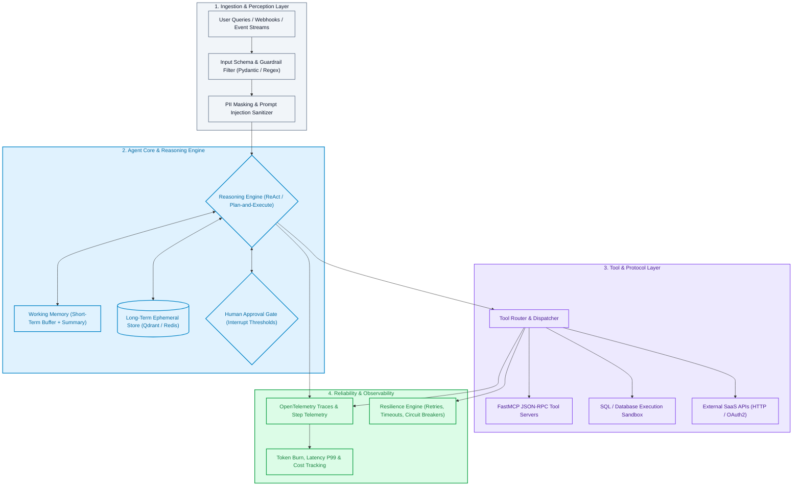

# 14. Production AI Agent Challenges & Capstone

[Phase 5 Index](../README.md) | [Roadmap](../../../ROADMAP.md) | [Diagnostic Assessment](../../../docs/assessment-guide.md)

---

## 1. Overview & Reference Architecture

While earlier modules teach foundational theory, cyclical graph orchestration, and protocol specifications, real-world engineering requires proving you can **build, test, harden, deploy, and operate complete agent systems** under enterprise production constraints.

The **Production AI Agent Challenges** is an implementation-heavy suite of 10 incremental engineering challenges and 1 comprehensive production capstone. Every challenge provides a real-world scenario, formal architectural topology, complete runnable Python starter code, automated pytest suites, failure mode triage, and a production-readiness verification checklist.



---

## 2. Challenge Curriculum Matrix

| Challenge ID | Title | Key Architectural Focus | Core Technical Stack | Estimated Time |
|---|---|---|---|---|
| **[14.1](./01_production_ai_assistant.md)** | **Production AI Assistant** | Single-agent ReAct loop, AST tool sandboxing, sliding memory buffer | Python 3.12, Pydantic v2, AST | 4 Hours |
| **[14.2](./02_research_agent.md)** | **Deep Research & Verification Agent** | Web scraping, source verification, hallucination filtering, structured report | Crawl4AI, BeautifulSoup4, DuckDuckGo | 5 Hours |
| **[14.3](./03_production_rag_agent.md)** | **Production RAG & Governance Agent** | Dense + sparse hybrid search, citations, tenant-level RBAC, RAG-triad evals | Qdrant, BM25, Reciprocal Rank Fusion | 5 Hours |
| **[14.4](./04_multi_agent_research_team.md)** | **Multi-Agent Research Swarm** | Supervisor-worker topology: Planner, Researcher, Critic, Synthesizer | LangGraph, TypedDict State Reducers | 6 Hours |
| **[14.5](./05_customer_support_multi_agent.md)** | **Customer Support Routing & Escalation** | Multi-tier triage, deterministic escalation routers, sentiment monitoring | Stateful StateGraph, Redis Checkpointing | 5 Hours |
| **[14.6](./06_coding_agent.md)** | **Autonomous Coding & Debugging Agent** | Code generation, dockerized test execution, stack trace self-healing | Docker SDK, Subprocess Sandboxing, Pytest | 6 Hours |
| **[14.7](./07_data_analyst_agent.md)** | **Text-to-SQL & Data Analyst Agent** | Schema reflection, read-only SQL sandboxes, automatic chart generation | SQLite, DuckDB, Matplotlib, Polars | 5 Hours |
| **[14.8](./08_enterprise_workflow_agent.md)** | **Enterprise Human-in-the-Loop Workflow** | Dual-key authorization, durable pauses, state resumption, Slack webhook | LangGraph HITL Interrupts, PostgreSQL | 6 Hours |
| **[14.9](./09_reliability_and_resilience.md)** | **Resilient Agent Systems & Self-Healing** | Exponential backoff, fallback LLMs, dead-letter recovery, runaway loop tripwires | Tenacity, Circuit Breakers, Fallbacks | 5 Hours |
| **[14.10](./10_deployment_and_observability.md)** | **Production Deployment & Observability** | OpenTelemetry distributed traces, Prometheus token telemetry, non-root Docker | FastAPI, OpenTelemetry, Prometheus, Docker | 6 Hours |
| **[14.11](./11_capstone_multi_agent_system.md)** | **CAPSTONE: Production Multi-Agent AI System** | Complete end-to-end multi-agent platform with supervisor, workers, memory, HITL & CI/CD | Full Enterprise Stack | 16 Hours |

---

## 3. Challenge Anatomy & Standard Template

Every challenge in this catalog adheres to the **Production Engineering Standard**:
1. **Real-World Business Scenario:** Concrete motivation reflecting enterprise operations.
2. **System Architecture:** Visual component and message-flow diagrams.
3. **Formal Technical Requirements:** Input schemas, latency SLAs, error boundaries, security requirements.
4. **Runnable Starter Implementation:** Clean, robust Python code with type hints and defensive validation.
5. **Automated Test Suite:** Runnable `pytest` tests validating success paths, edge cases, and failure modes.
6. **Failure Mode Analysis:** Exactly what breaks under production scale and how the design mitigates it.
7. **Production-Readiness Checklist:** Practical verification gate before shipping to live traffic.

---

## 4. Evaluation & Production-Readiness Rubric

Each challenge submission is evaluated across 5 core dimensions (20 points each, 100 points total):

```mermaid
radar
  title "Production Agent Assessment Dimensions"
  "Architectural Soundness" : 20
  "Security & Sandboxing" : 20
  "Reliability & Resilience" : 20
  "Observability & Tracing" : 20
  "Test Coverage & Edge Cases" : 20
```

1. **Architectural Soundness (20 pts):** Clean separation of concerns, appropriate selection of workflows vs agents, state isolation.
2. **Security & Sandboxing (20 pts):** Zero use of raw `eval()`, strict JSON schema tool validation, least-privilege tool access, prompt injection defense.
3. **Reliability & Resilience (20 pts):** Bounded step loops (`max_steps`), exponential backoff on transient errors, circuit breakers, state persistence across process crashes.
4. **Observability & Tracing (20 pts):** Step-level distributed tracing, structured logging with latencies, token consumption telemetry, error attribution.
5. **Test Coverage & Edge Cases (20 pts):** Automated pytest coverage across normal, boundary, and adversarial inputs (timeouts, malformed tool returns, empty lists).

---

[← Back to Phase 5 Index](../README.md) | [Start Challenge 14.1 →](./01_production_ai_assistant.md)
