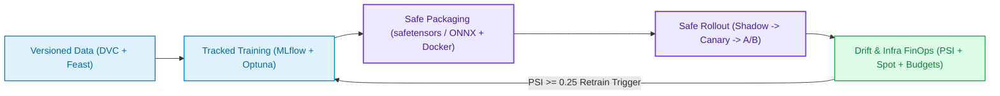

# Module 11: Production MLOps, AI Engineering, Drift & Cloud FinOps

> **Difficulty:** Advanced | **Estimated Study Time:** 8-10 Hours | **Prerequisites:** [Module 03: Classical ML](../02-machine-learning/03_classical_ml_and_recsys.md), [Module 10: Agent Evals & Safety](../05-agentic-ai/10_agent_evals_and_safety.md) | **Starter Repo:** [Local MLOps Starter Template](../../projects/intermediate/starter-local-mlops/README.md)  
> **Focus:** Safe serialization (zero-pickle, ONNX, SafeTensors), FastAPI async lifespans, non-root Docker containers, Feast feature stores, Population Stability Index (PSI) drift, and Cloud GPU FinOps

[← Previous: Module 10: Agent Evaluation & Safety](../05-agentic-ai/10_agent_evals_and_safety.md) | [Roadmap Index](../../README.md) | [Next: Module 12: Practical Troubleshooting Scenarios →](./12_system_troubleshooting_scenarios.md)

---

## 1. Overview

As documented in Google's landmark paper *[Hidden Technical Debt in Machine Learning Systems](https://papers.nips.cc/paper_files/paper/2015/hash/86df7dcfd896fcaf2674f757a2463eba-Abstract.html)* (Sculley et al., NeurIPS 2015), core modeling code comprises **only ~5%–10%** of a production AI system. A model with high offline accuracy delivers zero business value until surrounded by production infrastructure: safe serialization, type-safe REST APIs, containerized environments, feature stores, automated drift detection, and cloud GPU cost controls:



---

## 2. Learning Objectives

By the end of this module, you will be able to:
- **Eliminate Remote Code Execution (RCE) vulnerabilities** in model storage, replacing Python `pickle` with SafeTensors, ONNX, and `.npz` formats.
- **Build high-throughput FastAPI inference services** utilizing async lifespan context managers to load models once into memory.
- **Author production Dockerfiles** implementing multi-stage builds, non-root security users, and healthcheck probes.
- **Implement the Feast Feature Store architecture**, eliminating training-serving feature skew via point-in-time correct joins.
- **Calculate Population Stability Index (PSI)** to detect production data drift and trigger automated canary retraining pipelines.
- **Optimize Cloud GPU FinOps**, balancing Spot/Preemptible instances, dynamic batching, and semantic prompt caching.

---

## 3. Prerequisites

- **Machine Learning & Evaluation:** Leak-free pipelines and metrics from [Module 03](../02-machine-learning/03_classical_ml_and_recsys.md).
- **FastAPI & Async Python:** Concurrency and Pydantic validation from [Module 01](../01-foundations/01_python_sql_and_data_stack.md).

---

## 4. Core Concepts

### 4.1 Safe Model Serialization vs. Insecure Pickle
Python's standard `pickle.load` deserializes arbitrary byte streams, allowing attackers to embed arbitrary shell execution payloads. Production standards require zero-pickle formats:
- **NumPy `.npz` (with `allow_pickle=False`):** Structured numerical arrays for linear models, weights, and embeddings.
- **SafeTensors (HuggingFace):** Pure tensor bytes with a JSON header; zero execution vulnerability, fast memory mapping.
- **ONNX (Open Neural Network Exchange):** Graph format executable on optimized C++ runtimes across CPUs and GPUs.

### 4.2 FastAPI Lifespans for Inference Serving
Loading multi-gigabyte models inside an endpoint handler forces reloading on every HTTP request, exhausting RAM and causing seconds of latency. FastAPI's **lifespan context manager** loads weights into GPU/CPU memory once on application startup:

```python
from contextlib import asynccontextmanager
from fastapi import FastAPI
import numpy as np

ml_models = {}

@asynccontextmanager
async def lifespan(app: FastAPI):
    # Load model once on startup
    data = np.load("artifacts/model.npz", allow_pickle=False)
    ml_models["weights"] = data["weights"]
    ml_models["bias"] = float(data["bias"][0])
    yield
    # Clean up resources on shutdown
    ml_models.clear()

app = FastAPI(lifespan=lifespan)
```

### 4.3 Multi-Stage Non-Root Docker Architecture
Running containers as `root` creates severe container breakout vulnerabilities. Production Dockerfiles use multi-stage builds and unprivileged user accounts:

```dockerfile
FROM python:3.12-slim AS builder
WORKDIR /app
RUN apt-get update && apt-get install -y --no-install-recommends gcc && rm -rf /var/lib/apt/lists/*
COPY requirements.txt .
RUN pip install --no-cache-dir --user -r requirements.txt

FROM python:3.12-slim AS runner
WORKDIR /app
RUN useradd -m -u 1000 appuser
COPY --from=builder /root/.local /home/appuser/.local
COPY src/ /app/src/
COPY artifacts/ /app/artifacts/
ENV PATH=/home/appuser/.local/bin:$PATH
USER appuser
EXPOSE 8000
HEALTHCHECK --interval=30s --timeout=3s CMD curl -f http://localhost:8000/health || exit 1
CMD ["uvicorn", "src.app:app", "--host", "0.0.0.0", "--port", "8000"]
```

---

## 5. Technical Deep Dive

### 5.1 Training-Serving Skew & Feast Feature Store
- **Training-Serving Skew:** When feature calculations used during offline model training differ from real-time feature calculations computed during live inference.
- **Feast Solution:** Manages dual feature stores:
  1. **Offline Store (Parquet/Snowflake/BigQuery):** Performs **Point-in-Time correct joins** (`get_historical_features`), ensuring features for a training label reflect the exact state at timestamp $T$.
  2. **Online Store (Redis):** Key-value store providing sub-10ms feature retrieval by entity ID during live inference (`get_online_features`).

### 5.2 Population Stability Index (PSI) Drift Calculation
PSI measures shift between baseline reference training features $E$ (Expected) and live production inference features $A$ (Actual):

$$\text{PSI} = \sum_{i=1}^k (A_i - E_i) \times \ln\left(\frac{A_i}{E_i}\right)$$

<p align="center">
  
</p>

#### Drift Decision Thresholds:
- $\text{PSI} < 0.10$: **Stable:** No significant change in input distribution.
- $0.10 \le \text{PSI} < 0.25$: **Moderate Drift:** Investigate feature trends.
- $\text{PSI} \ge 0.25$: **Severe Drift:** Trigger automated alert and model retraining pipeline.

---

## 6. Hands-on Implementation

Implement the Population Stability Index calculation in pure NumPy:

```python
import numpy as np

def compute_psi(expected: np.ndarray, actual: np.ndarray, num_buckets: int = 10) -> float:
    # Form quantile breakpoints from reference distribution
    percentiles = np.linspace(0, 100, num_buckets + 1)
    breakpoints = np.percentile(expected, percentiles)
    breakpoints[0] = -np.inf
    breakpoints[-1] = np.inf

    e_counts = np.histogram(expected, bins=breakpoints)[0]
    a_counts = np.histogram(actual, bins=breakpoints)[0]

    # Normalize to proportions with epsilon smoothing to prevent div by zero
    e_pct = np.maximum(e_counts / len(expected), 1e-4)
    a_pct = np.maximum(a_counts / len(actual), 1e-4)

    psi_val = float(np.sum((a_pct - e_pct) * np.log(a_pct / e_pct)))
    return round(psi_val, 4)

# Synthetic baseline spend distribution
rng = np.random.default_rng(42)
baseline = rng.normal(loc=50.0, scale=10.0, size=10_000)

# Undrifted identical production stream
undrifted = rng.normal(loc=50.0, scale=10.0, size=2_000)
assert compute_psi(baseline, undrifted) < 0.10

# Severely shifted spend distribution (inflation spike)
drifted = rng.normal(loc=85.0, scale=15.0, size=2_000)
assert compute_psi(baseline, drifted) >= 0.25
print("Lab 11 Passed! Undrifted PSI:", compute_psi(baseline, undrifted), "| Drifted PSI:", compute_psi(baseline, drifted))
```

---

## 7. Practical Exercises

### Exercise 1: Multi-Feature PSI Monitor
1. Extend `compute_psi` to evaluate a multi-column feature matrix $X \in \mathbb{R}^{N \times D}$.
2. Output a structured dictionary identifying the specific feature columns that exceeded the $0.25$ drift threshold.

### Exercise 2: Graceful Fallback Inference Endpoint
1. Implement a FastAPI endpoint that checks model inference latency.
2. If primary GPU inference times out after $250\text{ ms}$, automatically route the request to a lightweight cached CPU heuristic model and log an alert.

---

## 8. Mini Project

### Full-Lifecycle Local MLOps Service
Inspect, run, and test the production starter kit:
- **Location:** [`projects/intermediate/starter-local-mlops/`](../../projects/intermediate/starter-local-mlops/README.md)
- **Features:** Leak-free `.npz` model training, FastAPI inference API, automated PSI endpoint, and Pytest validation.
- **Verification Commands:**
  ```bash
  python projects/intermediate/starter-local-mlops/src/train.py
  PYTHONPATH=projects/intermediate/starter-local-mlops pytest projects/intermediate/starter-local-mlops/tests
  ```

---

## 9. Advanced Topics

- **Shadow vs. Canary vs. Blue-Green Deployments:** Routing live production traffic to a shadow model (analyzing predictions without returning them to users) before advancing to 5% canary rollouts.
- **Spot GPU FinOps:** Utilizing cloud spot instances with checkpoint-resumable training to achieve 60%–80% cost savings compared to on-demand GPUs.
- **Model Quantization on Edge (ONNX INT8):** Quantizing floating-point weights to 8-bit integers using ONNX Runtime for edge mobile and embedded devices.

---

## 10. Common Mistakes & Gotchas

1. **Deserializing Models with Insecure Pickle:** Loading `pickle.load()` on untrusted files creates full Remote Code Execution (RCE) vulnerabilities. Always use SafeTensors, `.npz`, or ONNX.
2. **Reloading Models on Every Request:** Creating model objects inside route handlers instead of using FastAPI lifespan handlers causes extreme latency and OOM errors.
3. **Training Without Tracking:** Training 50 model iterations without logging parameters, datasets, and git commit hashes to MLflow.

---

## 11. Interview Questions & System Design

### Q1: How do you design an automated model retraining pipeline in production?
1. **Continuous Monitoring:** The inference service logs input features asynchronously to an event stream.
2. **Drift Detection:** A scheduled cron job calculates Population Stability Index (PSI) hourly.
3. **Trigger Gate:** When $\text{PSI} \ge 0.25$ on key features, an automated pipeline triggers retraining on the latest data window.
4. **Validation Gate:** The newly trained model is evaluated against the current champion model on a held-out benchmark.
5. **Canary Rollout:** If validation PR-AUC improves, the challenger receives a 5% canary rollout with automated rollback on error spikes.

### Q2: What causes Training-Serving Skew and how is it eliminated?
Training-serving skew occurs when feature definitions differ between offline training (e.g. SQL batch queries) and real-time inference (e.g. Python API logic), or when look-ahead bias leaks future data into historical training features. It is eliminated using an operational Feature Store (such as Feast), which enforces identical feature transformation logic and provides point-in-time correct joins for training datasets.

---

## 12. Recommended Resources

- **Landmark Paper:** [Hidden Technical Debt in Machine Learning Systems](https://papers.nips.cc/paper_files/paper/2015/hash/86df7dcfd896fcaf2674f757a2463eba-Abstract.html) (Sculley et al., NeurIPS 2015).
- **Book:** [Designing Machine Learning Systems](https://www.oreilly.com/library/view/designing-machine-learning/9781098107956/) by Chip Huyen.
- **Documentation:** [Feast Feature Store Architecture](https://docs.feast.dev/).

---

## 13. Completion Checklist

- [ ] Explain why Python `pickle` is banned in secure production ML deployments.
- [ ] Implement a FastAPI service loading model weights once via the lifespan context manager.
- [ ] Author a production multi-stage Dockerfile running as an unprivileged non-root user.
- [ ] Implement and verify the Population Stability Index (PSI) drift calculation in NumPy.
- [ ] Successfully run the training and API test suite in [`projects/intermediate/starter-local-mlops/`](../../projects/intermediate/starter-local-mlops/README.md).

---

[← Previous: Module 10: Agent Evaluation & Safety](../05-agentic-ai/10_agent_evals_and_safety.md) | [Home](../../README.md) | [Next: Module 12: Practical Troubleshooting Scenarios →](./12_system_troubleshooting_scenarios.md)
